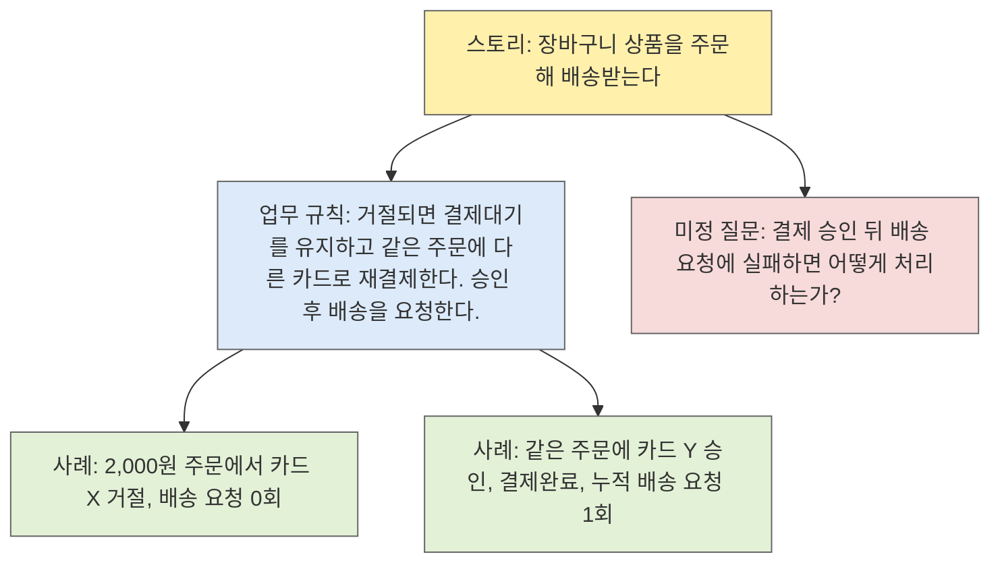
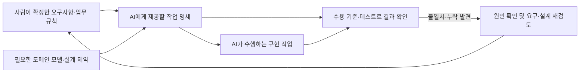

--------------------
Session 명: 03. 요구사항
--------------------

## 목차

01. 세션 목표
02. 주문 요청에서 빠진 결정
03. 요구와 요구사항
04. 명확하고 검증 가능한 요구사항
05. 사용자 스토리와 업무 규칙
06. 업무 사례와 수용 기준
07. 대안·예외와 미정 정책
08. 품질 요구사항
09. 요구사항 정의서와 작업 명세
10. 모델과 설계 산출물의 선택
11. LLM 초안 검토
12. 요구사항 작성의 AI 위임
13. 명세 주도 개발(SDD)
14. 요구사항 분석의 잘못된 관행
15. 실습 3 — 주문 요구사항 정의서
16. 요약

## 01. 세션 목표

**요구사항 분석**은 시스템이 해야 할 일과 결과를 받아들일 기준을 **합의**하는 활동이다.

이 세션을 마치면 다음을 수행할 수 있다.

- 이해관계자의 **요구**와 **시스템 요구사항**을 구분한다.
- 빠진 결정을 질문하고 **합의한 업무 규칙**을 기록한다.
- 사용자 스토리와 사례로 **수용 기준**을 작성한다.
- 대안·예외를 검토하고 **범위·제외·미정**을 구분한다.
- 품질의 **측정 조건과 목표 수준**을 정의한다.
- LLM 초안의 **가정·누락·모순**을 찾아 수정한다.
- 요구사항을 **모델링·설계·구현·검증**에 연결한다.

**강사 노트**

- 최초 요청만 AI에 주었을 때 빠진 결정을 누가 책임지는지 질문한다. 주문의 세부 규칙은 다음 장에서 확인한다.

---

## 02. 주문 요청에서 빠진 결정

한 줄의 주문 요청에서 **생성·금액·거절·배송의 결정**을 찾아낸다.

### 업무 담당자의 최초 요청

> “주문할 상품을 장바구니에 담고, 주문할 상품을 결제하면 주문이 되고 배송이 시작되게 해 주세요.”

- **주문**은 언제 생성하는가? **주문 금액**은 언제 확정하는가?
- 카드 승인이 거절되면 주문은 어떻게 되는가?
- 배송 시작은 배송 시스템에 **요청**하는 것인가, **실제 배송이 시작**되는 것인가?

### 업무 담당자가 확정한 규칙

**펜 2개(각 1,000원)**를 주문하고 배송지를 **서울**로 지정한 사례다.

| 질문 | 확정한 규칙 |
|---|---|
| 언제 주문을 만드는가? | 배송지를 확정하면 생성하고 결제대기로 둔다. |
| 언제 주문 금액을 확정하는가? | 주문 생성 시점의 판매가를 기준으로 2,000원으로 확정한다. |
| 결제가 거절되면? | 결제대기를 유지한다. 다른 카드로 같은 주문을 재결제할 수 있다. |
| 배송은 언제 요청하는가? | 카드 승인 후에만 요청한다. |

**미정** — 승인 뒤 배송 요청에 실패했을 때의 처리 정책

**페이지 분할**

### 빠진 결정을 임의로 채우면 원하는 결과를 얻지 못할 수 있다

**주문 생성 시점**, **금액 확정 시점**, 결제 거절 뒤의 상태, 배송 요청 조건에 따라 **구현 결과**가 달라진다.

**도식 — SVG — 요청에 없는 결정을 임의로 하면 발생하는 문제**

```svg
<svg xmlns="http://www.w3.org/2000/svg" viewBox="0 0 960 244" width="960" height="244" font-family="sans-serif" role="img" aria-label="주문 금액, 배송 요청, 결제 거절에 대해 확정된 업무 규칙과 잘못된 구현 사례를 비교한다">
  <g>
    <rect x="6" y="6" width="948" height="72" rx="8" fill="#f8fafc" stroke="#64748b" stroke-width="1.5"/>
    <text x="34" y="50" font-size="23" font-weight="bold" fill="#1e293b">주문 금액</text>
    <line x1="230" y1="14" x2="230" y2="70" stroke="#cbd5e1"/>
    <text x="256" y="34" font-size="19" fill="#334155">확정 규칙: 주문 생성 시 2,000원</text>
    <text x="256" y="64" font-size="19" fill="#8e2a1e">잘못된 예: 변경된 판매가로 2,400원 청구</text>
  </g>
  <g>
    <rect x="6" y="86" width="948" height="72" rx="8" fill="#f8fafc" stroke="#64748b" stroke-width="1.5"/>
    <text x="34" y="130" font-size="23" font-weight="bold" fill="#1e293b">배송 요청</text>
    <line x1="230" y1="94" x2="230" y2="150" stroke="#cbd5e1"/>
    <text x="256" y="114" font-size="19" fill="#334155">확정 규칙: 결제 승인 후에만 요청</text>
    <text x="256" y="144" font-size="19" fill="#8e2a1e">잘못된 예: 거절된 주문에도 배송 요청</text>
  </g>
  <g>
    <rect x="6" y="166" width="948" height="72" rx="8" fill="#f8fafc" stroke="#64748b" stroke-width="1.5"/>
    <text x="34" y="210" font-size="23" font-weight="bold" fill="#1e293b">결제 거절</text>
    <line x1="230" y1="174" x2="230" y2="230" stroke="#cbd5e1"/>
    <text x="256" y="194" font-size="19" fill="#334155">확정 규칙: 같은 주문을 유지하고 재결제</text>
    <text x="256" y="224" font-size="19" fill="#8e2a1e">잘못된 예: 주문을 삭제해 재결제 불가</text>
  </g>
</svg>
```

**강사 노트**

- 고객은 장바구니 상품을 카드로 결제해 배송받는다. 상품·결제·배송은 운영 중인 외부 시스템이다. 표를 보여 주기 전에 질문을 받는다. 도식은 가상 반례다.
- 펜의 현재 판매가가 1,200원으로 올라도 기존 주문의 승인 요청 금액은 2,000원이다.

---

## 03. 요구와 요구사항

**요구**는 이해관계자가 얻으려는 결과다. **요구사항**은 그 결과를 위해 시스템이 제공할 기능과 지킬 조건이다.

- **요구** — 선택한 상품을 주문하고 배송받고 싶다.
### 요구사항

- **기능** — 배송지를 확정하면 주문을 생성하고, 승인 후 배송을 요청한다.
- **업무 규칙** — 생성 시 주문 금액을 확정한다. 결제가 거절되어도 주문은 결제대기로 남는다.
- **품질** — 어떤 조건에서 어느 수준의 응답 성능과 접근 통제를 제공할지 정한다.

**인용문**

요구사항은 시스템이 준수해야 할 **역량과 조건**을 표현한다, "Requirements are capabilities and conditions to which the system … must conform", [Larman 2004]

**강사 노트**

- 기능은 무엇을 하는지, 업무 규칙은 어떤 동작과 결과를 허용하는지, 품질은 어떤 조건과 수준을 충족할지 설명한다.
- Larman 인용은 기능과 충족 조건의 뜻을 설명하는 데 사용한다. 위 구분은 이 교재의 설명 구조다.

---

## 04. 명확하고 검증 가능한 요구사항

요구사항은 이해관계자가 **같은 뜻**으로 이해할 수 있고, 충족 여부를 **객관적으로 확인**할 수 있어야 한다. 한 문장에는 **독립적으로 판정할 수 있는 요구사항 하나**를 담는다.

| 특성 | 확인 질문 |
|---|---|
| 명확성 | 모두 같은 조건과 결과로 이해하는가? |
| 검증 가능성 | 관찰하거나 측정할 결과가 있는가? |
| 단일성 | 다른 조건과 분리해 충족 여부를 판정할 수 있는가? |

- **명확성** — “주문할 때 금액을 정한다”를 “주문을 생성할 때의 판매가로 주문 금액을 확정한다”로 구체화한다.
- **검증 가능성** — 펜 2개를 각 1,000원에 주문한 뒤 판매가가 1,200원으로 올라도 승인 요청 금액이 2,000원인지 확인한다.
- **단일성** — 결제대기 유지, 같은 주문에 다른 카드로 재결제 허용, 거절 직후 배송 요청 0회를 별개 요구사항으로 기록한다.

**강사 노트**

- “정확하다”만으로 확인할 수 있는지를 묻는다. 세 결과를 개별적으로 검사할 수 있어야 한다. 승인 요청 금액은 요구사항에서 정하고, 주문 당시 단가를 저장하고 계산하는 방법은 설계에서 정한다.
- ISO/IEC/IEEE 29148:2018은 참고 기준이다. 표는 이 세션에서 확인할 특성을 정리한 것이다.

---

## 05. 사용자 스토리와 업무 규칙

### 요구사항을 표현하는 방법

**무엇을 확인할지**에 따라 고객 가치, 상호작용 흐름, 기대 행동, 업무 사건을 표현하는 방법을 고른다.

| 방법 | 초점 | 주문 예 |
|---|---|---|
| 유스케이스 | 행위자와 시스템의 상호작용, 기본·대안·예외 흐름 | 배송지 확정부터 결제 결과 확인까지 |
| 사용자 스토리 | 역할·목표·가치와 후속 대화 | 고객이 상품을 결제해 배송받는다. |
| BDD | 구체적 사례를 통한 기대 행동 합의 | 카드 거절 직후 배송 요청 0회 |
| 도메인 이벤트 | 이미 발생한 업무상 사건 | 주문 생성됨, 결제 승인됨 |

‘배송 요청됨’과 ‘배송 시작됨’은 서로 다른 **도메인 이벤트**다. 배송 요청을 보낸 시점과 실제 배송이 시작된 시점을 각각 기록할 수 있다.

### 사용자 스토리의 작성 문형

**역할**은 누가, **목표**는 무엇을, **가치**는 왜 원하는지 드러낸다.

> As a [role], I want [goal], so that [benefit].

> **[사용자 역할]로서, [원하는 행동이나 결과]를 하고 싶다. 그래야 [얻으려는 가치]를 얻을 수 있다.**

**주문한다**

> 고객으로서 장바구니에 담은 상품의 배송지를 정하고 카드로 결제하고 싶다. 그래야 상품을 배송받을 수 있다.

**페이지 분할**

### 카드·대화·확인으로 규칙을 구체화한다

**인용문**

사용자 스토리에는 **카드(Card)·대화(Conversation)·확인(Confirmation)**이라는 3가지 측면이 있다, "User stories have three critical aspects. We can call these Card, Conversation, and Confirmation.", [Jeffries 2001]

- **카드** — 고객이 얻으려는 가치를 적는다.
- **대화** — 금액 확정 시점과 결제 거절 처리를 확인한다.
- **확인** — 가격 변경 뒤 2,000원, 거절 뒤 결제대기를 사례로 검증한다.

### INVEST로 스토리를 점검한다

INVEST로 스토리의 **가치와 실행 가능성**을 확인하고, 더 논의할 조건을 찾는다.

| 항목 | 뜻 | ‘주문한다’에 적용 |
|---|---|---|
| **Independent** | 독립적 | 다른 스토리에 의존하는지 확인하고 따로 계획할 수 있는지 판단한다. |
| **Negotiable** | 협상 가능 | 금액 확정 시점과 거절 뒤 처리를 업무 담당자와 협의한다. |
| **Valuable** | 가치 있음 | 고객이 카드로 결제하고 배송받을 수 있다. |
| **Estimable** | 추정 가능 | 배송 요청 실패의 처리 정책이 미정이면 그 부분의 규모를 추정하기 어렵다. |
| **Small** | 작음 | 취소·환불·배송 진행을 제외하고, 남은 외부 연계까지 한 작업 주기에 다룰 수 있는지 확인한다. |
| **Testable** | 검증 가능 | 가격 변경 뒤 2,000원, 거절 직후 배송 요청 0회를 확인한다. |

‘주문한다’는 **고객 가치 단위**다. 결제 연동과 주문 기록은 **구현 기술 작업**이다.

**강사 노트**

- 문형은 역할·목표·가치를 확인하는 데 사용한다. 문형을 채운 뒤 가격 확정과 거절 처리에 관한 대화를 이어 간다.
- 수용 기준을 쓰다가 빠진 결정이 드러나면 업무 담당자와 다시 논의한다.
- INVEST는 [Wake 2003]의 점검 관점이다. 기계적인 합격 판정 대신, 각 항목에서 추가로 확인할 내용을 찾는다. 외부 시스템이 이미 있다는 사실만으로 스토리의 독립성이 입증되지는 않는다.

---

## 06. 업무 사례와 수용 기준

### 합의한 규칙을 수용 기준으로 표현한다

수용 기준은 상황별로 **금액·상태·배송 요청**의 기대 결과를 정한다. 공통 조건은 **펜 2개, 생성 시 개당 1,000원, 서울 배송, 주문 금액 2,000원**이다.

| 상황 | 관찰할 결과 |
|---|---|
| 카드 Y 승인 | 결제완료, 배송 요청 1회 |
| 판매가 1,200원으로 오른 뒤 승인 | 승인 요청 2,000원, 결제완료, 배송 요청 1회 |
| 카드 X 거절 | 결제대기 유지, 배송 요청 0회 |
| X 거절 뒤 같은 주문에 Y 승인 | 같은 주문, 승인 요청 2,000원, 결제완료, 누적 배송 요청 1회 |

‘주문 생성 시 금액을 확정한다’는 규칙은 판매가가 오른 뒤에도 승인 요청이 2,000원인지 확인하면 검증할 수 있다. 다음 장에서는 표의 **거절 후 재결제** 사례에 적용되는 업무 규칙을 예시 매핑으로 살펴본다.

**페이지 분할**

### BDD와 예시 매핑

**행동 주도 개발(BDD)**에서는 업무 담당자·개발자·테스터가 구체적인 사례를 놓고 시스템의 기대 행동을 합의한다. **예시 매핑**은 이 대화에서 나온 스토리·규칙·사례·미정 질문을 정리하는 방법이다.

**도식 — Mermaid — 재결제 사례의 예시 매핑**



합의한 **거절 후 재결제** 사례를 다음 장에서 **Gherkin**의 `Given–When–Then`으로 기록한다.

**페이지 분할**

### Given–When–Then으로 재결제 사례를 기록한다

**Gherkin**의 `Given`은 시작 조건, `When`은 사건, `Then`은 확인할 결과를 적는다.

```gherkin
Scenario: 거절된 주문을 다른 카드로 결제한다
  Given 주문 금액이 2,000원이고 상태가 결제대기다
    And 카드 X는 거절되고 카드 Y는 승인된다
  When 카드 X로 결제를 요청하고 거절 뒤 같은 주문에 카드 Y로 다시 요청한다
  Then 주문 식별자가 유지되고 상태가 결제완료가 된다
    And 카드 Y 승인 요청 금액은 2,000원이다
    And 배송 요청은 총 1회다
```

카드 X가 거절된 **직후**에 배송 요청이 0회인지는 ‘카드 X 거절’ 사례로 별도 확인한다.

**강사 노트**

- 수용 기준은 받아들일 결과이고, 수용 테스트는 그 결과를 실행으로 확인하는 수단이다. Gherkin은 합의한 사례를 기록하는 표기법이다. 테스트로 자동 실행하려면 각 단계에 실행 코드를 연결한다.
- 예시 매핑의 스토리·업무 규칙·사례·미정 질문이 어떻게 이어지는지 설명한다. 참고: [Example Mapping](https://cucumber.io/docs/bdd/example-mapping/), [Gherkin Reference](https://github.com/cucumber/docs/blob/main/content/docs/gherkin/reference.md). 최종 상태만 검사하면 거절 직후 발생한 잘못된 배송 요청을 놓칠 수 있다.

---

## 07. 대안·예외와 미정 정책

### 정상 흐름 뒤에 남는 질문

정상 승인뿐 아니라 **카드 거절과 배송 요청 실패**에서 지켜야 할 동작을 확인한다.

- **정상 승인** — 주문이 결제완료가 된다. 그 뒤 배송을 요청한다.
- **대안 흐름** — 카드 거절 시 결제대기를 유지하고 같은 주문에 재결제를 허용한다.
- **예외 흐름** — 승인 뒤 배송 요청 실패 시 상태·재시도·통지 정책은 미정이다.

### 범위·제외·미정

범위에는 수행할 일을 두고, **제외로 합의한 일과 담당자의 결정이 필요한 일**을 구분한다.

| 구분 | 주문 사례 |
|---|---|
| 범위 | 배송지 확정, 카드 결제, 승인 뒤 배송 요청, 주문 결과 확인 |
| 제외 | 취소·환불·배송 진행 |
| 미정 | 승인 뒤 배송 요청 실패의 처리 정책 |

미정에는 답할 사람과 확인할 질문을 남긴다.

**강사 노트**

- 카드 거절 처리는 이미 합의한 대안이다. 배송 요청 실패 후 자동 재시도, 취소, 통지 정책은 추가 합의가 필요하다.
- 결과 확인이 별도의 주문 확인 통지까지 뜻하는지는 미정이다.

---

## 08. 품질 요구사항

### 측정할 구간과 조건을 먼저 정한다

품질 요구사항은 **어떤 조건에서 어느 수준을 충족해야 하는지** 정한다.

| 품질 관점 | 결정할 내용 |
|---|---|
| 응답 성능 | 측정 시작·종료, 동시 요청 수, 외부 시스템 조건, 목표 시간·충족 비율 |
| 접근 통제 | 본인 확인, 대상 주문, 조회·변경 허용 범위 |
| 장애 대응 | 실패한 요청, 유지할 상태, 재시도·통지 책임 |

### ‘빠르게’를 검증할 수 있는 문장으로 바꾼다

> “동시 주문 요청 50건의 시험 조건에서, 주문 생성 API 요청의 95% 이상이 요청 수신 후 2초 이내에 응답해야 한다.”

- 같은 동시 요청 수와 외부 시스템 응답 조건에서 **API의 요청 수신부터 응답까지** 걸린 시간을 측정한다.

**강사 노트**

- 강의의 50건·95%·2초는 주문 생성 예시다. 실습의 100건·95건 이상·3초는 결제 요청부터 주문 결과 수신까지의 시험 조건이다.
- 본인 확인과 상태별 변경 권한을 구분한다. 결제 거절과 배송 요청 실패도 서로 다른 분기다.

---

## 09. 요구사항 정의서와 작업 명세

**요구사항 정의서**에는 지속해서 적용할 기능·범위·업무 규칙을 기록한다. **작업 명세**는 해당 요구사항을 참조해 이번 작업의 범위와 완료 조건을 정한다.

| 문서 | 기록할 내용 | 주문 예 |
|---|---|---|
| 요구사항 정의서 | 기능·범위·업무 규칙·용어·수용 기준 | 주문 생성 시 금액을 확정한다. |
| 작업 명세서 | 이번 작업의 범위와 확인할 결과 | 가격 변경 뒤에도 승인 요청이 2,000원인지 검사한다. |

단일 스토리의 **작업 범위와 완료 조건**이 이미 명확하면 **별도 문서를 생략**할 수 있다.

### 주문 요구사항 정의서의 최소 구성

- **목적·범위** — 배송지 확정부터 카드 결제와 주문 결과 확인까지. 취소·환불·배송 진행 제외.
- **기능·규칙** — 배송지 확정 시 주문 생성과 금액 확정. 승인 뒤 배송 요청.
- **용어** — 주문(Order)은 배송지 확정 시 생성된다. 주문 항목(OrderItem)은 상품과 수량을 나타낸다. 판매가(salePrice)는 상품의 현재 가격이고, 주문 금액(totalAmount)은 생성 시 확정한다.
- **수용 기준** — 가격이 올라가도 승인 요청은 2,000원. 거절 뒤 배송 요청은 0회.
- **품질·미정** — 성능·접근 조건은 측정 가능하게 적고, 배송 요청 실패 정책은 질문으로 남긴다.

**강사 노트**

- 장기간 유지할 업무 규칙과 일회성 작업 범위를 구분한다. 여러 사람이나 에이전트가 나누어 맡으면 작업 명세가 유용하다.
- 판매가와 주문 금액의 뜻은 "세션 04. 도메인 모델 — 정적 관점"에서 관계로 표현한다.

---

## 10. 모델과 설계 산출물의 선택

**개념·상태·시스템 책임**이 혼동돼 판단이나 검증이 어려울 때 그 문제를 드러내는 산출물을 작성한다.

| 혼동이 생기는 곳 | 도움이 되는 산출물 |
|---|---|
| 현재 판매가와 주문 시 확정한 금액 | 용어집·도메인 모델 |
| 결제대기·결제완료와 허용되는 상태 변화 | 상태 모델·시나리오 |
| 주문·결제·배송 시스템의 책임과 호출 경계 | 아키텍처·인터페이스 설계 |

기존 **요구사항과 검사**로 **변경 위험**을 통제할 수 있으면 그 자료를 활용한다.

**강사 노트**

- 별도 산출물을 생략해도 업무 규칙, 책임, 오류 처리는 검토해야 한다. 작성·유지 비용과 오류 감소 효과를 비교한다.

---

## 11. LLM 초안 검토

### 시연 입력 — 최초 요청과 회의 메모

회의에서 정한 금액·결제·배송 규칙으로 **요구사항 정의서 초안**을 작성하게 한다. 회의 메모에서 확정되지 않은 주문 생성 시점은 확인 질문으로 남기게 한다.

**기록 그대로**

```text
다음 요청과 회의 메모로 주문 시스템의 요구사항 정의서 초안을 써줘. 유저 스토리와
업무 규칙, 용어, 범위와 제외를 담고, 모르는 것은 정하지 말고 미정 질문으로 남겨줘.

[요청]
장바구니에 담은 상품을 결제하면 주문이 되고 배송이 시작되게 해 주세요.

[회의 메모 — 업무 담당자와 30분]
- 주문 금액: 주문이 생길 때의 판매가로 정한다. 결제 직전에 판매가가 올라도 주문 금액은 그대로다.
- 배송 요청: 결제가 승인된 뒤에만 한다.
- 결제 거절: 주문은 결제대기로 남고, 고객은 다른 카드로 다시 결제할 수 있다.
- 상품·결제·배송 시스템은 이미 운영 중이다.
```

**페이지 분할**

**기록 그대로**

**문서 형식 — 10pt**

### 주문 시스템 요구사항 정의서 초안

#### 1. 목적

고객이 장바구니에 담은 상품을 주문하고 결제할 수 있도록 하며, 결제 승인 후 기존 배송 시스템에 배송을 요청한다. 결제가 거절되면 고객이 다른 카드로 다시 결제할 수 있어야 한다.

#### 2. 범위

##### 포함 범위

- 장바구니 상품을 기반으로 주문 처리
- 주문 금액 확정 및 보존
.....

##### 제외 범위

회의에서 확인되지 않은 다음 기능은 이번 초안의 범위에 포함하지 않는다.

- 장바구니 기능 자체의 신규 개발
- 상품·결제·배송 시스템의 내부 기능 변경
.....

#### 3. 외부 시스템

| 시스템 | 역할 |
|---|---|
| 상품 시스템 | 상품 정보와 판매가 제공 |
| 결제 시스템 | 카드 결제 요청을 처리하고 승인 또는 거절 결과 반환 |
| 배송 시스템 | 결제 승인된 주문의 배송 요청 접수 |
| 주문 시스템 | 주문 금액과 상태를 관리하고 결제·배송 시스템을 연계 |

#### 4. 용어

| 용어 | 정의 |
|---|---|
| 장바구니 | 고객이 구매하려는 상품을 임시로 담아 둔 목록 |
| 주문 | 구매 대상 상품, 주문 시점의 판매가, 주문 금액 및 처리 상태를 보존하는 거래 단위 |
| 주문 금액 | 주문이 생성될 때 적용된 상품 판매가를 기준으로 확정한 금액 |
| 판매가 | 상품 시스템에서 관리하는 상품의 현재 판매 가격 |
| 결제대기 | 주문에 대한 결제가 아직 승인되지 않은 상태. 결제가 거절된 주문도 이 상태에 남는다. |
| 결제 승인 | 결제 시스템이 결제 요청을 성공으로 확정한 결과 |
| 결제 거절 | 결제 시스템이 결제 요청을 승인하지 않은 결과 |
| 재결제 | 결제가 거절된 주문에 대해 다른 카드로 다시 결제를 요청하는 행위 |
| 배송 요청 | 결제가 승인된 주문의 배송을 시작하기 위해 배송 시스템에 보내는 요청 |

#### 5. 유저 스토리

##### US-01. 장바구니 상품 주문

고객으로서 장바구니에 담은 상품을 주문하고 결제하고 싶다. 구매할 상품을 확정하고 배송을 받을 수 있기 때문이다.

인수 조건:

- 장바구니의 상품을 대상으로 주문 처리를 시작할 수 있다.
- 주문에는 주문 생성 시점의 판매가가 기록된다.
.....

##### US-02. 주문 금액 보존

고객으로서 주문 생성 후 판매가가 변경되더라도 확정된 주문 금액으로 결제하고 싶다. 주문 과정에서 확인한 금액이 임의로 바뀌지 않아야 하기 때문이다.

인수 조건:

- 주문이 생성되면 주문 금액을 확정하여 보존한다.
- 주문 생성 후 상품 시스템의 판매가가 올라도 기존 주문 금액은 변경하지 않는다.
.....

##### US-03. 결제 승인 후 배송 요청

고객으로서 결제가 승인되면 주문 상품의 배송이 시작되기를 원한다.

인수 조건:

- 결제 승인 결과를 받은 주문에 대해서만 배송 시스템에 배송을 요청한다.
- 결제 승인 전에는 배송을 요청하지 않는다.
.....

##### US-04. 결제 거절 후 재결제

고객으로서 카드 결제가 거절되면 다른 카드로 같은 주문을 다시 결제하고 싶다. 장바구니와 주문을 다시 만들지 않고 구매를 계속할 수 있어야 하기 때문이다.

인수 조건:

- 결제가 거절되면 주문을 삭제하거나 취소하지 않는다.
- 결제가 거절된 주문은 `결제대기` 상태로 남는다.
.....

#### 6. 업무 규칙

| ID | 업무 규칙 |
|---|---|
| BR-01 | 주문 금액은 주문이 생성될 때의 판매가를 기준으로 확정한다. |
| BR-02 | 주문 생성 후 판매가가 인상되어도 해당 주문의 주문 금액은 변경하지 않는다. |
| BR-03 | 최초 결제와 재결제에는 해당 주문에 확정된 주문 금액을 사용한다. |
| BR-04 | 배송 요청은 결제 시스템의 승인 결과를 받은 뒤에만 수행한다. |
| BR-05 | 결제가 거절되면 해당 주문은 `결제대기` 상태를 유지한다. |
| BR-06 | 결제가 거절된 주문은 다른 카드를 이용해 다시 결제할 수 있다. |
| BR-07 | 결제가 거절되었거나 아직 승인되지 않은 주문에는 배송을 요청하지 않는다. |
| BR-08 | 결제 시도가 여러 번 발생하더라도 하나의 주문 금액은 변경하지 않는다. |
| BR-09 | 결제 승인된 주문에 대한 배송 요청은 중복되지 않아야 한다. 중복 방지의 구체적인 구현 방식은 설계 단계에서 정한다. |

#### 7. 상태 및 처리 흐름

주문 생성 시점이 회의에서 명확하게 확정되지 않았으므로, 다음 도식은 주문이 결제 요청 전에 생성되어 `결제대기` 상태가 된다는 후보 흐름이다. 미정 질문이 확정되면 수정해야 한다.

.....

.....

#### 8. 데이터 요구사항 초안

주문 시스템은 최소한 다음 정보를 관리해야 한다. 필드 형식과 필수 여부는 상세 설계에서 확정한다.

- 주문 식별자
- 고객 식별 정보
.....

카드번호 등 민감한 결제정보를 주문 시스템이 직접 저장하는지는 정하지 않는다.

#### 9. 미정 질문

##### 주문 생성과 상태

1. 주문은 결제 요청 전에 생성되는가, 아니면 결제 승인 후에 생성되는가?
  - 회의 메모에는 “주문이 생길 때의 판매가”와 “결제 거절 시 주문은 결제대기로 남는다”가 있어 결제 전에 주문이 존재하는 것으로 보인다.
  - 그러나 최초 요청의 “결제하면 주문이 된다”는 표현과 차이가 있으므로 업무 담당자의 확인이 필요하다.
2. 주문 상태에는 `결제대기` 외에 어떤 상태가 필요한가?
.....

##### 금액

5. 주문 생성 후 판매가가 내려간 경우에도 기존 주문 금액을 유지하는가?
6. 주문 금액에 배송비, 세금, 할인, 쿠폰 및 포인트가 포함되는가?
.....

##### 결제

9. 결제 거절 사유를 고객에게 어느 수준까지 표시하는가?
10. 같은 카드로도 다시 결제할 수 있는가, 아니면 반드시 다른 카드를 사용해야 하는가?
.....

##### 상품 및 재고

15. 주문 생성 시 상품의 판매 가능 여부와 재고를 확인해야 하는가?
16. 재고는 주문 생성 시점과 결제 승인 시점 중 언제 예약하거나 차감하는가?
.....

##### 배송

19. 배송 요청에 필요한 배송지와 수령인 정보는 언제, 어디에서 입력받는가?
20. 배송 시스템이 요청을 거절하거나 응답하지 않으면 재시도하는가?
.....

##### 운영 및 연계

24. 기존 상품·결제·배송 시스템이 제공하는 API와 이벤트 방식은 무엇인가?
25. 각 외부 시스템 연계의 시간 제한, 재시도 횟수 및 장애 처리 기준은 무엇인가?
.....

**페이지 분할**

### 초안의 제안을 업무 결정과 대조한다

**AI가 발견한 질문**을 업무 담당자의 답과 대조해 정의서에 반영한다.

| 실제 응답에서 확인한 것 | 사람의 판단 | 정의서 반영 |
|---|---|---|
| BR-01~03·08은 주문 금액의 확정과 유지 조건을 제시한다. | 채택 | 주문 생성 시 판매가로 금액을 확정한다. 최초 결제와 재결제에 같은 금액을 쓴다. |
| BR-04~07은 배송 요청 조건과 카드 거절 후 처리를 제시한다. | 채택 | 승인 후에만 배송을 요청한다. 거절된 주문은 결제대기로 유지하고 다른 카드로 재결제할 수 있게 한다. |
| 「9. 미정 질문」의 ‘주문 생성과 상태’는 생성 시점과 결제대기 외에 필요한 상태를 묻는다. | 확정 | 배송지 확정 시 주문을 생성하고, 카드 승인 뒤에는 결제완료로 기록한다. |
| ‘배송’ 질문은 배송 시스템이 요청을 거절하거나 응답하지 않을 때의 재시도 여부를 묻는다. | 미정 | 실패 뒤 주문 상태, 재시도, 고객 통지 정책은 업무 담당자에게 확인한다. |
| US-01~04는 주문, 금액 보존, 승인 후 배송 요청, 거절 후 재결제를 각각 스토리로 제시한다. | 범위 및 스토리 정리 | 취소·환불은 제외한다. 결제대기 주문의 배송지는 변경할 수 없다. 주문·결제·재결제는 ‘주문한다’ 스토리 하나에 담는다. |

**강사 노트**

- 시연 응답은 Codex가 확보했다고 보고한 이번 실행의 전문과 사용한 입력을 저장소의 `code/s03/exercise-conversation/production-2026-11-16/README.md`에서 찾아 대조한다. 입력과 응답이 확인되면 저장된 실행을 사용한다. 이 판단표의 응답 참조는 38장 생성본에 표시된 텍스트를 기준으로 다듬었으므로 실행 전문과도 확인한다.
- 시연 입력과 판단표 사이에 실제 응답을 삽입한다. 문서는 첫 제목과 첫 문단부터 시작한다. 첫 문단은 들여쓰기 없이 첫 절 제목과 시작점을 맞춘다. 반복 목록은 원문의 앞 2항목을 남기고 그 뒤를 `.....`로 표시한다.
- 도식 제목과 유형은 이번 실행의 원문 Markdown을 확인한다. 제목 없는 도식과 판단에 쓰지 않는 후보 도식은 발췌에서 제외한다. 주문 생성 시점이 후보로 쓰였다는 설명과 확정된 업무 규칙의 구분은 유지한다.

---

## 12. 요구사항 작성의 AI 위임

시연에서 AI는 **빠진 결정을 질문**으로 드러냈다. AI에 초안을 맡길 때 **업무 결정과 승인 담당자**를 함께 정한다.

| 위임 전에 물을 질문 | 주문 사례 |
|---|---|
| 무엇이 쉬워졌는가? | 회의 메모로 초안과 확인 질문을 빠르게 만든다. |
| 무엇이 달라지는가? | 사람이 초안의 근거·누락·충돌을 검토한다. |
| 무엇이 잘못될 수 있는가? | AI가 배송 실패 후 자동 재요청을 임의로 확정할 수 있다. |
| 무엇을 갖춰야 하는가? | 출처, 확정 규칙, 미정 사항, 수용 기준과 승인 책임을 제공한다. |

**강사 노트**

- AI가 질문을 발견해도 업무 담당자가 결정한다. 미정 정책에 의존하는 구현과 검사는 승인 전 완료로 판정하지 않는다.

---

## 13. 명세 주도 개발(SDD)

### 명세를 AI의 작업 조건과 검증 기준으로 사용한다

**명세 주도 개발(SDD)**은 확정된 요구사항·업무 규칙·설계 제약·수용 기준을 **AI의 작업에 전달**하고, 결과를 **그 기준으로 검사**하는 접근 방식이다.

**인용문**

명세 주도 개발은 AI를 이용해 코드를 작성하기 전에 명세를 먼저 작성하는 방식이다(‘문서화 우선’). 이 명세는 사람과 AI가 함께 참조하는 **단일한 판단 기준**이 된다, "Spec-driven development means writing a \"spec\" before writing code with AI (\"documentation first\"). The spec becomes the source of truth for the human and the AI.", [Böckeler 2025]

### 확정된 요구사항을 AI 작업에 연결한다

**생성 시 금액 확정**을 작업 조건으로 주고, 가격이 올라도 승인 요청이 **2,000원**인지 검사한다.

**도식 — Mermaid — 공학적 결정과 AI 작업·검증의 연결**



- 불일치가 생기면 **규칙 누락**, **전달 부족**, **구현 오류** 중 원인을 확인한다.
- 작은 변경은 **기존 요구사항과 테스트**를 **직접 참조**해도 된다.

**강사 노트**

- 명세에는 기존 공학 활동에서 내린 결정을 연결한다. 새 파일이나 별도 단계가 필수는 아니다.
- 인용문의 영어 구분자는 그대로 둔다. 슬라이드의 따옴표 표시는 `../production-standard.md`의 「S03 제작 기준」을 적용한다.

---

## 14. 요구사항 분석의 잘못된 관행

테스트 통과에 앞서 **검사 기준이 합의된 업무 규칙을 반영하는지** 확인한다.

| 잘못된 관행 | 개선 |
|---|---|
| 최초 요청을 그대로 구현한다. | 생성·금액 확정 시점을 묻고 답을 기록한다. |
| ‘정확한 금액’처럼 양식만 채운다. | 가격 변경 전후의 기대 금액으로 합의한다. |
| 정상 승인만 검사한다. | 거절·재결제의 상태와 배송 요청도 검사한다. |
| 미정 정책을 제외하거나 추측한다. | 답할 사람과 추가 질문을 남긴다. |
| 업무 규칙을 여러 문서에 복제한다. | 작업 명세에서 승인된 원본 규칙을 참조한다. |
| AI 초안을 그대로 채택한다. | 근거와 제안을 구분하고 업무 담당자가 결정한다. |

**강사 노트**

- 같은 주문의 승인 테스트만 통과한 경우 어떤 업무 결함을 놓칠 수 있는지 질문한다.

---

## 15. 실습 3 — 주문 요구사항 정의서

주문 스토리 하나의 **요구사항과 수용 기준**을 AI와 함께 작성한다.

**투입물**

+ 실습 1 `주문한다-업무조건.md`, 실습 2 `활용-방식-판단.md`

**진행 방법**

+ 초안의 **누락·충돌**을 묻고, **확인된 답만 반영**한다.
+ **품질 시험 조건**은 강사가 **후속 대화**에서 제공한다.

**프롬프트**

  - 두 입력을 읽고 주문 스토리 1개의 흐름·규칙·용어·품질·범위를 정리해라. 미정은 질문으로 남겨라.

  …..

  - 합의한 내용으로 정의서를 작성해라. 정상 승인·가격 변경·거절·재결제를 한 표에 비교해라. 모델·설계·코드는 범위에서 제외해라.

**점검 항목**

  1. 같은 주문인지, 금액·상태·배송 요청 횟수를 확인할 수 있는가?
  2. 품질 시험의 측정 구간·환경·목표가 있는가?
  3. 범위·제외·미정이 구분되는가?
  4. 업무 규칙과 용어가 일치하는가?

**결과물**

  + `docs/주문한다-요구사항-정의서.md` → 실습 4 입력

**강사 노트**

- 한 장 좌우 배치 의도는 왼쪽 투입물·진행 방법·프롬프트·점검 항목, 오른쪽 결과물이다. ‘…..’는 수강생이 초안을 검토하고 필요한 확인 질문을 하는 구간이다. 두 요청은 개편한 수강생용 문구다. Codex가 저장한 이번 실습 실행의 입력과 최종 응답을 대조해 별첨에 반영한다.
- 후속 입력으로 결제 요청 100건 동시 실행, 95건 이상 3초 이내 결과 수신, 외부 상품·결제·배송 테스트 대역 정상 응답 및 각 1초 이내를 제공한다. 측정 구간은 결제 요청부터 주문 결과 수신까지다. 본인 주문 접근 조건도 확인한다. 두 조건은 실습 1의 최초 입력에 없으며 Course Design과 기존 확정 대화에서 제공됐다.
- 첫 응답에서 근거 없이 정한 정책이 있는지, 거절 직후 배송 요청이 0회인지, 끝에 미정과 제외가 구분됐는지 질문한다. 분석 범위는 한 스토리와 대표 상황 4개다. 주문 식별자·주문 금액·승인 요청 금액·상태·누적 배송 요청 횟수를 판정한다.

---

## 16. 요약

### 요구사항 합의와 검증

업무 담당자와 **기대 결과를 합의**하고, 그 결과를 기준으로 AI의 초안과 구현을 검증한다.

- **고객의 목적**에서 시스템의 **기능·업무 규칙·품질 조건**을 확인한다.
- **사용자 스토리**로 대화하고 **구체적인 사례**로 **수용 기준**을 합의한다.
- **승인·가격 변경·거절·재결제**를 확인하고, **모르는 정책**은 질문으로 남긴다.

### 다음 세션

"세션 04. 도메인 모델 — 정적 관점"에서 주문·주문 항목·판매가·주문 금액의 뜻과 관계를 구체화한다.

**강사 노트**

- 현재 판매가와 주문 당시 확정한 금액을 구분한다. 배송 실패의 미정 정책은 모델에서 새로 확정하지 않는다.
- 모델에서 보완된 것 — ‘주문한다’의 요구사항 정의서에 업무 규칙과 수용 기준을 기록하고, 주문·주문 항목·판매가·주문 금액의 뜻을 정리했다. 배송 요청 실패 정책은 미정으로 남겼다.

---

## 별첨. 실습 답

## 주문한다-요구사항-정의서

**실제 LLM 응답**

**문서 형식 — 10pt**

### 주문 기능 정의서 — 주문한다

#### 1. 목적

고객이 장바구니의 상품에 배송지를 확정하고 카드 승인을 받아 주문 결과를 확인하는 하나의 사용자 스토리인 **‘주문한다’**를 정의한다.

#### 2. 사용자 스토리

고객으로서 장바구니에 담은 상품을 배송지로 주문하고 카드로 결제하여 주문 결과를 확인하고 싶다.

#### 3. 범위

##### 전제

1. 고객이 상품을 조회했다.
2. 고객이 장바구니에 상품과 수량을 담았다.

상품 조회와 장바구니의 상세 동작은 정의하지 않는다.

##### 포함 범위

3. 고객이 배송지를 확정한다.
4. 주문을 생성하고 주문 금액을 확정한다.
.....

##### 기능 제외

- 카드 외 결제 수단
- 배송비
.....

##### 이 정의서의 작성 범위에서 제외

다음 산출물은 이 정의서에서 작성하지 않는다.

- 업무 모델 및 데이터 모델
- 기술 설계와 외부 연계 상세 설계
.....

용어의 영문 표기는 의사소통을 위한 것이며 데이터 구조, 클래스 또는 구현 이름을 결정하지 않는다.

#### 4. 확정된 업무 흐름

.....

이 흐름은 재고 판단의 시점, 횟수 또는 호출 순서를 정하지 않는다.

#### 5. 업무 규칙

##### 주문 생성과 식별

- 고객이 배송지를 확정하면 `주문(Order)`을 생성한다.
- 최초 주문 상태는 `결제대기(PENDING_PAYMENT)`다.
.....

##### 주문 금액

- 주문 항목 금액은 `주문 생성 시점에 기록한 항목 단가 × 수량`이다.
- `주문 금액(totalAmount)`은 모든 주문 항목 금액의 합계다.
.....

##### 결제와 상태

- 결제 수단은 카드뿐이다.
- 카드 승인 완료 시 주문이 성립한다.
.....

##### 권한과 변경 제한

- 고객은 본인의 주문만 조회하거나 변경을 요청할 수 있다.
- 타인의 주문 조회 및 변경 요청은 거절한다.
.....

##### 재고

- 재고는 상품 시스템의 판단을 따른다.
- 주문 시스템은 재고를 별도로 확보하거나 예약하지 않는다.
.....

##### 배송 요청

- 카드 승인 전과 승인 거절 직후에는 배송을 요청하지 않는다.
- 정상 승인 시 배송 요청은 한 번 발생한다.
.....

#### 6. 대표 상황 비교

공통 사례는 다음과 같다.

- 상품: 펜
- 수량: 2개
- 주문 생성 시 판매가: 개당 1,000원
- 배송지: 서울
- 주문 금액: 2,000원
- 카드 X: 승인 거절
- 카드 Y: 승인

| 상황 | 전제 및 사건 | 동일 주문 여부 | 주문 금액 | 카드 승인 요청 금액 | 최종 상태 | 누적 배송 요청 |
|---|---|---|---:|---:|---|---:|
| 정상 승인 | 펜 2개와 서울 배송지로 주문을 생성하고 카드 Y 승인 | 생성된 같은 주문 | 2,000원 | 2,000원 | `결제완료(PAID)` | 1회 |
| 가격 변경 후 승인 | 2,000원으로 주문을 생성한 뒤 현재 판매가가 1,200원으로 상승하고 카드 Y 승인 | 가격 변경 전에 생성된 같은 주문 | 2,000원 | 2,000원 | `결제완료(PAID)` | 1회 |
| 카드 거절 | 2,000원의 결제대기 주문에 카드 X 승인 요청 후 거절 | 생성된 같은 주문 | 2,000원 | 2,000원 | `결제대기(PENDING_PAYMENT)` | 0회 |
| 거절 후 재결제 | 같은 주문에서 카드 X 거절 후 카드 Y로 다시 요청하여 승인 | X 거절 전후와 Y 승인 후 모두 같은 주문 식별자 | 2,000원 | X: 2,000원, Y: 2,000원 | 최종 `결제완료(PAID)` | 전체 과정 총 1회 |

#### 7. 품질 및 수용 조건

##### 기능 수용 조건

- 배송지 확정 시 주문이 생성되고 `PENDING_PAYMENT`가 되어야 한다.
- 정상 승인 시 승인 요청 금액은 2,000원이고 결과 상태는 `PAID`여야 한다.
.....

##### 성능 시험 조건

다음 조건에서 카드 결제 요청 100건을 동시에 실행한다.

- 외부 상품·결제·배송 시스템은 정상 응답하는 테스트 대역이다.
- 각 외부 시스템은 1초 이내에 응답한다.
- 측정 구간은 카드 결제 요청부터 주문 결과 수신까지다.
- 100건 중 95건 이상이 3초 이내에 주문 결과를 수신해야 한다.

이 수치는 제한된 시험 환경의 수용 조건이며 운영 환경의 성능 보장 수치가 아니다.

#### 8. 용어

| 용어 | 표기 | 정의 |
|---|---|---|
| 주문 | `Order` | 배송지 확정 시 생성되는 업무 기록 |
| 주문 항목 | `OrderItem` | 주문에 포함된 상품, 수량 및 주문 생성 시점에 기록한 항목 단가 |
| 판매가 | `salePrice` | 상품 시스템이 제공하는 현재 판매 가격 |
| 주문 금액 | `totalAmount` | 생성 시점의 항목 단가와 수량으로 계산한 주문 항목 금액의 합계 |
| 결제대기 | `PENDING_PAYMENT` | 주문은 생성됐지만 카드 승인이 완료되지 않은 상태 |
| 결제완료 | `PAID` | 카드 승인이 완료되어 주문이 성립한 상태 |
| 승인 거절 | — | 카드 승인이 허용되지 않은 확정 결과이며 청구 완료가 아님 |
| 응답 불확정 | — | 승인과 거절 중 어느 결과인지 확정할 수 없는 상황 |
| 배송 요청 | — | 카드 승인 완료 후 배송 시스템에 전달하는 요청 |

`판매가(salePrice)`와 주문 생성 시점에 주문 항목에 기록된 단가는 서로 구분한다. 기록된 항목 단가의 영문 표기는 아직 정하지 않았다.

#### 9. 미정 사항

미정 사항은 영구적으로 아무 처리도 하지 않는다는 정책이 아니라, 담당자가 결정하기 전까지 최종 수용 기준이 미완성이라는 의미다.

- 비회원 주문 허용 여부와 본인 확인 방법
- 결제대기 기한과 기한 경과 후 처리
.....

**강사 노트**

- `code/s03/exercise-conversation/production-2026-11-16/README.md`에서 이번 실습 3의 입력·후속 대화·최종 응답 전문을 찾아 대조한다. 확인된 최종 응답의 첫 제목과 첫 절부터 원문 순서대로 싣는다.
- 반복되는 목록은 앞 2항목과 `.....`로 표시한다. 주문 확정 금액, 거절·재결제, 확인된 품질 조건과 미정 정책의 구분은 본문·표에서 확인할 수 있어야 한다. 정상 승인·가격 변경·거절·재결제는 서로 다른 수용 상황이므로 대표 상황 비교표의 네 행을 유지한다. 성능 시험 조건도 모두 보인다.
- 도식 없이 업무 규칙과 수용 기준으로 설명할 수 있는 복잡한 흐름도는 발췌에서 제외한다. 두 도식이 모두 필요한 경우 원문 제목을 붙여 좌우 한 장에서 읽을 수 있을 때 함께 제시한다. 남긴 문구·표·도식은 실행본과 대조한다.
