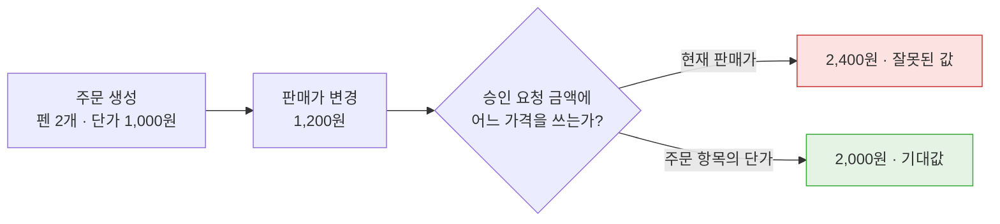
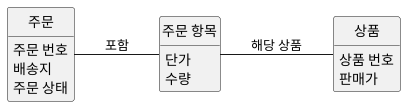
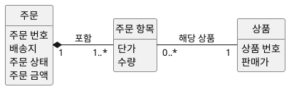
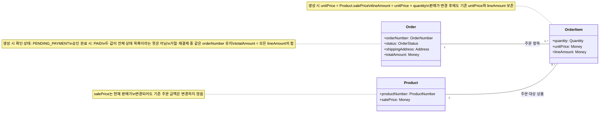

--------------------
Session 명: 04. 도메인 모델 — 정적 관점
--------------------

## 목차

01. 세션 목표
02. 판매가와 주문 금액
03. 도메인 모델의 목적
04. 업무 용어와 용어집
05. 개념과 속성이 모델의 시작이다
06. 관계와 다중성
07. 무엇이 같은 주문인가?
08. 불변 조건과 파생 속성
09. 주문 모델의 속성과 관계
10. 요구사항으로 모델 검토하기
11. AI에게 맡기기 전의 4가지 질문
12. 정적 모델의 작성과 점검
13. 모델 규칙과 코드·테스트
14. 잘못된 관행
15. 실습 4 — 정적 모델
16. 요약

## 01. 세션 목표

**도메인 모델**의 개념·속성·관계·조건을 정의하고, LLM 응답에 포함된 모델을 요구사항과 대조할 수 있다.

- 같은 뜻에 **같은 이름**을 쓰고 상품의 판매가와 주문 항목의 단가를 구별한다.
- 요구사항의 문장에서 **개념과 속성**을 찾아 정의한다.
- 주문 한 건에 속하는 항목 수와 항목 하나가 속하는 주문 수를 **다중성**으로 확인한다.
- **불변 조건**에 사례의 값을 대입해 테스트 기대값을 계산한다.
- **LLM 응답**에서 업무 근거가 없는 결정을 찾아 확인할 질문으로 남긴다.
- **모델 규칙**을 어느 코드에서 적용하고 어떤 테스트로 확인하는지 설명한다.

**강사 노트**

- 입력은 "세션 03. 요구사항"에서 확정한 요구사항 정의서다. 기능은 "주문한다" 하나다.
- 다이어그램을 그리는 절차는 가르치지 않는다. 읽고 틀린 곳을 찾는 것이 목적이다.
- 동적 관점은 "세션 05. 도메인 모델 — 동적 관점"이 맡는다. 상태와 전이를 미리 설명하지 않는다.

---

## 02. 판매가와 주문 금액

펜 2개를 개당 1,000원에 주문했다. 결제 전에 상품의 판매가가 1,200원으로 올랐다. 카드 승인 요청에는 **주문할 때 기록한 단가**를 사용하므로 요청 금액은 2,000원이다.

**도식 — Mermaid — 주문 금액이 갈린 자리**



**강사 노트**

- "세션 01. 사람의 일과 AI의 일"에서 업무 담당자 리뷰가 찾아낸 문제 3가지 가운데 첫째다.
- 주문의 값은 과정 설계의 공통 전제다. 여기서 세운 값을 세션 끝까지 그대로 쓴다.

---

## 03. 도메인 모델의 목적

## 정적과 동적은 한 모델이다

**도메인 모델**은 업무에서 다루는 대상과 규칙을 정의한다. 주문·주문 항목·상품의 구조는 **정적 관점**으로, 결제 승인·거절 때 주문에 일어나는 변화는 **동적 관점**으로 설명한다.

**인용문**

도메인 모델은 영역의 **개념 클래스나 실제 상황의 객체**를 시각적으로 표현한 것이다, "A domain model is a visual representation of conceptual classes or real-situation objects in a domain", [Larman 2004]

- 다음 세션의 동적 관점에서는 결제 승인과 거절에 따라 주문 상태가 어떻게 바뀌는지 다룬다.
- **개념 모델**은 업무 개념과 그 관계를 표현한다. 클래스 다이어그램으로 개념과 관계를 나타낼 수 있다.
- 도메인 모델과 **온톨로지**는 개념과 관계의 의미를 정의한다는 공통점이 있다. 이 실습에서는 개념과 관계를 정적 모델과 용어집에 정의한다.
- 온톨로지는 **개념화의 명시적 명세**다, "An ontology is an explicit specification of a conceptualization.", [Gruber 1993]

**강사 노트**

- 인용은 `tools/verify-quote.js`로 원문 확인했다. Larman의 정의는 정적 개념도의 것이며 정적·동적 관점을 함께 쓰는 이 과정의 용례와 구별한다.
- Gruber 원문 확인. 온톨로지 언어·지식 그래프·추론 엔진의 사용법은 범위 밖이다.
- "세션 04. 도메인 모델 — 정적 관점"과 "세션 05. 도메인 모델 — 동적 관점"은 하나의 주문 도메인 모델을 두 관점에서 발전시킨다. 학습 순서를 고정된 개발 단계로 설명하지 않는다.

---

## 분석은 설계를 정하지 않는다

분석에서는 **주문 금액에 사용할 단가**를 정의한다. 설계에서는 그 단가를 어디에 기록하고 어떤 객체가 합계를 계산할지 정한다.

**인용문**

분석은 해결책보다 **문제와 요구사항의 탐구**를 강조한다, "Analysis emphasizes an investigation of the problem and requirements, rather than a solution.", [Larman 2004]

**표 — 주문 금액에 관한 서로 다른 결정**
| 관점 | 답하는 질문 | 주문 금액의 결정 |
|---|---|---|
| **요구** | 어떤 결과를 원하는가? | 가격 변경 뒤에도 2,000원 |
| **분석** | 어느 시점의 가격을 사용해야 하는가? | 주문 생성 당시의 판매가를 단가로 사용 |
| **설계** | 누가 단가를 보관하고 합계를 계산하는가? | 주문 항목에 단가를 기록하고 주문에서 합산 |
| **구현** | 어떻게 실행하는가? | `Money`와 반복문으로 계산 |

- 무엇을 저장하는지에 답하는 것은 **데이터 모델**이고, 같은 관계를 데이터 관점에서 그린 것이 **개체 관계 다이어그램**(ERD)이다.
- 도메인 모델은 **데이터 모델이 아니다**, "A domain model is not a data model", [Larman 2004]
- **설계 클래스**에는 객체의 책임을 정의한다. 테이블과 키는 데이터 저장 방식에 맞춰 설계한다.

**강사 노트**

- Larman 2004의 분석 정의와 "도메인 모델은 데이터 모델이 아니다" 두 대목을 원문 확인했다. 표의 4관점은 `guides/sw-engineering-principles.md`의 「결정과 검증」을 주문 사례에 적용했다.
- [Chen 1976] 원문에서 개체와 관계로 현실을 보는 관점을 확인했다. 서지는 별첨에 있다.
- 분석과 설계를 표기 종류로 구별하지 않는다. 같은 클래스 표기로 둘 다 그린다.

---

## 04. 업무 용어와 용어집

모델을 작성할 때는 먼저 업무 용어의 이름과 뜻을 맞춘다. 업무 담당자와 개발자가 같은 뜻으로 쓰는 말을 **보편 언어**(ubiquitous language)라 한다. 용어집에는 용어와 그 의미를 정의한다.

**인용문**

언어의 변경은 곧 **모델의 변경**임을 인식하라, "Recognize that a change in the language is a change to the model.", [Evans 2015]

**표 — "주문한다"의 용어집**
| 용어 | 영문명 | 업무 의미 |
|---|---|---|
| **주문** | `Order` | 배송지 지정으로 생긴 거래 기록 |
| **주문 항목** | `OrderItem` | 주문에 담긴 상품·단가·수량 |
| **상품** | `Product` | 상품 시스템이 관리하는 주문 대상 |
| **판매가** | `salePrice` | 상품의 현재 판매가 |
| **단가** | `unitPrice` | 주문 생성 당시의 판매가를 항목에 기록한 값 |
| **주문 금액** | `totalAmount` | 주문에 속한 모든 항목의 단가 × 수량을 합한 금액 |

- 주문이 생길 때의 판매가 1,000원을 단가로 확정하므로, 판매가가 1,200원이 되어도 그 주문의 금액은 **2,000원**이다.
- 상품 번호와 수량만 남기면 **주문 당시의 금액을 재현할 수 없다**.

**강사 노트**

- Eric Evans, Domain-Driven Design Reference, 2015의 Ubiquitous Language 원문 확인. 적용 범위는 주문 업무로 한정한다.
- 영문명의 원천은 과정 설계의 「영한 용어집과 명명 규칙」이다. 표는 이번 판단에 필요한 대표 항목이다.
- "세션 03. 요구사항" 별첨은 현재 판매가와 기록된 항목 단가를 구별하고 항목 단가의 영문 표기를 미정으로 뒀다. 여기서 과정 용어집에 따라 `unitPrice`를 쓴다. 과정 용어표의 ‘주문 총액’과 요구사항 정의서의 ‘주문 금액’은 같은 `totalAmount`다.
- 수강생이 실습에서 다른 이름을 골라도 된다. 자기 용어집에 먼저 더하게 한다.

---

## 05. 개념과 속성이 모델의 시작이다

## 개념은 요구 문장에서 찾는다

요구사항에서 따로 구별해야 할 대상을 **모델의 개념**으로 정의한다. 주문은 거래 한 건이고, 주문 항목에는 그 주문의 상품·단가·수량을 기록한다. 상품은 여러 주문 항목에서 참조할 수 있다.

**인용문**

현재 반복의 요구로 범위를 한정해 **개념 클래스를 찾고**, 클래스로 그린 뒤 연관과 속성을 더한다, "Bounded by the current iteration requirements under design: 1. Find the conceptual classes … 2. Draw them as classes in a UML class diagram. 3. Add associations and attributes.", [Larman 2004]

**표 — 요구에서 찾은 개념**
| 요구의 단서 | 판단 | 모델에 남길 것 |
|---|---|---|
| **배송지 지정 뒤 주문 생성** | 승인 전에도 주문이 있다 | 주문 |
| **상품별 가격과 수량** | 주문마다 다른 거래 조건 | 주문 항목 |
| **상품 시스템의 현재 판매가** | 거래 대상과 지금 값 | 상품 |
| **본인의 주문만 조회** | 주체를 가리킬 개념이 없다 | 질문으로 남긴다 |
| **승인 결과·배송 요청** | 사건과 외부 반응이다 | 동적 관점에서 다룬다 |

- **고객·결제·배송**은 요구사항에서 모델에 필요한 정보와 관계를 확인한 뒤 구체화한다.

**강사 노트**

- Larman 2004의 도메인 모델 작성 지침을 원문 확인했다. 순서는 처음 만드는 안내이지 닫아 두는 절차가 아니다.
- 외부 시스템의 연동 방식과 업무 개념의 의미는 별개다. 상품 시스템 내부를 설계하지 않아도 상품을 분석할 수 있다.
- 본인 주문 확인 요구를 없애거나 해결했다고 선언하지 않는다. 회원·비회원과 본인 확인은 "세션 03. 요구사항"에서 넘어온 미정이다.
- 승인 결과와 배송 요청은 "세션 05. 도메인 모델 — 동적 관점"이 사건과 전이로 다룬다.

---

## 속성은 알아야 할 값만 둔다

개념마다 업무에 필요한 **속성**을 정의한다. 주문에는 주문 번호·배송지·주문 상태를, 주문 항목에는 단가·수량을, 상품에는 현재 판매가를 기록한다.

**인용문**

속성은 객체의 **논리적 데이터 값**이다, "An attribute is a logical data value of an object.", [Larman 2004]

**도식 — PlantUML — 주문 도메인 모델의 개념과 속성**



- 화면에 보일 문자열, 저장 구조의 키, 외부 시스템의 응답 코드는 **속성으로 두지 않는다**.

**강사 노트**

- Larman 2004의 속성 정의를 원문 확인했다. 개념 클래스는 Java 클래스 선언을 뜻하지 않는다.
- 이 그림에는 개념·속성과 기본 관계를 표시했다. 「06. 관계와 다중성」에서 관계의 종류와 다중성을 설명한다.
- 배송지는 주문의 값 속성으로 둔다(「09. 주문 모델의 속성과 관계」의 도식).

---

## 금액과 수량은 값 타입이다

예제에서는 기본 데이터 타입 `long`으로 표현할 수 있는 금액과 수량을 **사용자 정의 데이터 타입** `Money`와 `Quantity`로 구별한다. 금액은 0 이상의 원 단위 정수, 수량은 1 이상의 정수로 정의한다.

```java
public record Money(long won) {
    public static final Money ZERO = new Money(0);
    public Money {
        if (won < 0) throw new IllegalArgumentException("금액은 0 이상");
    }
// ... 금액을 더하는 plus 생략
    public Money times(Quantity quantity) {
        return new Money(Math.multiplyExact(won, quantity.value()));
    }
}
```

- **유효성 검사**는 값을 만드는 곳에서 한다. `Money`는 음수 금액을, `Quantity`는 1보다 작은 수량을 거절한다.
- `Money.times`의 인자 타입은 `Quantity`다. `Money`를 인자로 넘기면 컴파일 오류가 난다.

**강사 노트**

- 원본은 `code/s04/static-model/src/order/Money.java`다. `package` 선언만 빼고 그대로다. `Quantity`는 같은 폴더의 `Quantity.java`이며 1 미만을 거절하도록 한 예제다.
- 금액 0 이상·수량 1 이상은 교육용 가정이며 과정 설계에 기록했다. 실제 통화·세금·환불의 음수 금액을 금지하는 모델로 설명하지 않는다.
- `Money`를 쓸지는 설계의 결정이다. 여기서는 **값으로 다룰 것**이라는 판단까지 한다.

---

## 06. 관계와 다중성

## 관계 표기 읽기

클래스 다이어그램에서 **연관(Association), 집약(Aggregation), 합성(Composition), 일반화(Generalization)** 표기를 읽는다. 주문과 주문 항목에는 합성을, 주문 항목과 상품에는 연관을 사용한다.

**도식 — SVG — 네 가지 관계 표기**

```svg
<svg xmlns="http://www.w3.org/2000/svg" viewBox="0 0 960 382" width="960" height="382" font-family="sans-serif" aria-label="연관·합성·집약·일반화의 선 모양과 읽는 법. 주문한다 모델에 있는 것은 연관과 합성이고 집약과 일반화는 없다.">
  <g>
    <rect x="4" y="6" width="952" height="86" rx="8" fill="#e8eff8" stroke="#2b5fa8" stroke-width="2"/>
    <line x1="34" y1="49" x2="160" y2="49" stroke="#1b3f70" stroke-width="2"/>
    <text x="190" y="58" font-size="23" font-weight="bold" fill="#1b3f70">연관</text>
    <text x="190" y="77" font-size="15" fill="#334155">Association</text>
    <line x1="300" y1="18" x2="300" y2="80" stroke="#9db8d8"/>
    <text x="326" y="40" font-size="19" fill="#1b3f70">두 개념 사이에 업무상 관계가 있다</text>
    <text x="326" y="74" font-size="19" fill="#8e2a1e">주문 항목과 상품 — 이 모델에 있다</text>
  </g>
  <g>
    <rect x="4" y="100" width="952" height="86" rx="8" fill="#e8eff8" stroke="#2b5fa8" stroke-width="2"/>
    <polygon points="34,143 58,132 82,143 58,154" fill="#1b3f70"/>
    <line x1="82" y1="143" x2="160" y2="143" stroke="#1b3f70" stroke-width="2"/>
    <text x="190" y="152" font-size="23" font-weight="bold" fill="#1b3f70">합성</text>
    <text x="190" y="171" font-size="15" fill="#334155">Composition</text>
    <line x1="300" y1="112" x2="300" y2="174" stroke="#9db8d8"/>
    <text x="326" y="134" font-size="19" fill="#1b3f70">부분은 한 번에 하나의 전체에 속한다</text>
    <text x="326" y="168" font-size="19" fill="#8e2a1e">주문과 주문 항목 — 이 모델에 있다</text>
  </g>
  <g>
    <rect x="4" y="194" width="952" height="86" rx="8" fill="#f8fafc" stroke="#64748b" stroke-width="1.5"/>
    <polygon points="34,237 58,226 82,237 58,248" fill="#ffffff" stroke="#475569" stroke-width="2"/>
    <line x1="82" y1="237" x2="160" y2="237" stroke="#475569" stroke-width="2"/>
    <text x="190" y="246" font-size="23" font-weight="bold" fill="#1e293b">집약</text>
    <text x="190" y="265" font-size="15" fill="#334155">Aggregation</text>
    <line x1="300" y1="206" x2="300" y2="268" stroke="#cbd5e1"/>
    <text x="326" y="228" font-size="19" fill="#334155">빈 마름모로 전체와 부분의 관계를 표시한다</text>
    <text x="326" y="262" font-size="19" fill="#64748b">이 모델에는 없다</text>
  </g>
  <g>
    <rect x="4" y="288" width="952" height="86" rx="8" fill="#f8fafc" stroke="#64748b" stroke-width="1.5"/>
    <line x1="34" y1="331" x2="136" y2="331" stroke="#475569" stroke-width="2"/>
    <polygon points="160,331 136,318 136,344" fill="#ffffff" stroke="#475569" stroke-width="2"/>
    <text x="190" y="340" font-size="23" font-weight="bold" fill="#1e293b">일반화</text>
    <text x="190" y="359" font-size="15" fill="#334155">Generalization</text>
    <line x1="300" y1="300" x2="300" y2="362" stroke="#cbd5e1"/>
    <text x="326" y="322" font-size="19" fill="#334155">빈 삼각형은 일반 개념 쪽을 가리킨다</text>
    <text x="326" y="356" font-size="19" fill="#64748b">이 모델에는 없다</text>
  </g>
</svg>
```

- 회원만 주문할 수 있는지는 **미정**이다. 회원 여부에 따라 주문 유형을 추가하려면 업무 규칙을 먼저 확인한다.

**강사 노트**

- 집약과 일반화도 표기 비교에 포함했다. 주문 사례에서는 연관과 합성을 사용한다.
- 일반화는 특수 개념의 인스턴스가 일반 개념에도 속할 때 사용한다. 예를 들어 특수한 주문 종류를 추가하려면 공통 특성과 구별할 업무 규칙이 있어야 한다.
- 그리는 절차는 "객체지향 분석과 설계 실무"가 맡는다. 여기서는 읽고 판정한다.

---

## 연관명과 다중성

주문 한 건에는 **항목이 한 개 이상** 있고, 항목 하나는 **주문 한 건**에 속한다. 펜 2개를 한 항목에 기록하면 항목 수는 1이고 수량은 2다.

**인용문**

다중성은 클래스 A의 인스턴스 몇 개가 클래스 B의 인스턴스 하나와 **연관될 수 있는지**를 정의한다, "Multiplicity defines how many instances of a class A can be associated with one instance of a class B", [Larman 2004]

**도식 — SVG — 주문과 주문 항목의 연관**

```svg
<svg xmlns="http://www.w3.org/2000/svg" viewBox="0 0 960 160" width="960" height="160" font-family="sans-serif" aria-label="주문과 주문 항목을 잇는 선에 채운 마름모, 연관명 포함, 다중성 1과 1..*가 적혀 있다.">
  <rect x="70" y="42" width="230" height="68" rx="6" fill="#eef2f7" stroke="#475569" stroke-width="1.5"/>
  <text x="185" y="84" font-size="23" text-anchor="middle" fill="#1e293b">주문</text>
  <rect x="640" y="42" width="250" height="68" rx="6" fill="#eef2f7" stroke="#475569" stroke-width="1.5"/>
  <text x="765" y="84" font-size="23" text-anchor="middle" fill="#1e293b">주문 항목</text>
  <polygon points="300,76 326,64 352,76 326,88" fill="#475569"/>
  <line x1="352" y1="76" x2="640" y2="76" stroke="#475569" stroke-width="2"/>
  <text x="496" y="56" font-size="19" text-anchor="middle" fill="#1e293b">포함</text>
  <text x="362" y="106" font-size="19" fill="#8e2a1e">1</text>
  <text x="586" y="106" font-size="19" fill="#8e2a1e">1..*</text>
</svg>
```

**표 — 관계선과 양 끝의 다중성**
| 적힌 것 | 무엇을 뜻하는가? |
|---|---|
| **채운 마름모** | 주문은 전체, 주문 항목은 그 주문에 속하는 부분이다 |
| **연관명(association name) ‘포함’** | 주문이 주문 항목을 포함한다는 관계를 표시한다 |
| **항목 쪽 `1..*`** | 주문 하나에는 항목이 한 개 이상 있다 |
| **주문 쪽 `1`** | 항목 하나는 주문 한 건에만 속한다 |

- **연관명**은 ‘포함’이다. 주문에서 본 상대편의 **역할명(role name)**은 ‘주문 항목들’이다.

**강사 노트**

- 이 개념도는 탐색 방향을 명시하지 않는다. 두 끝의 다중성은 상대편 인스턴스 한 개를 기준으로 읽는다. `1..*`가 코드에서 유지되는지는 빈 주문 거절 사례로 확인한다.
- Larman 2004의 다중성 정의를 원문 확인했다. 역할 이름(role name)은 상대가 맡는 이름이며 연관명과 구별해 읽게 한다.
- 빈 주문의 합계를 0으로 계산할 수 있다. 항목이 한 개 이상이라는 조건은 합계와 별도로 확인한다.
- 연관에 화살표를 그리지 않는다. 탐색 방향은 "세션 07. 설계 — 책임과 협력"의 결정이다.
- 같은 상품을 항목 하나로 합칠지는 별도 정책이며 수량 상한도 정하지 않는다.

---

## 주문 항목의 소속

주문 항목은 주문의 일부이며 한 주문에만 속한다. 이 모델은 이를 **합성**으로 표현한다. 상품은 여러 주문 항목에서 참조할 수 있으므로 주문 항목과 상품은 **연관**으로 표현한다.

**인용문**

합성 관계에서 **전체는 부분의 생성과 삭제를 책임진다**, "the composite is responsible for the creation and deletion of its parts", [Larman 2004]

**표 — 주문에 속하는 것과 별도로 존재하는 것**
| 관계 | 펜 주문에서 확인할 뜻 |
|---|---|
| **주문과 주문 항목** | 단가 1,000원·수량 2인 항목은 이를 기록한 주문에 속한다. |
| **주문 항목과 상품** | 같은 펜 상품을 서로 다른 주문 항목이 참조할 수 있다. |

**강사 노트**

- Larman 2004의 합성 설명을 원문 확인했다. 원문은 한 부분이 한 전체에만 속한다는 조건도 설명한다.
- 합성은 항목의 업무상 소속을 보인다. 주문 삭제·보존 정책과 데이터베이스의 연쇄 삭제는 별도 결정이다.
- 집약은 이 모델에 없다. 없는 것을 적지 않고 구별하는 기준만 남긴다.

---

## 07. 무엇이 같은 주문인가?

같은 펜을 같은 가격에 두 번 주문해도 **주문 번호**가 다르면 서로 다른 주문이다. 두 주문의 금액이 모두 2,000원이면 **금액 값**은 같다.

**도식 — SVG — 같은 값, 다른 주문**

```svg
<svg xmlns="http://www.w3.org/2000/svg" viewBox="0 0 960 340" width="960" height="340" font-family="sans-serif" aria-label="상품·수량·금액·배송지가 같은 두 주문도 주문 번호가 다르면 다른 주문이고, 2000원과 2000원은 같은 금액이다.">
  <g>
    <rect x="14" y="14" width="586" height="312" rx="10" fill="#e8eff8" stroke="#2b5fa8" stroke-width="2"/>
    <text x="307" y="52" font-size="23" font-weight="bold" text-anchor="middle" fill="#1b3f70">식별자로 본다 — 주문</text>
    <rect x="44" y="76" width="256" height="152" rx="6" fill="#fff" stroke="#475569"/>
    <text x="64" y="110" font-size="19" fill="#8e2a1e">주문 번호 1001</text>
    <text x="64" y="144" font-size="19" fill="#334155">펜 2개 · 2,000원</text>
    <text x="64" y="178" font-size="19" fill="#334155">배송지 서울</text>
    <text x="64" y="212" font-size="19" fill="#64748b">10시에 주문</text>
    <rect x="320" y="76" width="256" height="152" rx="6" fill="#fff" stroke="#475569"/>
    <text x="340" y="110" font-size="19" fill="#8e2a1e">주문 번호 1002</text>
    <text x="340" y="144" font-size="19" fill="#334155">펜 2개 · 2,000원</text>
    <text x="340" y="178" font-size="19" fill="#334155">배송지 서울</text>
    <text x="340" y="212" font-size="19" fill="#64748b">11시에 주문</text>
    <text x="44" y="264" font-size="19" fill="#1b3f70">값이 같아도 번호가 다르면 다른 주문이다</text>
  </g>
  <g>
    <rect x="612" y="14" width="334" height="312" rx="10" fill="#f8fafc" stroke="#64748b" stroke-width="1.5"/>
    <text x="779" y="52" font-size="23" font-weight="bold" text-anchor="middle" fill="#1e293b">값으로 본다 — 금액</text>
    <rect x="642" y="86" width="136" height="64" rx="6" fill="#fff" stroke="#475569"/>
    <text x="710" y="126" font-size="19" text-anchor="middle" fill="#1e293b">2,000원</text>
    <rect x="794" y="86" width="136" height="64" rx="6" fill="#fff" stroke="#475569"/>
    <text x="862" y="126" font-size="19" text-anchor="middle" fill="#1e293b">2,000원</text>
    <text x="779" y="196" font-size="23" text-anchor="middle" fill="#245128">같은 금액이다</text>
    <text x="642" y="264" font-size="19" fill="#334155">금액·수량은 값으로 본다</text>
    <text x="642" y="300" font-size="19" fill="#64748b">값이 바뀌면 다른 값이다</text>
  </g>
</svg>
```

- 식별자는 **업무가 쓰는 번호**다. 저장 구조의 키를 모델에 올리지 않는다.
- 식별자의 **형식과 발급 방법**은 정하지 않고 미정으로 남긴다.

**강사 노트**

- 주문 번호는 공통 전제의 식별자다. 세션 사이에서 속성명을 바꾸지 않는다.
- 1001·1002와 주문 시각은 같음을 가르려고 둔 예시 값이다. 주문 시각을 속성으로 더하지 않는다.

---

## 08. 불변 조건과 파생 속성

## 주문 금액이 유지되는 조건

주문 금액은 항상 **항목별 단가 × 수량의 합**과 같다. 항상 참이어야 하는 규칙을 **불변 조건**이라 한다.

**도식 — SVG — 판매가가 바뀐 뒤의 주문**

```svg
<svg xmlns="http://www.w3.org/2000/svg" viewBox="0 0 960 215" width="960" height="215" font-family="sans-serif" aria-label="서울로 받는 결제대기 주문이 펜 2개인 주문 항목 하나를 포함하고, 항목이 현재 판매가 1200원인 펜 상품을 가리킨다. 확정 단가는 1000원이고 주문 금액은 2000원이다.">
  <g fill="#ffffff" stroke="#475569" stroke-width="1.4">
    <rect x="10" y="24" width="280" height="176"/>
    <rect x="340" y="24" width="280" height="176"/>
    <rect x="670" y="24" width="280" height="176"/>
    <path d="M290 112H340M620 112H670" fill="none"/>
    <path d="M10 62H290M340 62H620M670 62H950"/>
  </g>
  <g font-size="23" text-anchor="middle" font-weight="bold" text-decoration="underline" fill="#1b3f70">
    <text x="150" y="52">:주문</text>
    <text x="480" y="52">:주문 항목</text>
    <text x="810" y="52">펜:상품</text>
  </g>
  <g font-size="19" fill="#1e293b">
    <text x="26" y="98">배송지 = 서울</text>
    <text x="26" y="132">상태 = 결제대기</text>
    <text x="26" y="166">주문 금액 = 2,000원</text>
    <text x="356" y="98">단가 = 1,000원</text>
    <text x="356" y="132">수량 = 2개</text>
    <text x="686" y="98">판매가 = 1,200원</text>
    <text x="686" y="132">상품 번호 = PEN</text>
  </g>
</svg>
```

- 주문 생성 시 판매가 **1,000원**을 항목 단가로 기록한다. 이후 상품 판매가가 **1,200원**이 되어도 기존 항목의 단가는 **1,000원**이다.
- 기록한 단가와 수량을 합계식에 대입해 테스트의 **기대값 2,000원**을 계산한다.
- **결제대기**에서 다른 상태로 바뀌는 조건은 "세션 05. 도메인 모델 — 동적 관점"에서 다룬다.

**강사 노트**

- 단가 1,000원과 현재 판매가 1,200원이 다른 것은 오류가 아니다. 생성 시점에 올바르게 확정했는지와 그 뒤 값을 보존했는지가 판정 대상이다.
- 상품 번호 `PEN`은 펜을 가리키는 예제 값이며 형식 규칙이 아니다.
- 수업에서는 주문 금액을 먼저 예측하게 한 뒤 「13. 모델 규칙과 코드·테스트」의 실행 결과와 대조한다.

---

## 파생 속성과 계산식

다른 속성 값으로 계산하는 속성을 **파생 속성**이라 한다. 예제의 `totalAmount()`는 각 주문 항목의 단가에 수량을 곱해 더한다.

```java
    public Money totalAmount() {
        Money total = Money.ZERO;
        for (OrderItem item : items) {
            total = total.plus(item.unitPrice().times(item.quantity()));
        }
        return total;
    }
```

**표 — 주문 금액 계산에 쓰는 값**
| 값 | 모델에서 정의하는 의미 |
|---|---|
| **단가와 수량** | 주문 항목에서 보존하는 값 |
| **주문 금액** | 항목별 단가 × 수량의 합 |

**강사 노트**

- 원본은 `code/s04/static-model/src/order/Order.java`의 `totalAmount`다. 필드 선언과 조회 메서드는 전체 원본에 있다.
- 이 계산에는 상품의 현재 판매가를 읽는 의존이 없다.

- 이 메서드는 모든 항목을 순회한다. 대표 주문 한 건으로는 합계 구현을 확인할 수 없다.

---

## 09. 주문 모델의 속성과 관계

주문에는 **주문 항목**이 포함된다. 항목 하나는 상품 하나에 해당하고, 그 상품의 주문 당시 단가와 주문 수량을 기록한다.

**도식 — PlantUML — 주문 도메인 모델**



**표 — 도식의 개념과 속성**
| 개념 | 의미와 속성 |
|---|---|
| **주문 `Order`** | 주문 번호 `OrderNumber`, 배송지 `shippingAddress`, 주문 상태 `OrderStatus`, 주문 금액 `totalAmount`(파생 속성) |
| **주문 항목 `OrderItem`** | 확정 단가 `unitPrice`, 수량 `Quantity` |
| **상품 `Product`** | 상품 번호 `ProductNumber`, 현재 판매가 `salePrice` |

- **주문–주문 항목** — 생성된 주문에는 항목이 한 개 이상 있다. 항목은 주문 한 건에 속한다.
- **주문 항목–상품** — 항목 하나는 상품 하나에 해당한다. 상품 하나에는 해당하는 항목이 없거나 여러 개 있을 수 있다. 여러 주문에 등장할 수 있다는 뜻이며 같은 주문 안에서의 중복·병합 정책은 미정이다.

---

## 요구사항으로 모델 판정하기

정적 모델에서는 주문 항목의 단가와 수량, 주문 한 건에 포함되는 항목 수, 주문 금액 계산식을 확인한다. 사례에서는 결제가 거절됐을 때 다시 결제할 수 있는지, 결제 승인 후에만 배송을 요청하는지 확인한다.

**표 — 확정 규칙과 정적 모델**
| 확인할 조건 | 근거와 판정 |
|---|---|
| **합계 등식** | 모든 유효한 주문의 금액은 해당 주문 항목의 `unitPrice × quantity`를 더한 값이다. |
| **생성 시점** | 항목에 그 시점의 `salePrice`를 `unitPrice`로 기록한다. |
| **생성 이후** | 현재 판매가가 바뀌어도 기존 항목 단가와 주문 금액을 보존한다. 카드 승인 요청에도 그 주문 금액을 쓴다. |

**표 — 결제와 배송 요청을 확인하는 사례**
| 사례 | 정적 모델로 확인할 값 | 결제와 배송 요청의 기대 결과 |
|---|---|---|
| **정상 승인** | 펜 2개, 단가 1,000원, 주문 금액 2,000원 | 2,000원 승인 요청, 결제완료, 배송 요청 1회 |
| **가격 변경 후 승인** | 현재 판매가 1,200원, 기존 단가 1,000원, 기존 금액 2,000원 | 2,000원 승인 요청, 결제완료, 배송 요청 1회 |
| **카드 거절** | 같은 주문 번호와 금액 2,000원 | 2,000원 승인 요청 뒤 결제대기, 배송 요청 0회 |
| **거절 후 재결제** | 최초 요청·거절·다른 카드 재결제에서 같은 주문 번호와 금액 2,000원 | 카드 X·Y 각각 2,000원 요청, Y 승인 뒤 결제완료, 전체 배송 요청 1회 |

---

## 모델에 남길 가정과 질문

- **예제의 가정** — 주문은 항목을 한 개 이상 포함한다. 수량은 1 이상의 정수이고, 금액은 0 이상의 원 단위 정수다. 실습 중 추가한 가정은 확정 요구사항과 구분해 기록한다.
- **확정된 접근 규칙** — 본인 주문만 조회·변경을 요청할 수 있다.
- **미정** — 회원 여부, 본인 확인 방법, 주문자 식별 정보는 추가 확인이 필요하다. 결제 이력, 주소와 식별자 형식, 항목 병합, 수량 상한도 미정이다.
- **추가로 확인할 동작** — 승인 후 배송 요청이 실패하면 어떻게 처리하는가? 결제 결과를 확인할 수 없을 때는 어떻게 처리하는가?
- 사건·상태 전이와 요청 순서는 "세션 05. 도메인 모델 — 동적 관점", 시스템 경계와 연동 규격은 "세션 06. 아키텍처", 객체 책임과 협력은 "세션 07. 설계 — 책임과 협력"에서 이어진다.

**강사 노트**

- 수강생에게 본인 주문만 조회한다는 규칙과, 본인 여부를 확인하는 데 필요한 정보를 나누어 말하게 한다.
- 요구사항 전체가 분석 완료됐다고 주장하지 않는다. 행동과 외부 요청의 순서는 "세션 05. 도메인 모델 — 동적 관점"에서 확인한다.
- 주문과 주문 항목의 소속, 합계에 쓰는 단가를 설명한 뒤 코드·테스트와 대조한다.

---

## 10. 요구사항으로 모델 검토하기

**펜 주문의 금액을 계산해 본다**

개당 1,000원인 펜 2개로 주문을 생성했다. 결제 전에 상품 판매가가 1,200원으로 올랐다. 요구사항에 따르면 기존 주문 금액은 2,000원이다.

**검토할 모델**

- 주문을 받으려면 고객이 회원이어야 한다.
- 주문 한 건에는 주문 항목이 0개 이상 있다.
- 주문 항목에는 상품과 수량을 기록한다.
- 주문 금액은 상품의 현재 판매가 × 수량을 항목별로 더한 값이다.

1. 판매가가 1,200원으로 오른 뒤 이 모델로 주문 금액을 계산하라. 기대값 2,000원을 유지하려면 주문 항목에 어떤 값을 기록해야 하는가?
2. 주문에 항목이 한 개 이상 필요하도록 관계의 어느 쪽 다중성을 바꿔야 하는가?
3. 본인 주문만 조회할 수 있다는 요구에서 회원만 주문할 수 있다고 판단할 수 있는가?

**강사 노트**

- 수업용 모델이다. 수강생에게 고칠 부분을 찾게 한 뒤 다음 장에서 근거와 수정안을 보여 준다.
- 이전 실제 시연의 입력과 첫 응답은 `code/s04/exercise-conversation/order/prompt-01.txt`와 `code/s04/exercise-conversation/order/codex-response-01.md`에 있다.

---

## 모델 수정안

**표 — 근거와 모델 수정안**
| 검토 항목 | 판정 근거 | 모델 수정안 |
|---|---|---|
| **주문 금액** | 확정 요구에 따르면 생성 이후 판매가가 올라가도 주문 금액은 2,000원이다. | 주문 항목에 생성 시점의 단가 1,000원을 기록한다. 금액은 기록 단가 × 수량을 항목별로 더한다. |
| **항목 수** | 이 예제에서 주문에는 항목이 한 개 이상 있다. 펜 2개는 수량이 2인 항목 한 개다. | 주문의 항목 수를 `0..*`에서 `1..*`로 고친다. |
| **회원 여부** | 본인 주문만 조회할 수 있다는 규칙은 조회 권한을 정한다. 회원 가입 필요 여부는 미정이다. | 회원을 주문의 필수 조건에서 빼고, 본인 확인 방법을 미정 질문으로 남긴다. |

**강사 노트**

- ‘빈 주문’은 항목 수 규칙으로 확인한다. 항목 수와 합계 등식은 각각 검사한다.
- 도식의 구문과 업무 의미를 구별하는 참고 자료는 [Gao 외 2025]다.

---

## 11. AI에게 맡기기 전의 4가지 질문

LLM에 **정적 모델 작성**을 맡길 때 확정 요구사항과 사례를 함께 주고, 미정 사항은 질문으로 남기라고 요청한다.

**도식 — SVG — 모델을 AI에게 맡기기 전의 4가지 질문**

```svg
<svg xmlns="http://www.w3.org/2000/svg" viewBox="0 0 960 382" width="960" height="382" font-family="sans-serif" aria-label="정적 모델 작성을 맡기기 전의 입력, 요청할 결과물, 검토할 내용과 판정 기준을 확인한다.">
  <g>
    <rect x="4" y="6" width="952" height="86" rx="8" fill="#eef2f7" stroke="#64748b" stroke-width="1.5"/>
    <text x="30" y="58" font-size="23" font-weight="bold" fill="#1e293b">무엇을 주는가</text>
    <line x1="250" y1="18" x2="250" y2="80" stroke="#94a3b8"/>
    <text x="276" y="40" font-size="19" fill="#334155">확정 요구사항과 사례</text>
    <text x="276" y="74" font-size="19" fill="#334155">아직 정하지 않은 업무 정책</text>
  </g>
  <g>
    <rect x="4" y="100" width="952" height="86" rx="8" fill="#eef2f7" stroke="#64748b" stroke-width="1.5"/>
    <text x="30" y="152" font-size="23" font-weight="bold" fill="#1e293b">무엇을 맡기는가</text>
    <line x1="250" y1="112" x2="250" y2="174" stroke="#94a3b8"/>
    <text x="276" y="134" font-size="19" fill="#334155">용어집과 정적 모델 작성</text>
    <text x="276" y="168" font-size="19" fill="#334155">단가·다중성·합계 규칙 정의</text>
  </g>
  <g>
    <rect x="4" y="194" width="952" height="86" rx="8" fill="#fdecec" stroke="#c0392b" stroke-width="1.5"/>
    <text x="30" y="246" font-size="23" font-weight="bold" fill="#8e2a1e">어디를 확인하는가</text>
    <line x1="250" y1="206" x2="250" y2="268" stroke="#d98b80"/>
    <text x="276" y="228" font-size="19" fill="#3b1f1a">단가를 기록하는 시점과 양 끝 다중성</text>
    <text x="276" y="262" font-size="19" fill="#3b1f1a">미정인 회원 정책을 확정했는지 여부</text>
  </g>
  <g>
    <rect x="4" y="288" width="952" height="86" rx="8" fill="#e8f1e8" stroke="#2f6b35" stroke-width="1.5"/>
    <text x="30" y="340" font-size="23" font-weight="bold" fill="#245128">무엇으로 판정하는가</text>
    <line x1="250" y1="300" x2="250" y2="362" stroke="#8ab08e"/>
    <text x="276" y="322" font-size="19" fill="#1f2e20">펜 2개의 주문 금액이 2,000원인지 확인</text>
    <text x="276" y="356" font-size="19" fill="#1f2e20">각 규칙의 근거를 요구사항과 대조</text>
  </g>
</svg>
```

**강사 노트**

- 앞선 "세션 03. 요구사항"의 「12. 요구사항 작성의 AI 위임」과 연결해, 정적 모델을 맡길 때 줄 자료와 검토할 항목을 보여 준다.
- 사람과 AI의 역할은 검토 책임의 구분이다. 사람이 다이어그램을 직접 그려야 한다는 뜻이 아니다.

---

## 12. 정적 모델의 작성과 점검

`주문한다-정적모델.md`에 **용어·속성, 관계와 다중성, 계산 규칙**을 정의한다. **사례와 미정 질문**을 기록하고 클래스 다이어그램 원본을 같은 파일에 둔다.

**도식 — SVG — 정적 모델 문서의 4개 절**

```svg
<svg xmlns="http://www.w3.org/2000/svg" viewBox="0 0 960 380" width="960" height="380" font-family="sans-serif" aria-label="주문한다 정적모델 문서 하나가 용어와 속성, 관계와 다중성, 계산 규칙과 사례, 미정 질문의 4개 절로 이루어진다.">
  <rect x="4" y="6" width="952" height="44" rx="8" fill="#e2e8f0" stroke="#475569" stroke-width="1.5"/>
  <text x="30" y="37" font-size="23" font-weight="bold" fill="#1e293b">주문한다-정적모델.md — 문서 하나</text>
  <g>
    <rect x="4" y="58" width="952" height="72" rx="8" fill="#f8fafc" stroke="#64748b" stroke-width="1.5"/>
    <text x="30" y="104" font-size="23" font-weight="bold" fill="#1e293b">1. 용어와 속성</text>
    <line x1="270" y1="68" x2="270" y2="120" stroke="#cbd5e1"/>
    <text x="296" y="86" font-size="19" fill="#334155">판매가·단가·주문 금액의 뜻을 정의한다</text>
    <text x="296" y="116" font-size="19" fill="#8e2a1e">용어집에 없는 속성명이 있는가?</text>
  </g>
  <g>
    <rect x="4" y="138" width="952" height="72" rx="8" fill="#e8eff8" stroke="#2b5fa8" stroke-width="2"/>
    <text x="30" y="184" font-size="23" font-weight="bold" fill="#1b3f70">2. 관계와 다중성</text>
    <line x1="270" y1="148" x2="270" y2="200" stroke="#9db8d8"/>
    <text x="296" y="166" font-size="19" fill="#1b3f70">클래스 다이어그램에 개념·관계·다중성을 표시한다</text>
    <text x="296" y="196" font-size="19" fill="#8e2a1e">목록과 다이어그램의 다중성이 같은가?</text>
  </g>
  <g>
    <rect x="4" y="218" width="952" height="72" rx="8" fill="#f8fafc" stroke="#64748b" stroke-width="1.5"/>
    <text x="30" y="264" font-size="23" font-weight="bold" fill="#1e293b">3. 계산 규칙과 사례</text>
    <line x1="270" y1="228" x2="270" y2="280" stroke="#cbd5e1"/>
    <text x="296" y="246" font-size="19" fill="#334155">단가 1,000원인 펜 2개면 2,000원이다</text>
    <text x="296" y="276" font-size="19" fill="#8e2a1e">판매가가 바뀌어도 주문 금액이 같은가?</text>
  </g>
  <g>
    <rect x="4" y="298" width="952" height="72" rx="8" fill="#f8fafc" stroke="#64748b" stroke-width="1.5"/>
    <text x="30" y="344" font-size="23" font-weight="bold" fill="#1e293b">4. 미정 질문</text>
    <line x1="270" y1="308" x2="270" y2="360" stroke="#cbd5e1"/>
    <text x="296" y="326" font-size="19" fill="#334155">회원 여부·번호 형식·수량 상한을 질문으로 기록한다</text>
    <text x="296" y="356" font-size="19" fill="#8e2a1e">미정인 사항을 확정한 부분이 있는가?</text>
  </g>
</svg>
```

- 목록과 다이어그램에서 주문과 주문 항목 사이의 **관계와 다중성**이 같은지 확인한다.

**강사 노트**

- LLM 응답의 모델을 수정한 뒤 목록과 다이어그램의 용어·관계·다중성을 다시 대조하게 한다.
- 실습 답의 실제 응답은 별첨에서 확인할 수 있다.
- 다이어그램을 따로 떼어 별도 산출물로 관리하지 않는다. 실습 4의 결과물이 이 문서이고 실습 5의 투입물이 된다.

---

## 13. 모델 규칙과 코드·테스트

## 모델 규칙을 코드로 구현한다

예제에서는 **주문 생성 시** `OrderItem.confirm`으로 상품의 당시 판매가를 주문 항목의 단가로 기록한다. `Order`는 항목이 없는 주문을 거절하고, `totalAmount()`는 기록한 단가와 수량으로 주문 금액을 계산한다.

**표 — 모델 규칙과 코드·테스트의 대응**
| 모델의 요소 | 코드 | 테스트에서 확인할 내용 |
|---|---|---|
| **개념과 식별** | 값 타입 `ProductNumber`, `OrderItem.productNumber()` | 주문 항목에 기록된 상품 번호가 `PEN`인지 확인한다. |
| **단가와 판매가** | `OrderItem.unitPrice`, `Product.salePrice` | 판매가 변경 뒤 기존 단가 1,000원을 확인한다. |
| **값 조건** | 값 객체 `Money`, `Quantity` | 음수 금액과 0 수량의 생성 거절을 각각 확인한다. |
| **다중성 `1..*`** | `Order` 생성 시 항목 수 확인 | 빈 목록으로 주문을 만들 수 없는지 확인한다. |
| **합계 등식** | `totalAmount()` | 수량 곱과 복수 항목 합계가 모두 반영되는지 확인한다. |

**강사 노트**

- 검사를 명령 하나로 모으는 일은 "세션 10. 검사 파이프라인"에서 다룬다.
- 전체 원본은 `code/s04/static-model/src/`다. 저장소 루트에서 `node courses/ai-native/sessions/code/s04/static-model/run.mjs`로 컴파일·실행하며 JDK 17 이상을 쓴다.
- 참조 방향·컬렉션·`record`·계산 위치는 이 예제의 설계 선택이다. 분석 도식만으로 결정되지 않는다.
- 목록 변경 방지는 컬렉션의 보호를 확인한다. 항목의 업무상 소속이나 결제·배송 동작은 그 검사만으로 판정할 수 없다.

---

## 가격 변경을 실행해 확인한다

상품 판매가를 바꾼 뒤 테스트에서 값 3개를 확인한다. **현재 판매가 1,200원, 기존 항목 단가 1,000원, 기존 주문 금액 2,000원**이다.

**표 — 규칙대로의 결과와 잘못 만든 구현의 결과**
| 관찰 | 규칙대로의 결과 | 잘못 만든 구현의 결과 |
|---|---|---|
| **생성 당시 단가** | 1,000원 | 1,200원 — 틀린 확정 값 |
| **수량 2개의 주문 금액** | 2,000원 | 1,000원 — 수량 누락 |
| **가격 변경 뒤 주문 금액** | 2,000원 | 2,400원 — 현재 판매가 사용 |

```java
        OrderItem item = OrderItem.confirm(pen, new Quantity(2));
// ... 주문 생성과 상품 번호·배송지·생성 상태 확인 생략
        pen.changeSalePrice(new Money(1200));
        equal(new Money(1200), pen.salePrice(), "상품의 현재 판매가 변경");
        equal(new Money(1000), item.unitPrice(), "기존 항목의 확정 단가 유지");
        equal(new Money(2000), order.totalAmount(), "가격 변경 후 기존 주문 총액 유지");
```

- **기대값**은 업무 규칙으로 계산한다.

**강사 노트**

- 원본은 `code/s04/static-model/src/test/StaticModelTest.java`의 앞부분 발췌다. `equal`은 기대값 불일치 때 `AssertionError`를 던진다. 항목 없는 주문은 같은 파일의 `rejects`가 거절을 확인한다.
- 펜 2개인 주문이 통과해도 결제 요청 금액과 배송 요청 순서는 확인하지 않았다. 그 기대값은 해당 행동의 검사로 이어진다.
- Codex가 원본 테스트를 실행하고 금액·다중성·값 제약·복수 항목 합계의 실제 검사 범위와 결과를 확인한다. 통과 건수는 실행 기록으로 확인한 값만 수업 자료에 사용한다.
- `Product.changeSalePrice`는 테스트가 가격 변경 상황을 만드는 로컬 도구다. 상품 관리 기능을 "주문한다"에 더하지 않는다.
- 결제·배송·전이·영속과 외부 조회의 동시성은 확인하지 않았다. 승인 뒤 배송 요청 실패는 미정이다.

---

## 14. 잘못된 관행

주문 모델의 **이름, 관계, 계산 규칙**이 요구사항에 맞는지 확인한다.

**표 — 주문 모델의 오류와 그 결과**
| 관행 | 그래서 생기는 일 |
|---|---|
| **용어집 없이 코드에서 속성명을 만든다** | 같은 것이 **2가지 이름**으로 불린다 |
| **속성에 화면 문자열·저장 키를 넣는다** | 업무가 바뀌지 않았는데 모델이 바뀐다 |
| **주문 항목 끝을 `0..*`로 둔다** | 항목이 없는 주문을 허용한다 |
| **회원 가입을 주문 조건으로 정한다** | 미정인 회원 정책을 확정한다 |
| **현재 판매가로 주문 금액을 계산한다** | 판매가가 1,200원으로 오르면 기존 주문 금액이 2,400원이 된다 |

**강사 노트**

- 현재 판매가를 주문 금액 계산에 사용한 모델의 예는 「10. 요구사항으로 모델 검토하기」에 있다.
- 데이터 모델 자체가 낮은 수준의 산출물이라고 설명하지 않는다. 도메인 개념의 분석과 저장 구조의 목적이 다르다는 뜻이다.

---

## 15. 실습 4 — 정적 모델

실습 3에서 확정한 요구사항을 LLM에 주고, **응답에 포함된 모델**을 검토한다. 수정한 모델은 실습 5에서 사용한다.

**투입물**
  + 실습 3의 최종 `order-system/docs/주문한다-요구사항-정의서.md`

**진행 방법**
  + 첫 응답 받기 5분 · 요구사항과 대조 9분 · 모델 수정 7분 · 저장 및 인계 확인 4분

**프롬프트**
  + ① 최종 정의서로 정적 모델 초안을 작성해라. 용어·개념과 속성·관계와 양 끝 다중성·불변 조건·클래스 다이어그램 원본을 담아라. 규칙·가정·미정을 구별하고 대표 주문의 가격 변경 전후를 보여라.
  + ② [근거와 발견한 문제]를 반영해 목록과 도식을 고쳐라. 대표 주문으로 확인하고 미정은 질문으로 남겨 최종 Markdown을 작성해라.

**점검 항목**
  1. **용어와 근거** — 가격의 뜻을 구별하고 근거 없는 개념을 걸렀는가?
  2. **관계** — 양 끝 다중성이 목록과 도식에서 같고 항목 수와 수량이 구별되는가?
  3. **조건** — 가격 변경 전후에 합계·생성·보존 조건이 맞는가?
  4. **미정** — 배송 요청 실패와 결제 결과 확정 불가의 후속 처리가 질문으로 남았는가?

**결과물**
  + `주문한다-정적모델.md`를 `docs/`에 저장·커밋한다. **실습 5의 투입물**로 최종 정의서와 함께 사용한다.

**강사 노트**

- 세션 배정은 1시간 30분, 강의 50분·직접 실습 25분이다. 단계마다 소요 시간을 확인하고 25분에 마친다.
- 수정 근거는 수강생의 최종 정의서 또는 명시한 교육 가정에서 찾는다. ②는 실제로 발견한 문제를 넣어 보낸다. 직접 고쳐도 된다.
- 인계 시 두 MD를 열어 같은 주문의 식별자·상태 속성·금액과 미정 질문을 모델에서 찾고, 승인·거절·재결제와 배송 요청의 수용 기준을 정의서에서 찾는다. 다음 실습에서 대화 기억 없이 두 파일을 읽어 시작할 수 있어야 한다.
- 첫 응답이 늦거나 고칠 곳을 찾기 어려우면 「10. 요구사항으로 모델 검토하기」의 수업용 예를 사용한다.
- 질문에 답하는 것과 업무 정책을 정하는 것을 구별한다. 수강생은 자기 정의서를 기준으로 판단한다. 승인된 기준본은 그대로 두고, 새 업무 결정이 필요하면 근거와 질문을 실습 결과에 기록한다.
- 클래스 다이어그램의 렌더 화면이 있으면 대조한다. 렌더를 사용할 수 없는 경우에도 원본의 개념·속성·다중성을 목록과 직접 대조하고 소스 코드를 MD에 넣는다.

---

## 16. 요약

정적 모델은 **주문을 구성하는 대상과 관계, 지켜야 할 업무 규칙**을 정의한다.

- 상품의 **현재 판매가**와 주문 생성 시 기록한 **항목 단가**를 구별한다.
- 주문과 주문 항목의 **관계와 다중성**을 정의한다.
- **합계 규칙**에 사례의 값을 대입해 테스트 기대값을 계산한다.
- **LLM 응답**에 포함된 모델을 요구사항과 대조한다. 요구사항과 다른 부분은 수정하고, 근거가 없는 결정은 확인할 질문으로 남긴다.

### 다음 세션

- "세션 05. 도메인 모델 — 동적 관점"은 **사건이 상태를 바꾸는 조건과 허용·금지된 순서**를 정한다.

**강사 노트**

- 모델에서 보완된 것 — 용어집에서 단가를 정의하고 주문과 주문 항목의 합성과 `1..*`를 설명한다. 본인 확인 방법과 결제 이력 구조는 질문으로 이어진다.
- 이 정적 코드가 통과해도 승인 전 배송 요청이나 거절 뒤 재결제의 행동은 검증되지 않았다. 그 빈틈이 다음 세션의 입력이다.

---

## 별첨. 실습 답

## 주문 기능 정적 모델 정의서 — 최종안

**실제 LLM 응답**

**문서 형식 — 10pt**

### 1. 목적과 범위

이 문서는 승인된 S03 최종 정의서의 주문 기능을 수업용 최소 정적 모델로 정리한다.

모델의 핵심 개념은 다음 세 가지로 한정한다.

- 주문(`Order`)
- 주문 항목(`OrderItem`)
- 상품(`Product`)

고객 식별, 결제 이력, 카드 참조, 배송 요청 이력은 업무상 필요하거나 발생하는 정보이지만 구조가 확정되지 않았으므로 별도 모델 개념으로 추가하지 않는다. 관련 요구는 규칙과 미정 질문으로 보존한다.

이 모델은 데이터베이스 구조, 구현 클래스, 외부 시스템 연동 절차, 상태 전이 또는 저장 방향을 결정하지 않는다.

### 2. 구분 기준

- **확정 업무 규칙**: 승인된 S03 최종 정의서에서 확정된 제약과 수용 기준이다.
- **교육 예제 가정**: 과정 설계와 S04에서 모델 검증을 위해 명시적으로 사용하는 가정이다. 업무 정책으로 확정된 것은 아니다.
- **미정 질문**: 추가 결정이 필요하며, 현재 허용 또는 금지로 단정할 수 없는 사항이다.

### 3. 용어와 개념

### 3.1 핵심 개념

| 개념 | 표기 | 정의 | 근거 구분 |
|---|---|---|---|
| 주문 | `Order` | 배송지가 확정될 때 생성되며 주문 항목, 주문 금액, 상태 및 주문 식별 정보를 갖는 업무 기록 | 확정 업무 규칙 |
| 주문 항목 | `OrderItem` | 주문에 포함된 상품, 수량 및 주문 생성 시점에 기록한 단가를 나타내는 항목 | 확정 업무 규칙 |
| 상품 | `Product` | 상품 시스템에서 식별되며 현재 판매가가 제공되는 주문 대상 | 확정 업무 규칙 |

### 3.2 값과 타입

| 용어 | 표기 | 정의 | 근거 구분 |
|---|---|---|---|
| 주문번호 | `OrderNumber` | 같은 주문을 구별하는 값의 타입 | 식별 필요성은 확정, 형식은 미정 |
| 상품번호 | `ProductNumber` | 상품을 구별하는 값의 타입 | 상품 식별 필요성은 확정, 형식은 미정 |
| 금액 | `Money` | 판매가, 기록 단가, 항목 금액 및 주문 금액을 표현하는 값의 타입 | 교육 예제 가정 포함 |
| 수량 | `Quantity` | 주문 항목의 상품 개수를 표현하는 값의 타입 | 교육 예제 가정 포함 |
| 주소 | `Address` | 주문에 확정된 배송지를 표현하는 값의 타입 | 상세 구성은 미정 |
| 주문 상태 | `OrderStatus` | 주문의 현재 상태를 표현하는 값의 타입 | 확인된 값 외 전체 목록은 미정 |
| 판매가 | `salePrice` | 상품 시스템이 제공하는 현재 판매 가격 | 확정 업무 규칙 |
| 기록 단가 | `unitPrice` | 주문 생성 시점의 판매가를 주문 항목에 기록한 단가 | 확정 업무 규칙, 이번 교육 모델의 명칭 |
| 항목 금액 | `lineAmount` | 주문 항목의 `unitPrice × quantity`로 계산되는 금액 | 확정 업무 규칙 |
| 주문 금액 | `totalAmount` | 주문에 속한 모든 주문 항목 금액의 합계 | 확정 업무 규칙 |
| 결제대기 | `PENDING_PAYMENT` | 주문은 생성됐지만 카드 승인이 완료되지 않은 것으로 확인된 상태 값 | 확정 업무 규칙 |
| 결제완료 | `PAID` | 카드 승인이 완료되어 주문이 성립한 것으로 확인된 상태 값 | 확정 업무 규칙 |

`PENDING_PAYMENT`와 `PAID`는 현재 정의서에서 확인된 상태 값이다. 이 둘이 `OrderStatus`의 전체 값이라고 확정하지 않는다. 결제 결과 확정 불가는 새로운 주문 상태로 추가하지 않는다.

### 4. 속성

### 4.1 주문 (`Order`)

| 속성 | 타입 | 의미 | 제약 | 근거 구분 |
|---|---|---|---|---|
| `orderNumber` | `OrderNumber` | 같은 주문을 식별하는 값 | 거절과 재결제를 거쳐도 같은 주문은 같은 값을 유지한다 | 확정 업무 규칙 |
| `status` | `OrderStatus` | 주문의 현재 상태 | 생성 시 확인된 상태는 `PENDING_PAYMENT`, 승인 완료 시 `PAID` | 확정 업무 규칙 |
| `shippingAddress` | `Address` | 주문을 생성하기 전에 확정한 배송지 | `PENDING_PAYMENT`인 같은 주문에서는 변경할 수 없다 | 확정 업무 규칙 |
| `totalAmount` | `Money` | 모든 주문 항목 금액의 합계 | 생성 후 판매가가 변해도 기존 주문의 값은 변하지 않는다 | 확정 업무 규칙 |

주문자 식별 속성은 추가하지 않는다. 본인 주문만 조회하거나 변경 요청할 수 있다는 요구는 유지하지만, 고객 타입과 식별·인증 방식은 미정이다.

### 4.2 주문 항목 (`OrderItem`)

| 속성 | 타입 | 의미 | 제약 | 근거 구분 |
|---|---|---|---|---|
| `quantity` | `Quantity` | 주문한 상품의 수량 | 교육 예제에서는 1 이상의 정수이며, `PENDING_PAYMENT`인 같은 주문에서는 변경할 수 없다 | 규칙·교육 예제 가정 |
| `unitPrice` | `Money` | 주문 생성 시점에 기록한 상품 단가 | 생성 시점의 `Product.salePrice`를 기록하며 이후 판매가가 변해도 변하지 않는다 | 확정 업무 규칙 |
| `lineAmount` | `Money` | 해당 주문 항목의 금액 | `unitPrice × quantity`와 같다 | 확정 업무 규칙 |

주문 항목 자체의 식별자는 정의하지 않는다. 필요 여부는 미정이다.

### 4.3 상품 (`Product`)

| 속성 | 타입 | 의미 | 제약 | 근거 구분 |
|---|---|---|---|---|
| `productNumber` | `ProductNumber` | 상품을 식별하는 값 | 구체적인 형식은 정하지 않는다 | 식별 필요성은 확정, 형식은 미정 |
| `salePrice` | `Money` | 상품 시스템이 제공하는 현재 판매가 | 변경될 수 있으며 기존 주문의 `unitPrice`와 `totalAmount`를 변경하지 않는다 | 확정 업무 규칙 |

### 5. 관계와 양 끝 다중성

| 관계 | `Order` 쪽 다중성 | `OrderItem` 쪽 다중성 | `Product` 쪽 다중성 | 의미 | 근거 구분 |
|---|---:|---:|---:|---|---|
| 주문—주문 항목 | `1` | `1..*` | — | 하나의 주문은 하나 이상의 주문 항목을 가지며, 각 주문 항목은 정확히 하나의 주문에 속한다 | 항목 수 하한은 교육 예제 가정 |
| 주문 항목—상품 | — | `0..*` | `1` | 각 주문 항목은 정확히 하나의 상품을 나타내며, 하나의 상품은 0개 이상의 주문 항목에서 참조될 수 있다 | 확정 업무 관계 |

양 끝을 각각 읽으면 다음과 같다.

- 하나의 `Order`에는 `OrderItem`이 `1..*`개 연결된다.
- 하나의 `OrderItem`에는 `Order`가 정확히 `1`개 연결된다.

.....

관계는 일반 연관으로 표현한다. 구현 참조 방향, 객체 소유권, 데이터 저장 위치 및 외래 키 구조는 정하지 않는다.

### 6. 불변 조건과 생성 시점 조건

### 6.1 확정 업무 규칙

#### 합계 조건

모든 주문 항목에 대해 항목 금액은 기록 단가와 수량의 곱이다.

```text
OrderItem.lineAmount = OrderItem.unitPrice × OrderItem.quantity
```

주문 금액은 해당 주문에 연결된 모든 주문 항목 금액의 합이다.

```text
Order.totalAmount = Order.items.lineAmount의 합계
```

#### 생성 시점 조건

주문 항목의 `unitPrice`는 주문 생성 시점에 해당 상품의 `salePrice`를 기록한 값이다.

```text
주문 생성 시:
OrderItem.unitPrice = OrderItem.product.salePrice
```

주문의 최초 확인 상태는 `PENDING_PAYMENT`다.

```text
주문 생성 시:
Order.status = PENDING_PAYMENT
```

카드 승인 요청에는 확정된 `Order.totalAmount`를 사용한다.

#### 가격 변경 후 보존 조건

주문 생성 후 상품의 현재 `salePrice`가 변경되더라도 기존 주문의 다음 값은 변경되지 않는다.

- `OrderItem.unitPrice`
- `OrderItem.lineAmount`

.....

```text
Product.salePrice 변경
≠ 기존 OrderItem.unitPrice 변경
≠ 기존 OrderItem.lineAmount 변경
≠ 기존 Order.totalAmount 변경
```

#### 상태와 같은 주문의 식별

- 카드 승인 거절 후 주문 상태는 `PENDING_PAYMENT`로 유지된다.
- 승인 거절은 청구 완료로 취급하지 않는다.
- 다른 카드로 재결제할 때 새 주문을 생성하지 않는다.
- 거절과 재결제를 거치는 동안 같은 `orderNumber`를 유지한다.
- 카드 승인 완료 시 같은 주문의 상태는 `PAID`가 된다.
- 결제 결과가 확정되지 않았을 때 승인이나 거절로 임의 확정하지 않는다.

#### 결제대기 주문의 변경 제한

`PENDING_PAYMENT`인 같은 주문에서는 다음을 변경할 수 없다.

- 상품
- 수량
- 배송지

이를 변경하려면 새 주문을 생성해야 한다. 이 제한을 `PAID` 이후를 포함한 모든 상태의 영구 불변 조건으로 확대하지 않는다.

#### 본인 주문 접근 제한

- 주문 조회나 변경 요청은 본인 주문에 대해서만 허용한다.
- 타인의 주문 조회 및 변경 요청은 거절한다.
- 고객 타입, 주문자 식별 속성, 인증 및 본인 확인 방식은 이 모델에서 확정하지 않는다.

### 6.2 교육 예제 가정

다음은 확정 업무 정책이 아니라 과정 설계와 S04의 모델 검증을 위한 가정이다.

- `Money`는 원 단위 정수로 표현한다.
- `Money` 값은 0 이상이다.
- `Quantity`는 1 이상의 정수다.
- 생성된 주문의 주문 항목 수는 1개 이상이다.
- 금액과 수량의 구체적인 상한은 정하지 않는다.

```text
Money ∈ 정수, Money >= 0
Quantity ∈ 정수, Quantity >= 1
Order.items->size() >= 1
```

### 7. 승인·거절·재결제 및 배송 기대값

다음 네 사례의 수용 기준은 S03 최종 정의서 6~7절에서 가져온다. 결제 이력이나 배송 요청을 별도 정적 개념으로 추가하지 않고, 대표 사례의 기대 결과로 확인한다.

| 사례 | 주요 사건 | 같은 주문 여부 | 주문 금액 | 카드 승인 요청 금액 | 최종 상태 | 누적 배송 요청 |
|---|---|---|---:|---:|---|---:|
| 정상 승인 | 펜 2개와 서울 배송지로 주문 생성 후 카드 Y 승인 | 생성된 같은 주문 | 2,000원 | 2,000원 | `PAID` | 1회 |
| 가격 변경 후 승인 | 2,000원으로 주문 생성 후 현재 판매가가 1,200원으로 상승하고 카드 Y 승인 | 가격 변경 전에 생성된 같은 주문 | 2,000원 | 2,000원 | `PAID` | 1회 |
| 카드 거절 | 카드 X 승인 요청 후 명시적으로 거절 | 생성된 같은 주문 | 2,000원 | 2,000원 | `PENDING_PAYMENT` | 0회 |
| 거절 후 재결제 | 같은 주문에서 카드 X 거절 후 카드 Y 승인 | X 거절 전후와 Y 승인 후 모두 같은 주문 | 2,000원 | X: 2,000원, Y: 2,000원 | 최종 `PAID` | 전체 과정 1회 |

정상 승인과 카드 X 거절 후 카드 Y 승인의 누적 배송 요청 1회는 위 수용 사례의 기대값이다. 이를 배송 실패와 재시도가 포함된 모든 상황에서 주문별 배송 요청이 최대 한 번이라는 전역 불변 조건으로 일반화하지 않는다.

### 8. 대표 주문 검산

### 8.1 주문 생성 시점

대표 주문은 다음과 같다.

| 대상 | 값 |
|---|---:|
| 상품 | 펜 |
| `Product.salePrice` | 1,000원 |
| `OrderItem.quantity` | 2 |
| `OrderItem.unitPrice` | 1,000원 |
| `OrderItem.lineAmount` | 2,000원 |
| `Order.totalAmount` | 2,000원 |
| `Order.shippingAddress` | 서울 |
| `Order.status` | `PENDING_PAYMENT` |

항목 금액을 검산하면 다음과 같다.

```text
lineAmount
= unitPrice × quantity
= 1,000원 × 2
= 2,000원
```

항목이 하나이므로 주문 금액은 다음과 같다.

```text
totalAmount
= 모든 lineAmount의 합계
= 2,000원
```

### 8.2 현재 판매가 변경 전후

주문 생성 후 상품의 현재 판매가가 1,000원에서 1,200원으로 상승한다.

```text
Product.salePrice: 1,000원 → 1,200원
```

| 값 | 가격 변경 전 | 가격 변경 후 |
|---|---:|---:|
| `Product.salePrice` | 1,000원 | 1,200원 |
| `OrderItem.unitPrice` | 1,000원 | 1,000원 |
| `OrderItem.quantity` | 2 | 2 |
| `OrderItem.lineAmount` | 2,000원 | 2,000원 |
| `Order.totalAmount` | 2,000원 | 2,000원 |
| 카드 Y 승인 요청 금액 | — | 2,000원 |

변경 후에도 다음 계산이 유지된다.

```text
기존 주문의 lineAmount
= 기존 unitPrice 1,000원 × quantity 2
= 2,000원

기존 주문의 totalAmount
= 2,000원

카드 승인 요청 금액
= 기존 Order.totalAmount
= 2,000원
```

현재 판매가로 다시 계산한 2,400원을 기존 주문이나 카드 승인 요청에 사용하지 않는다.

### 8.3 거절 후 같은 주문에서 재결제

아래의 `ORD-예시-A`는 같은 주문임을 설명하기 위한 값일 뿐이다. 접두어, 길이, 문자 구성 같은 `OrderNumber` 형식 규칙을 정의하지 않는다.

| 순서 | 사건 | 설명용 `orderNumber` | 요청 금액 | 주문 상태 | 누적 배송 요청 |
|---:|---|---|---:|---|---:|
| 1 | 주문 생성 | `ORD-예시-A` | — | `PENDING_PAYMENT` | 0회 |
| 2 | 카드 X 승인 요청 | `ORD-예시-A` | 2,000원 | `PENDING_PAYMENT` | 0회 |
| 3 | 카드 X 승인 거절 | `ORD-예시-A` | 2,000원 | `PENDING_PAYMENT` | 0회 |
| 4 | 카드 Y 승인 요청 | `ORD-예시-A` | 2,000원 | `PENDING_PAYMENT` | 0회 |
| 5 | 카드 Y 승인 완료 | `ORD-예시-A` | 2,000원 | `PAID` | 1회 |

이 사례에서는 주문번호, 주문 항목의 `unitPrice`, `lineAmount` 및 주문의 `totalAmount`가 재결제 전후에 유지된다.

### 9. 미정 질문

미정 질문은 담당자가 결정하기 전까지 최종 수용 기준이 완성되지 않았다는 뜻이다. 현재 문서에서 임의로 허용하거나 금지하지 않는다.

### 9.1 주문자와 권한

1. 비회원 주문을 허용하는가?
2. 회원과 비회원을 포함한 주문자를 어떤 방식으로 식별하는가?

.....

### 9.2 주문 식별과 항목 구성

6. `OrderNumber`와 `ProductNumber`의 형식, 생성 주체 및 유일성 범위는 무엇인가?
7. 주문 항목 자체에 별도 식별자가 필요한가?

.....

### 9.3 주문 상태와 결제대기

14. `PENDING_PAYMENT`와 `PAID` 외에 필요한 주문 상태 값은 무엇인가?
15. 결제대기 기한은 얼마인가?

.....

### 9.4 결제 결과와 이력

19. 결제 결과를 확정할 수 없을 때 주문에 어떤 상태 또는 표식을 남기는가?
20. 결제 결과가 불확정일 때 대사는 누가, 언제, 어떤 기준으로 수행하는가?

.....

### 9.5 재고

29. 재고는 어느 시점에 판단하는가?
30. 주문과 결제 과정에서 재고를 몇 번 확인하는가?

.....

### 9.6 배송 요청

33. 배송 요청 실패 시 주문 상태를 어떻게 처리하는가?
34. 배송 요청 실패 시 재시도하는가?

.....

### 9.7 주문 결과 확인

40. 주문 확인 통지는 어느 시스템이 담당하는가?
41. 주문 확인 통지는 어느 시점에 발송하는가?

.....

### 10. 클래스 다이어그램 원본



### 11. 모델 해석의 경계

- `Order`, `OrderItem`, `Product`는 업무 개념이며 구현 클래스나 데이터베이스 테이블을 의미하지 않는다.
- 관계는 업무상 다중성만 나타내며 참조 방향, 객체 소유권 및 저장 구조를 결정하지 않는다.
- `Money`, `Quantity`, `Address`, `OrderNumber`, `ProductNumber`, `OrderStatus`는 속성의 의미를 설명하는 값 타입이다.
- `PENDING_PAYMENT`와 `PAID`는 확인된 상태 값이며 전체 상태 집합을 닫지 않는다.
- 결제 결과 확정 불가는 별도의 주문 상태로 모델링하지 않는다.
- 결제 이력, 카드 참조 및 배송 요청 이력은 구조가 확정되지 않았으므로 클래스로 추가하지 않는다.
- 정상 승인과 거절 후 재결제 사례의 배송 요청 1회는 수용 사례의 기대값이며, 실패와 재시도를 포함한 전역 최대 1회 제약이 아니다.
- 이 문서는 상태 전이, 외부 연동 절차, 트랜잭션, 동시성 제어, 오류 코드 또는 화면 표현을 새로 정의하지 않는다.

**강사 노트**

- 이번 실행 원본은 `code/s04/exercise-conversation/production-2026-11-17/codex-response-02.md`이며, 최종 `주문한다-정적모델.md`와 바이트 단위로 같다. 승인된 앞 실습의 최종 정의서와 현재 실습의 두 프롬프트로 실행했다. 10절의 검토 문제는 강의용 예제다.
- 교재용 발췌는 원문의 첫 제목과 첫 절부터 시작하며 문구·절 번호·순서·강조를 보존했다. 미정 질문 일곱 그룹에는 그룹명과 첫 두 질문을 남겼다. 관계의 반복 설명과 판매가 변경 뒤 보존 값의 반복 목록도 앞 두 항목을 싣고 생략 위치에 `.....`를 표시했다. 네 수용 사례와 모든 표, 클래스 다이어그램 원본은 그대로 수록했다. 생략한 전문은 위 실행 기록에서 확인한다. ‘최종안’은 응답의 원래 제목이다.
- 제작 시 별첨은 좌우 두 열이다. 왼쪽 열을 먼저 채운 뒤 이어지는 묶음을 오른쪽에 둔다. 표는 모두 한 열 안에 8pt로 배치한다. 소제목과 첫 자료, 표 바로 뒤의 설명은 묶어서 배치하고 실제 열 너비로 행 높이를 계산한다.
