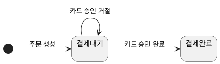
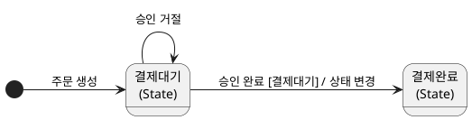
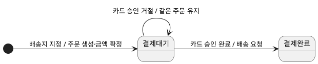
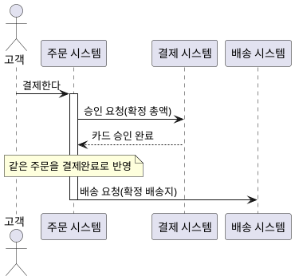
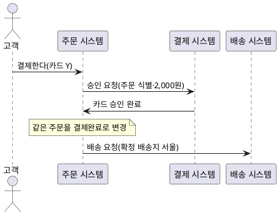
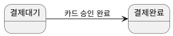
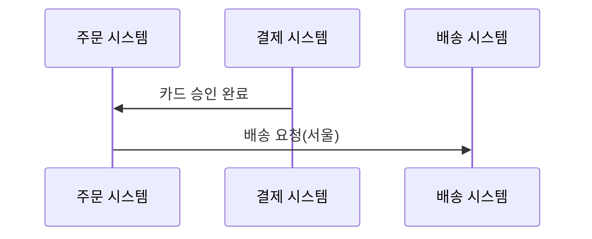
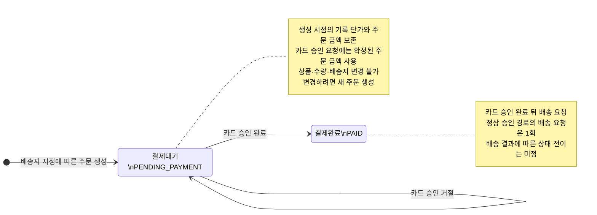
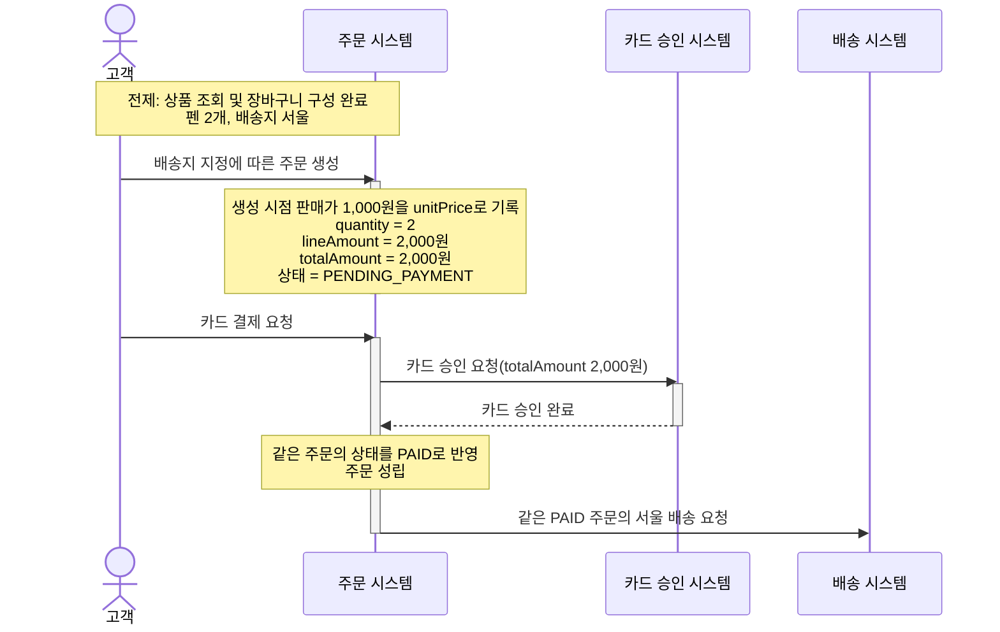

--------------------
Session 명: 05. 도메인 모델 — 동적 관점
--------------------

## 목차

01. 세션 목표
02. 도메인 모델의 동적 관점
03. 상태 기계
04. 시퀀스 다이어그램
05. 동적 모델의 정합성
06. 업무 규칙과 대표 사례
07. 금지와 미정
08. 코드와 검사
09. 실습 5 — 동적 모델
10. 요약

## 01. 세션 목표

**도메인 모델은 업무의 구조와 행위를 함께 표현한다.** 정적 모델은 개념·관계·제약을, 동적 모델은 사건에 따른 상태 변화와 상호작용을 표현한다. 두 관점은 동일한 업무 규칙을 일관되게 설명해야 한다.

- **관계** — 정적 모델과 동적 모델을 같은 주문에 적용한다.
- **표현** — 상태 기계와 시퀀스를 작성하고, 다른 도식의 용도를 구별한다.
- **검증** — 사건·전이·메시지와 주문의 확정 값이 일관되는지 확인한다.
- **AI 활용** — AI 응답을 업무 규칙과 대조하고, 오류가 없으면 승인하며 미정 정책을 임의로 확정하지 않는다.

**강사 노트**

- 강의 30분·실습 20분. 01(1분), 02(7분), 03(5분), 04(4분), 05(5분), 06(2분), 07(1분), 08(3분), 10(2분). 09절은 별도 20분이다.
- 이 과정의 목적은 UML 작도 숙련이 아니라 업무 판단의 명시와 AI 모델의 검증이다. 정적·동적 모델을 서로 다른 도메인으로 설명하지 않는다.

---

## 02. 도메인 모델의 동적 관점

## 정적 모델과 동적 모델

**정적 모델이 업무의 구조와 제약을 정의한다면, 동적 모델은 그 제약이 사건의 전후에도 어떻게 유지되는지와 참여자 간 상호작용의 순서를 설명한다.** 주문의 정적 모델에 있는 식별자·확정 금액·배송지는 주문 생성·결제 거절·재결제·승인 후 배송 요청 과정에서도 일관되어야 한다.

**표 — 같은 주문을 설명하는 두 관점**
| 정적 조건 | 동적 질문 | 일치 여부를 확인할 근거 |
|---|---|---|
| 주문에 식별자와 주문항목이 있다 | 거절 뒤 재결제도 같은 주문인가? | 사건 전후 주문 식별 |
| 단가 1,000원 × 펜 2개 = 확정 총액 2,000원 | 판매가 변경·재결제 때 무엇을 청구하는가? | 승인 요청 금액 2,000원 |
| 주문의 확정 배송지는 서울이다 | 언제 어디로 배송을 요청하는가? | 승인 결과 이후 서울로 요청 |
| 주문은 현재 상태를 가진다 | 어떤 사건이 상태를 바꾸거나 유지하는가? | 결제대기·결제완료의 전이 |

- **주문 사례의 판단** — 결제 거절 후에도 주문 식별자와 확정 금액은 유지된다. 승인 완료 전에는 배송 요청이 없어야 한다. 이 두 조건을 정적 값과 동적 흐름에서 함께 확인한다.
- **분석과 설계의 경계** — 업무 사건·상태·상호작용을 먼저 모델링한다. 구현 책임과 연동 규격은 후속 설계에서 결정한다.

**강사 노트**

- 확정 값과 주문 식별을 3가지 업무 사건에 적용한다. 강의 예시의 값과 수강생 실습 3·4의 실제 확정 값은 구별한다.

---

## 동적 모델의 표현 방법

**동적 관점은 하나의 도식으로 모든 질문에 답하지 않는다.** 상태 변화, 상호작용, 활동 흐름, 데이터 흐름 가운데 검증할 질문에 필요한 표현을 선택한다.

**표 — 동적 관점과 관련된 다섯 도식**
| 관점 | 도식 | 답하는 질문 | 이 과정에서의 사용 |
|---|---|---|---|
| 상태 변화 | **상태 기계(State Machine)** | 사건 뒤 상태와 허용된 전이는 무엇인가? | **주요 모델 — 상세화·검증** |
| 상호작용 | **시퀀스(Sequence)** | 누가 어떤 메시지를 어떤 순서로 보내는가? | **주요 모델 — 상세화·검증** |
| 상호작용 | 커뮤니케이션(Communication) | 참여자 사이의 연결과 메시지는 무엇인가? | 시퀀스와 비교 소개 |
| 활동 흐름 | 액티비티(Activity) | 조건에 따라 활동이 어떻게 분기하는가? | 승인·거절 경로 비교 소개 |
| 데이터 흐름 | 데이터 흐름도(DFD) | 데이터가 어디에서 와서 어디로 이동하는가? | 확정 값의 사용처 비교 소개 |

- **DFD는 UML이 아니다.** 데이터 흐름의 논리적 분석 기법이며 메시지 순서나 전이 가드를 단독으로 규정하지 않는다.
- **선택 기준** — 상태가 궁금하면 상태 기계, 메시지의 선후가 궁금하면 시퀀스를 우선한다. 다른 도식은 새로운 검토 질문이 있을 때 보완한다.

**강사 노트**

- 다섯 기법의 표기법을 모두 강의하지 않는다. 도식의 역할을 분류한 다음 3~5장을 통해 관계를 이해시키고, 상세 작성은 03·04절에서 한다.

---

## 상태 변화 — 상태 기계

**상태 기계는 사건에 따른 상태 변화와 허용된 경로를 표현한다.** 주문이 결제대기일 때 카드 거절은 같은 상태를 유지하고, 승인 완료는 결제완료로 전이시킨다.

**도식 — PlantUML — 상태 변화 개요**


- **상자**는 상태, **화살표**는 전이, **화살표의 이름**은 전이를 유발하는 사건이다. 초기점은 주문 생성 이전의 주문 상태를 의미하지 않는다.
- 주문 상태가 결제완료라고 해서 승인 결과보다 앞서 배송 요청이 없었다는 사실까지 증명하지는 못한다.

**강사 노트**

- 여기서는 역할만 소개한다. 사건·가드·전이 목록의 상세는 03절에서 설명한다.

---

## 상호작용 — 시퀀스와 커뮤니케이션

**시퀀스와 커뮤니케이션은 동일한 참여자와 메시지를 다른 관점에서 표현한다.** 시퀀스는 시간 순서를, 커뮤니케이션은 참여자 간 연결과 번호 붙은 메시지를 강조한다.

**도식 — SVG — 동일 상호작용의 두 표현**

```svg:uml
<svg xmlns="http://www.w3.org/2000/svg" width="900" height="300" viewBox="0 0 900 300"><defs><marker id="arrow" markerWidth="7" markerHeight="7" refX="6" refY="3" orient="auto"><path d="M0,0 L6,3 L0,6" fill="none" stroke="#222"/></marker></defs><g font-family="Malgun Gothic, Apple SD Gothic Neo, sans-serif" font-size="14" fill="#111" stroke="none"><text x="230" y="22" text-anchor="middle" font-size="20">시퀀스 다이어그램</text><text x="685" y="22" text-anchor="middle" font-size="20">커뮤니케이션 다이어그램</text><rect x="5" y="42" width="90" height="30" fill="white" stroke="#222"/><text x="50.0" y="62.0" text-anchor="middle" font-size="14">고객</text><line x1="50" y1="72" x2="50" y2="282" stroke="#222" stroke-width="1.2" stroke-dasharray="4 4"/><rect x="125" y="42" width="90" height="30" fill="white" stroke="#222"/><text x="170.0" y="62.0" text-anchor="middle" font-size="14">주문 시스템</text><line x1="170" y1="72" x2="170" y2="282" stroke="#222" stroke-width="1.2" stroke-dasharray="4 4"/><rect x="245" y="42" width="90" height="30" fill="white" stroke="#222"/><text x="290.0" y="62.0" text-anchor="middle" font-size="14">결제 시스템</text><line x1="290" y1="72" x2="290" y2="282" stroke="#222" stroke-width="1.2" stroke-dasharray="4 4"/><rect x="365" y="42" width="90" height="30" fill="white" stroke="#222"/><text x="410.0" y="62.0" text-anchor="middle" font-size="14">배송 시스템</text><line x1="410" y1="72" x2="410" y2="282" stroke="#222" stroke-width="1.2" stroke-dasharray="4 4"/><line x1="50" y1="104" x2="170" y2="104" stroke="#222" stroke-width="1.2" marker-end="url(#arrow)"/><text x="110.0" y="96" text-anchor="middle" font-size="14">1. 결제한다</text><line x1="170" y1="152" x2="290" y2="152" stroke="#222" stroke-width="1.2" marker-end="url(#arrow)"/><text x="230.0" y="144" text-anchor="middle" font-size="14">2. 승인 요청</text><line x1="290" y1="200" x2="170" y2="200" stroke="#222" stroke-width="1.2" marker-end="url(#arrow)"/><text x="230.0" y="192" text-anchor="middle" font-size="14">3. 승인 완료</text><line x1="170" y1="248" x2="410" y2="248" stroke="#222" stroke-width="1.2" marker-end="url(#arrow)"/><text x="290.0" y="240" text-anchor="middle" font-size="14">4. 배송 요청</text><rect x="475" y="155" width="80" height="34" fill="white" stroke="#222"/><text x="515.0" y="177.0" text-anchor="middle" font-size="14">고객</text><rect x="610" y="155" width="100" height="34" fill="white" stroke="#222"/><text x="660.0" y="177.0" text-anchor="middle" font-size="14">주문 시스템</text><rect x="775" y="62" width="110" height="34" fill="white" stroke="#222"/><text x="830.0" y="84.0" text-anchor="middle" font-size="14">결제 시스템</text><rect x="775" y="238" width="110" height="34" fill="white" stroke="#222"/><text x="830.0" y="260.0" text-anchor="middle" font-size="14">배송 시스템</text><line x1="555" y1="172" x2="610" y2="172" stroke="#222" stroke-width="1.2" marker-end="url(#arrow)"/><text x="582" y="144" text-anchor="middle" font-size="14">1. 결제한다</text><line x1="690" y1="155" x2="790" y2="96" stroke="#222" stroke-width="1.2" marker-end="url(#arrow)"/><text x="720" y="100" text-anchor="middle" font-size="14">2. 승인 요청</text><line x1="820" y1="96" x2="710" y2="171" stroke="#222" stroke-width="1.2" marker-end="url(#arrow)"/><text x="808" y="144" text-anchor="middle" font-size="14">3. 승인 완료</text><line x1="710" y1="184" x2="790" y2="238" stroke="#222" stroke-width="1.2" marker-end="url(#arrow)"/><text x="780" y="210" text-anchor="middle" font-size="14">4. 배송 요청</text></g></svg>
```

- **같은 상호작용** — 두 그림의 3번 승인 완료와 4번 배송 요청은 동일한 업무 메시지다.
- **선택** — 승인 결과보다 배송 요청이 먼저인지를 검토하려면 시퀀스가 직관적이다.

**강사 노트**

- 커뮤니케이션 다이어그램을 별도의 모델이나 추가 요구로 오해하지 않게 한다. 두 그림의 메시지 번호·참여자를 비교하고 끝낸다. 상세 시퀀스 구성 요소는 04절에서 설명한다.

---

## 활동·데이터 흐름과 도식의 관계

**액티비티는 업무 활동의 조건부 흐름을, DFD는 데이터의 출처와 목적지를 표현한다.** 전자는 승인·거절에 따른 분기를, 후자는 확정 금액과 배송지의 사용 위치를 설명한다.

**도식 — SVG — 승인·거절 활동 흐름**

```svg:uml
<svg xmlns="http://www.w3.org/2000/svg" width="1000" height="250" viewBox="0 0 1000 250"><defs><marker id="a" markerWidth="7" markerHeight="7" refX="6" refY="3" orient="auto"><path d="M0,0 L6,3 L0,6" fill="none" stroke="#222"/></marker></defs><g fill="#111" font-family="Malgun Gothic, Apple SD Gothic Neo, sans-serif" font-size="16"><circle cx="15" cy="125" r="7"/><rect x="42" y="105" width="155" height="40" rx="10" fill="white" stroke="#222"/><text x="119.5" y="130.0" text-anchor="middle" font-size="16">카드 승인 요청</text><rect x="220" y="105" width="120" height="40" rx="10" fill="white" stroke="#222"/><text x="280.0" y="130.0" text-anchor="middle" font-size="16">결과 수신</text><line x1="22" y1="125" x2="42" y2="125" stroke="#222" marker-end="url(#a)"/><line x1="197" y1="125" x2="220" y2="125" stroke="#222" marker-end="url(#a)"/><line x1="340" y1="125" x2="375" y2="125" stroke="#222" marker-end="url(#a)"/><path d="M375,125 L400,100 L425,125 L400,150 Z" fill="white" stroke="#222"/><path d="M400,100 L400,45 L465,45" fill="none" stroke="#222" marker-end="url(#a)"/><text x="428" y="34" text-anchor="middle" font-size="16">승인</text><path d="M400,150 L400,205 L465,205" fill="none" stroke="#222" marker-end="url(#a)"/><text x="428" y="194" text-anchor="middle" font-size="16">거절</text><rect x="465" y="25" width="155" height="40" rx="10" fill="white" stroke="#222"/><text x="542.5" y="50.0" text-anchor="middle" font-size="16">결제완료로 변경</text><rect x="650" y="25" width="130" height="40" rx="10" fill="white" stroke="#222"/><text x="715.0" y="50.0" text-anchor="middle" font-size="16">배송 요청</text><line x1="620" y1="45" x2="650" y2="45" stroke="#222" marker-end="url(#a)"/><rect x="465" y="185" width="155" height="40" rx="10" fill="white" stroke="#222"/><text x="542.5" y="210.0" text-anchor="middle" font-size="16">결제대기 유지</text><rect x="650" y="185" width="130" height="40" rx="10" fill="white" stroke="#222"/><text x="715.0" y="210.0" text-anchor="middle" font-size="16">배송 요청 없음</text><line x1="620" y1="205" x2="650" y2="205" stroke="#222" marker-end="url(#a)"/><path d="M780,45 L820,45 L820,105" fill="none" stroke="#222" marker-end="url(#a)"/><path d="M780,205 L820,205 L820,145" fill="none" stroke="#222" marker-end="url(#a)"/><path d="M800,125 L820,105 L840,125 L820,145 Z" fill="white" stroke="#222"/><line x1="840" y1="125" x2="860" y2="125" stroke="#222" marker-end="url(#a)"/><rect x="860" y="105" width="110" height="40" rx="10" fill="white" stroke="#222"/><text x="915.0" y="130.0" text-anchor="middle" font-size="16">결과 확인</text><line x1="970" y1="125" x2="985" y2="125" stroke="#222" marker-end="url(#a)"/><circle cx="992" cy="125" r="7" fill="white" stroke="#222"/><circle cx="992" cy="125" r="4"/></g></svg>
```

**도식 — SVG — 결제 처리의 논리적 데이터 흐름**

```svg
<svg xmlns="http://www.w3.org/2000/svg" width="900" height="300" viewBox="0 0 900 300"><defs><marker id="arrow" markerWidth="7" markerHeight="7" refX="6" refY="3" orient="auto"><path d="M0,0 L6,3 L0,6" fill="none" stroke="#222"/></marker></defs><g font-family="Malgun Gothic, Apple SD Gothic Neo, sans-serif" font-size="14" fill="#111" stroke="none"><rect x="5" y="110" width="100" height="50" fill="white" stroke="#222"/><text x="55.0" y="140.0" text-anchor="middle" font-size="14">고객</text><rect x="730" y="30" width="150" height="50" fill="white" stroke="#222"/><text x="805.0" y="60.0" text-anchor="middle" font-size="14">결제 시스템</text><rect x="730" y="220" width="150" height="50" fill="white" stroke="#222"/><text x="805.0" y="250.0" text-anchor="middle" font-size="14">배송 시스템</text><circle cx="420" cy="140" r="55" fill="white" stroke="#222"/><text x="420" y="135" text-anchor="middle" font-size="14">1</text><text x="420" y="157" text-anchor="middle" font-size="14">결제 처리</text><line x1="300" y1="250" x2="550" y2="250" stroke="#222" stroke-width="1.2"/><line x1="300" y1="284" x2="550" y2="284" stroke="#222" stroke-width="1.2"/><text x="425" y="273" text-anchor="middle" font-size="14">D1 주문 정보</text><line x1="105" y1="120" x2="365" y2="120" stroke="#222" stroke-width="1.2" marker-end="url(#arrow)"/><text x="232" y="108" text-anchor="middle" font-size="14">주문 식별·카드</text><line x1="365" y1="155" x2="105" y2="155" stroke="#222" stroke-width="1.2" marker-end="url(#arrow)"/><text x="232" y="180" text-anchor="middle" font-size="14">주문 결과</text><line x1="469" y1="114" x2="730" y2="55" stroke="#222" stroke-width="1.2" marker-end="url(#arrow)"/><text x="591" y="63" text-anchor="middle" font-size="14">승인 요청 정보</text><line x1="730" y1="78" x2="475" y2="143" stroke="#222" stroke-width="1.2" marker-end="url(#arrow)"/><text x="610" y="130" text-anchor="middle" font-size="14">결제 결과</text><line x1="469" y1="170" x2="730" y2="242" stroke="#222" stroke-width="1.2" marker-end="url(#arrow)"/><text x="608" y="190" text-anchor="middle" font-size="14">배송 요청 정보</text><line x1="390" y1="250" x2="390" y2="190" stroke="#222" stroke-width="1.2" marker-end="url(#arrow)"/><text x="280" y="220" text-anchor="middle" font-size="14">확정 금액·배송지</text><line x1="450" y1="190" x2="450" y2="250" stroke="#222" stroke-width="1.2" marker-end="url(#arrow)"/><text x="552" y="240" text-anchor="middle" font-size="14">결제완료 상태</text></g></svg>
```

**표 — 같은 승인 결과의 서로 다른 표현**
| 표현 | 승인 결과와의 관계 | 확인하는 것 |
|---|---|---|
| 상태 기계 | 승인 완료가 전이의 계기 | 결제대기 → 결제완료 |
| 시퀀스·커뮤니케이션 | 승인 완료가 주문으로 전달되는 메시지 | 배송 요청보다 앞서는가, 참여자는 누구인가 |
| 액티비티 | 승인·거절의 분기 조건 | 승인 경로에서만 배송을 요청하는가 |
| DFD | 결제 처리에 들어오거나 나가는 정보 | 승인 요청 금액·배송지의 출처와 사용처 |

- **상호 보완** — 다섯 도식은 일대일 대응 관계가 아니다. 같은 업무 사실을 서로 다른 질문으로 확인한다.

**강사 노트**

- 액티비티와 DFD는 비교 소개에 그친다. DFD의 화살표에 시간 순서의 의미를 부여하지 않는다. 02절의 5개 소개 슬라이드는 ‘정적/동적 관계 → 기법 분류 → 상태 기계 → 상호작용 → 활동/데이터·상호관계’ 순서다. 마지막 장에 두 도식과 비교표가 함께 들어가지 못하면 내용을 줄이지 말고 별도 슬라이드로 분할한다.

---

## 03. 상태 기계

## 상태 기계의 표기와 의미

**상태 기계는 한 객체가 사건에 반응해 허용된 상태로 전이하는 규칙을 표현한다.** 현재 상태·사건·조건(가드)·반응을 구분하며, 주문에서는 승인 요청 자체가 아니라 승인 결과가 전이의 계기다.

**도식 — PlantUML — 상태 기계의 기본 표기(주문 사례)**


**표 — 그림에서 직접 찾는 노테이션**
| 표기 | 의미 | 그림의 위치 |
|---|---|---|
| 검은 원 `[*]` | 시작점(초기 의사 상태) | 주문 생성 전; 주문 자체의 상태가 아님 |
| 둥근 사각형 | 상태(State) | 결제대기·결제완료 |
| 방향 화살표 | 전이(Transition) | 결제대기 → 결제완료 |
| 자기 자신으로 돌아오는 화살표 | 자기 전이(Self transition) | 카드 승인 거절 뒤 결제대기 |
| `사건 [조건] / 반응` | 사건(Event), 가드(Guard), 효과(Effect) | 승인 완료·적용 조건·결제완료 반영 |

- **가드의 범위** — `[결제대기]`는 전이가 허용되는 조건의 표현 예다. 승인 결과와 대상 주문의 연결 방식은 후속 설계에서 결정한다.

**인용문**
도메인의 활동에 관한 정보를 **일련의 개별 이벤트**로 모델링한다, "Model information about activity in the domain as a series of discrete events.", [Evans 2015]

**강사 노트**

- 실제 도식과 노테이션 해설을 함께 배치한다. 각 노테이션은 심볼 자체를 왼쪽에, 해당 의미를 오른쪽에 표시한다. 예제 도식의 전이 라벨·화살표·노트가 서로 겹치면 도식 내 설명을 줄이고 심볼 설명으로 옮긴다. 인용문은 필요하면 강사 노트로 이동한다.
- 화살표는 상태 변경뿐 아니라 같은 상태로 돌아오는 자기 전이도 나타낸다. `결제 요청`은 승인 결과가 아니므로 결제완료 전이로 그리지 않는다.

---

## 주문 상태 기계와 전이 목록

**주문 상태 기계는 하나의 주문에 적용되는 허용된 전이를 명시한다.** 같은 사건 이름과 상태 이름을 전이 목록과 사례에서도 사용한다.

**도식 — PlantUML — 주문의 상태 기계**


**표 — 주문 전이 목록**
| 현재 상태 | 사건 | 다음 상태 | 확인할 업무 결과 |
|---|---|---|---|
| 주문 생성 전(상태 없음) | 배송지 지정 | 결제대기 | 같은 주문 식별·확정 단가·총액·배송지 생성 |
| 결제대기 | 카드 승인 거절 | 결제대기 | 같은 주문 유지, 배송 요청 없음 |
| 결제대기 | 카드 승인 완료 | 결제완료 | 승인 완료를 받은 뒤 확정 배송지로 배송 요청 |

- **재결제** — 카드 X 거절 뒤 카드 Y로 다시 승인 요청을 하지만, 별도 `재결제` 주문 상태나 상태 전이는 추가하지 않는다.
- **정책 경계** — 결과 미확정과 배송 요청 실패 뒤의 추가 처리는 선행 요구의 미정 질문으로 남긴다.

**강사 노트**

- 표의 '주문 생성 전'은 이해를 위한 표식이지 주문 엔터티 상태가 아니다. 초기 화살표를 도메인 상태로 착각하지 않게 한다.
- 정상 승인 뒤 배송 요청은 상태 전이의 업무 반응이며, 요청의 성공 여부를 별도 주문 상태로 가정하지 않는다.

---

## 04. 시퀀스 다이어그램

## 시퀀스의 표기와 의미

**시퀀스 다이어그램은 참여자 사이 메시지의 선후 관계를 세로 시간축으로 표현한다.** 상태 기계가 주문의 상태 변화를 설명한다면 시퀀스는 승인 결과를 언제 받고 배송 요청을 언제 보내는지 설명한다.

**도식 — PlantUML — 시퀀스의 기본 표기(주문 사례)**


**표 — 그림에서 직접 찾는 노테이션**
| 표기 | 의미 | 그림에서 확인할 부분 |
|---|---|---|
| 참여자 머리글·수직 점선 | 참여자와 생명선(Lifeline) | 고객·주문·결제·배송 |
| 실선 화살표 | 전달 메시지(Message) | 승인 요청·배송 요청 |
| 점선 화살표 | 응답 메시지(Reply) 표현의 예 | 카드 승인 완료 결과 |
| 세로 방향 | 메시지의 앞뒤 순서 | 승인 완료가 배송 요청보다 위쪽 |
| 세로 활성 막대 | 참여자가 처리 중인 구간의 예 | 주문 시스템의 처리 구간 |

- **의미와 구현의 구분** — 실선·점선 표기는 본 그림의 읽기 예이며 동기/비동기 통신 규약을 여기서 확정하지 않는다. 생명선은 객체의 영속 수명을 의미하지 않는다.

**강사 노트**

- 노테이션을 소개하는 페이지에 그림을 함께 보이고 각 표기와 해당 화살표를 짚는다. 노테이션 목록만 있는 텍스트 슬라이드는 제작 실패로 판정한다.
- 점선 화살표는 UML에서 응답을 나타내는 관례적 표기이며 모든 결과 메시지가 반드시 점선이어야 한다는 뜻은 아니다.

---

## 정상 승인 시퀀스

**카드 승인 결과를 받은 뒤에만 배송을 요청한다.** 주문 시스템은 생성 시 확정한 2,000원으로 승인 요청을 보내고, 승인 완료가 확인되면 같은 주문을 결제완료로 변경한 뒤 서울로 배송을 요청한다.

**도식 — PlantUML — 정상 승인 시퀀스**


- **거절 경로** — 카드 X 거절 뒤 같은 주문의 상태는 결제대기다. 배송 요청은 발생하지 않고, 고객이 다른 카드로 다시 승인 요청할 수 있다.
- **결과 확인** — 고객은 주문의 결제 결과를 확인한다. 별도 통지 여부와 통지 주체는 미정이며, 위 시퀀스는 승인 결과와 배송 요청의 순서만 표현한다.

**강사 노트**

- 거절·재결제를 별도 시퀀스로 모두 그리도록 강요하지 않는다. 상태 기계와 대표 사례로 검증한다. 고객의 결과 확인을 독립 통지 메시지로 임의 추가하지 않는다.

---

## 05. 동적 모델의 정합성

**모델의 정합성은 요구사항·정적 모델·동적 모델이 동일한 업무 규칙에 대해 모순되지 않는 것이다.** 상태 기계의 전이, 시퀀스의 메시지 순서, 주문의 확정 값이 서로 맞아야 한다.

**표 — 모델 간 정합성 대조**
| 요구사항·정적 모델의 근거 | 상태 기계 | 시퀀스·대표 사례 | 불일치 예 |
|---|---|---|---|
| 주문 시 금액 확정 | 승인 완료 전이가 적용되는 주문 | 승인 요청 2,000원 | 현재 판매가 1,200원으로 재계산 |
| 거절 뒤 같은 주문 재결제 | 거절은 결제대기 자기 전이 | 같은 주문으로 카드 Y 재시도 | 거절 즉시 주문 취소·새 주문 생성 |
| 승인 뒤 배송 요청 | 승인 후 결제완료 | 승인 완료 수신 → 배송 요청 | 승인 결과를 받기 전 배송 요청 |
| 미정 정책은 미정으로 유지 | 미확정 결과를 거절로 전이시키지 않음 | 근거 없는 통지·재시도 추가 안 함 | 자동 취소·별도 통지 확정 |

- **모델 검토 순서** — 요구·정적 모델의 규칙을 먼저 확인하고, 전이 목록과 시퀀스가 해당 규칙을 실제로 표현하는지 대조한다. 반대로 그림만으로 새 정책을 만들어서는 안 된다.

**강사 노트**

- 같은 업무 사건을 다른 도식에서 다른 의미로 사용하지 않는지 확인한다. 모든 요소의 1:1 대응을 요구하지는 않는다.

---

## 06. 업무 규칙과 대표 사례

**대표 사례는 사건 전후 상태, 주문 식별, 확정 값과 외부 요청의 관찰 결과를 함께 확인한다.** 결과가 같아도 잘못된 순서를 놓칠 수 있으므로 요청이 발생한 시점도 확인한다.

**표 — 주문의 대표 사례**
| 사례 | 승인 요청 금액 | 주문 식별·이후 상태 | 배송 요청 |
|---|---|---|---|
| 정상 승인 | 2,000원 | 같은 주문·결제완료 | 승인 후 서울로 요청 |
| 판매가 1,200원으로 상승한 뒤 승인 | 2,000원 | 같은 주문·결제완료 | 승인 후 서울로 요청 |
| 카드 X 거절 | 2,000원 | 같은 주문·결제대기 | 요청 없음 |
| 카드 X 거절 뒤 카드 Y 승인 | 두 요청 모두 2,000원 | 같은 주문·결제완료 | 거절 시 없음, 승인 후 요청 |

- **판정 질문** — 상태는 맞지만 배송 요청이 승인 전에 이루어졌다면 통과인가? 아니다. 최종 값과 행위의 순서를 함께 검사해야 한다.

**강사 노트**

- 강의 예시의 배송 요청 '1회'는 단일 정상 사례의 관찰 결과이며 운영 중 재시도·중복 억제 정책을 확정하지 않는다. 실제 실습 문서의 수용 기준과 충돌할 때는 선행 문서가 기준이다.

---

## 07. 금지와 미정

**금지는 합의된 업무 규칙으로 위반 여부를 판정할 수 있고, 미정은 아직 기대 결과를 정할 근거가 없는 정책이다.** 미정인 결과를 임의로 상태·분기·메시지에 추가하지 않는다.

**표 — 주문 사례의 범위**
| 구분 | 내용 | 처리 |
|---|---|---|
| 확정 금지 | 카드 승인 완료 전 배송 요청 | 동적 모델과 검사에서 금지 |
| 확정 규칙 | 결제 응답이 미확정임 | 승인·거절로 처리하지 않음 |
| 미정 | 미확정 응답의 조회·재결제 정책 | 질문으로 보존 |
| 미정 | 승인 뒤 배송 요청 실패·별도 통지 | 복구·통지 주체와 시점을 정하지 않음 |
| 생애주기 참고 | 배송 시작·완료 | 이번 주문 처리 상태 기계의 주 상태로 확대하지 않음 |
| 범위 밖 | 취소 | 확정된 주문 전이로 추가하지 않음 |

**강사 노트**

- ‘미확정 결과를 승인/거절로 분류하지 않는다’는 확정된 제약과, 미확정 뒤 어떤 후속 처리로 이어지는지는 미정인 정책을 구별한다.

---

## 08. 코드와 검사

## 상태 전이를 코드로 연결

**승인 완료 전이는 현재 상태의 확인과 상태 변경으로 코드에 대응한다.** 코드의 존재 자체는 승인 결과의 진위나 배송 요청 순서가 옳다는 증거가 아니다.

**도식 — PlantUML — 승인 완료 전이**


```java
    // ... Order 클래스의 나머지 코드 생략
    public void onPaid() {
        requireState(OrderStatus.PENDING_PAYMENT);
        status = OrderStatus.PAID;
    }
```

**강사 노트**

- 기존 `code/s05/dynamic-model/src/order/Order.java` 원본 발췌를 그대로 유지했다. 승인 결과를 확인한 이후 전이시키는 주변 책임은 설계에서 정한다. 사용 범위는 상태 전이 한 가지다.

---

## 메시지 순서를 검사로 연결

**최종 주문 상태만으로는 배송 요청의 선후 관계를 검증할 수 없다.** 승인 완료 결과가 기록된 뒤에 배송 요청이 발생했는지 확인해야 업무 규칙을 검증할 수 있다.

**도식 — Mermaid — 승인과 배송 요청**


```java
        // ... 검사 준비 코드 생략
        PaymentGateway payment = (number, amount, method) -> {
            check(amount.equals(new Money(2000)), "승인 요청 금액은 확정 금액 2000원");
            events.add("승인 결과");
            return PaymentDecision.APPROVED;
        };
        DeliveryGateway delivery = (number, address) -> {
            check(approved.status() == OrderStatus.PAID, "배송 요청 시점에는 결제완료");
            check(address.equals(new Address("서울")), "확정 배송지 사용");
            events.add("배송 요청");
        };
        PaymentExample.pay(approved, new PaymentMethod("Y"), payment, delivery);
        check(events.equals(List.of("승인 결과", "배송 요청")), "승인 뒤 배송 요청 1회");
```

**강사 노트**

- 기존 `code/s05/dynamic-model/src/test/DynamicModelTest.java`의 발췌를 유지했다. 이 검사는 승인 요청 금액 2,000원, 배송 요청 순간의 결제완료·서울, 이벤트 기록 순서를 확인한다. 거절·미확정 응답의 모든 운영 정책을 검증한다고 해석하지 않는다.
- 실행 기록과 원본 코드의 재검증은 Codex의 책임이다. 이 개정에서 코드를 새로 실행하지 않았다.
- **제작 검증(본문 미표시)** — 이 슬라이드의 문단·목록은 문단 앞뒤 간격 각 3pt, 줄 간격은 배수 지정이 아닌 1줄(단일 줄간격)을 적용한다. 도식·코드·본문이 겹치지 않는지 실제 렌더링으로 확인한다. 구현은 기존 Production 공통 규칙을 재사용한다.

---

## 09. 실습 5 — 동적 모델

**실습 목적** — 실습 3·4의 확정 문서를 입력으로 상태 기계와 정상 승인 시퀀스를 작성하고, AI 응답의 전이·금액·순서·미정 정책을 검토한다. 문제가 없으면 승인하고 실제 문제가 있을 때만 근거를 명시해 수정한다. **실습 안내는 반드시 1장, 좌우 배치**다.

**실습 안내 — 좌우 2단(하나의 슬라이드)**

**왼쪽 — 투입물·진행(20분)·결과물**

- **투입물** — 실습 3 `주문한다` 요구사항 정의서 전문 + 실습 4 정적 모델 전문.
- **4분** — 두 문서를 첨부하고 ①로 상태 기계·시퀀스 응답을 받는다.
- **11분** — 전이·금액·순서·미정을 대조하고 ②~④의 피드백을 필요한 만큼 보낸다.
- **5분** — ⑤로 최종 MD를 받고 도식·표의 일치 여부를 확인한다.
- **결과물** — `docs/주문한다-동적모델.md` (실습 6의 투입물).

**오른쪽 — 프롬프트·점검 기준**

- **① 모델 작성** — “첨부한 요구사항 정의서와 정적 모델만을 근거로 사건·상태 목록, 상태 기계와 정상 승인 시퀀스의 Mermaid 원본, 전이 목록, 대표 사례 및 미정 질문을 작성해라. 선행 문서에 없는 정책은 확정하지 마라.”
- **②~④ 검토·피드백** — AI 응답에서 실제 발견한 불일치가 있으면 해당 문장·전이·메시지와 요구사항 근거를 지정한다. 불일치가 없으면 확인한 항목을 기록하고 승인한다. **전이**(같은 주문·거절·재결제), **값/순서**(확정 총액·승인 후 배송), **미정**(미확정 응답·배송 실패·별도 통지)를 검토한다. 오류가 없으면 추가 수정 요청을 하지 않는다.
- **⑤ 확정** — “확인한 수정만 반영해 `주문한다-동적모델.md` 전체를 출력해라. 상태 기계·시퀀스 Mermaid, 전이·금지 목록, 대표 사례와 미정 질문을 포함하고 새 정책을 추가하지 마라.”
- **점검** — 상태 전이 / 승인 후 배송 / 확정 금액·주문 식별 / 미정 유지 / 도식·표 일치.

**강사 노트**

- **하드 게이트** — 강의 본문에서 `09. 실습 5`로 시작하는 학습자용 슬라이드는 **정확히 1장**이어야 한다. 제목의 `(1/5)` 같은 자동 분할은 FAIL. 좌측은 투입물·시간·결과물, 우측은 프롬프트·점검이다. 렌더러가 지원하지 않으면 renderer의 실습 전용 레이아웃을 고친다. 원고를 슬라이드에 맞춘다는 이유로 업무 규칙을 삭제하지 않는다.
- ①·⑤의 문구는 별첨에 연결된 대표 실행의 `prompt-01.txt` 첫 문단과 `prompt-05.txt`에 일치한다. ①에는 두 확정 문서를 첨부했다.
- 수강생의 ②~④ 피드백은 실제 AI 응답에서 발견한 문제와 근거를 포함한다. 오류가 없으면 검토 항목과 승인 판단만 기록한다. 다음 예시는 검토 틀이지 미리 알고 있는 정답을 복사하는 문구가 아니다: `문제: [AI 응답의 문장/화살표] / 근거: [실습3·4의 문장] / 수정: [최소 변경] / 재확인: [모델 간 일치]`.
- 상세 점검: (1) 생성 후 결제대기, 거절 뒤 같은 주문의 결제대기, 승인 뒤 결제완료; (2) 승인 결과 수신 뒤에만 배송 요청, 거절 시 요청 없음; (3) 판매가 변경·재결제에도 확정 총액·식별 보존; (4) 미확정 응답·배송 요청 실패·통지 미정 유지; (5) 상태 기계·시퀀스·전이 목록·대표 사례 간 용어와 값 일치.
- **실습 답 생성·실행·검증·선정은 Codex 담당**이다. 선정 전 별첨에 임의의 정답을 채우거나 이전 답을 재활용하지 않는다. Codex는 실제 원문 응답을 별첨에 넣고 `**문서 형식**` 표식으로 두 단 표시를 확인한다. 원본 보존과 넓은 표의 가독성을 우선한다.

---

## 10. 요약

**도메인 모델의 품질은 개별 도식의 모양이 아니라 같은 업무 규칙을 서로 모순 없이 설명하고 검증할 수 있는지로 판단한다.**

**표 — 동적 모델의 핵심 판단**
| 관점 | 핵심 내용 | 검증할 질문 |
|---|---|---|
| 정적·동적 모델 | 구조와 행위는 하나의 업무 모델을 이루는 상호 보완적 관점이다 | 사건 전후에도 주문 식별·확정 값의 제약이 유지되는가? |
| 상태 기계 | 사건·가드·전이가 허용된 상태 변화를 표현한다 | 거절은 대기 유지, 승인은 완료 전이인가? |
| 시퀀스 | 참여자 사이 메시지의 선후를 표현한다 | 승인 결과를 받은 뒤에만 배송 요청하는가? |
| 보완 도식 | 커뮤니케이션·액티비티·DFD는 연결·활동·데이터 흐름의 질문에 답한다 | 추가 도식이 새로운 판단을 제공하는가? |
| AI와 검증 | AI 응답을 요구사항·정적 모델·대표 사례와 대조하고, 문제가 없으면 승인한다 | 근거 없는 변경 없이 적합성을 판단했는가? |

### 다음 세션

- 동적 모델은 어떤 업무 사건과 반응이 필요하고 참여자 사이에 어떤 순서가 성립해야 하는지를 명시한다. "세션 06. 아키텍처"에서는 이를 실현하는 소프트웨어 경계와 의존 관계를 결정한다. **분석 수준의 메시지는 구현 인터페이스를 미리 확정하지 않는다.**

**강사 노트**

- 모델에서 보완된 것 — 같은 주문·확정 금액 보존, 거절의 자기 전이, 승인 뒤 배송 요청이다. 더 상위의 결론은 정적·동적 모델의 의미적 정합성이다. "세션 10. 검사 파이프라인"에서는 이러한 전이와 순서를 자동 검사할 기대값으로 연결한다.

---

## 별첨. 실습 답

## 주문한다 — 동적 모델

**실제 LLM 응답**

**문서 형식 — 10pt**

### 1. 범위와 해석 원칙

이 문서는 주문 기능 정의서와 주문 기능 정적 모델 정의서에서 확인된 사건, 주문 상태, 상태 전이, 정상 승인 시퀀스, 금지 사항, 대표 사례와 미정 질문을 정리한다.

- 확정된 주문 상태 전이는 `배송지 지정에 따른 주문 생성`, `카드 승인 거절`, `카드 승인 완료`만 표현한다.
- 카드 승인 요청과 재결제 요청은 상태를 변경하는 사건이 아니라 업무 행위로 다룬다.

.....

### 2. 사건과 업무 행위 목록

#### 2.1 선행 사건

| 사건 또는 행위 | 의미 | 동적 모델에서의 취급 |
|---|---|---|
| 상품 조회 | 고객이 주문할 상품을 조회한다. | 주문 흐름의 전제이며 상세 동작은 범위 밖이다. |
| 장바구니 구성 | 고객이 상품과 수량을 장바구니에 담는다. | 주문 흐름의 전제이며 상세 동작은 범위 밖이다. |

#### 2.2 확정된 상태 전이 사건

| 사건 | 현재 상태 | 결과 상태 | 의미 |
|---|---|---|---|
| 배송지 지정에 따른 주문 생성 | 주문 없음 | `PENDING_PAYMENT` | 배송지가 확정되면 주문을 생성한다. 생성 시점의 판매가를 기록 단가로 보존하고 주문 금액을 확정한다. |
| 카드 승인 거절 | `PENDING_PAYMENT` | `PENDING_PAYMENT` | 명시적 거절을 청구 완료로 취급하지 않고 같은 주문과 상태를 유지한다. |

.....

#### 2.3 상태 전이로 표현하지 않는 업무 행위와 외부 결과

| 사건 또는 행위 | 확정된 내용 | 상태 전이로 표현하지 않는 이유 |
|---|---|---|
| 생성 시점 단가 기록 | 각 주문 항목에 주문 생성 시점의 `Product.salePrice`를 `unitPrice`로 기록한다. | 주문 생성에 포함되는 계산·기록 행위다. |
| 주문 금액 확정 | `lineAmount = unitPrice × quantity`, `totalAmount = 모든 lineAmount의 합`으로 확정한다. | 주문 생성에 포함되는 계산·기록 행위다. |

.....

재고 판단은 업무 과정에서 발생할 수 있지만 판단 시점, 호출 횟수, 호출 순서와 승인 전후 재고 부족 처리가 모두 미정이므로 위 흐름의 특정 위치에 배치하지 않는다.

### 3. 상태 목록

#### 3.1 확인된 주문 상태

| 상태 | 의미 | 진입 또는 유지 조건 |
|---|---|---|
| `PENDING_PAYMENT` | 주문은 생성됐지만 카드 승인이 완료되지 않은 상태 | `배송지 지정에 따른 주문 생성`으로 진입한다. `카드 승인 거절` 뒤에도 같은 주문이 이 상태를 유지한다. |
| `PAID` | 카드 승인이 완료되어 주문이 성립한 상태 | `카드 승인 완료`로 같은 주문이 이 상태에 진입한다. |

`PENDING_PAYMENT`와 `PAID`가 `OrderStatus`의 전체 상태 값이라는 뜻은 아니다.

#### 3.2 주문 상태로 확정하지 않는 상황

| 상황 | 현재 확정된 내용 |
|---|---|
| 카드 승인 결과 미확정 | 승인이나 거절로 보지 않는다. 별도 주문 상태를 임의로 추가하지 않는다. |
| 배송 요청 성공 | 주문 상태 변경이 정의되지 않았다. |

.....

### 4. 주문 상태 기계 Mermaid 원본



카드 승인 요청과 다른 카드로의 재결제 요청은 상태 기계에 자기 전이로 추가하지 않는다. 두 요청 자체에는 상태 변화가 정의되지 않았기 때문이다.

카드 승인 결과 미확정과 배송 요청 성공·실패도 확정된 주문 상태 전이가 아니므로 상태 기계에 포함하지 않는다. `PAID` 이후의 취소·환불·반품·교환과 배송 진행 역시 범위 밖이므로 `PAID`를 종료 상태로 확정하지 않는다.

### 5. 정상 승인 시퀀스 Mermaid 원본

다음 시퀀스는 펜 2개, 기록 단가 1,000원, 확정 총액 2,000원, 배송지 서울인 주문의 정상 승인 경로를 나타낸다.

재고 판단은 시점과 호출 순서가 미정이므로 넣지 않는다. 배송 요청의 성공 응답, 주문 시스템의 별도 고객 통지나 결과 제공, 고객의 결과 확인과 배송 요청 사이의 추가 선후도 확정되지 않았으므로 표현하지 않는다.



배송 요청은 카드 승인 완료 뒤에만 발생한다. 승인 전이나 카드 승인 거절 직후에는 배송을 요청하지 않는다.

### 6. 확정 전이 목록

| 번호 | 전이 이름 | 현재 상태 | 다음 상태 | 확정된 동작과 제약 |
|---:|---|---|---|---|
| T1 | 배송지 지정에 따른 주문 생성 | 주문 없음 | `PENDING_PAYMENT` | 배송지가 확정되면 새 주문을 생성한다. 생성 시점의 판매가를 각 항목의 `unitPrice`로 기록하고 `lineAmount`와 `totalAmount`를 확정한다. |
| T2 | 카드 승인 거절 | `PENDING_PAYMENT` | `PENDING_PAYMENT` | 명시적 거절을 청구 완료로 취급하지 않는다. 같은 `orderNumber`, 주문 항목, 배송지와 확정 금액을 유지하며 배송을 요청하지 않는다. |

.....

### 7. 전이 목록에서 제외한 행위와 상황

| 행위 또는 상황 | 확정된 제약 | 제외 사유 |
|---|---|---|
| 카드 승인 요청 | 확정된 `totalAmount`를 승인 요청 금액으로 사용한다. | 요청 자체에는 상태 변화가 없다. |
| 카드 승인 거절 뒤 다른 카드로 재결제 요청 | 새 주문을 만들지 않고 같은 주문 식별자와 확정 금액을 사용한다. | 요청 자체에는 상태 변화가 없다. |

.....

### 8. 금지 목록

| 금지 사항 | 근거가 되는 확정 제약 |
|---|---|
| 카드 승인 요청만으로 주문을 `PAID`로 변경해서는 안 된다. | `PAID` 전이는 카드 승인 완료 시 발생한다. |
| 카드 승인 완료 전에 배송을 요청해서는 안 된다. | 배송 요청은 카드 승인 완료 뒤 발생한다. |

.....

### 9. 대표 사례

대표 사례의 공통 값은 다음과 같다.

| 항목 | 값 |
|---|---:|
| 상품 | 펜 |
| 수량 | 2개 |

.....

#### 9.1 정상 승인

| 순서 | 사건 또는 행위 | 주문 상태 | 승인 요청 금액 | 누적 배송 요청 |
|---:|---|---|---:|---:|
| 1 | 배송지 지정에 따른 주문 생성 | `PENDING_PAYMENT` | — | 0회 |
| 2 | 카드 Y 승인 요청 | `PENDING_PAYMENT` | 2,000원 | 0회 |

.....

기대 결과:

- 기록 단가: 1,000원
- 확정 주문 금액: 2,000원

.....

배송 요청 성공 응답과 그에 따른 상태 변화는 이 사례에서 확정하지 않는다.

#### 9.2 주문 생성 후 판매가 변경

1. 판매가가 1,000원일 때 펜 2개와 서울 배송지로 주문을 생성한다.
2. 주문 항목의 `unitPrice`는 1,000원, `lineAmount`는 2,000원, 주문의 `totalAmount`는 2,000원으로 확정된다.

.....

| 값 | 주문 생성 시 | 판매가 변경 후 |
|---|---:|---:|
| `Product.salePrice` | 1,000원 | 1,200원 |
| 기존 주문의 `unitPrice` | 1,000원 | 1,000원 |

.....

기대 결과:

- 최종 확인 상태: `PAID`
- 승인 요청 금액: 2,000원

.....

#### 9.3 카드 승인 거절

| 순서 | 사건 또는 행위 | 주문 상태 | 승인 요청 금액 | 누적 배송 요청 |
|---:|---|---|---:|---:|
| 1 | 서울 배송지로 주문 생성 | `PENDING_PAYMENT` | — | 0회 |
| 2 | 카드 X 승인 요청 | `PENDING_PAYMENT` | 2,000원 | 0회 |

.....

기대 결과:

- 카드 X의 명시적 거절을 청구 완료로 취급하지 않는다.
- 같은 주문 식별자를 유지한다.

.....

#### 9.4 카드 X 거절 후 카드 Y 재결제

아래의 `ORD-예시-A`는 동일 주문을 설명하기 위한 값이며 주문번호 형식을 정하지 않는다.

| 순서 | 사건 또는 행위 | 설명용 `orderNumber` | 기록 단가 | 확정 주문 금액 | 배송지 | 주문 상태 | 누적 배송 요청 |
|---:|---|---|---:|---:|---|---|---:|
| 1 | 배송지 지정에 따른 주문 생성 | `ORD-예시-A` | 1,000원 | 2,000원 | 서울 | `PENDING_PAYMENT` | 0회 |
| 2 | 카드 X 승인 요청 | `ORD-예시-A` | 1,000원 | 2,000원 | 서울 | `PENDING_PAYMENT` | 0회 |

.....

기대 결과:

- 카드 X 거절 전후와 카드 Y 승인 후 모두 같은 주문이다.
- 카드 X와 카드 Y의 승인 요청 금액은 각각 2,000원이다.

.....

이 사례의 누적 배송 요청 1회를 배송 실패와 재시도가 포함된 모든 상황에서 주문별 배송 요청이 최대 한 번이라는 정책으로 확대하지 않는다.

#### 9.5 카드 승인 결과 미확정

카드 승인 결과를 승인과 거절 중 어느 것으로도 확정할 수 없다면 다음 내용만 적용한다.

- 승인 완료로 간주하여 `PAID`로 전이시키지 않는다.
- 명시적 거절로 간주하여 거절 후 재결제 흐름을 자동 적용하지 않는다.

.....

### 10. 미정 질문

미정 질문은 담당자가 결정하기 전까지 최종 수용 기준이 완성되지 않았다는 의미다. 현재 문서에서는 임의로 허용하거나 금지하지 않는다.

#### 10.1 주문자와 권한

1. 비회원 주문을 허용하는가?
2. 회원과 비회원을 포함한 주문자를 어떤 방식으로 식별하는가?

.....

#### 10.2 주문 식별과 항목 구성

6. `OrderNumber`와 `ProductNumber`의 형식, 생성 주체와 유일성 범위는 무엇인가?
7. 주문 항목 자체에 별도 식별자가 필요한가?

.....

#### 10.3 주문 상태와 결제대기

14. `PENDING_PAYMENT`와 `PAID` 외에 필요한 주문 상태 값은 무엇인가?
15. 결제대기 기한은 얼마인가?

.....

#### 10.4 카드 승인 결과 미확정과 결제 이력

19. 카드 승인 결과가 미확정일 때 주문에 어떤 상태 또는 표식을 남기는가?
20. 미확정 결과의 대사는 누가, 언제, 어떤 기준으로 수행하는가?

.....

#### 10.5 재고

29. 재고를 어느 시점에 판단하는가?
30. 주문과 결제 과정에서 재고를 몇 번 확인하는가?

.....

#### 10.6 배송 요청

33. 배송 요청 성공 시 별도의 주문 상태 또는 표식이 필요한가?
34. 배송 요청 실패 시 주문 상태를 어떻게 처리하는가?

.....

#### 10.7 주문 결과 확인과 통지

41. 주문 확인을 위한 별도 통지가 필요한가?
42. 별도 통지가 필요하다면 어느 시스템이 담당하는가?

.....

**강사 노트**

- 실제 최종 응답에서 대표 목록 항목과 표 행을 발췌했다. 생략 지점은 `.....`로 표시했다. 전체 원문, 프롬프트, 첨부 자료와 수행 시간은 `code/s05/exercise-conversation/production-2026-11-24-layout/`에 있다.
