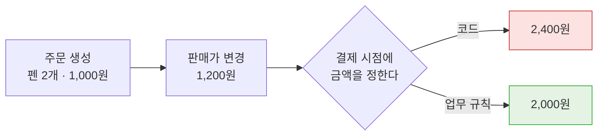
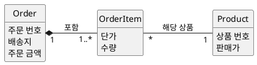
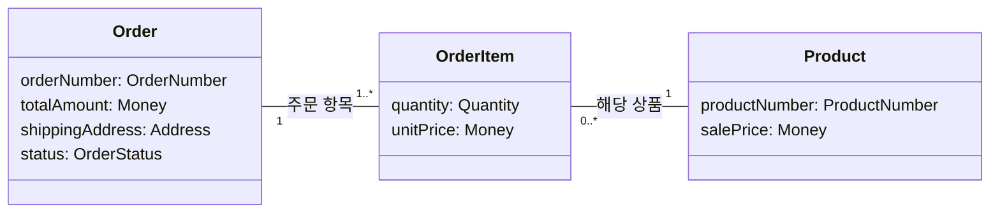

--------------------
Session 명: 04. 도메인 모델 — 정적 관점
--------------------

## 목차

01. 세션 목표
02. 다른 의미의 가격
03. 속성명을 구분하여 정확히 정의한다
04. 개념과 속성을 정의한다
05. 개념 사이의 관계를 정의한다
06. 무엇이 같은 주문인가?
07. 불변 조건을 정의한다
08. 데이터 모델도 설계 클래스도 아니다
09. 문법은 맞고 뜻이 틀린다
10. 맡기기 전에 묻는 4가지
11. 조건은 다이어그램에 없다
12. 모델이 코드의 타입이 된다
13. 잘못된 관행
14. 실습 4 — 정적 모델
15. 요약

## 01. 세션 목표

업무의 뜻을 **객체·속성·관계·조건**으로 정의하고, LLM이 생성한 모델에서 틀린 곳을 찾아낼 수 있다.

- 같은 의미일 때 **같은 명칭**을 사용한다. 가격이 변동되면 **판매가와 단가**를 구별해야 한다.
- 요구사항에서 **개념과 속성**을 정의한다.
- 관계의 **다중성과 선 모양**을 읽어 그 관계가 업무와 맞는지 판단한다.
- **언제나 참이어야 하는 조건**을 정의하고, 그것을 테스트한다.
- LLM 초안이 **근거 없이 단정한 것**을 질문으로 피드백한다.

**강사 노트**

- 입력은 "세션 03. 요구와 수용 기준"에서 확정한 요구사항 정의서다. 기능은 "주문한다" 하나다.
- 다이어그램을 그리는 절차는 가르치지 않는다. 읽고 틀린 곳을 찾는 것이 목적이다.

---

## 02. 다른 의미의 가격

"가격"이 **2가지 다른 의미**를 갖고 있어 코드는 틀릴 수 있다.

**도식 — Mermaid — 주문 금액이 갈린 자리**



- 코드는 결제 시점의 **판매가**를 읽었고, 업무 담당자는 주문 시점에 확정한 **단가**를 뜻했다.
- 속성명 하나가 2가지 뜻을 가지면 **테스트도 둘 중 하나만** 테스트한다.

**강사 노트**

- "세션 01. 사람의 일과 AI의 일"에서 업무 담당자 리뷰가 찾아낸 문제 3가지 가운데 첫째다.
- 확인에 사용하는 주문은 펜 2개, 판매가 각 1,000원, 배송지 서울이다. 금액은 2,000원이다.

---

## 03. 속성명을 구분하여 정확히 정의한다

모델은 다이어그램이 아니라 **객체와 속성명**에서 시작한다. 업무 담당자와 개발자가 같은 뜻으로 사용하는 말을 **보편 언어**(ubiquitous language)라 하고, 그 말과 뜻을 기록한 것이 용어집이다. "주문한다"에서 "가격"은 2가지 의미를 가지므로 분리하여 정의한다.

**표 — "주문한다"에서 정의한 속성명**
| 속성명 | 뜻 | 언제 정해지는가? |
|---|---|---|
| **판매가** | 상품의 지금 값 | 상품이 바뀔 때마다 |
| **단가** | 주문 항목이 확정한 값 | 주문이 생길 때 한 번 |
| **주문 금액** | 단가 × 수량의 합 | 단가가 정해지면 따라온다 |

- 모델·코드·테스트가 **정의된 속성**을 사용한다. 코드에서 새로운 속성을 정의하지 않는다.
- "가격"은 이제 사용하지 않는다. **2가지 의미**를 가진 속성명은 따로 정의한다.

**강사 노트**

- 영문 속성명은 과정 설계의 영한 용어집을 따른다 — `salePrice`, `unitPrice`, `totalAmount`.
- 수강생이 실습에서 다른 속성명을 선택해도 된다. 자기 용어집에 먼저 더하게 한다.

---

## 04. 개념과 속성을 정의한다

## 속성에 두지 않는 것

개념은 업무가 **알고 있어야 하는 것**만 속성으로 가진다. 주문은 주문 번호·배송지·주문 금액을, 주문 항목은 단가와 수량을 가진다. 판매가는 상품의 속성이다 — **판매가와 단가는 서로 다른 시점**의 값이기 때문이다.

**도식 — PlantUML — 주문 도메인 모델**



- 상품은 주문 안에 넣지 않는다. 상품은 **주문보다 오래 남고 따로 변경된다**.
- 화면에 보일 문자열, 저장 구조의 키, 외부 시스템의 응답 코드는 **속성으로 정의하지 않는다**.

**강사 노트**

- 이 다이어그램은 업무의 개념을 그린 것이다. 자바 클래스 선언으로 읽지 않게 한다.
- 배송지는 값이므로 속성으로 둔다. 선으로 다시 잇지 않는다(「09. 문법은 맞고 뜻이 틀린다」).

---

## 값 타입으로 정의한다

금액과 수량은 **값 자체로 구별되는 것**이므로 `long` 하나로 두지 않고 타입으로 정의한다. 0 이상·원 단위라는 업무 규칙을 `Money` 안에서 한 번만 정의하면 음수 금액은 만들어지지 않는다.

**표 — 숫자로 둘 때와 타입으로 둘 때**
| | `long amount` | `Money` |
|---|---|---|
| 음수를 막는 곳 | 사용하는 쪽마다 if | 만들 때 한 번 |
| 단위를 아는 곳 | 변수 이름 | 타입 |
| 더하는 규칙 | 호출하는 쪽 | `plus` 한 군데 |

```java
public record Money(long amount) {
    public Money {
        if (amount < 0) throw new IllegalArgumentException("금액은 0 이상이다");
    }
    public Money plus(Money other) { return new Money(amount + other.amount); }
}
```

- 값 타입은 **식별자가 없다**. 같은 금액이면 같은 값이고, 변경하지 않고 새로 만든다.

**강사 노트**

- 실습 3의 합의는 수량 1 이상 정수, 금액 0 이상 원 단위다.
- `Money`를 사용할지는 설계의 결정이다. 여기서는 **값으로 다룰 것**이라는 판단까지 한다.

---

## 05. 개념 사이의 관계를 정의한다

## 연관의 유형

클래스 사이의 선은 **4가지**다. 연관은 두 개념이 서로를 아는 관계이고, 합성과 집약은 전체와 부분의 관계이며, 일반화는 종류의 관계다. 선 모양이 그대로 업무 규칙을 의미한다.

**도식 — SVG — 연관의 4가지 유형**

```svg
<svg xmlns="http://www.w3.org/2000/svg" viewBox="0 0 960 340" width="960" height="340" font-family="sans-serif">
  <g>
    <rect x="6" y="10" width="948" height="74" rx="8" fill="#f8fafc" stroke="#64748b" stroke-width="1.5"/>
    <line x1="40" y1="47" x2="150" y2="47" stroke="#475569" stroke-width="2"/>
    <text x="190" y="53" font-size="16" font-weight="bold" fill="#1e293b">연관</text>
    <line x1="270" y1="20" x2="270" y2="74" stroke="#cbd5e1"/>
    <text x="296" y="40" font-size="13" fill="#334155">두 개념이 서로를 안다. 도메인 모델의 연관은 방향이 없는 양방향이다</text>
    <text x="296" y="66" font-size="13" fill="#8e2a1e">주문 항목과 상품</text>
  </g>
  <g>
    <rect x="6" y="94" width="948" height="74" rx="8" fill="#e8eff8" stroke="#2b5fa8" stroke-width="2"/>
    <polygon points="40,131 58,122 76,131 58,140" fill="#1b3f70"/>
    <line x1="76" y1="131" x2="150" y2="131" stroke="#1b3f70" stroke-width="2"/>
    <text x="190" y="137" font-size="16" font-weight="bold" fill="#1b3f70">합성</text>
    <line x1="270" y1="104" x2="270" y2="158" stroke="#9db8d8"/>
    <text x="296" y="124" font-size="13" fill="#1b3f70">전체가 사라지면 부분도 함께 사라진다. 부분은 혼자 존재하지 않는다</text>
    <text x="296" y="150" font-size="13" fill="#8e2a1e">주문이 주문 항목을 포함한다</text>
  </g>
  <g>
    <rect x="6" y="178" width="948" height="74" rx="8" fill="#f8fafc" stroke="#64748b" stroke-width="1.5"/>
    <polygon points="40,215 58,206 76,215 58,224" fill="#ffffff" stroke="#475569" stroke-width="2"/>
    <line x1="76" y1="215" x2="150" y2="215" stroke="#475569" stroke-width="2"/>
    <text x="190" y="221" font-size="16" font-weight="bold" fill="#1e293b">집약</text>
    <line x1="270" y1="188" x2="270" y2="242" stroke="#cbd5e1"/>
    <text x="296" y="208" font-size="13" fill="#334155">전체와 부분이지만 수명은 따로다. 전체가 사라져도 부분은 남는다</text>
    <text x="296" y="234" font-size="13" fill="#64748b">이 모델에는 없다</text>
  </g>
  <g>
    <rect x="6" y="262" width="948" height="74" rx="8" fill="#f8fafc" stroke="#64748b" stroke-width="1.5"/>
    <line x1="40" y1="299" x2="132" y2="299" stroke="#475569" stroke-width="2"/>
    <polygon points="150,299 132,289 132,309" fill="#ffffff" stroke="#475569" stroke-width="2"/>
    <text x="190" y="305" font-size="16" font-weight="bold" fill="#1e293b">일반화</text>
    <line x1="270" y1="272" x2="270" y2="326" stroke="#cbd5e1"/>
    <text x="296" y="292" font-size="13" fill="#334155">아래 개념이 위 개념을 대체할 수 있다. 종류를 나누는 표시가 아니다</text>
    <text x="296" y="318" font-size="13" fill="#64748b">이 모델에는 없다</text>
  </g>
</svg>
```

- 선 모양을 결정하기 전에 **수명과 대체 가능성**을 먼저 확인한다.
- 이 모델에 있는 것은 **연관과 합성 2가지**다. 없는 유형은 그리지 않는다.

**강사 노트**

- 4가지를 모두 정의하는 이유는 LLM 초안이 집약과 일반화를 근거 없이 사용하기 때문이다.
- 이 장은 표기를 소개하는 자리다. 그리는 절차는 "객체지향 분석과 설계 실무"가 맡는다.

---

## 연관을 읽는 법

주문과 주문 항목을 잇는 선 하나에 **3가지**가 적혀 있다. 연관명, 양 끝의 다중성, 선 끝의 마름모다. 3가지가 각각 다른 업무 규칙을 의미한다.

**도식 — SVG — 주문과 주문 항목의 연관**

```svg
<svg xmlns="http://www.w3.org/2000/svg" viewBox="0 0 960 150" width="960" height="150" font-family="sans-serif">
  <rect x="90" y="40" width="210" height="66" rx="6" fill="#eef2f7" stroke="#475569" stroke-width="1.5"/>
  <text x="195" y="80" font-size="17" text-anchor="middle" fill="#1e293b">주문</text>
  <rect x="660" y="40" width="210" height="66" rx="6" fill="#eef2f7" stroke="#475569" stroke-width="1.5"/>
  <text x="765" y="80" font-size="17" text-anchor="middle" fill="#1e293b">주문 항목</text>
  <polygon points="300,73 322,62 344,73 322,84" fill="#475569"/>
  <line x1="344" y1="73" x2="660" y2="73" stroke="#475569" stroke-width="2"/>
  <text x="502" y="60" font-size="15" text-anchor="middle" fill="#1e293b">포함</text>
  <text x="356" y="100" font-size="15" fill="#1e293b">1</text>
  <text x="614" y="100" font-size="15" fill="#1e293b">1..*</text>
</svg>
```

**표 — 선 하나에 적힌 3가지**
| 적힌 것 | 무엇을 의미하는가? |
|---|---|
| **채운 마름모** | 주문이 사라지면 주문 항목도 함께 사라진다 |
| **선 위의 연관명** | 주문이 주문 항목을 포함한다 |
| **양 끝의 `1`과 `1..*`** | 항목 없는 주문은 만들지 않는다 |

- 연관명이 없는 선은 두 개념이 **관계있다**는 것만 의미한다.
- 도메인 모델의 연관은 **방향이 없는 양방향**이다. 어느 쪽에서 탐색할지는 설계에서 결정한다.

**강사 노트**

- 역할 이름(role name)은 상대가 맡는 이름이다. 연관명과 구별해 읽게 한다.
- 연관에 화살표를 그리지 않는다. 탐색 방향은 "세션 07. 설계 — 책임과 협력"의 결정이다.

---

## 다중성이 생성자를 결정한다

관계의 양 끝에 적는 개수를 **다중성**이라 하고, 그 값이 그대로 코드의 생성자가 된다. 주문–주문 항목을 `1..*`로 정의하면 항목 없는 주문을 만들 수 없고, `0..*`로 정의하면 빈 주문이 허용되어 **주문 금액 합계 규칙이 깨진다**.

**표 — 다중성을 읽는 법**
| 적힌 것 | 읽는 법 | "주문한다"에서 |
|---|---|---|
| `1 — 1..*` | 한쪽에 **최소 하나** | 항목 없는 주문은 만들지 않는다 |
| `1 — 0..*` | 없어도 된다 | 빈 주문이 생길 수 있다 |
| `* — 1` | 많은 쪽이 하나와 연관된다 | 같은 상품이 여러 주문 항목에 나타난다 |

- 다중성 하나가 변경되면 **생성자와 테스트가 함께** 변경된다.
- 다중성이 틀려도 **컴파일은 된다**. 사람이 읽어야 찾아낸다.

**강사 노트**

- 초안의 다중성은 구체적인 주문(펜 2개)에 대입해 확인했다. 다이어그램이 아니라 예로 확인한다.
- 수량 상한은 이번에 결정하지 않는다. 미정으로 남긴다.

---

## 수명이 같으면 합성이다

합성과 집약을 가르는 기준은 **수명**이다. 주문을 지우면 그 주문 항목도 함께 사라지지만, 상품은 주문과 무관하게 남는다. 그래서 주문과 주문 항목은 **합성**이고, 주문 항목과 상품은 **연관**이다.

**도식 — SVG — 주문을 지울 때 일어나는 일**

```svg
<svg xmlns="http://www.w3.org/2000/svg" viewBox="0 0 960 340" width="960" height="340" font-family="sans-serif">
  <g>
    <rect x="20" y="20" width="450" height="300" rx="10" fill="#f6f8fb" stroke="#64748b" stroke-width="1.5"/>
    <text x="245" y="52" font-size="16" font-weight="bold" text-anchor="middle" fill="#1e293b">합성 — 주문과 주문 항목</text>
    <rect x="60" y="80" width="160" height="54" rx="6" fill="#fff" stroke="#475569"/>
    <text x="140" y="113" font-size="14" text-anchor="middle" fill="#1e293b">주문 #1001</text>
    <rect x="60" y="150" width="160" height="54" rx="6" fill="#fff" stroke="#475569"/>
    <text x="140" y="183" font-size="14" text-anchor="middle" fill="#1e293b">주문 항목 펜 2</text>
    <text x="255" y="145" font-size="20" fill="#8e2a1e">→</text>
    <rect x="290" y="80" width="150" height="124" rx="6" fill="#fdecec" stroke="#c0392b" stroke-dasharray="5 4"/>
    <text x="365" y="137" font-size="14" text-anchor="middle" fill="#8e2a1e">둘 다 사라진다</text>
    <text x="60" y="256" font-size="13" fill="#334155">주문 항목은 주문 밖에서 혼자 존재하지 않는다</text>
    <text x="60" y="288" font-size="13" fill="#64748b">채운 마름모로 그린다</text>
  </g>
  <g>
    <rect x="490" y="20" width="450" height="300" rx="10" fill="#f6f8fb" stroke="#64748b" stroke-width="1.5"/>
    <text x="715" y="52" font-size="16" font-weight="bold" text-anchor="middle" fill="#1e293b">집약 — 주문과 상품</text>
    <rect x="530" y="80" width="160" height="54" rx="6" fill="#fff" stroke="#475569"/>
    <text x="610" y="113" font-size="14" text-anchor="middle" fill="#1e293b">주문 #1001</text>
    <rect x="530" y="150" width="160" height="54" rx="6" fill="#fff" stroke="#475569"/>
    <text x="610" y="183" font-size="14" text-anchor="middle" fill="#1e293b">상품 펜</text>
    <text x="725" y="145" font-size="20" fill="#245128">→</text>
    <rect x="760" y="150" width="150" height="54" rx="6" fill="#e8f1e8" stroke="#2f6b35"/>
    <text x="835" y="183" font-size="14" text-anchor="middle" fill="#245128">상품은 남는다</text>
    <text x="530" y="256" font-size="13" fill="#334155">상품은 주문보다 오래 남고 따로 변경된다</text>
    <text x="530" y="288" font-size="13" fill="#64748b">마름모 없는 연관으로 그린다</text>
  </g>
</svg>
```

- 수명을 묻지 않고 "부분처럼 보이니 합성"으로 적으면 **지우는 규칙이 업무와 어긋난다**.
- 지우는 규칙은 저장 구조의 결정이 아니라 **업무의 결정**이다.

**강사 노트**

- 집약은 이 모델에 없다. 없는 것을 적지 않고, 구별하는 기준만 남긴다.

---

## 일반화는 분류가 아니다

위 개념이 사용되는 **모든 자리에 아래 개념을 그대로 넣을 수 있을 때만** 일반화다. 회원 주문과 비회원 주문을 나누고 싶다면 먼저 주문이 사용되는 모든 자리에 둘 다 들어갈 수 있는지 물어야 한다. 실습 3의 요구사항에는 그 근거가 없다.

**표 — 일반화인가, 속성인가**
| 나누고 싶은 것 | 일반화로 두면 | 이 모델의 판단 |
|---|---|---|
| 회원 주문 / 비회원 주문 | 주문이 사용되는 모든 자리에 둘 다 들어가야 한다 | **미정** — 요구에 근거가 없다 |
| 카드 결제 / 계좌 결제 | 결제 수단마다 다른 규칙이 있어야 한다 | 이번 범위 밖 |

- 종류를 나누고 싶을 뿐이면 **속성 하나**로 둔다. 선을 그어 타입을 늘리지 않는다.
- 요구에 없는 타입을 만드는 것이 LLM 초안에서 가장 흔한 **근거 없는 단정**이다.

**강사 노트**

- 실습 3의 요구사항에는 회원·비회원 구분이 없다. `Member` 같은 타입을 만들지 않는다.
- 대체할 수 있는지로 구별하는 설명은 "객체지향 분석과 설계 실무"의 LSP와 같은 기준이다.

---

## 06. 무엇이 같은 주문인가?

펜 2개를 두 번 주문하면 두 주문의 모든 값이 같다. 그래도 서로 **다른 주문**이고, 둘을 구별하는 것은 주문 번호다. 금액 2,000원과 2,000원은 값이 같으면 **같은 금액**이다. 무엇으로 같음을 보는지는 개념마다 다르다.

**도식 — SVG — 같은 값, 다른 주문**

```svg
<svg xmlns="http://www.w3.org/2000/svg" viewBox="0 0 960 340" width="960" height="340" font-family="sans-serif">
  <g>
    <rect x="20" y="20" width="560" height="300" rx="10" fill="#f6f8fb" stroke="#64748b" stroke-width="1.5"/>
    <text x="300" y="52" font-size="16" font-weight="bold" text-anchor="middle" fill="#1e293b">식별자로 본다 — 주문</text>
    <rect x="50" y="78" width="230" height="130" rx="6" fill="#fff" stroke="#475569"/>
    <text x="70" y="106" font-size="14" fill="#8e2a1e">주문 번호 1001</text>
    <text x="70" y="134" font-size="13" fill="#334155">펜 2개 · 2,000원</text>
    <text x="70" y="160" font-size="13" fill="#334155">배송지 서울</text>
    <text x="70" y="190" font-size="13" fill="#64748b">10시에 주문</text>
    <rect x="320" y="78" width="230" height="130" rx="6" fill="#fff" stroke="#475569"/>
    <text x="340" y="106" font-size="14" fill="#8e2a1e">주문 번호 1002</text>
    <text x="340" y="134" font-size="13" fill="#334155">펜 2개 · 2,000원</text>
    <text x="340" y="160" font-size="13" fill="#334155">배송지 서울</text>
    <text x="340" y="190" font-size="13" fill="#64748b">11시에 주문</text>
    <text x="50" y="254" font-size="13" fill="#334155">모든 값이 같아도 번호가 다르면 다른 주문이다</text>
    <text x="50" y="288" font-size="13" fill="#64748b">속성이 변경되어도 같은 주문이다</text>
  </g>
  <g>
    <rect x="600" y="20" width="340" height="300" rx="10" fill="#f6f8fb" stroke="#64748b" stroke-width="1.5"/>
    <text x="770" y="52" font-size="16" font-weight="bold" text-anchor="middle" fill="#1e293b">값으로 본다 — 금액</text>
    <rect x="630" y="78" width="130" height="60" rx="6" fill="#fff" stroke="#475569"/>
    <text x="695" y="114" font-size="14" text-anchor="middle" fill="#1e293b">2,000원</text>
    <rect x="780" y="78" width="130" height="60" rx="6" fill="#fff" stroke="#475569"/>
    <text x="845" y="114" font-size="14" text-anchor="middle" fill="#1e293b">2,000원</text>
    <text x="770" y="170" font-size="15" text-anchor="middle" fill="#245128">같은 금액이다</text>
    <text x="630" y="254" font-size="13" fill="#334155">금액·수량·배송지는 값으로 본다</text>
    <text x="630" y="288" font-size="13" fill="#64748b">변경되면 다른 값이 된다</text>
  </g>
</svg>
```

- 식별자는 **업무가 사용하는 번호**다. 저장 구조의 키를 모델에 올리지 않는다.
- 식별자의 **형식**(자릿수·발급 방법)은 이번에 결정하지 않는다.

**강사 노트**

- 주문 번호는 공통 전제의 식별자다. 세션 사이에서 속성명을 바꾸지 않는다.

---

## 07. 불변 조건을 정의한다

## 불변 조건은 테스트가 된다

주문 금액은 **언제나** 항목의 단가 × 수량의 합이다. 이렇게 언제나 참이어야 하는 조건을 **불변 조건**이라 한다. 모델에 정의한 그 문장이 그대로 테스트의 기대값이 된다 — 펜 2개를 1,000원에 주문하면 2,000원이다.

**표 — 조건과 그것을 확인하는 곳**
| 조건 | 적는 곳 | 확인하는 곳 |
|---|---|---|
| 주문 금액 = 단가 × 수량의 합 | 주문 | 금액 계산 테스트 |
| 항목이 **1개 이상** | 주문 — 주문 항목 | 생성자가 거절한다 |
| 수량은 1 이상 정수 | 주문 항목 | 값 타입이 거절한다 |

```java
@Test
void 주문_금액은_항목_단가와_수량의_합이다() {
    Order order = new Order(주문번호, List.of(항목(1_000, 2)));
    assertEquals(new Money(2_000), order.totalAmount());
}
```

- 불변 조건은 **그 시점에만 참인 조건**과 구별한다. "결제대기"는 지금 상태이고 불변 조건이 아니다.

**강사 노트**

- 상태 값의 전체 범위와 전이는 "세션 05. 동적 모델"에서 확인한다. 여기서는 지금 상태를 속성으로만 둔다.
- 2,000원은 「02. 다른 의미의 가격」에서 세운 주문의 금액이다.

---

## 파생 속성은 저장하지 않는다

다른 값에서 계산되는 값을 **파생 속성**이라 한다. 계산식만 정의하고 저장하지 않는다. 주문 금액을 단가·수량과 나란히 저장하면 **둘이 어긋나는 순간**이 온다.

**표 — 저장할 값과 계산할 값**
| 값 | 어디서 오는가? | 두는 방식 |
|---|---|---|
| 단가 | 주문이 생길 때 확정 | **저장한다** |
| 수량 | 고객이 정한다 | 저장한다 |
| 주문 금액 | 단가 × 수량의 합 | **계산식으로 둔다** |

- 계산식을 정의해 두면 금액이 틀렸을 때 **확인할 곳**이 한 군데다.
- 성능 때문에 저장하기로 하는 것은 설계의 결정이다. 업무의 뜻은 **계산식 쪽**이다.

**강사 노트**

- 모델에서 계산식으로 둔 값은 코드에서 메서드가 된다(「12. 모델이 코드의 타입이 된다」).

---

## 08. 데이터 모델도 설계 클래스도 아니다

같은 모양의 클래스 다이어그램이 **3가지 다른 것**을 의미할 수 있다. 도메인 모델은 업무가 무엇인지, 데이터 모델은 무엇을 저장하는지, 설계 클래스는 누가 무엇을 하는지에 답한다. 외래 키나 저장소가 들어온 다이어그램은 업무를 설명하지 않는다.

**표 — 3가지가 답하는 질문**
| | 도메인 모델 | 데이터 모델 | 설계 클래스 |
|---|---|---|---|
| 답하는 질문 | 업무가 **무엇인가?** | 무엇을 **저장하는가?** | 누가 **무엇을 하는가?** |
| 들어가는 것 | 개념·관계·조건 | 테이블·키·인덱스 | 책임·메서드·의존 |
| 이 모델에 없는 것 | — | 외래 키, 식별자 형식 | 서비스, 저장소 |

- 업무 개념이 코드의 클래스와 **하나씩 맞아떨어지지 않아도** 된다. 맞추려고 모델을 고치지 않는다.
- **책임과 협력**은 "세션 07. 설계 — 책임과 협력"의 결정이다.

**강사 노트**

- 분석과 설계를 표기 종류로 구별하지 않는다. 같은 클래스 표기로 둘 다 그린다.
- 3가지를 독립된 산출물로 나열하지 않는다. 같은 업무를 다른 관심으로 본 것이다.

---

## 09. 문법은 맞고 뜻이 틀린다

LLM이 생성한 초안은 표기를 거의 틀리지 않는다. 틀리는 것은 **업무의 뜻**이고, 표기의 정확성과 뜻의 정확성 사이의 차이를 **시맨틱 갭**(semantic gap)이라 한다.

**인용문**

LLM은 구문이 맞는 UML을 만들 수 있지만 **의미의 품질**에서 어려움을 겪고, 특히 다이어그램의 **규모가 커지면** 자연어와 잘 맞지 않는다, "Although LLMs can generate syntactically correct UML code, they are struggling with semantic quality and tend to align poorly with natural languages, especially when the diagram scale is large.", [Gao 외 2025]

**표 — 초안이 쓴 말과 사람이 내린 판단**
| 초안이 쓴 말 | 무엇이 문제인가? | 사람이 결정한 것 |
|---|---|---|
| "정확히 하나의 배송지가 확정된다" | 값을 **관계로 중복** 표현 | 배송지는 속성으로만 둔다 |
| "결제대기 또는 결제완료" | 확인한 값을 **전부라고 단정** | 확인한 값만 적고 나머지는 열어 둔다 |
| "회원 주문만 허용하는가" | 질문 — 요구에 근거 없음 | 미정으로 남긴다 |

- 3줄 모두 **문법은 맞다**. UML로도 맞고 문장으로도 읽힌다.
- 초안이 **질문으로 남긴 것**은 결함이 아니라, 사람이 결정할 자리를 드러낸 것이다.

**강사 노트**

- 첫 열은 실제 초안(`code/s04/exercise-conversation/order/codex-response-01.md`)의 문장을 줄인 것이다. 초안이 회원 타입을 실제로 만들었다고 설명하지 않는다.
- 인용 근거: [Gao 외 2025] 원문 확인. 규모가 커질수록 뜻의 품질이 떨어진다는 진단이다.

---

## 10. 맡기기 전에 묻는 4가지

초안을 생성하는 비용이 거의 0이 되면 사람에게 남는 일은 **읽고 판단하는 일**이다. 무엇이 쉬워졌고, 무엇이 달라지며, 무엇이 깨지고, 무엇을 갖춰야 하는지를 맡기기 전에 확인한다.

**도식 — SVG — 모델을 맡기기 전에 묻는 4가지**

```svg
<svg xmlns="http://www.w3.org/2000/svg" viewBox="0 0 960 340" width="960" height="340" font-family="sans-serif">
  <g>
    <rect x="6" y="10" width="948" height="74" rx="8" fill="#eef2f7" stroke="#64748b" stroke-width="1.5"/>
    <text x="34" y="53" font-size="16" font-weight="bold" fill="#1e293b">쉬워진 일</text>
    <line x1="230" y1="20" x2="230" y2="74" stroke="#94a3b8"/>
    <text x="256" y="40" font-size="13" fill="#334155">요구사항 문서를 읽고 클래스 다이어그램을 몇 초에 생성한다</text>
    <text x="256" y="66" font-size="13" fill="#334155">조건과 미정 사항도 확인할 질문과 함께 적어 준다</text>
  </g>
  <g>
    <rect x="6" y="94" width="948" height="74" rx="8" fill="#eef2f7" stroke="#64748b" stroke-width="1.5"/>
    <text x="34" y="137" font-size="16" font-weight="bold" fill="#1e293b">달라지는 것</text>
    <line x1="230" y1="104" x2="230" y2="158" stroke="#94a3b8"/>
    <text x="256" y="124" font-size="13" fill="#334155">표기와 문법은 거의 틀리지 않는다</text>
    <text x="256" y="150" font-size="13" fill="#334155">초안을 생성하는 비용이 거의 들지 않아 고치는 것보다 다시 받는 것이 빠르다</text>
  </g>
  <g>
    <rect x="6" y="178" width="948" height="74" rx="8" fill="#fdecec" stroke="#c0392b" stroke-width="1.5"/>
    <text x="34" y="221" font-size="16" font-weight="bold" fill="#8e2a1e">깨지는 것</text>
    <line x1="230" y1="188" x2="230" y2="242" stroke="#d98b80"/>
    <text x="256" y="208" font-size="13" fill="#3b1f1a">업무의 뜻이 틀린다 — 근거 없는 단정, 틀린 다중성, 빠진 조건</text>
    <text x="256" y="234" font-size="13" fill="#3b1f1a">읽지 않고 받으면 그 모델이 다음 세션의 입력이 된다</text>
  </g>
  <g>
    <rect x="6" y="262" width="948" height="74" rx="8" fill="#e8f1e8" stroke="#2f6b35" stroke-width="1.5"/>
    <text x="34" y="305" font-size="16" font-weight="bold" fill="#245128">갖춰야 할 것</text>
    <line x1="230" y1="272" x2="230" y2="326" stroke="#8ab08e"/>
    <text x="256" y="292" font-size="13" fill="#1f2e20">다이어그램과 조건을 함께 적은 문서를 사람이 읽고 판단한다</text>
    <text x="256" y="318" font-size="13" fill="#1f2e20">조건은 테스트로 만들어 변경될 때마다 다시 확인한다</text>
  </g>
</svg>
```

- 바뀌지 않는 것은 **업무의 개념**이다. 바뀌는 것은 초안을 누가 생성하는가다.

**강사 노트**

- 이 4가지는 과정 전체의 반복 틀이다. 세션마다 같은 자리에서 같은 4가지를 묻는다.

---

## 11. 조건은 다이어그램에 없다

클래스 다이어그램이 담는 것은 개념·속성·관계·다중성까지다. 단가가 "주문 생성 시점에 확정한 값"이라는 **뜻**도, 주문 금액이 언제나 단가 × 수량의 합이라는 **조건**도, 회원 구분을 미정으로 남긴 **이유**도 다이어그램에는 적을 자리가 없다. 그래서 정적 모델은 **문서 하나**로 작성하고, 다이어그램은 그 문서의 한 절이 된다.

**도식 — SVG — 정적 모델 문서의 4개 절**

```svg
<svg xmlns="http://www.w3.org/2000/svg" viewBox="0 0 960 392" width="960" height="392" font-family="sans-serif">
  <rect x="6" y="6" width="948" height="42" rx="8" fill="#e2e8f0" stroke="#475569" stroke-width="1.5"/>
  <text x="34" y="34" font-size="16" font-weight="bold" fill="#1e293b">주문한다-정적모델.md — 문서 하나</text>
  <g>
    <rect x="6" y="58" width="948" height="74" rx="8" fill="#f8fafc" stroke="#64748b" stroke-width="1.5"/>
    <text x="34" y="101" font-size="16" font-weight="bold" fill="#1e293b">1. 용어와 속성</text>
    <line x1="250" y1="68" x2="250" y2="122" stroke="#cbd5e1"/>
    <text x="276" y="88" font-size="13" fill="#334155">판매가·단가·주문 금액이 각각 무슨 뜻인지 정의한다</text>
    <text x="276" y="114" font-size="13" fill="#8e2a1e">용어집에 없는 속성명이 있는가?</text>
  </g>
  <g>
    <rect x="6" y="142" width="948" height="74" rx="8" fill="#e8eff8" stroke="#2b5fa8" stroke-width="2"/>
    <text x="34" y="185" font-size="16" font-weight="bold" fill="#1b3f70">2. 다이어그램과 관계</text>
    <line x1="250" y1="152" x2="250" y2="206" stroke="#9db8d8"/>
    <text x="276" y="172" font-size="13" fill="#1b3f70">개념·속성·관계·다중성을 클래스 다이어그램으로 그린다 — 여기까지가 다이어그램이다</text>
    <text x="276" y="198" font-size="13" fill="#8e2a1e">다중성과 수명이 업무와 맞는가?</text>
  </g>
  <g>
    <rect x="6" y="226" width="948" height="74" rx="8" fill="#f8fafc" stroke="#64748b" stroke-width="1.5"/>
    <text x="34" y="269" font-size="16" font-weight="bold" fill="#1e293b">3. 조건과 대표 예</text>
    <line x1="250" y1="236" x2="250" y2="290" stroke="#cbd5e1"/>
    <text x="276" y="256" font-size="13" fill="#334155">주문 금액 = 단가 × 수량의 합. 펜 2개를 1,000원에 주문하면 2,000원이다</text>
    <text x="276" y="282" font-size="13" fill="#8e2a1e">언제나 참인가, 예로 확인했는가?</text>
  </g>
  <g>
    <rect x="6" y="310" width="948" height="74" rx="8" fill="#f8fafc" stroke="#64748b" stroke-width="1.5"/>
    <text x="34" y="353" font-size="16" font-weight="bold" fill="#1e293b">4. 정하지 않은 것</text>
    <line x1="250" y1="320" x2="250" y2="374" stroke="#cbd5e1"/>
    <text x="276" y="340" font-size="13" fill="#334155">회원 구분·식별자 형식·수량 상한을 이유와 함께 남긴다</text>
    <text x="276" y="366" font-size="13" fill="#8e2a1e">근거 없이 확정한 것이 있는가?</text>
  </g>
</svg>
```

- 같은 것을 두 번 적지 않는다. 글로 정의하는 것은 **다이어그램에 적을 자리가 없는 것**이다.
- 객체명·속성명의 뜻은 **용어집**에, 이번 기능의 조건과 미정은 **이 문서**에 있다. 용어집은 세션을 가로질러 자라고, 문서는 기능마다 하나다.

**강사 노트**

- 별첨의 「“주문한다” 정적 업무 모델」이 이 문서다. 4개 절이 그대로 보인다.
- 다이어그램을 따로 떼어 별도 산출물로 관리하지 않는다. 실습 4의 결과물이 이 문서이고 실습 5의 투입물이 된다.

---

## 12. 모델이 코드의 타입이 된다

모델의 요소마다 코드와 검사에서 **대응하는 자리**가 있다. 개념은 타입이 되고, 다중성 `1..*`는 빈 목록을 거절하는 생성자가 되며, 파생 속성은 `totalAmount()` 메서드가 된다.

**표 — 모델 요소가 가는 자리**
| 모델의 요소 | 코드 | 검사 |
|---|---|---|
| 개념 | 타입(`Order`) | 컴파일 |
| 속성 | 필드(`unitPrice`) | — |
| 값 타입 | 값 객체(`Money`) | 만들 때 거절 |
| 다중성 `1..*` | 생성자가 빈 목록을 거절 | 단위 테스트 |
| 파생 속성 | 메서드(`totalAmount()`) | 금액 계산 테스트 |
| 용어집의 속성명 | 필드·메서드 이름 | 속성명 대조 |

- 용어집의 속성명과 코드의 필드명을 맞추는 것이 **모델과 코드가 맞는지** 보는 검사다.
- 모델을 정의하지 않고 코드를 맡기면 LLM이 **모델을 추측으로 채운다**.
- 검사를 **하나의 명령으로** 모으는 일은 "세션 09. 검사 파이프라인"에서 다룬다.

**강사 노트**

- 속성명 대조는 사람이 눈으로 하지 않아도 된다. 검사로 만들 수 있다는 것만 짚는다.

---

## 13. 잘못된 관행

잘못된 관행은 모두 같다 — **다이어그램은 늘어나는데 결정은 비어 있다**. 5가지 모두 모델의 양을 늘릴 뿐 "무엇이 언제나 참이어야 하는가"에 답하지 않는다.

**표 — 자주 보는 잘못**
| 관행 | 그래서 생기는 일 |
|---|---|
| 용어집 없이 코드에서 속성명을 만든다 | 같은 것이 **2가지 명칭**으로 불린다 |
| 속성에 화면 문자열·저장 키를 넣는다 | 업무가 바뀌지 않았는데 모델이 바뀐다 |
| 다중성을 전부 `0..*`로 둔다 | 빈 주문이 합법이 되고 합계 규칙이 무너진다 |
| 종류마다 타입을 만든다 | 요구에 없는 개념이 쌓인다 |
| 초안을 읽지 않고 받는다 | **문법만 맞는 모델**이 다음 세션의 입력이 된다 |

- 모델은 **적게 적고 정확히** 적는다. 다이어그램의 크기가 품질이 아니다.

**강사 노트**

- 마지막 줄은 이 과정 전체의 실패 방식이다. 세션마다 같은 모양으로 돌아온다.

---

## 14. 실습 4 — 정적 모델

②~④에 **질문의 답과 수정 요청**을 적어 도메인 모델의 정적 구조를 완성한다.

**투입물**
  + 실습 3의 **요구사항 정의서**(`주문한다-요구사항-정의서.md`)

**프롬프트 — 요청사항 포함**
  + ① "실습 3의 요구사항 정의서로 **도메인 모델의 정적 구조**를 제안해라. 용어와 속성, 클래스 다이어그램과 관계, 조건과 대표 예, 정하지 않은 것을 **한 문서**에 담고 없는 정책은 질문해라. 설계·구현·상태 전이는 만들지 마라."
  + ② "[앞선 질문에 대한 답]과 [추가 질문·수정 요청]을 적는다. **근거 없는 개념·속성**을 걸러내고 지금 판매가와 확정된 단가를 구별해라."
  + ③ "[앞선 질문에 대한 답]과 [추가 질문·수정 요청]을 적는다. **관계의 다중성·값의 범위·불변 조건**을 구체적인 주문에 대입해 확인하고 생성 시점과 변경 뒤의 조건을 구별해라."
  + ④ "[앞선 질문에 대한 답]과 [추가 질문·수정 요청]을 적는다. **다이어그램과 글의 객체·속성·관계·조건**을 대조하고 필요한 미정만 이유와 함께 남겨라."
  + ⑤ "합의한 **도메인 모델의 정적 관점을 Markdown 파일**로 생성해라. 객체·속성·관계·조건·클래스 다이어그램 원본과 대표 예를 보존하고 새 정책·설계는 추가하지 마라."

**점검 항목**
  1. **근거** — 요구에 없는 개념·속성을 확정했는가?
  2. **뜻** — 판매가와 단가의 시점이 구별되는가?
  3. **관계** — 다이어그램과 글의 대상·다중성이 같은가?
  4. **조건** — 합계·값의 범위·변경 전후를 예로 확인했는가?
  5. **경계** — 구현 결정과 미정 정책을 섞지 않았는가?

**결과물**
  + `주문한다-정적모델.md` — 도메인 모델의 정적 관점을 담아 저장소의 `docs`에 두고 커밋한다. **실습 5의 투입물**이며 요구사항 정의서와 함께 첨부한다

**강사 노트**

- 실제 실행 입력은 `code/s04/exercise-conversation/order/input-s03.md`다. 전체 입력·실제 응답은 같은 폴더에 보존한다.
- ①~⑤는 고정된 대화 횟수가 아니다. 실제 후속 요청은 받은 응답의 질문에 답하고 발견한 문제를 적는다.
- 대화창에서 다이어그램을 그려 보게 한다. 코드만 보이는 환경의 확인은 시각 검토가 아니다.
- ※ 현행화 기준: 단가의 정의와 수량·금액·항목 수의 합의는 실습 3의 요구사항 정의서에 반영한다. 상태·결제 이력·회원 정책의 미정은 확정하지 않는다.

---

## 15. 요약

### 세션 핵심

- 같은 의미일 때 같은 명칭을 사용한다. **용어집이 코드의 속성명을 결정한다**.
- 관계의 **다중성과 선 모양**이 업무 규칙이고, 틀려도 컴파일로는 찾아내지 못한다.
- **불변 조건**은 모델에 정의한 문장과 테스트가 확인하는 값이 같은 하나다.
- LLM 초안은 문법이 맞고 뜻이 틀린다. 그래서 **조건과 미정까지 정의한 문서**로 판단한다.

### 다음 세션

"세션 05. 동적 모델"은 같은 모델에서 **사건이 상태를 어떻게 변경하는지**를 정의한다.

**강사 노트**

- 모델에서 보완된 것 — 용어집에 단가를 추가하고, 주문과 주문 항목의 다중성을 1..*로 바로잡았으며, 회원 구분은 미정으로 남겼다.
- 동적 관점은 다음 세션이 맡는다. 여기서 상태와 전이를 미리 설명하지 않는다.

---

## 별첨. 실습 답

## “주문한다” 정적 업무 모델

**실제 LLM 응답**

**문서 형식 — 10pt**

이 정적 모델은 주문·주문 항목·상품의 관계와, 주문 생성 시점의 판매가를 단가로 확정하여 각 항목의 확정 단가에 수량을 곱한 금액의 합계로 주문 금액을 유지하는 조건을 명시한다.

### 1. 용어와 속성

- 주문 `Order`
  - `orderNumber: OrderNumber`: 주문 식별 값
  - `totalAmount: Money`: 주문 항목별 확정 단가와 수량으로 계산한 주문 금액
  - `shippingAddress: Address`: 주문 생성 시 확정된 배송지
  - `status: OrderStatus`: 주문의 현재 상태

- 주문 항목 `OrderItem`
  - `quantity: Quantity`: 주문한 상품의 수량
  - `unitPrice: Money`: 주문 생성 시점의 `salePrice`로 확정된 단가

- 상품 `Product`
  - `productNumber: ProductNumber`: 상품 식별 값
  - `salePrice: Money`: 상품의 현재 판매가

- `Money`: 원 단위의 0 이상 정수
- `Quantity`: 1 이상의 정수
- `Address`: 주문에 확정된 배송지 값
- `OrderNumber`: 주문 식별 값
- `ProductNumber`: 상품 식별 값
- `OrderStatus`: 주문의 현재 상태 값. 현재 확인된 값은 `PENDING_PAYMENT`와 `PAID`이며 가능한 상태 전체가 확정된 것은 아니다.

### 2. 클래스 도식과 관계

관계선은 업무상 관계와 개수만 나타내며 연관 방향이나 저장 방식을 정하지 않는다.



1. 하나의 `Order`에는 `OrderItem`이 1개 이상 있다.
2. 하나의 `OrderItem`은 정확히 하나의 `Order`에 속한다.
3. 하나의 `OrderItem`은 정확히 하나의 `Product`에 해당한다.
4. 하나의 `Product`는 0개 이상의 `OrderItem`과 관계를 맺을 수 있다.

### 3. 조건과 대표 예

- `salePrice`, `unitPrice`, `totalAmount`는 원 단위의 0 이상 정수다.
- `quantity`는 1 이상의 정수다.
- 하나의 `Order`에는 `OrderItem`이 1개 이상 있고 `shippingAddress`가 존재한다.
- 유효한 주문에서는 다음 합계 등식이 항상 성립한다.

  ```text
  Order.totalAmount
  = Σ(OrderItem.unitPrice × OrderItem.quantity)
  ```

- `unitPrice`는 장바구니에 담은 시점이 아니라 `Order` 생성 시점의 해당 `Product.salePrice`로 확정된다.
- 생성 이후 현재 `salePrice`가 변경되어도 기존 `unitPrice`와 `totalAmount`는 변하지 않는다.
- `PENDING_PAYMENT`인 기존 주문에서는 주문 항목의 구성, 각 항목의 `quantity`와 `unitPrice`, `shippingAddress`가 변경되지 않는다.

대표 주문과 판매가 변경 전후는 다음과 같다.

| 값 | 주문 생성 직후 | 판매가 변경 후 |
|---|---:|---:|
| 상품 | 펜 | 펜 |
| `OrderItem` 수 | 1 | 1 |
| `Product.salePrice` | 1,000원 | 1,200원 |
| `OrderItem.unitPrice` | 1,000원 | 1,000원 |
| `OrderItem.quantity` | 2 | 2 |
| `Order.totalAmount` | 2,000원 | 2,000원 |
| `Order.shippingAddress` | 서울 | 서울 |

생성 시점에는 `unitPrice = salePrice = 1,000원`이고, `totalAmount = 1,000원 × 2 = 2,000원`이다. 이후 현재 판매가가 1,200원으로 바뀌어도 기존 주문은 확정 단가 1,000원과 총액 2,000원을 유지한다.

### 4. 정하지 않은 항목과 기존 업무 미정

본인 주문에 대해서만 조회 또는 변경 요청의 권한을 인정하며 다른 고객의 주문 요청은 거절한다. 주문자와 수령인은 같은 사람으로 본다. 다만 회원·비회원 여부와 주문 주체, 본인 확인, 주문자 및 수령인을 나타낼 구체 타입이나 식별 정보는 정하지 않는다.

정적 모델에서 다음 사항은 정하지 않는다.

- `OrderNumber`와 `ProductNumber`의 형식 및 생성 규칙
- `Address`의 세부 항목
- `Quantity`의 구체적인 상한
- 동일 상품 주문 항목의 병합 여부와 중복 허용 여부
- 결제 이력과 승인 결과의 보존 구조
- 현재 확인된 값 이외의 `OrderStatus`

기존 업무 미정은 다음과 같다.

- 결제대기 기한과 만료 정책
- 결제 응답을 확정할 수 없을 때의 처리와 재결제 허용 여부
- 재고 판단 시점과 승인 전 재고 부족 처리
- 카드 승인 뒤 재고 부족 처리
- 배송 요청 실패 처리와 재요청 기준
- 주문 결과의 별도 통지 여부와 담당 시스템

이 미정 사항에서 허용 또는 금지 정책, 새로운 개념이나 상태를 도출하지 않는다.

**강사 노트**

- 실제 최종 응답의 전문이다. 원본은 `code/s04/exercise-conversation/order/주문한다-정적모델.md`이며 문장·도식·표·원래 강조를 편집하지 않았다. 제목 단계와 목록 들여쓰기만 Session Source 형식으로 변환했다.
- 사용자 배치 요청으로 Mermaid에 `direction LR` 한 줄만 추가해 클래스를 가로로 배치했다. 도식은 위, 설명은 아래에 둔다.
- 본문의 「09. 문법은 맞고 뜻이 틀린다」가 고친 3줄은 이 최종 응답에 이미 반영돼 있다.
