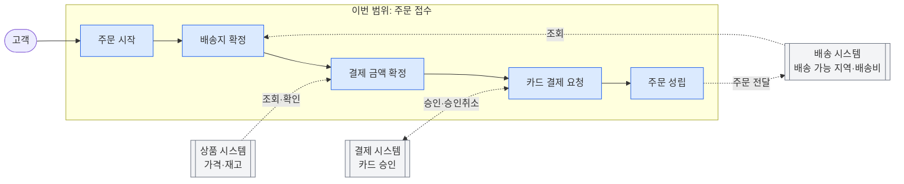
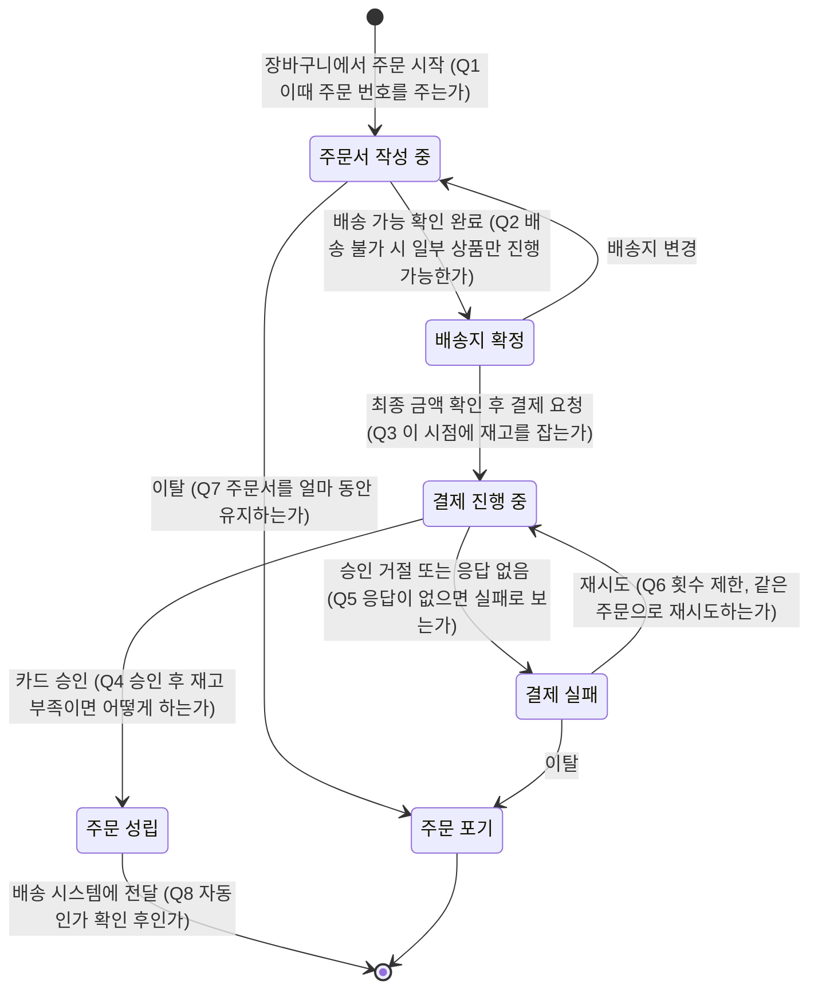

# 배송지 지정부터 카드 결제 완료까지: 요구사항 정의 전에 정할 업무 조건

범위를 다음과 같이 좁혔습니다.

- **다루는 것**: 고객이 장바구니에서 주문을 시작해 배송지를 정하고 카드 결제를 마쳐 주문이 성립할 때까지
- **외부 시스템(이미 운영 중)**: 상품(가격·재고), 결제(카드 승인), 배송
- **제외**: 화면 구성, 기술 설계, 결제 후의 배송 진행, 취소·환불·반품, 카드 외 결제 수단

그래서 이번에 정할 것은 크게 두 가지입니다. 하나는 **이 구간 안의 업무 규칙**이고, 다른 하나는 **외부 시스템과 책임을 어떻게 나누는지**입니다.

---

## 1. 범위 경계: 무엇을 판단하고 무엇을 외부에 맡기는가

외부 시스템이 이미 있으므로 "어느 시스템의 판단을 최종으로 보는가"를 업무 담당자와 정해야 합니다.

| 정할 것 | 예시 선택지 |
|---|---|
| 판매 가격의 기준 | 상품 시스템이 결제 시점에 알려 주는 가격 / 장바구니에 담을 때의 가격 |
| 재고 판단의 기준 | 상품 시스템의 판단을 그대로 따름 / 주문 쪽에서 별도 기준을 둠 |
| 배송 가능 지역과 배송비를 정하는 쪽 | 배송 시스템 / 주문 쪽 업무 규칙 |
| 결제 성공의 기준 | 결제 시스템의 승인 결과 하나만 인정하는가 |
| 주문 성립 후 배송 시스템에 넘기는 시점과 내용 | 결제 완료 즉시 / 운영자 확인 후. 넘기는 항목(배송지, 상품, 수량, 요청사항) |

## 2. 용어 정의

| 용어 | 정해야 할 것 |
|---|---|
| 주문 시작 | 장바구니 전체를 주문하는가, 고객이 고른 상품만 주문하는가 |
| 주문 성립 | 카드 승인이 완료된 때인가, 승인 후 재고 확정까지 끝난 때인가 |
| 결제 완료 | 카드 승인 시점과 같은가 (매입 시점과는 구분) |
| 주문자와 수령인 | 같은 사람이어야 하는가, 선물 주문처럼 다를 수 있는가 |
| 카드 결제 | 신용·체크카드만인가, 카드 기반 간편결제도 포함하는가. 법인카드와 해외 발급 카드도 받는가 |

## 3. 주문 접수 상태와 전이 시점

Q로 표시한 곳이 업무 담당자에게 확인할 질문입니다.

## 4. 배송지 조건

| 정할 것 | 왜 필요한가 |
|---|---|
| 비회원 주문을 허용하는가 | 배송지 저장, 주문자 확인 방법이 달라집니다. |
| 필수 입력 항목 | 수령인 이름, 연락처, 주소, 우편번호, 배송 요청사항 중 무엇이 필수인지 정합니다. |
| 배송지 목록 저장과 기본 배송지 | 회원의 주소록을 이번 범위에서 관리하는지 정합니다. |
| 한 주문에 배송지를 여러 개 지정할 수 있는가 | 지정할 수 있으면 주문 하나를 여러 배송 건으로 나눠야 합니다. |
| 배송 불가 지역, 도서산간 | 차단하는지, 추가 배송비를 받는지, 상품마다 다른지 정합니다. |
| 해외 배송지 | 받는지, 받지 않는지 정합니다. |
| 배송지를 바꿀 수 있는 마지막 시점 | 이번 범위에서는 결제 요청 전까지만 바꿀 수 있게 하고, 결제 후 변경은 범위 밖으로 둘지 정합니다. |

## 5. 결제 금액 확정 조건

| 정할 것 | 왜 필요한가 |
|---|---|
| 가격이 바뀌었을 때 | 장바구니에 담은 뒤 가격이 바뀌면 고객에게 알리고 다시 확인받는지 정합니다. |
| 배송비 계산 규칙 | 무료배송 기준 금액, 묶음배송, 도서산간 추가비를 정합니다. |
| 쿠폰, 적립금, 즉시할인 | 이번 범위에 넣는지 정합니다. 넣는다면 어느 시스템이 할인을 관리하는지도 정해야 합니다. |
| 최소·최대 주문 금액, 1인당 구매 수량 제한 | 결제 요청 전에 확인할 항목이 됩니다. |
| 금액 확정 시점 | 고객이 최종 금액을 확인한 뒤 결제 직전까지 금액이 바뀌면 어떻게 하는지 정합니다. |

## 6. 재고 조건

| 정할 것 | 선택지 예시 |
|---|---|
| 재고를 확인하는 시점 | 주문 시작 / 결제 요청 직전 / 승인 후 |
| 재고를 잡아 두는가, 얼마 동안인가 | 결제 진행 중 N분 동안 잡아 둠 / 잡지 않고 승인 후 확정 |
| 결제 중에 품절되면 | 결제 전에 막음 / 승인 후 자동으로 승인을 취소하고 고객에게 알림 |
| 일부 상품만 품절되면 | 주문 전체를 막음 / 품절 상품을 빼고 진행할지 고객에게 물음 |

## 7. 카드 결제 조건과 예외

| 정할 것 | 왜 필요한가 |
|---|---|
| 할부 허용 여부와 개월 수, 무이자 할부 조건 | 금액 기준이나 카드사별 조건이 있는지 정합니다. |
| 결제를 마쳐야 하는 시간 | 그 시간이 지나면 주문서를 어떻게 처리하는지 정합니다. |
| 승인 거절 시 고객에게 알릴 내용 | 거절 사유를 어디까지 알려 주는지, 다른 카드로 다시 시도할 수 있는지 정합니다. |
| 승인됐는데 주문이 성립하지 못하면 | 재고 부족 등으로 주문이 성립하지 못할 때 승인 취소를 자동으로 할지, 고객에게 언제까지 알릴지 정합니다. |
| 승인이 두 번 된 경우 | 한 주문에 승인이 두 건 생기면 어떻게 처리하고 누가 확인하는지 정합니다. |
| 결제 결과를 알 수 없는 경우 | 결제 시스템 응답이 없을 때 고객에게 "실패"로 안내하는지, "확인 중"으로 안내하는지, 최종 확인은 누가 언제 하는지 정합니다. |
| 결제 시스템이 멈췄을 때 | 주문 접수를 중단하는지, 안내만 하는지 정합니다. |

## 8. 주문 성립 직후의 처리

이번 범위의 마지막 단계이므로 다음을 정해야 합니다.

- **주문 확인 통지**: 누구에게, 어떤 수단(문자, 알림톡, 이메일)으로, 어떤 내용을 보내는지 정합니다. 통지가 이번 범위에 들어가는지도 정합니다.
- **배송 시스템에 전달하지 못했을 때**: 주문은 성립했는데 전달이 실패하면 누가 언제 다시 처리하는지 정합니다.
- **운영자 확인 단계**: 고액 주문이나 의심 주문을 운영자가 확인한 뒤 넘기는 절차가 필요한지 정합니다.

## 9. 법규 조건

- **결제 전 고지와 확인**: 전자상거래법에 따라 결제 전에 상품, 가격, 배송비, 청약철회 조건 같은 거래 조건을 알리고, 고객이 주문 내용을 확인하고 정정할 기회를 줘야 합니다. 고지할 항목 목록을 업무 담당자와 확정하세요.
- **주문 확인 통지**: 청약을 받았다는 사실을 고객에게 지체 없이 알려야 합니다(8절과 연결).
- **기록 보존**: 계약·대금결제 기록은 5년 동안 보존해야 합니다. 이 기록을 주문 쪽과 결제 시스템 중 어디서 보존하는지 정합니다.
- **개인정보**: 수령인 정보를 배송 시스템에 넘기는 것이 동의받은 이용 범위에 들어가는지, 비회원 정보는 얼마 동안 보존하는지 정합니다.

---

## 먼저 정해야 할 5가지

1. **주문 성립의 기준**: 카드 승인만으로 성립하는지, 재고 확정까지 끝나야 성립하는지
2. **외부 시스템별 최종 판단 주체**: 가격, 재고, 배송 가능 여부, 배송비를 각각 어느 시스템이 정하는지
3. **재고 확인·선점 시점과 결제 중 품절 처리**
4. **승인 후 주문이 성립하지 못하거나 결제 결과를 알 수 없을 때 고객에게 어떻게 처리하는지**
5. **범위에 넣을지 여부**: 비회원 주문, 쿠폰·적립금, 여러 배송지, 주문 확인 통지

## 이번 범위에서 빠진 항목 (명시해 둘 것)

- 결제 후 배송지 변경, 주문 취소, 환불, 반품, 교환
- 출고, 송장, 배송 추적 (배송 시스템 담당)
- 무통장입금, 계좌이체 등 카드 외 결제 수단
- 화면 구성과 기술 설계

빠진 항목도 "이번에 하지 않는다"는 결정으로 기록해 두세요. 그래야 개발 중에 범위가 슬그머니 넓어지지 않습니다. 회의 기록은 앞에서 말한 대로 "질문 / 선택지 / 결정 / 결정한 사람 / 날짜" 표를 그대로 쓰면 됩니다.