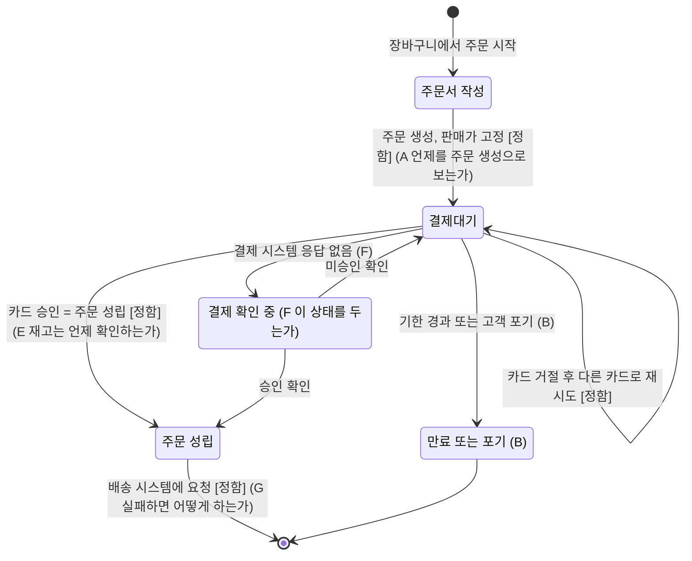

# 요구사항을 쓰기 전에 더 정해야 할 조건

답하신 다섯 항목(주문 금액, 배송 요청, 결제 거절, 주문 성립과 재고, 수령인과 결제 수단)은 모두 결정된 것으로 봅니다. 그 밖에 꼭 정해야 할 조건이 더 있습니다. 대부분은 이번 결정들을 함께 적용했을 때 새로 생기는 빈칸입니다.

특히 다음 두 곳은 지금 결정만으로는 요구사항이 서로 부딪힙니다.

- **가격은 주문할 때 고정되는데 결제대기에는 끝이 없습니다.** 고객이 몇 주 뒤에 예전 가격으로 결제할 수 있습니다.
- **주문은 카드 승인으로 성립하는데 재고는 상품 시스템이 판단합니다.** 승인은 났는데 재고가 없으면, 주문은 성립했지만 배송할 수 없게 됩니다.

---

## 결정을 반영한 흐름과 남은 질문

`[정함]`은 이미 결정된 전이이고, 알파벳은 아래 절의 번호입니다.

---

## 지금 꼭 정해야 할 조건

### A. "주문이 생기는 때"가 언제인가

- **정할 것**: 주문서에 들어간 때, 배송지를 확정한 때, 처음 결제를 요청한 때 가운데 어느 때를 주문 생성으로 보는지 정합니다.
- **이유**: "주문이 생길 때의 판매가로 청구한다"는 결정은 이 시점이 정해져야 적용할 수 있습니다. 시점에 따라 고정되는 가격이 달라지고, 결제대기 상태가 시작되는 때와 주문 번호를 주는 때도 달라집니다.

### B. 결제대기를 얼마 동안 유지하고, 끝나면 어떻게 하는가

- **정할 것**: 결제대기를 유지하는 기한, 기한이 지났을 때 주문을 처리하는 방법, 고객이 결제대기 주문을 직접 포기할 수 있는지 정합니다.
- **이유**: 거절돼도 주문을 취소하지 않고 결제대기로 남기기로 했으므로, 기한이 없으면 결제대기가 끝나지 않습니다. 그러면 판매가가 올라도 예전 가격으로 언제든 결제할 수 있습니다. 미결제 주문이 계속 쌓이고 재고 판단도 낡은 정보가 됩니다.
- **참고**: 결제하지 않은 주문을 끝내는 일은 환불이 없으므로, 범위에서 뺀 "취소·환불"과 다릅니다. 이번 범위에 넣어야 합니다.

### C. 고정되는 "주문 금액"에 무엇이 들어가는가

- **정할 것**
  - 판매가만 고정하는지, 배송비도 고정하는지 정합니다.
  - 쿠폰이나 할인이 이번 범위에 들어가는지 정합니다.
  - 결제 전에 판매가가 **내려간** 경우를 정합니다.
- **이유**: 지금 결정은 판매가가 오른 경우만 다룹니다. 가격이 내렸는데 주문할 때의 높은 금액을 청구하면 민원이 생기기 쉬우므로, 내렸을 때 어떻게 할지도 명시해야 합니다. 배송비는 배송지에 따라 달라지므로 D와도 이어집니다.

### D. 결제대기 중에 주문 내용을 바꿀 수 있는가

- **정할 것**: 결제대기 중에 배송지, 수량, 상품을 바꿀 수 있는지 정합니다. 선택지는 다음과 같습니다.
  - 아무것도 바꿀 수 없고, 바꾸려면 새 주문을 만든다.
  - 배송지만 바꿀 수 있다.
  - 모두 바꿀 수 있다.
- **이유**: 내용을 바꿀 수 있으면 새로 담은 상품을 어느 시점 가격으로 청구할지, 바뀐 배송지의 배송비를 다시 계산할지를 정해야 합니다. 바꿀 수 없게 하면 A~C의 규칙이 단순해집니다.

### E. 재고는 언제 확인하고, 승인 뒤 재고가 없으면 어떻게 하는가

- **정할 것**
  - 재고를 확인하는 시점(주문 생성 때, 결제 요청 직전, 둘 다)을 정합니다.
  - 카드는 승인됐는데 상품 시스템이 재고 없음이라고 답하면 어떻게 할지 정합니다.
- **이유**: 결제대기가 길어질 수 있으므로 주문 생성 때만 확인하면 결제 시점에는 품절일 수 있습니다. 승인 뒤 재고가 없으면 선택지는 두 가지이고, 어느 쪽이든 지금 결정한 내용을 고쳐야 합니다.
  1. 승인을 취소하고 주문을 성립시키지 않는다. 이 경우 주문 성립의 정의가 "승인 완료"에서 "승인 완료와 재고 확정"으로 바뀝니다.
  2. 주문을 성립시키고 취소 절차로 넘긴다. 이 경우 범위에서 뺀 취소·환불 기능에 기대게 됩니다.
- **확인할 사실**: 상품 시스템이 재고를 잡아 두는(선점) 기능을 제공하는지 먼저 확인하세요. 제공한다면 결제 요청 직전에 선점해서 이 문제를 크게 줄일 수 있습니다.

### F. 결제 결과를 알 수 없을 때와 승인이 두 번 났을 때

- **정할 것**
  - 결제 시스템이 응답하지 않으면 주문을 결제대기로 둘지, "결제 확인 중" 같은 별도 상태로 둘지 정합니다.
  - 결과가 확인될 때까지 재시도를 막을지 정합니다.
  - 결과를 누가, 언제까지 확정하는지 정합니다.
  - 한 주문에 승인이 두 건 생기면 어떻게 처리하는지 정합니다.
- **이유**: 다른 카드로 다시 결제할 수 있게 했으므로, 첫 결제 결과를 모르는 상태에서 고객이 재시도하면 한 주문에 승인이 두 건 생길 수 있습니다. 주문 성립이 "승인 완료"로 정해져 있으니 결과를 모르는 동안 주문이 어느 상태인지도 정해야 합니다. 중복 승인을 취소하는 일을 이번 범위에 넣을지도 정해야 합니다. 고객이 요청한 취소가 아니므로 범위에서 뺀 취소와는 별개입니다.

### G. 배송 요청은 언제, 어떻게 하고, 실패하면 어떻게 하는가

- **정할 것**
  - 승인 직후 자동으로 요청하는지, 운영자 확인을 거치는지 정합니다.
  - 요청이 실패해도 주문 성립 상태를 유지하는지 정합니다.
  - 실패하면 누가 다시 요청하는지 정합니다.
- **이유**: "승인 뒤에만 요청한다"는 결정은 요청 시점의 하한일 뿐, 자동으로 요청하는지는 정하지 않았습니다. 또 주문은 성립했는데 배송이 시작되지 않는 상태를 누가 책임지는지 정하지 않으면, 요구사항에 정상 흐름만 남습니다.

### H. 비회원 주문을 허용하는가

- **정할 것**: 비회원도 주문할 수 있는지 정합니다. 허용한다면 결제대기 주문을 다시 찾을 때 본인 확인을 어떻게 하는지도 정합니다.
- **이유**: 거절 뒤 다른 카드로 다시 결제하려면 고객이 그 주문으로 돌아올 수 있어야 합니다. 회원은 로그인으로 해결되지만, 비회원은 별도의 본인 확인 규칙이 있어야 이 결정을 실현할 수 있습니다.

### I. 주문 확인 통지를 누가 보내는가

- **정할 것**: 이 시스템이 보내는지, 결제나 배송 시스템의 통지로 갈음하는지 정합니다.
- **이유**: 전자상거래법상 청약을 받았다는 사실을 지체 없이 알려야 합니다. 이 시스템이 보낸다면 요구사항이 하나 생기고, 다른 시스템에 맡긴다면 그 사실을 요구사항에 명시해야 합니다. 통지 수단과 문구는 나중에 정해도 됩니다.

---

## 지금 정하지 않아도 요구사항을 쓸 수 있는 것

이 항목들은 요구사항에 "값은 추후 확정" 또는 "외부 시스템의 판단을 따른다"고 적어 두면 됩니다. 흐름과 상태는 바뀌지 않습니다.

| 항목 | 지금 정하지 않아도 되는 이유 | 요구사항에 적는 방법 |
|---|---|---|
| 결제대기 기한의 정확한 값 (예: 30분, 24시간) | 기한이 있다는 원칙(B)만 정하면 흐름이 정해집니다. | "결제대기는 N시간 뒤 만료된다(N 추후 확정)" |
| 결제 재시도 횟수 제한 | 숫자가 바뀌어도 흐름은 같습니다. | "재시도 횟수 상한을 둔다(값 추후 확정)" |
| 할부 개월 수, 무이자 조건 | 카드 승인 조건이라 결제 시스템이 정합니다. | "할부 조건은 결제 시스템 정책을 따른다" |
| 승인 거절 안내 문구 | 문구일 뿐이고 업무 흐름과 상관없습니다. | "거절 사실과 재시도 방법을 안내한다" |
| 배송지 입력 항목의 세부, 주소록 저장 | 수령인이 주문자와 같으므로 필수 항목은 주소와 연락처로 좁혀졌습니다. 주소록은 회원 기능입니다. | 필수 항목만 적고, 주소록은 범위 밖으로 표시 |
| 배송 가능 지역, 도서산간 추가비 | 배송 시스템의 판단을 따르면 됩니다. 단, 배송비를 금액에 포함하는지는 C에서 정합니다. | "배송 가능 여부와 배송비는 배송 시스템에서 받는다" |
| 최소·최대 주문 금액, 1인당 구매 수량 제한 | 검증 규칙을 하나 더하는 일이라 흐름에 영향이 없습니다. | 검증 규칙 목록에 "추후 확정"으로 자리만 둠 |
| 결제 전 고지 항목의 문구 | 고지하고 확인받는다는 요구는 지금 적을 수 있고, 문구는 법무 검토 사항입니다. | "법정 거래 조건을 고지하고 확인받는다" |
| 기록 5년 보존을 어느 시스템이 하는가 | 보존 의무는 요구사항에 적고, 보존 위치는 설계 단계에서 정해도 됩니다. | "주문·결제 기록을 5년 보존한다" |
| 알림 수단, 운영자 조회 권한, 처리 규모 | 기능을 덧붙이는 것이거나 비기능 조건이라, 핵심 흐름과 따로 정할 수 있습니다. | 별도 절로 분리 |

---

## 요약

- **결정끼리 부딪히는 곳**: B(결제대기 기한)와 E(승인 뒤 재고 부족)입니다. 이 둘을 정하지 않으면 지금 결정만으로는 요구사항이 서로 모순됩니다.
- **결정을 적용하려면 꼭 필요한 정의**: A(주문 생성 시점), C(고정 금액의 범위), D(결제대기 중 변경)입니다.
- **재시도 결정 때문에 생기는 예외**: F(결과 불명과 중복 승인), H(비회원의 재접근)입니다.
- **범위의 마지막 단계와 법적 의무**: G(배송 요청 실패), I(주문 확인 통지)입니다.

E를 정하기 전에 상품 시스템이 재고 선점 기능을 제공하는지부터 확인하는 것이 좋습니다. 답에 따라 E의 선택지가 달라집니다.