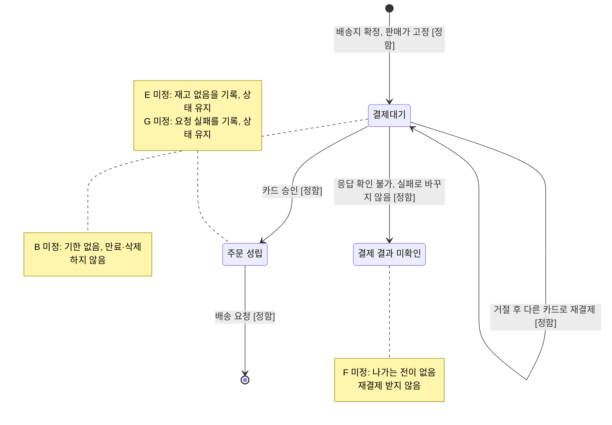

# 미정으로 남기는 B·E·F·G: 요구사항 작성 가능 여부와 구현에서 임의로 정하면 안 되는 것

네 가지 모두 미정인 채로 요구사항을 쓸 수 있습니다. 다만 두 가지를 요구사항에 반드시 적어야 합니다.

- **현재 동작**: 그 경우가 생겼을 때 주문이 어느 상태에 머무는지, 그리고 그 사실을 기록한다는 것
- **금지 사항**: 구현이 되돌릴 수 없는 처리를 스스로 정하지 않는다는 것. 예를 들어 승인 취소, 주문 상태 변경, 삭제, 재결제나 재요청 허용이 여기에 해당합니다.

미정은 "아무것도 적지 않는다"는 뜻이 아닙니다. "정해질 때까지 주문을 이 상태로 두고, 이런 처리는 하지 않는다"고 적어야 합니다.

## 항목별 정리

| 항목 | 미정인 채로 요구사항을 쓸 수 있는가 | 구현에서 임의로 정하면 안 되는 것 |
|---|---|---|
| **B** 결제대기 기한과 만료 처리 | 쓸 수 있습니다. 결제대기에는 이번 범위에서 끝이 없다고 적고, "기한과 만료 처리는 미정"이라고 명시합니다. | 시간이 지났다는 이유로 결제대기 주문을 만료·취소·삭제하거나, 결제를 막거나, 금액을 다시 계산하면 안 됩니다. |
| **E** 승인 뒤 재고가 없는 경우 | 쓸 수 있습니다. 성립은 카드 승인이므로 주문은 "주문 성립"에 그대로 두고 그 사실을 기록한다고 적습니다. | 승인을 자동으로 취소하거나, 주문을 성립이 아닌 상태로 바꾸거나, 배송 요청을 보류하거나, 일부 수량만 요청하면 안 됩니다. |
| **F** 결제 응답을 확인할 수 없는 경우 | 조건부로 쓸 수 있습니다. 결제대기·주문 성립과 구분되는 "결제 결과 미확인" 상태를 두고, 그 상태에서 나가는 처리는 미정으로 적습니다. | 성공으로 보고 주문을 성립시키거나 배송을 요청하면 안 됩니다. 결과를 모르는 채로 재결제를 받거나, 결과를 자동으로 확정하거나, 중복 승인 중 한 건을 취소해서도 안 됩니다. |
| **G** 승인 뒤 배송 요청이 실패한 경우 | 쓸 수 있습니다. 주문은 "주문 성립"으로 유지하고, 배송을 아직 요청하지 못했다는 사실을 기록한다고 적습니다. | 실패를 이유로 주문 상태를 바꾸거나 승인을 취소하면 안 됩니다. 재요청할 주체·횟수와 중복 요청이 생길 수 있는 자동 재요청을 구현이 정해서도 안 되고, 실패를 기록 없이 넘겨서도 안 됩니다. |

## 미정 사항이 걸린 흐름

## 기존 결정에서 따라 나오는 내용 (확인해 주세요)

위 표의 두 칸은 새로 정한 것이 아니라 이미 내린 결정에서 끌어낸 것입니다. 해석이 다르면 지금 바로잡아야 합니다.

- **F의 재결제 차단**: 다른 카드로 다시 결제할 수 있는 것은 거절된 결제에 대한 처리입니다. 결과를 모르는 응답에 재결제를 허용하면 그 응답을 사실상 실패로 다루는 셈입니다. 그러면 "확정할 수 없는 응답을 실패로 바꾸지 않는다"는 결정과 어긋나고, 한 주문에 승인이 두 건 생길 수 있습니다. 그래서 결제대기와 구분되는 상태를 두고, 그 상태에서는 재결제를 받지 않는 것으로 봤습니다.
- **E의 배송 요청 유지**: 주문 성립은 승인, 배송 요청은 승인 뒤, 재고 판단은 상품 시스템이라는 결정을 함께 적용하면, 주문 쪽은 배송 요청을 그대로 보내고 재고 부족은 상품·배송 쪽에서 드러나게 됩니다. 배송 요청을 보류하려면 그것도 업무 결정이 필요합니다.

## 요구사항 문서에 미정 사항을 적는 방법

"미정 사항" 절을 따로 두고, 항목마다 다음 내용을 적으세요.

- **ID**: B, E, F, G
- **현재 동작**: 주문이 머무는 상태와 기록 내용
- **금지 사항**: 위 표의 셋째 열
- **수용한 위험**
- **결정할 사람과 기한**

특히 B는 미정으로 두는 동안 다음 위험을 감수한다고 적어 두어야 합니다.

- 고객이 기한 없이 예전 판매가로 결제할 수 있습니다.
- 결제하지 않은 주문이 계속 쌓입니다.

E, F, G도 실제 운영에서 생기면 처리할 수단이 없습니다. 그래서 "발생 사실을 기록한다"는 요구가 이 처리를 결정할 때까지 이들을 찾아내는 유일한 방법입니다.