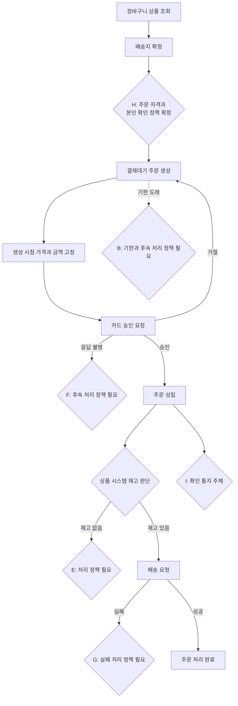

# 첫 주문 기능 개발 초안

판단 기준: 규칙과 절차가 확정되고 자동 판정할 수 있으면 **워크플로**, 사람의 정책 결정이 필요하면 **대화형 보조**, 외부 시스템을 실제로 확인해야 하거나 되돌리기 어려우면 **수작업**으로 둔다. 현재 범위에는 **에이전트가 꼭 필요한 일은 없다.**

| 개발할 일 | 업무 규칙 | 절차 | 자동 확인 | 되돌리기 | 가장 단순한 방식 |
|---|---|---|---|---|---|
| 주문 항목·판매가·재고 조회 | 일부 확정 | 일부 미정 | 쉬움 | 쉬움 | 대화형 보조 |
| 배송지 확정 및 주문 생성 | H 제외 확정 | H에 따라 달라짐 | 쉬움 | 쉬움 | 대화형 보조 → 확정 후 워크플로 |
| 생성 시점 가격 고정 및 금액 계산 | 확정 | 확정 | 쉬움 | 쉬움 | 워크플로 |
| 결제대기 주문 변경 방지 | 확정 | 확정 | 쉬움 | 쉬움 | 워크플로 |
| 카드 승인 요청 및 거절 처리 | 확정 | 확정 | 쉬움 | 결제 전에는 쉬움 | 워크플로 |
| 결제 응답 불명 처리 | F 미정 | 미정 | 부분 가능 | 어려움 | 대화형 보조 |
| 승인 완료와 주문 성립 처리 | 확정 | 확정 | 쉬움 | 어려움 | 워크플로 |
| 승인 뒤 재고 판단 반영 | E 미정 | 미정 | 부분 가능 | 매우 어려움 | 대화형 보조 |
| 승인 뒤 배송 요청 | G 미정 | 일부 미정 | 부분 가능 | 어려움 | 대화형 보조 |
| 주문 확인 통지 | I 미정 | 미정 | 가능 | 비교적 쉬움 | 대화형 보조 |
| 결제대기 기한 처리 | B 미정 | 미정 | 확정 후 쉬움 | 정책에 따라 다름 | 대화형 보조 |
| 정상·거절·중복·장애 시나리오 자동 시험 | 선행 정책 필요 | 대부분 확정 가능 | 쉬움 | 쉬움 | 워크플로 |
| 외부 시스템 연계 검증과 출시 승인 | 계약 확인 필요 | 운영 협의 필요 | 부분 가능 | 어려움 | 수작업 |

## 권장 진행 순서

정책이 확정되기 전에도 가격 고정, 금액 계산, 주문 불변 조건, 카드 거절 처리와 해당 자동 시험은 개발할 수 있다. 다만 미정 분기는 임의의 성공·실패·취소 상태로 바꾸지 않고 개발 완료 조건에서도 제외해 두어야 한다.

## 먼저 답이 필요한 질문

1. **H—주문 자격:** 비회원 주문을 허용하는가? 허용한다면 결제대기 주문을 다시 찾을 때 어떤 정보와 인증으로 본인을 확인하는가?
2. **B—결제대기:** 기한은 얼마인가? 기한 후 결제를 막는가? 주문 상태를 바꾸는가, 기록을 유지하거나 삭제하는가?
3. **F—결제 응답 불명:** 주문을 어떤 상태로 표시하는가? 결제 시스템에 누가·언제 승인 결과를 재확인하는가? 확인 전 재결제를 허용하는가?
4. **E—승인 뒤 재고 없음:** 주문을 유지하는가? 카드 승인을 취소하는가? 고객 또는 운영자에게 어떤 후속 조치를 요구하는가?
5. **G—배송 요청 실패:** 주문 상태를 바꾸는가? 자동 재요청, 운영자 재요청, 배송 시스템의 재수신 중 누가 책임지는가?
6. **I—주문 확인 통지:** 이 주문 시스템이 보내는가, 결제·배송 등 다른 시스템의 통지로 대신하는가?
7. **재고 판단 시점:** 상품 시스템에 재고 판단을 요청하는 정확한 시점은 카드 승인 전인가, 승인 후인가?
8. **중복 요청:** 고객의 연속 클릭이나 통신 재시도로 같은 주문·승인·배송 요청이 반복될 때, 업무상 한 건으로 보아야 하는 기준은 무엇인가?

이 질문들이 확정되면 미정 항목을 워크플로와 자동 인수시험으로 전환할 수 있다. 에이전트 적용은 자동 판정과 안전한 복구가 모두 약한 현재 단계에서는 불필요하다.