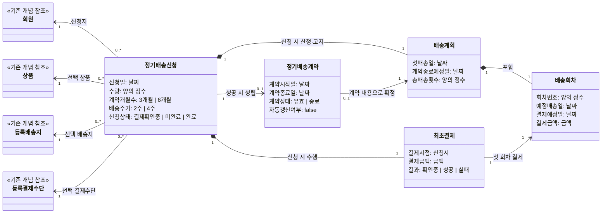

아래 모델은 결제 성공 전의 **정기배송 신청**과 성공 후 성립하는 **정기배송 계약**을 분리한다. 기존 쇼핑몰의 회원·상품·배송지·결제수단은 내부 구조 없이 참조 대상으로만 표현했다.

적용한 업무 제약은 다음과 같다.

- 한 신청은 상품 한 종류와 하나의 수량, 신청자 본인의 등록 배송지·결제수단을 선택한다.
- 첫 배송일은 `신청일 + 3달력일`부터 선택할 수 있으며, 해당 날짜도 포함한다. 선택일은 기존 배송 달력상 가능한 날이어야 한다.
- 계약 종료 예정일은 첫 배송일에 3개월 또는 6개월을 더해 산정한다. 같은 날짜가 없으면 해당 월의 말일이며 종료일 자체는 계약기간에서 제외한다.
- 첫 배송일부터 2주 또는 4주 간격으로 계산한 날짜 중 계약 종료 예정일보다 이른 날짜만 배송회차가 된다.
- 각 회차의 결제 예정일은 예정 배송일의 3달력일 전이다. 첫 회차는 이 예정일과 무관하게 신청 시 결제한다.
- 신청 시점의 기존 쇼핑몰 가격·할인·배송비 정책으로 회차별 결제금액을 확정하고 계약기간 동안 유지한다.
- 최초결제 결과가 성공이면 하나의 계약이 성립한다. 실패이면 계약이 성립하지 않으며 신청은 미완료다. 결과를 확인할 수 없으면 계약 성립을 확정하지 않고 결제확인중 상태로 둔다.
- 성립한 계약의 시작일은 첫 배송일이고 종료일은 계산된 계약 종료일이다. 자동 갱신하지 않는다.
- 한 번의 신청 의사에서 발생한 반복 전송은 동일 신청으로 본다. 동일 신청에는 계약이 최대 하나, 최초결제가 하나만 존재한다.
- 이후 배송 불가일 조정과 실제 후속 결제 처리는 기존 쇼핑몰 정책의 영역이며 별도 개념으로 추가하지 않았다.

확인이 필요한 의미가 두 가지 있다.

1. 최초결제 실패 후 회원이 다시 결제를 시도하면 **기존 신청의 재결제**인지, 신청 절차를 새로 시작하는 **별개의 신규 신청**인지 기준이 필요하다. 현재 모델은 동일 신청당 최초결제를 하나로 제한한다.
2. “회차별 결제금액”은 신청 시점부터 회차마다 서로 다른 금액일 수 있는가? 예를 들어 첫 회차에만 할인이 적용될 수 있는지, 아니면 모든 회차가 반드시 동일 금액인지 명확하지 않다. 현재 모델은 회차별 금액이 다를 가능성을 허용하되, 한번 산정된 각 금액은 계약기간 동안 변경되지 않는 것으로 해석했다.