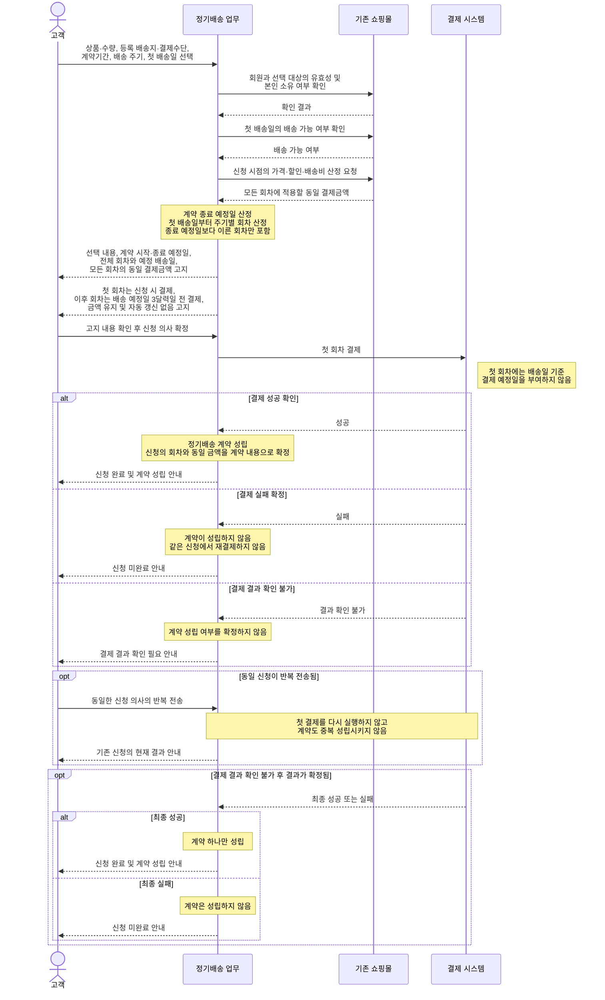
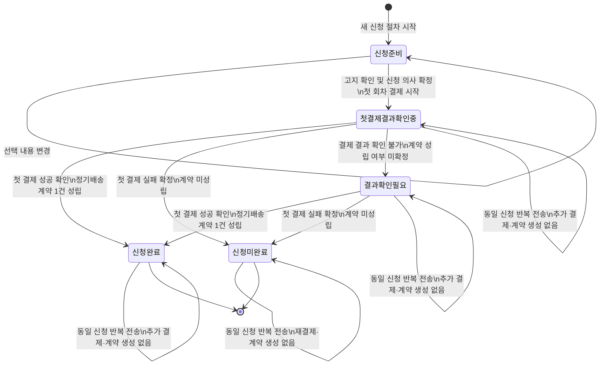

아래 동적 모델은 정기배송 신청을 중심으로 하며, 성공이 확인된 첫 결제로만 계약이 성립하도록 표현했다. 일정 묶음용 별도 개념이나 구현 구성요소는 두지 않았다.

### 시퀀스 다이어그램

### 정기배송 신청 상태 머신

적용한 핵심 의미는 다음과 같다.

- 신청 준비 및 결제 결과 확인 단계에서는 아직 계약이 성립하지 않는다.
- 첫 결제의 성공이 확인된 사건만 `신청완료` 전이와 계약 성립을 발생시킨다.
- 결과 확인 불가는 실패가 아니며, 성공이나 실패가 확인될 때까지 계약 성립 여부도 확정하지 않는다.
- 실패 확정 후 재신청하려면 새로운 신청 절차를 시작한다.
- 동일 신청의 반복 전송은 어느 상태에서도 추가 결제나 중복 계약을 만들지 않는다.
- 모든 회차의 결제금액은 신청 시 산정한 하나의 동일 금액이다.
- 첫 회차는 신청 시 결제하고, 배송 예정일 3일 전 결제 조건은 이후 회차에만 적용한다.

확인이 필요한 사항이 하나 있다. 결제 결과 확인 불가 상태에서 최종 결과를 확인하는 주체와 고객 안내 방식이 정해져 있지 않다. 결제 시스템이 결과를 전달하는 것으로 표현했지만, 고객이 별도로 결과 확인을 요청하는 흐름도 허용해야 하는지 확인이 필요하다.