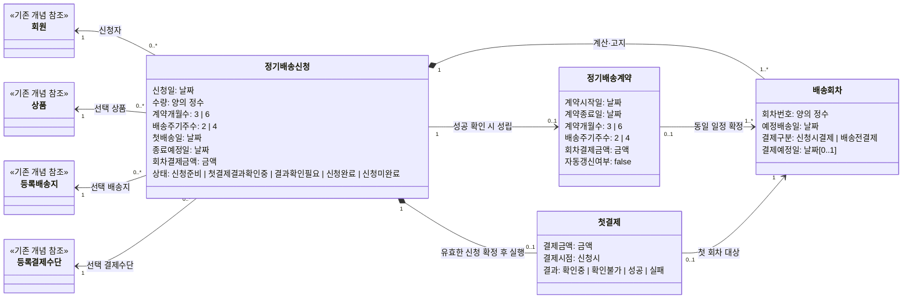
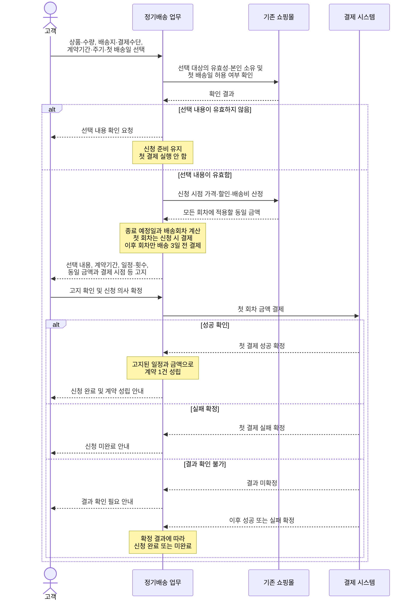
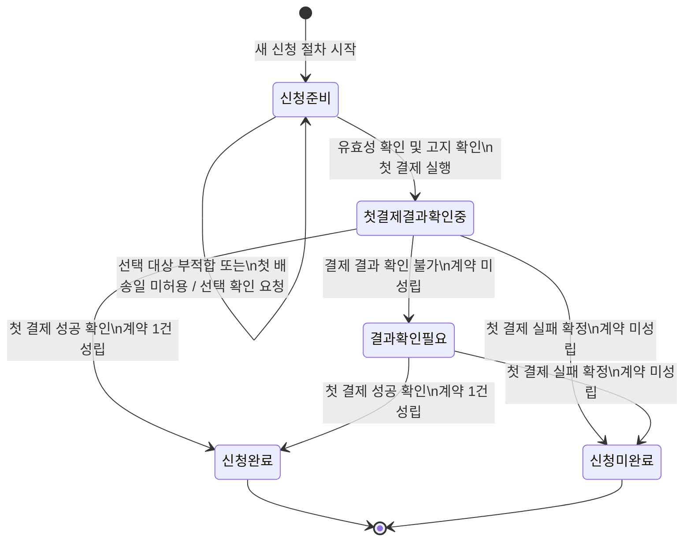

대표 수용 기준을 기준으로 용어와 규칙을 통일하고, 신청과 계약을 분리해 세 다이어그램을 보완했다.

## 용어와 업무 규칙

- **정기배송 신청:** 고객이 상품 한 종류·수량, 본인의 등록 배송지·결제수단, 계약기간, 배송 주기와 첫 배송일을 선택해 계약 체결을 요청하는 과정.
- **정기배송 계약:** 첫 결제 성공이 확인될 때 신청으로부터 성립하는 계약. 신청당 최대 하나만 성립한다.
- **배송회차:** 신청 시 계산하고 고객에게 고지하는 예정 일정. 실제 배송 실행 상태를 뜻하지 않는다.
- **첫 결제:** 첫 회차 금액을 신청 시 결제하는 행위. 이후 회차의 결제 예정일 규칙과 구분한다.
- **동일 회차 결제금액:** 신청 시 기존 쇼핑몰 정책으로 산정하며 모든 회차에 같은 금액을 적용한다.

핵심 규칙은 다음과 같다.

- 선택 대상이 유효하지 않거나 본인 소유가 아니거나 첫 배송일이 허용되지 않으면 신청 준비 상태를 유지하며 첫 결제를 실행하지 않는다.
- 첫 배송일은 `신청일 + 3달력일`부터 선택할 수 있으며 해당 날짜를 포함한다.
- 종료일은 첫 배송일에 계약 개월 수를 더해 계산하고 계약기간에서 제외한다. 대응 날짜가 없으면 해당 월의 말일이다.
- 종료일보다 이른 예정 배송일만 회차에 포함한다.
- 첫 회차는 신청 시 결제한다. 이후 회차에만 예정 배송일 3달력일 전의 결제 예정일을 둔다.
- 첫 결제 성공 확인만 계약을 성립시킨다. 실패 확정은 신청 미완료이고, 결과 확인 불가는 실패가 아니다.
- 계약이 성립하면 신청 시 고지한 일정과 동일 결제금액이 계약 내용으로 확정된다.
- 동일 신청의 반복 전송은 추가 청구, 추가 계약 또는 상태 변화를 발생시키지 않는다. 별개의 신규 신청은 허용한다.

## 클래스 다이어그램

정적 제약:

- 첫 회차의 `결제구분`은 `신청시결제`이며 `결제예정일`은 없다.
- 2회차 이후는 `배송전결제`이며 `결제예정일 = 예정배송일 - 3달력일`이다.
- 모든 배송회차에는 신청의 `회차결제금액`과 같은 금액이 적용된다.
- 계약의 일정·금액은 해당 신청에서 계산·고지된 값 및 회차와 동일하다.
- 첫 결제 성공 확인 전에는 계약이 존재하지 않는다.

## 시퀀스 다이어그램

결과 확인 불가 이후의 성공·실패 확정은 결제 시스템의 결과 확인으로 발생하는 업무 사건만 나타낸다. 통지·조회 방식과 고객 알림 수단은 포함하지 않는다.

## 정기배송 신청 상태 머신

상태 머신 전체에 적용되는 공통 불변 규칙은 다음과 같다.

> 동일 신청이 반복 전달되어도 상태는 바뀌지 않으며 첫 결제, 계약 또는 배송회차를 추가하지 않는다. 기존에 확정된 결과가 있으면 그 결과를, 아직 확정되지 않았으면 결과 확인 필요를 안내한다.

## 대표 수용 기준 검토

| 검토 항목 | 모델 적용 결과 |
|---|---|
| 일정 | 2027-11-03 시작, 3개월, 2주 주기이면 종료일은 2028-02-03이며 제외된다. 2028-01-26까지 7회다. |
| 월말 | 2027-01-31 시작, 3개월이면 대응 날짜가 없으므로 종료일은 2027-04-30이며 제외된다. |
| 금액 | 회차결제금액은 10,000원이고 7개 회차 모두 10,000원으로 유지된다. |
| 청구 시점 | 신청 시에는 첫 회차 10,000원만 결제한다. 총액 70,000원을 일시불로 청구하지 않는다. |
| 신청 결과 | 성공 확인만 신청 완료와 계약 성립을 발생시킨다. 실패 확정은 신청 미완료, 결과 미확정은 결과 확인 필요다. |
| 선택 오류 | 신청 준비를 유지하고 선택 내용 확인을 요청하며 결제를 실행하지 않는다. |
| 반복 전송 | 추가 청구·계약·회차·상태 변화 없이 기존 결과만 안내한다. |
| 성능·정보 보호 | 모델의 검토 제약으로 유지하며 별도 업무 개념이나 기술 구성요소로 만들지 않았다. |

현재 제공된 답변과 대표 수용 기준 사이에 추가로 확인이 필요한 불명확한 의미는 없다.