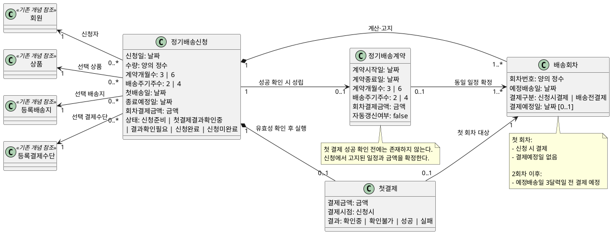
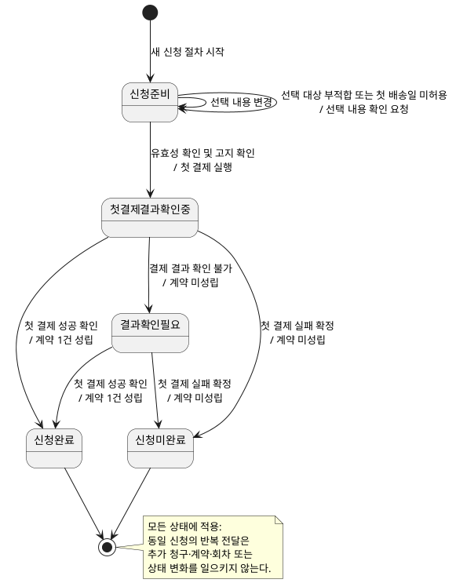

# 실습 2 정기배송 최초 신청 도메인 모델

## 1. 용어와 업무 규칙

### 1.1 용어

- **정기배송 신청:** 고객이 상품 한 종류와 수량, 본인의 등록 배송지·결제수단, 계약기간, 배송 주기 및 첫 배송일을 선택하여 계약 체결을 요청하는 과정이다.
- **정기배송 계약:** 첫 결제 성공이 확인될 때 정기배송 신청으로부터 성립하는 계약이다. 신청당 최대 하나만 성립한다.
- **배송회차:** 신청 시 계산하여 고객에게 고지하는 예정 일정이다. 실제 배송 실행이나 운영 상태를 의미하지 않는다.
- **첫 결제:** 첫 회차 금액을 신청 시 결제하는 행위다.
- **회차 결제금액:** 신청 시점의 기존 쇼핑몰 가격·할인·배송비 정책으로 산정하여 모든 회차에 동일하게 적용하는 금액이다.
- **동일 신청:** 고객이 한 번의 신청 의사로 시작한 신청이 반복 전달된 경우다. 선택 내용이 같다는 사실만으로 동일 신청이 되지는 않는다.
- **별개 신규 신청:** 고객이 신청 절차를 새로 시작하고 별도로 신청 의사를 확인한 신청이다.

### 1.2 업무 규칙

- 한 신청에서는 상품 한 종류와 수량을 선택한다.
- 고객은 본인의 유효한 등록 배송지와 등록 결제수단만 선택할 수 있다.
- 계약기간은 3개월 또는 6개월이고 배송 주기는 2주 또는 4주다.
- 첫 배송일은 신청일에 3달력일을 더한 날짜부터 선택할 수 있으며 그 날짜를 포함한다. 기존 쇼핑몰 배송 달력에서 허용된 날짜여야 한다.
- 선택 대상이 유효하지 않거나 본인 소유가 아니거나 첫 배송일이 허용되지 않으면 선택 내용 확인을 요청하고 신청 준비 상태를 유지한다. 이때 첫 결제는 실행하지 않는다.
- 계약 종료 예정일은 첫 배송일에 계약 개월 수를 더해 계산한다. 같은 날짜가 없는 달은 말일을 사용하며 종료일 자체는 계약기간과 회차에서 제외한다.
- 첫 배송일부터 선택한 배송 주기마다 예정 배송일을 계산하고, 종료 예정일보다 이른 회차만 포함한다.
- 신청 완료 전 선택 내용, 계약기간, 시작·종료 예정일, 배송 일정과 횟수, 결제금액과 결제 시점, 금액 유지 및 자동 갱신 없음을 고지한다.
- 첫 회차는 신청 시 결제한다. 첫 회차에는 배송일 기준의 결제 예정일을 부여하지 않는다.
- 2회차 이후의 결제 예정일은 예정 배송일 3달력일 전이다. 실제 후속 결제 실행과 휴일 조정은 범위 밖이다.
- 모든 회차에는 신청 시 산정한 동일한 결제금액을 적용한다.
- 첫 결제 성공이 확인된 경우에만 신청이 완료되고 계약이 성립한다.
- 첫 결제 실패가 확정되면 신청은 미완료되고 계약은 성립하지 않는다. 다시 신청하려면 별개의 신규 신청을 시작해야 한다.
- 결제 결과를 확인할 수 없으면 실패로 취급하지 않고 결과 확인 필요 상태로 둔다. 이후 결제 시스템의 결과 확인을 통해 성공 또는 실패가 확정된다.
- 계약이 성립하면 신청 시 고지한 회차 일정과 결제금액이 계약 내용으로 확정된다.
- 계약은 자동 갱신하지 않으며 계약 종료일에 종료한다.
- 동일 신청의 반복 전달은 추가 청구, 추가 계약, 회차 추가 또는 상태 변화를 일으키지 않는다. 결과가 확정되었으면 기존 결과를, 아직 확정되지 않았으면 결과 확인 필요를 안내한다.
- 별개의 신규 신청은 허용한다. 동일 신청을 식별하는 기술적 방식은 설계에서 결정한다.
- 이후 회차의 배송 불가일 조정은 기존 쇼핑몰 정책을 준용하며 별도 정책으로 모델링하지 않는다.
- 일정과 금액 계산의 검증값은 **실습 2 요구사항 정의서의 대표 수용 기준**을 따른다. 성능과 정보 보호 요구는 모델 검토의 제약으로만 적용한다.

## 2. 클래스 다이어그램

신청과 계약을 서로 다른 업무 개념으로 구분한다. 회원·상품·등록 배송지·등록 결제수단은 기존 쇼핑몰 개념에 대한 참조만 표현한다.



정적 제약은 다음과 같다.

- 신청의 상태 값은 상태 머신의 상태 이름과 일치한다.
- 신청당 첫 결제는 최대 하나이고 계약도 최대 하나다.
- 첫 결제 성공 확인 전에는 계약이 존재하지 않는다.
- 모든 배송회차에는 신청의 회차 결제금액과 같은 금액이 적용된다.
- 성립한 계약의 시작일은 첫 배송일이고 종료일은 신청에서 계산한 종료 예정일이다.
- 배송회차는 예정 일정이며 실제 배송 운영 상태를 나타내지 않는다.

## 3. 시퀀스 다이어그램

최초 신청에 필요한 고객, 정기배송 업무, 기존 쇼핑몰 및 결제 시스템 사이의 업무 상호작용만 표현한다.

```plantuml:sequence
@startuml
actor 고객
participant "정기배송 업무" as 정기업무
participant "기존 쇼핑몰" as 쇼핑몰
participant "결제 시스템" as 결제

고객 -> 정기업무:
  상품·수량, 배송지·결제수단,\n계약기간·배송 주기·첫 배송일 선택

정기업무 -> 쇼핑몰:
  선택 대상의 유효성·본인 소유 및\n첫 배송일 허용 여부 확인
쇼핑몰 --> 정기업무: 확인 결과

alt 선택 내용이 유효하지 않음
  정기업무 --> 고객: 선택 내용 확인 요청
  note over 정기업무
    신청 준비 상태 유지
    첫 결제 실행 안 함
  end note
else 선택 내용이 유효함
  정기업무 -> 쇼핑몰:
    신청 시점의 가격·할인·배송비 산정
  쇼핑몰 --> 정기업무:
    모든 회차에 적용할 동일 결제금액

  note over 정기업무
    종료 예정일과 배송회차 계산
  end note

  정기업무 --> 고객:
    선택 내용, 계약기간, 일정·횟수,\n금액·결제 시점 및 계약 조건 고지
  고객 -> 정기업무: 고지 확인 및 신청 의사 확정
  정기업무 -> 결제: 첫 회차 금액 결제

  alt 첫 결제 성공 확인
    결제 --> 정기업무: 성공 확정
    note over 정기업무
      고지된 일정과 금액으로
      계약 1건 성립
    end note
    정기업무 --> 고객: 신청 완료 및 계약 성립 안내
  else 첫 결제 실패 확정
    결제 --> 정기업무: 실패 확정
    정기업무 --> 고객: 신청 미완료 안내
  else 결제 결과 확인 불가
    결제 --> 정기업무: 결과 미확정
    정기업무 --> 고객: 결과 확인 필요 안내

    ... 결제 시스템의 결과 확인 ...

    결제 --> 정기업무: 성공 또는 실패 확정
    alt 성공 확정
      note over 정기업무: 계약 1건 성립
      정기업무 --> 고객: 신청 완료 및 계약 성립 안내
    else 실패 확정
      정기업무 --> 고객: 신청 미완료 안내
    end
  end
end

note over 고객, 결제
  동일 신청의 반복 전달은 추가 청구·계약·회차 또는
  상태 변화를 일으키지 않고 기존 결과를 안내한다.
end note
@enduml
```

결제 결과의 기술적 통지·조회 방식과 고객 알림 수단은 설계에서 결정하며 이 모델에 포함하지 않는다.

## 4. 상태 머신 다이어그램

상태 머신의 대상은 정기배송 계약이 아닌 **정기배송 신청**이다. 계약 종료, 배송 진행, 해지 등 계약 성립 이후의 운영 상태는 포함하지 않는다.



- 선택 오류는 `신청준비`를 유지하므로 결제 실패에 따른 `신청미완료`와 구분된다.
- `결과확인필요`는 실패 상태가 아니며 결제 결과가 아직 확정되지 않은 상태다.
- `신청완료` 전이는 첫 결제 성공 확인에 의해서만 발생하며 동시에 계약 하나가 성립한다.
- 실패 확정 후 다시 신청하려면 새로운 신청 절차를 시작해야 한다.

## 5. 수용 기준 및 미결 사항

- 세 모델의 날짜, 회차, 월말, 금액, 청구 시점 및 신청 결과는 **실습 2 요구사항 정의서의 대표 수용 기준**으로 검증한다.
- 신청 시에는 첫 회차 금액만 결제하며 전체 계약기간의 금액을 일시불로 청구하지 않는다.
- 현재 합의된 범위에서 남은 업무 의미상의 미결 사항은 없다.
- 동일 신청의 식별 방식, 결제 결과 확인 방식 및 고객 알림 수단은 구현 설계 사항이므로 이 도메인 모델에서 결정하지 않는다.