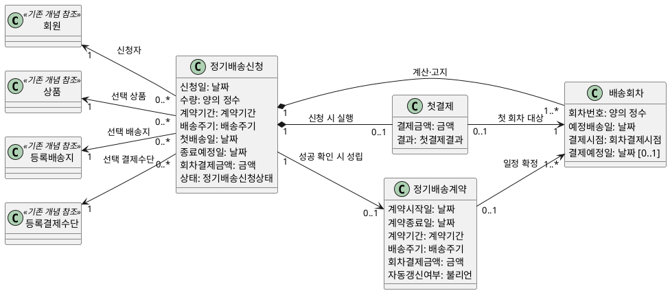
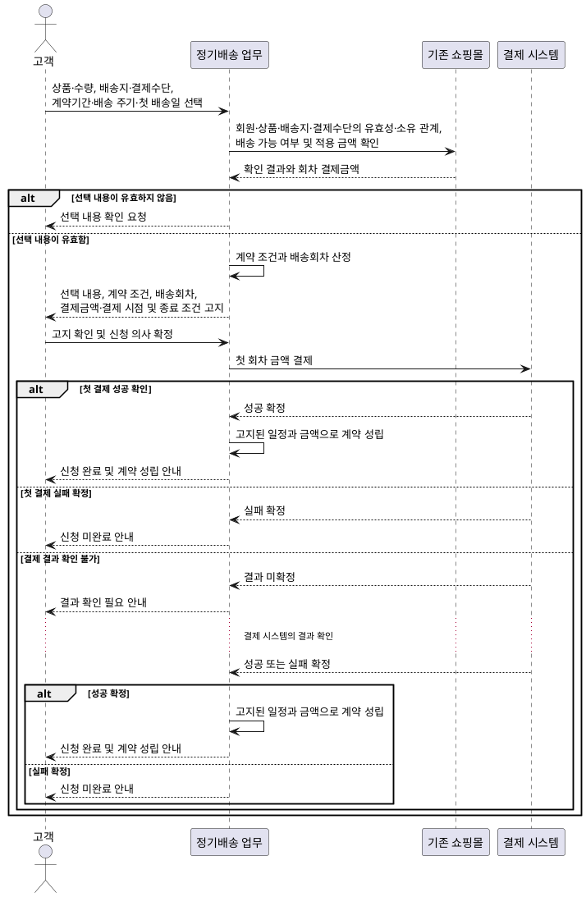
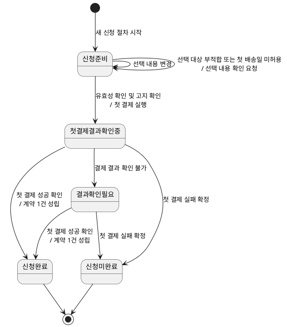

# 실습 3 정기배송 최초 신청 도메인 모델

## 1. 용어와 업무 규칙

### 1.1 용어

- **정기배송 신청:** 고객이 상품 한 종류와 수량, 본인의 등록 배송지·결제수단 및 배송 조건을 선택하여 계약 체결을 요청하는 과정이다.
- **정기배송 계약:** 첫 결제 성공이 확인될 때 정기배송 신청으로부터 성립하는 계약이다.
- **배송회차:** 신청 시 계산하여 고객에게 고지하는 예정 일정이다. 실제 배송 실행이나 운영 상태를 뜻하지 않는다.
- **첫 결제:** 첫 회차 금액을 신청 시 결제하는 행위다.
- **회차 결제금액:** 모든 배송회차에 동일하게 적용하도록 신청 시 확정하는 금액이다.
- **동일 신청:** 고객이 한 번의 신청 의사로 시작한 신청이 반복 전달된 경우다. 선택 내용이 같다는 사실만으로 동일 신청이 되지는 않는다.
- **별개 신규 신청:** 고객이 신청 절차를 새로 시작하고 별도로 신청 의사를 확인한 신청이다.

### 1.2 업무 규칙

- 한 신청에서는 상품 한 종류와 수량을 선택한다.
- 기존 회원·상품·등록 배송지·등록 결제수단은 기존 쇼핑몰의 개념을 참조하며 내부 구조를 새로 정의하지 않는다.
- 고객은 본인의 유효한 등록 배송지와 등록 결제수단만 선택할 수 있다.
- 선택 대상이 유효하지 않거나 본인 소유가 아니거나 첫 배송일이 허용되지 않으면 선택 내용 확인을 요청하고 `신청준비` 상태를 유지한다. 이때 첫 결제를 실행하지 않는다.
- 날짜 산정, 배송회차 계산, 월말 처리, 금액 산정·유지 및 그 검증값은 **실습 2 요구사항 정의서와 대표 수용 기준**을 따른다.
- 신청 완료 전 선택 내용, 계약 조건, 배송 일정과 횟수, 결제금액과 결제 시점, 금액 유지 및 자동 갱신 없음을 고지한다.
- 첫 회차는 신청 시 결제하며 별도의 배송 전 결제 예정일을 갖지 않는다. 이후 회차만 실습 2에서 정한 결제 예정일을 갖는다.
- 첫 결제 성공이 확인된 경우에만 신청이 완료되고 신청당 최대 하나의 계약이 성립한다.
- 첫 결제 실패가 확정되면 신청은 미완료되고 계약은 성립하지 않는다. 다시 신청하려면 별개의 신규 신청을 시작해야 한다.
- 결제 결과를 확인할 수 없으면 실패로 취급하지 않고 `결과확인필요` 상태로 둔다. 이후 결제 시스템의 결과 확인을 통해 성공 또는 실패가 확정된다.
- 계약이 성립하면 신청 시 고지한 배송회차와 회차 결제금액이 계약 내용으로 확정된다.
- 동일 신청의 반복 전달은 추가 청구, 추가 계약, 회차 추가 또는 상태 변화를 일으키지 않는다. 결과가 확정되었으면 기존 결과를, 아직 확정되지 않았으면 결과 확인 필요를 안내한다.
- 별개의 신규 신청은 허용한다.
- 이후 배송 운영, 후속 결제 실행, 배송 불가일 조정, 계약 변경 및 해지는 이 모델의 범위에서 제외한다.

## 2. 클래스 다이어그램

신청과 계약을 서로 다른 업무 개념으로 표현한다. 신청 상태와 첫 결제 결과의 값은 상태 머신에서 정의한다.

- 첫 회차의 결제시점은 신청 시점이며 결제예정일은 없다.
- 이후 회차에는 예정 배송일을 기준으로 산정된 결제예정일이 있다.
- 성립한 계약은 해당 신청에서 고지한 배송회차와 회차 결제금액을 확정한다.
- 배송회차는 예정 정보이며 실제 배송 상태를 포함하지 않는다.

## 3. 시퀀스 다이어그램

기존 쇼핑몰을 통한 정보 확인을 하나의 상호작용으로 묶고, 선택 오류와 첫 결제 결과에 따른 최초 신청 결과를 표현한다.

결제 결과를 통지하거나 조회하는 기술적 방식과 고객 알림 수단은 구현 설계에서 결정한다.

## 4. 상태 머신 다이어그램

상태 머신의 대상은 정기배송 계약이 아니라 `정기배송신청`이다. 계약 성립 이후의 배송 진행과 계약 운영 상태는 포함하지 않는다.

- 선택 오류는 `신청준비`를 유지하므로 결제 실패에 따른 `신청미완료`와 구분된다.
- `결과확인필요`는 실패가 아니라 첫 결제 결과가 확정되지 않은 상태다.
- `신청완료`와 계약 성립은 첫 결제 성공 확인에 의해서만 발생한다.