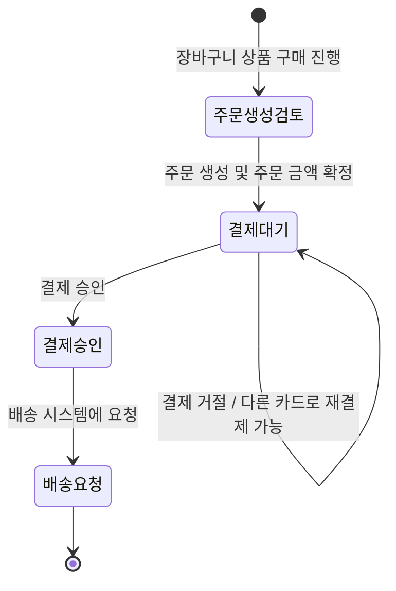
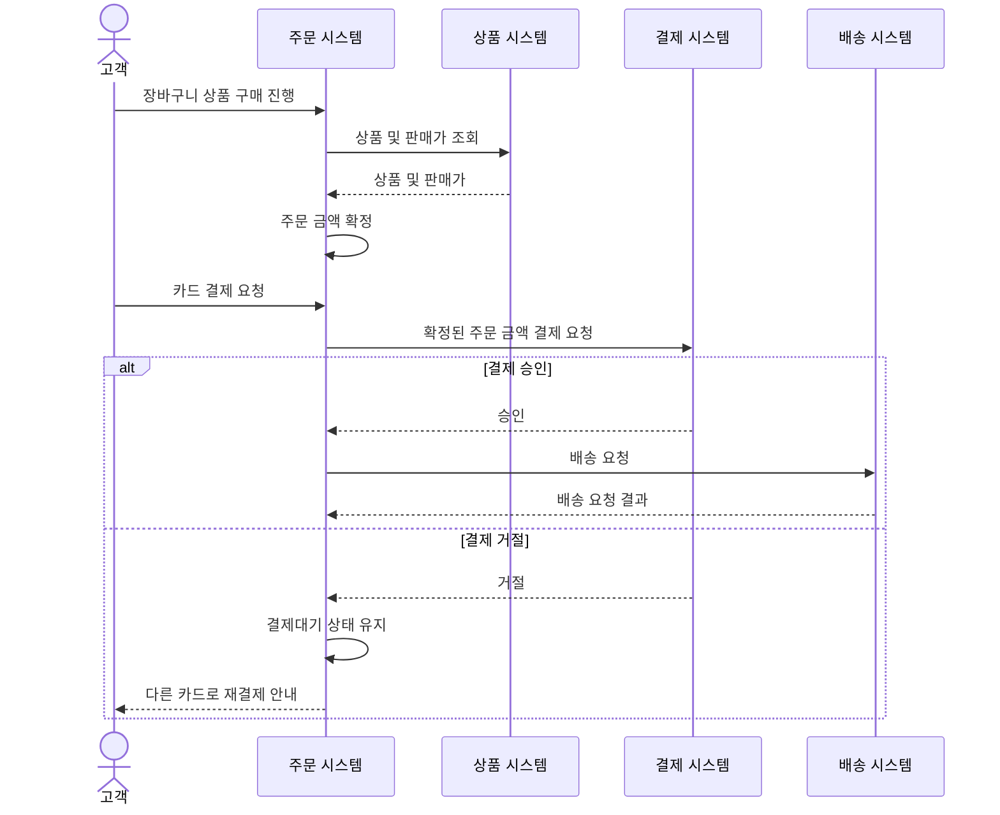

# 주문 시스템 요구사항 정의서 초안

## 1. 목적

고객이 장바구니에 담은 상품을 주문하고 결제할 수 있도록 하며, 결제 승인 후 기존 배송 시스템에 배송을 요청한다. 결제가 거절되면 고객이 다른 카드로 다시 결제할 수 있어야 한다.

## 2. 범위

### 포함 범위

- 장바구니 상품을 기반으로 주문 처리
- 주문 금액 확정 및 보존
- 기존 결제 시스템을 통한 결제 요청
- 결제 승인·거절 결과에 따른 주문 상태 처리
- 결제 거절 후 다른 카드로 재결제
- 결제 승인 후 기존 배송 시스템에 배송 요청
- 기존 상품 시스템에서 상품 및 판매가 정보 연계

### 제외 범위

회의에서 확인되지 않은 다음 기능은 이번 초안의 범위에 포함하지 않는다.

- 장바구니 기능 자체의 신규 개발
- 상품·결제·배송 시스템의 내부 기능 변경
- 주문 취소 및 환불
- 배송 취소, 배송지 변경 및 반품
- 쿠폰, 할인, 포인트 및 배송비 계산
- 재고 예약·차감·복구
- 부분 결제 및 분할 배송
- 결제 승인 후 배송 요청 실패에 대한 자동 복구 정책
- 주문 또는 결제의 유효기간과 자동 만료
- 고객 알림
- 비회원 주문

## 3. 외부 시스템

| 시스템 | 역할 |
|---|---|
| 상품 시스템 | 상품 정보와 판매가 제공 |
| 결제 시스템 | 카드 결제 요청을 처리하고 승인 또는 거절 결과 반환 |
| 배송 시스템 | 결제 승인된 주문의 배송 요청 접수 |
| 주문 시스템 | 주문 금액과 상태를 관리하고 결제·배송 시스템을 연계 |

## 4. 용어

| 용어 | 정의 |
|---|---|
| 장바구니 | 고객이 구매하려는 상품을 임시로 담아 둔 목록 |
| 주문 | 구매 대상 상품, 주문 시점의 판매가, 주문 금액 및 처리 상태를 보존하는 거래 단위 |
| 주문 금액 | 주문이 생성될 때 적용된 상품 판매가를 기준으로 확정한 금액 |
| 판매가 | 상품 시스템에서 관리하는 상품의 현재 판매 가격 |
| 결제대기 | 주문에 대한 결제가 아직 승인되지 않은 상태. 결제가 거절된 주문도 이 상태에 남는다. |
| 결제 승인 | 결제 시스템이 결제 요청을 성공으로 확정한 결과 |
| 결제 거절 | 결제 시스템이 결제 요청을 승인하지 않은 결과 |
| 재결제 | 결제가 거절된 주문에 대해 다른 카드로 다시 결제를 요청하는 행위 |
| 배송 요청 | 결제가 승인된 주문의 배송을 시작하기 위해 배송 시스템에 보내는 요청 |

## 5. 유저 스토리

### US-01. 장바구니 상품 주문

고객으로서 장바구니에 담은 상품을 주문하고 결제하고 싶다. 구매할 상품을 확정하고 배송을 받을 수 있기 때문이다.

인수 조건:

- 장바구니의 상품을 대상으로 주문 처리를 시작할 수 있다.
- 주문에는 주문 생성 시점의 판매가가 기록된다.
- 주문 금액은 기록된 판매가를 기준으로 확정된다.
- 주문 생성과 결제 요청의 정확한 선후 관계는 미정 질문에서 확정한다.

### US-02. 주문 금액 보존

고객으로서 주문 생성 후 판매가가 변경되더라도 확정된 주문 금액으로 결제하고 싶다. 주문 과정에서 확인한 금액이 임의로 바뀌지 않아야 하기 때문이다.

인수 조건:

- 주문이 생성되면 주문 금액을 확정하여 보존한다.
- 주문 생성 후 상품 시스템의 판매가가 올라도 기존 주문 금액은 변경하지 않는다.
- 결제 시스템에는 기존 주문 금액으로 결제를 요청한다.
- 판매가가 내려가는 경우의 처리 방식은 별도로 확정한다.

### US-03. 결제 승인 후 배송 요청

고객으로서 결제가 승인되면 주문 상품의 배송이 시작되기를 원한다.

인수 조건:

- 결제 승인 결과를 받은 주문에 대해서만 배송 시스템에 배송을 요청한다.
- 결제 승인 전에는 배송을 요청하지 않는다.
- 결제가 거절된 주문에 대해서는 배송을 요청하지 않는다.

### US-04. 결제 거절 후 재결제

고객으로서 카드 결제가 거절되면 다른 카드로 같은 주문을 다시 결제하고 싶다. 장바구니와 주문을 다시 만들지 않고 구매를 계속할 수 있어야 하기 때문이다.

인수 조건:

- 결제가 거절되면 주문을 삭제하거나 취소하지 않는다.
- 결제가 거절된 주문은 `결제대기` 상태로 남는다.
- 고객은 해당 주문에 다른 카드를 사용하여 다시 결제할 수 있다.
- 재결제 시 기존 주문 금액을 유지한다.
- 재결제가 승인되기 전에는 배송을 요청하지 않는다.
- 재결제가 승인되면 배송 시스템에 배송을 요청한다.

## 6. 업무 규칙

| ID | 업무 규칙 |
|---|---|
| BR-01 | 주문 금액은 주문이 생성될 때의 판매가를 기준으로 확정한다. |
| BR-02 | 주문 생성 후 판매가가 인상되어도 해당 주문의 주문 금액은 변경하지 않는다. |
| BR-03 | 최초 결제와 재결제에는 해당 주문에 확정된 주문 금액을 사용한다. |
| BR-04 | 배송 요청은 결제 시스템의 승인 결과를 받은 뒤에만 수행한다. |
| BR-05 | 결제가 거절되면 해당 주문은 `결제대기` 상태를 유지한다. |
| BR-06 | 결제가 거절된 주문은 다른 카드를 이용해 다시 결제할 수 있다. |
| BR-07 | 결제가 거절되었거나 아직 승인되지 않은 주문에는 배송을 요청하지 않는다. |
| BR-08 | 결제 시도가 여러 번 발생하더라도 하나의 주문 금액은 변경하지 않는다. |
| BR-09 | 결제 승인된 주문에 대한 배송 요청은 중복되지 않아야 한다. 중복 방지의 구체적인 구현 방식은 설계 단계에서 정한다. |

## 7. 상태 및 처리 흐름

주문 생성 시점이 회의에서 명확하게 확정되지 않았으므로, 다음 도식은 주문이 결제 요청 전에 생성되어 `결제대기` 상태가 된다는 후보 흐름이다. 미정 질문이 확정되면 수정해야 한다.

## 8. 데이터 요구사항 초안

주문 시스템은 최소한 다음 정보를 관리해야 한다. 필드 형식과 필수 여부는 상세 설계에서 확정한다.

- 주문 식별자
- 고객 식별 정보
- 주문 상품 식별자
- 주문 상품 수량
- 주문 생성 시점의 상품 판매가
- 확정된 주문 금액
- 주문 상태
- 주문 생성 일시
- 결제 시도 이력
- 결제 승인 여부 및 승인 식별 정보
- 배송 요청 여부 및 배송 시스템 요청 식별 정보

카드번호 등 민감한 결제정보를 주문 시스템이 직접 저장하는지는 정하지 않는다.

## 9. 미정 질문

### 주문 생성과 상태

1. 주문은 결제 요청 전에 생성되는가, 아니면 결제 승인 후에 생성되는가?
   - 회의 메모에는 “주문이 생길 때의 판매가”와 “결제 거절 시 주문은 결제대기로 남는다”가 있어 결제 전에 주문이 존재하는 것으로 보인다.
   - 그러나 최초 요청의 “결제하면 주문이 된다”는 표현과 차이가 있으므로 업무 담당자의 확인이 필요하다.
2. 주문 상태에는 `결제대기` 외에 어떤 상태가 필요한가?
3. 결제 승인 후 상태를 `결제완료`, `배송요청`, `배송중` 등으로 세분화할 것인가?
4. 결제대기 주문에 만료시간이 있는가? 만료된다면 이후 상태와 재결제 가능 여부는 어떻게 되는가?

### 금액

5. 주문 생성 후 판매가가 내려간 경우에도 기존 주문 금액을 유지하는가?
6. 주문 금액에 배송비, 세금, 할인, 쿠폰 및 포인트가 포함되는가?
7. 여러 상품을 주문할 때 상품별 판매가를 각각 보존하는가?
8. 결제대기 중 상품 구성이나 수량을 변경할 수 있는가?

### 결제

9. 결제 거절 사유를 고객에게 어느 수준까지 표시하는가?
10. 같은 카드로도 다시 결제할 수 있는가, 아니면 반드시 다른 카드를 사용해야 하는가?
11. 재결제 횟수 또는 시간 제한이 있는가?
12. 결제 요청 중 응답 지연이나 결과 불명 상태가 발생하면 주문을 어떻게 처리하는가?
13. 중복 결제 방지를 위해 결제 요청별 식별자나 멱등성 키를 사용하는가?
14. 결제 승인 후 주문 시스템이 결과를 받지 못한 경우 승인 여부를 어떻게 확인하는가?

### 상품 및 재고

15. 주문 생성 시 상품의 판매 가능 여부와 재고를 확인해야 하는가?
16. 재고는 주문 생성 시점과 결제 승인 시점 중 언제 예약하거나 차감하는가?
17. 결제대기 중 품절된 경우 기존 주문의 재결제를 허용하는가?
18. 상품 시스템 조회에 실패하면 주문 생성이나 결제를 허용하는가?

### 배송

19. 배송 요청에 필요한 배송지와 수령인 정보는 언제, 어디에서 입력받는가?
20. 배송 시스템이 요청을 거절하거나 응답하지 않으면 재시도하는가?
21. 결제는 승인되었지만 배송 요청이 실패한 주문의 상태와 운영 처리 방식은 무엇인가?
22. 배송 요청의 중복을 방지하기 위해 주문별로 한 번만 요청해야 하는가?
23. 실제 “배송 시작”은 주문 시스템의 배송 요청 시점인가, 배송 시스템이 출고를 확정한 시점인가?

### 운영 및 연계

24. 기존 상품·결제·배송 시스템이 제공하는 API와 이벤트 방식은 무엇인가?
25. 각 외부 시스템 연계의 시간 제한, 재시도 횟수 및 장애 처리 기준은 무엇인가?
26. 고객에게 결제 승인, 결제 거절 및 배송 시작 알림을 보내야 하는가?
27. 주문·결제·배송 처리 이력을 운영자가 조회하고 수동으로 재처리할 관리 기능이 필요한가?