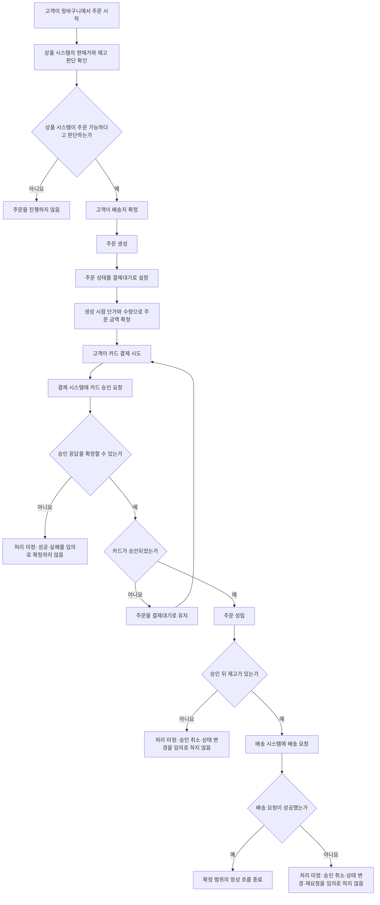

# 주문 스토리: 카드 승인으로 주문을 성립한다

## 1. 사용자 스토리

고객으로서 장바구니의 상품을 주문하기 위해 배송지를 확정하고 카드 승인을 받아 주문을 성립시키고 싶다.

## 2. 범위

### 시작 조건

- 고객이 장바구니에서 주문을 시작한다.
- 상품 시스템에서 판매가와 재고 판단을 받을 수 있다.

### 종료 조건

다음 중 하나에 도달할 때까지를 다룬다.

- 카드 승인이 완료되어 주문이 성립하고 배송 시스템에 배송을 요청한다.
- 카드 승인이 거절되어 주문이 결제대기로 남는다.
- 결제 응답을 확정할 수 없어 정책 결정이 필요한 상태가 된다.
- 카드 승인 뒤 재고 부족 또는 배송 요청 실패가 발생해 정책 결정이 필요한 상태가 된다.

### 포함

- 배송지 확정
- 주문 생성
- 주문 금액 확정
- 상품 시스템의 재고 판단 사용
- 카드 승인 요청과 결과 처리
- 카드 승인 후 배송 요청
- 확정된 범위와 미정 정책의 구분

### 제외

- 화면과 사용자 인터페이스
- 기술 설계와 구현 방식
- 카드 외 결제 수단
- 배송비
- 쿠폰과 할인
- 주문 성립 이후의 취소, 환불, 반품, 교환 및 배송 진행
- 외부 시스템 내부 동작
- 운영 시스템과 실제 고객 데이터 사용
- 주문 확인 통지의 구체적 구현(정책 미정)

## 3. 기본 흐름

재고 확인의 정확한 시점과 호출 횟수는 주어진 조건만으로 확정되지 않았다. 위 흐름의 “승인 뒤 재고” 판단은 미정 E를 드러내기 위한 표현이며, 상세 절차로 확정하면 안 된다.

## 4. 확정된 업무 규칙

### 주문 생성

- 고객이 배송지를 확정한 때 주문을 생성한다.
- 생성된 주문의 최초 상태는 `결제대기`다.
- 주문자와 수령인은 같은 사람으로 취급한다.
- 결제대기 주문의 상품, 수량 및 배송지는 변경할 수 없다.
- 이를 바꾸려는 고객은 새 주문을 만들어야 한다.

### 주문 금액

- 각 주문 항목의 금액은 `주문 생성 시점의 판매 단가 × 수량`이다.
- 주문 금액은 모든 주문 항목 금액의 합계다.
- 주문 생성 후 판매가가 변해도 주문 금액은 바뀌지 않는다.
- 카드 승인 요청에는 확정된 주문 금액을 청구한다.
- 배송비, 쿠폰 및 할인은 계산하지 않는다.

### 결제

- 결제 수단은 카드만 허용한다.
- 카드 승인이 완료된 때 주문이 성립한다.
- 카드 승인이 거절되어도 주문을 취소하지 않는다.
- 승인 거절 후 주문을 결제대기로 유지하여 다른 카드로 다시 결제할 수 있게 한다.
- 결제 시스템의 응답을 확정할 수 없으면 이를 성공 또는 실패로 임의 변환하지 않는다.

### 재고

- 재고 판단은 상품 시스템의 판단을 그대로 따른다.
- 주문 시스템은 재고를 별도로 확보하거나 예약하지 않는다.
- 승인 후 재고 부족에 대한 보상 처리는 아직 정하지 않는다.

### 배송 요청

- 카드 승인이 완료되기 전에는 배송을 요청하지 않는다.
- 카드 승인 완료 후에만 배송 시스템에 배송을 요청한다.
- 배송 요청 실패 시 승인 취소, 주문 상태 변경 및 재요청 방식을 임의로 정하지 않는다.

## 5. 대안·예외 흐름

### 카드 승인 거절

1. 결제 시스템이 카드 승인을 거절한다.
2. 주문은 취소되지 않고 결제대기로 남는다.
3. 고객은 다른 카드로 다시 승인 요청을 할 수 있다.

### 결제 응답 불확정

1. 승인 요청 후 성공인지 실패인지 확정할 수 없다.
2. 시스템은 이를 승인 성공이나 승인 실패로 단정하지 않는다.
3. 재결제 허용 여부를 포함한 이후 처리는 미정으로 남긴다.

### 승인 후 재고 부족

1. 카드 승인은 완료되었지만 상품 시스템이 재고 부족으로 판단한다.
2. 승인 취소나 주문 상태 변경을 임의로 수행하지 않는다.
3. 이후 처리는 미정으로 남긴다.

### 승인 후 배송 요청 실패

1. 카드 승인 완료 후 배송을 요청한다.
2. 배송 시스템이 요청을 받지 못하거나 실패를 반환한다.
3. 승인 취소, 주문 상태 변경 또는 재요청을 임의로 수행하지 않는다.
4. 재요청 주체와 방식은 미정으로 남긴다.

## 6. 용어

| 용어 | 의미 |
|---|---|
| 장바구니 | 고객이 주문하려는 상품과 수량을 모아 둔 주문 시작 자료 |
| 배송지 확정 | 고객이 주문에 사용할 배송지를 최종 선택하는 행위이며 주문 생성 시점 |
| 주문 | 확정된 상품, 수량, 배송지, 생성 시점 단가와 주문 금액을 보유하는 업무 기록 |
| 주문 항목 | 주문에 포함된 개별 상품과 그 수량 및 확정 단가 |
| 결제대기 | 주문은 생성됐지만 카드 승인이 완료되지 않은 상태 |
| 주문 금액 | 각 항목의 생성 시점 단가와 수량을 곱한 뒤 합산한 금액 |
| 카드 승인 | 결제 시스템이 해당 카드와 주문 금액의 결제를 허가한 결과 |
| 승인 거절 | 결제 시스템이 카드 결제를 허가하지 않았다고 확정한 결과 |
| 응답 불확정 | 카드 승인 성공 또는 거절 중 어느 쪽인지 확정할 수 없는 상황 |
| 주문 성립 | 카드 승인이 완료된 시점에 발생하는 업무 결과 |
| 재고 판단 | 상품 시스템이 제공하는 주문 가능 여부에 대한 판단 |
| 배송 요청 | 카드 승인 후 배송 시스템에 전달하는 배송 처리 요청 |
| 미정 정책 | 담당자가 아직 결정하지 않았으며 구현이 임의로 보완해서는 안 되는 규칙 |

`결제대기` 외의 구체적인 주문 상태 이름은 주어진 조건에 없으므로 새로 정의하지 않는다.

## 7. 품질 조건

### 업무 규칙 보존

- 주문 금액은 주문 생성 시점 이후의 판매가 변경에 영향을 받지 않아야 한다.
- 카드 승인 전에는 주문이 성립한 것으로 취급하지 않아야 한다.
- 카드 승인 전에는 배송 요청이 발생하지 않아야 한다.
- 승인 거절만으로 주문을 취소하거나 삭제하지 않아야 한다.
- 결제대기 주문의 상품, 수량 또는 배송지를 수정하지 않아야 한다.
- 주문 시스템이 자체적으로 재고를 확보한 것으로 간주하지 않아야 한다.

### 미정 정책 보호

- 결제대기 기한이나 만료 처리를 임의로 추가하지 않아야 한다.
- 불확정 결제 응답을 성공 또는 실패로 임의 확정하지 않아야 한다.
- 승인 후 재고 부족을 이유로 카드 승인을 임의 취소하지 않아야 한다.
- 배송 요청 실패 시 주문 상태, 승인 취소 및 재시도 방식을 임의로 결정하지 않아야 한다.
- 주문 확인 통지의 발송 주체를 임의로 결정하지 않아야 한다.

### 외부 연계 안전성

- 상품 시스템의 판매가와 재고 판단을 주문 시스템이 자의적으로 대체하지 않아야 한다.
- 결제 시스템에서 승인 완료가 확인된 경우에만 주문 성립으로 처리해야 한다.
- 배송 요청은 승인 완료 이후에만 발생해야 한다.
- 외부 시스템의 응답이 모호하면 확정된 응답으로 변환하지 않아야 한다.

### 개발 활용 방식

- 현재 업무 조건 결정은 수작업으로 수행하고, LLM은 질문과 정리만 보조한다.
- 요구·모델·설계·코드·검사 초안은 담당자가 LLM의 답마다 검토한다.
- 미정 사항은 자동화나 구현 편의를 위해 대신 결정하지 않는다.
- 검사와 완료 조건이 마련되고 실제 오류를 잡는다고 사람이 확인하기 전에는 자율 실행으로 전환하지 않는다.
- 릴리스 설명은 확정 범위, 제외 범위 및 미정 사항을 구분하며 공개 전에 사람이 최종 승인한다.
- 운영 시스템과 실제 고객 데이터는 사용하지 않는다.
- 로컬 변경은 Git으로 되돌릴 수 있는 범위에서 수행한다.

## 8. 사람 확인이 필요한 질문

### H. 고객 자격과 본인 확인

1. 비회원도 주문할 수 있는가?
2. 비회원 주문을 허용한다면 결제대기 주문을 다시 찾을 때 무엇으로 본인을 확인하는가?
3. 비회원 주문 조회에 필요한 정보와 보관 범위는 무엇인가?

### B. 결제대기 기한

4. 결제대기 주문에는 결제 가능 기한이 있는가?
5. 기한은 어느 시점부터 얼마 동안 계산하는가?
6. 기한이 지나면 주문을 만료, 취소 또는 삭제하는가, 아니면 결제만 차단하는가?
7. 기한 경계에서 진행 중인 카드 승인 요청은 어떻게 처리하는가?

### F. 결제 응답 불확정

8. 승인 결과를 확정할 수 없을 때 주문에 어떤 업무 상태 또는 표식을 남기는가?
9. 결제 시스템에 승인 결과를 조회하거나 대사하는 주체는 누구인가?
10. 결과를 확정하기 전 고객의 재결제를 허용하는가?
11. 재결제를 허용한다면 중복 승인 위험을 어떻게 처리하는가?
12. 불확정 상태를 해소하는 기한과 수동 처리 절차가 있는가?

### E. 승인 후 재고 부족

13. 승인 완료 뒤 상품 시스템이 재고 부족으로 판단하면 주문을 어떻게 처리하는가?
14. 카드 승인 취소가 필요한가? 필요하다면 누가 언제 수행하는가?
15. 주문 전체를 처리하지 못하게 하는가, 일부 항목만 처리할 수 있는가?
16. 재고 부족을 고객에게 누가 어떻게 알리는가?

### G. 배송 요청 실패

17. 배송 요청 실패 시 주문의 업무 상태는 무엇인가?
18. 배송 요청을 다시 시도하는가?
19. 재시도한다면 주체, 횟수, 간격 및 중단 조건은 무엇인가?
20. 같은 주문의 중복 배송 요청을 배송 시스템과 어떻게 식별하는가?
21. 최종적으로 배송 요청이 불가능하면 카드 승인과 주문을 어떻게 처리하는가?

### I. 주문 확인 통지

22. 주문 확인 통지는 이 주문 시스템이 보내는가, 다른 시스템의 통지로 대신하는가?
23. 통지는 카드 승인 직후와 배송 요청 성공 후 중 어느 시점에 보내는가?
24. 배송 요청이 실패했을 때도 주문 성립 통지를 보내는가?

### 추가로 확인할 경계

25. 최초 재고 판단은 배송지 확정 전인지 후인지, 또는 카드 승인 직전인지?
26. 주문 생성부터 승인까지 재고를 다시 확인해야 하는가?
27. 주문 성립 후 사용할 공식 주문 상태와 상태 전이 명칭은 무엇인가?
28. 결제 요청의 중복 제출을 식별하는 기준과 중복 승인 방지 책임은 어느 시스템에 있는가?
29. 배송지 확정 후 새 주문을 만들 때 원래 결제대기 주문은 그대로 유지하는가?
30. 외부 시스템의 지연·일시 오류와 명시적 거절을 업무적으로 어떻게 구분하는가?