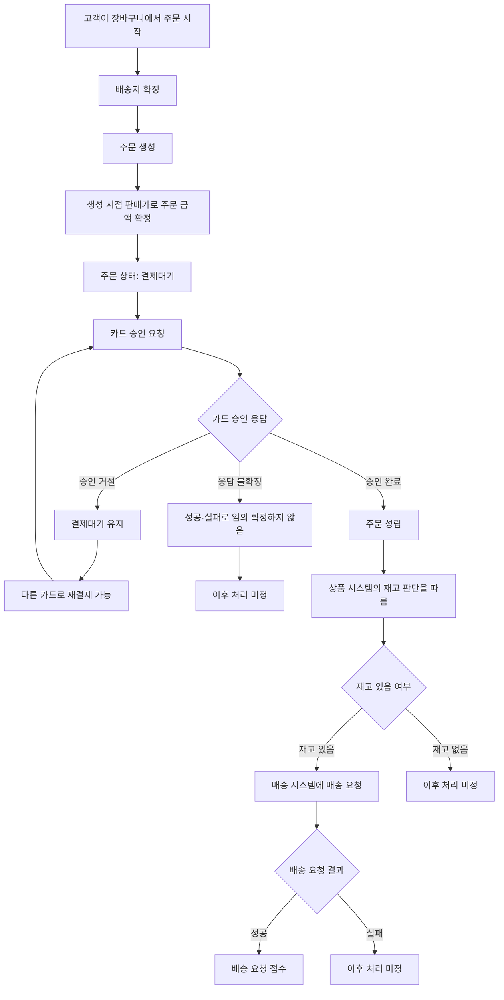

# 주문 기능 요구사항 정의서 초안

## 1. 목적

고객이 장바구니에서 주문을 시작하여 배송지를 확정하고, 카드 결제 승인을 받아 주문이 성립할 때까지의 요구사항을 정의한다.

본 문서는 제공된 업무 조건만 반영한다. 미정 사항은 정책으로 확정하지 않고 질문으로 남긴다.

## 2. 사용자 스토리

> 고객으로서, 장바구니의 상품과 배송지를 기준으로 주문을 생성하고 카드 결제 승인을 받아 주문을 성립시키고 싶다.

## 3. 기능과 흐름

### 3.1 주요 기능

1. 장바구니를 바탕으로 주문을 시작한다.
2. 고객이 배송지를 확정하면 주문을 생성한다.
3. 주문 생성 시 판매가와 수량을 기준으로 주문 금액을 확정한다.
4. 생성된 주문을 `결제대기` 상태로 둔다.
5. 결제대기 주문에 대해 카드 승인을 요청한다.
6. 카드 승인 결과에 따라 다음과 같이 처리한다.
   - 승인 완료: 주문이 성립한다.
   - 승인 거절: 주문을 `결제대기` 상태로 유지한다.
   - 응답 불확정: 성공이나 실패로 임의 확정하지 않는다.
7. 카드 승인 뒤 상품 시스템의 재고 판단을 따른다.
8. 카드 승인 뒤에만 배송 시스템에 배송을 요청한다.

### 3.2 기본 흐름

배송 요청과 재고 확인의 정확한 선후관계는 입력에서 확정되지 않았다. 위 도식은 승인 이후 두 연계가 필요함을 표현한 초안이며, 실제 순서는 미정 질문에서 확인해야 한다.

## 4. 업무 규칙

### BR-01 주문 생성

- 고객이 배송지를 확정하면 주문을 생성한다.
- 생성된 주문의 최초 상태는 `결제대기`이다.
- 주문자와 수령인은 같은 사람으로 본다.

### BR-02 주문 금액

- 각 주문 항목의 금액은 다음과 같이 계산한다.
  - `주문 생성 시점의 판매가 × 수량`
- 주문 금액은 모든 주문 항목 금액의 합이다.
- 주문 생성 뒤 상품 판매가가 변해도 주문 금액은 변경하지 않는다.
- 결제 시 주문 생성 때 확정한 금액을 청구한다.
- 배송비, 쿠폰 및 할인은 주문 금액 계산 범위에서 제외한다.

### BR-03 결제대기 주문의 변경 제한

- 결제대기 중에는 다음 정보를 변경할 수 없다.
  - 상품
  - 수량
  - 배송지
- 위 정보를 바꾸려면 기존 주문을 수정하지 않고 새로 주문해야 한다.

### BR-04 결제 수단과 주문 성립

- 결제 수단은 카드만 허용한다.
- 카드 승인이 완료된 때 주문이 성립한다.
- 카드 승인이 거절되어도 주문을 취소하지 않는다.
- 승인 거절 주문은 `결제대기` 상태로 유지한다.
- 고객은 승인 거절 후 다른 카드로 다시 결제할 수 있다.

### BR-05 결제 응답 불확정

- 결제 시스템의 응답을 확정할 수 없으면 이를 결제 실패로 바꾸지 않는다.
- 불확정 응답을 결제 성공으로도 임의 확정하지 않는다.
- 응답 불확정 이후의 처리와 재결제 허용 여부는 미정이다.

### BR-06 재고

- 재고 여부는 상품 시스템의 판단을 그대로 따른다.
- 주문 기능은 재고를 별도로 확보하지 않는다.
- 카드 승인 뒤 재고가 없을 때 승인 취소나 주문 상태 변경을 임의로 수행하지 않는다.

### BR-07 배송 요청

- 배송 시스템에는 카드 승인 뒤에만 배송을 요청한다.
- 배송 요청 실패 시 다음 처리를 임의로 수행하지 않는다.
  - 카드 승인 취소
  - 주문 상태 변경
  - 임의의 배송 재요청
- 재요청의 주체와 방식은 미정이다.

## 5. 용어

| 용어 | 정의 |
|---|---|
| 고객 | 장바구니에서 주문을 시작하고 배송지와 카드 결제를 제공하는 사람 |
| 주문자 | 주문하는 고객. 이 범위에서는 수령인과 같은 사람으로 본다. |
| 수령인 | 주문 상품을 받을 사람. 이 범위에서는 주문자와 같은 사람으로 본다. |
| 장바구니 | 고객이 주문하려는 상품과 수량을 담은 주문 시작점 |
| 주문 항목 | 주문에 포함된 개별 상품과 그 수량 및 주문 생성 시점의 판매가 |
| 주문 금액 | 각 주문 항목의 `주문 생성 시점 판매가 × 수량`을 모두 합한 금액 |
| 결제대기 | 주문이 생성되었으나 카드 승인이 완료되지 않은 상태 |
| 카드 승인 완료 | 결제 시스템에서 카드 결제가 승인되어 주문이 성립하는 조건 |
| 카드 승인 거절 | 결제 시스템에서 카드 승인을 거절한 결과. 주문은 결제대기로 유지된다. |
| 응답 불확정 | 결제 시스템의 응답을 성공 또는 실패로 확정할 수 없는 상황 |
| 주문 성립 | 카드 승인이 완료된 상태 |
| 재고 판단 | 상품 시스템이 해당 상품의 재고 여부를 판단하는 것 |
| 배송 요청 | 카드 승인 뒤 배송 시스템에 배송 처리를 요청하는 것 |

`주문 성립`이 별도의 주문 상태를 뜻하는지, 업무상 성립 여부만 뜻하는지는 미정이다.

## 6. 품질 요구사항

입력에서 성능, 보안, 가용성 및 운영 품질의 구체적인 목표치는 제시되지 않았다. 현재 확정할 수 있는 품질 요구사항은 다음과 같다.

### QR-01 금액 일관성

- 주문 생성 시 확정한 단가와 주문 금액은 이후 판매가 변경의 영향을 받지 않아야 한다.
- 카드 승인 요청 금액은 주문 생성 시 확정한 주문 금액과 같아야 한다.

### QR-02 상태 및 결과의 임의 확정 방지

- 카드 승인 거절을 주문 취소로 처리하지 않아야 한다.
- 결제 응답 불확정을 성공이나 실패로 임의 변경하지 않아야 한다.
- 미정 정책에 해당하는 상황에서 승인 취소, 주문 상태 변경, 삭제 또는 결제 차단을 임의로 수행하지 않아야 한다.

### QR-03 외부 시스템 판단 존중

- 판매가는 상품 시스템에서 제공한 주문 생성 시점의 값을 사용해야 한다.
- 재고는 상품 시스템의 판단을 그대로 따라야 한다.
- 카드 승인 완료 여부는 결제 시스템의 결과를 기준으로 해야 한다.
- 카드 승인 전에는 배송 요청이 발생하지 않아야 한다.

### 추가로 정의가 필요한 품질 항목

다음 항목은 목표나 기준이 입력에 없으므로 담당자의 결정이 필요하다.

- 주문 및 결제 처리 응답시간
- 동시 주문 처리량
- 서비스 가용성 및 장애 복구 목표
- 개인정보와 결제 관련 정보의 보호 기준
- 주문·결제·배송 요청 이력의 보존 및 추적 기준
- 외부 시스템 호출의 시간 제한과 장애 판단 기준
- 중복 주문, 중복 결제 및 중복 배송 요청 방지 기준

## 7. 수용 기준

### AC-01 주문 생성

**Given** 고객이 장바구니에서 주문을 시작했고  
**When** 배송지를 확정하면  
**Then** 주문이 생성되고 주문 상태는 `결제대기`여야 한다.

### AC-02 주문 금액 확정

**Given** 주문 항목별 판매가와 수량이 제공되었고  
**When** 주문이 생성되면  
**Then** 주문 금액은 각 항목의 `생성 시점 판매가 × 수량`을 합산한 값이어야 한다.

### AC-03 판매가 변경

**Given** 주문 금액이 확정된 주문이 있고  
**When** 상품 시스템의 판매가가 변경되어도  
**Then** 해당 주문의 단가와 주문 금액은 변경되지 않아야 하며, 확정된 주문 금액을 청구해야 한다.

### AC-04 결제대기 정보 변경 제한

**Given** 주문이 `결제대기` 상태일 때  
**When** 고객이 상품, 수량 또는 배송지를 변경하려 하면  
**Then** 기존 주문에서는 변경할 수 없어야 하며 새 주문이 필요함을 알려야 한다.

알림의 표현 및 전달 방식은 화면 범위에 해당하므로 본 문서에서는 정하지 않는다.

### AC-05 카드 승인 완료

**Given** 주문이 `결제대기` 상태이고  
**When** 카드 승인이 완료되면  
**Then** 주문이 성립해야 한다.

### AC-06 카드 승인 거절

**Given** 주문이 `결제대기` 상태이고  
**When** 카드 승인이 거절되면  
**Then** 주문은 취소되지 않고 `결제대기` 상태로 남아야 하며 다른 카드로 다시 결제할 수 있어야 한다.

### AC-07 결제 응답 불확정

**Given** 결제 시스템에 카드 승인을 요청했고  
**When** 응답을 성공 또는 실패로 확정할 수 없으면  
**Then** 이를 성공이나 실패로 임의 확정하지 않아야 한다.

재결제 허용 여부와 이후 처리에 관한 수용 기준은 정책 확정 전까지 정의하지 않는다.

### AC-08 재고 판단

**Given** 카드 승인이 완료되었고  
**When** 재고 여부를 판단하면  
**Then** 주문 기능이 별도 재고를 확보하지 않고 상품 시스템의 판단을 따라야 한다.

승인 뒤 품절인 경우의 최종 결과는 정책 확정 전까지 정의하지 않는다.

### AC-09 배송 요청 시점

**Given** 주문의 카드 승인 여부가 확인되지 않았거나 승인이 완료되지 않았을 때  
**Then** 배송 시스템에 배송을 요청하지 않아야 한다.

**Given** 카드 승인이 완료되었을 때  
**Then** 배송 시스템에 배송을 요청해야 한다.

배송 요청 실패 이후의 최종 결과는 정책 확정 전까지 정의하지 않는다.

## 8. 범위

### 포함

- 장바구니에서 주문 시작
- 배송지 확정
- 주문 생성
- 주문 생성 시점의 판매가 및 주문 금액 확정
- 결제대기 주문 관리
- 카드 승인 요청과 결과 처리
- 카드 승인 완료에 따른 주문 성립
- 상품 시스템의 재고 판단 연계
- 카드 승인 뒤 배송 시스템에 배송 요청

### 연계 대상

- 상품 시스템
  - 판매가 제공
  - 재고 판단
- 결제 시스템
  - 카드 승인
- 배송 시스템
  - 배송 요청 수신

## 9. 제외 범위

- 화면 및 사용자 인터페이스
- 기술 설계
- 데이터 모델
- 코드 및 구현 방식
- 결제 이후의 취소
- 환불
- 반품
- 교환
- 배송 진행
- 카드 외 결제 수단
- 배송비
- 쿠폰
- 할인

## 10. 미정 사항 및 확인 질문

### H. 비회원 주문

1. 비회원 주문을 허용하는가?
2. 허용한다면 비회원이 결제대기 주문을 다시 찾을 때 어떤 정보와 절차로 본인을 확인하는가?
3. 회원 주문만 허용한다면 주문 시작 또는 배송지 확정 중 어느 시점에 회원 여부를 확인하는가?

### B. 결제대기 기한

1. 결제대기 주문에 기한을 둘 것인가?
2. 기한을 둔다면 언제부터 얼마 동안인가?
3. 기한이 지나면 주문을 어떤 상태로 처리하는가?
4. 기한이 지난 주문을 취소, 삭제 또는 보존하는가?
5. 기한이 지난 뒤 결제를 차단하는가?
6. 기한 경과 시 고객에게 알림이 필요한가?

### F. 결제 응답 불확정

1. 결제 응답을 확정할 수 없을 때 주문에 어떤 상태 또는 표시를 적용하는가?
2. 불확정 결과를 누가, 어떤 근거로 확인하는가?
3. 결제 시스템에 승인 결과를 다시 조회하는가?
4. 결과 확인 전 고객의 재결제를 허용하는가?
5. 재결제를 허용한다면 중복 승인 가능성을 어떻게 처리하는가?
6. 불확정 상태를 고객이나 운영 담당자에게 통지하는가?

### E. 승인 뒤 재고 없음

1. 카드 승인 완료 뒤 상품 시스템이 재고 없음을 판단하면 주문을 어떻게 처리하는가?
2. 카드 승인을 취소하는가?
3. 주문 상태를 변경하는가? 변경한다면 어떤 상태인가?
4. 일부 항목만 재고가 없을 때 주문 전체와 해당 항목을 어떻게 처리하는가?
5. 고객 또는 운영 담당자에게 통지하는가?
6. 카드 승인 이후에 재고를 확인하는 것이 확정된 순서인가, 아니면 승인 전에도 재고 판단이 필요한가?

### G. 배송 요청 실패

1. 배송 요청 실패 시 누가 재요청하는가?
2. 자동으로 재요청한다면 횟수와 간격은 어떻게 정하는가?
3. 수동 재요청을 허용하는가?
4. 실패 시 주문 상태를 변경하는가?
5. 카드 승인을 유지하는가, 취소하는가?
6. 재요청 과정에서 중복 배송 요청을 어떻게 식별하고 방지하는가?
7. 고객 또는 운영 담당자에게 실패를 통지하는가?

### I. 주문 확인 통지

1. 주문 성립 후 고객에게 주문 확인을 통지하는가?
2. 이 주문 기능이 통지를 보내는가, 다른 시스템의 통지로 대신하는가?
3. 통지한다면 대상, 시점 및 채널은 무엇인가?
4. 통지 실패 시 재시도나 운영 처리가 필요한가?

### 추가 확인이 필요한 사항

1. `주문 성립`은 별도의 주문 상태인가, 카드 승인 완료라는 업무상 결과인가?
2. 카드 승인 완료 뒤 주문 상태의 명칭은 무엇인가?
3. 배송 요청과 승인 후 재고 판단의 정확한 실행 순서는 무엇인가?
4. 카드 승인 전에 상품 시스템에서 재고를 확인하는 절차가 있는가?
5. 주문 생성 시 상품 시스템이 재고 없음을 반환하면 주문 생성을 허용하는가?
6. 장바구니가 비어 있거나 수량이 유효하지 않을 때 주문 생성을 어떻게 처리하는가?
7. 주문 생성 시 상품 시스템에서 판매가를 가져올 수 없으면 어떻게 처리하는가?
8. 동일한 요청으로 주문이 중복 생성되는 것을 방지해야 하는가?
9. 카드 승인 요청이나 배송 요청이 중복 전달될 때 외부 시스템과 주문 기능은 이를 어떻게 처리하는가?
10. 주문 및 외부 연계 이력을 얼마나 오래 보존해야 하는가?
11. 개인정보, 배송지 및 카드 관련 정보에 적용할 보안·접근·보존 기준은 무엇인가?
12. 응답시간, 처리량, 가용성 및 장애 복구에 대한 목표는 무엇인가?