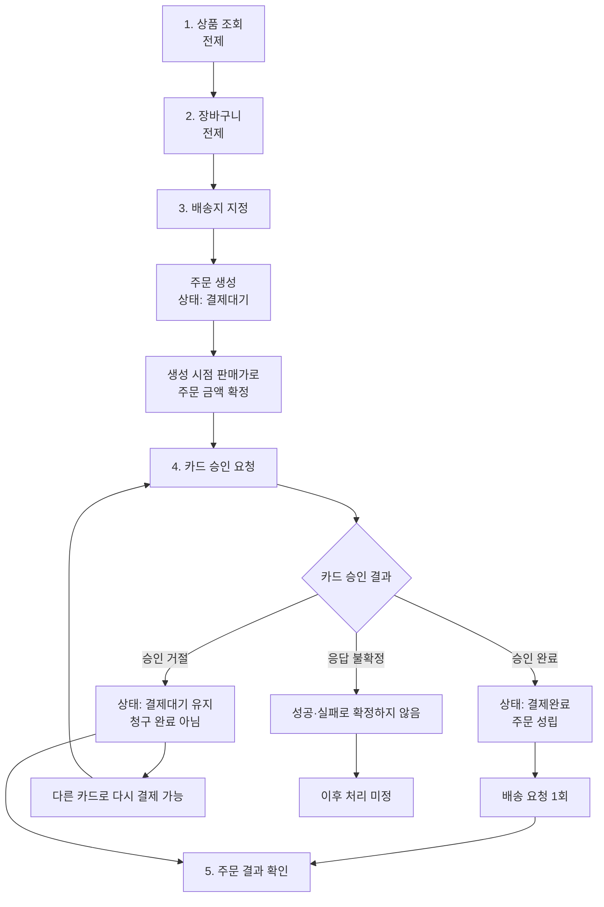

# 주문 기능 요구사항 정의서 초안 — 수정본

## 1. 목적과 작성 원칙

고객이 장바구니에서 주문을 시작해 배송지를 지정하고, 카드 결제 결과를 확인할 때까지의 요구사항을 정의한다.

- 기본 흐름 1~2는 전제, 상세 범위는 3~5이다.
- 제공된 업무 조건과 추가 확정 자료만 반영한다.
- 미정 사항은 확정 흐름이나 수용 기준에 끼워 넣지 않는다.
- 모델, 기술 설계, 코드 및 화면은 이 문서에서 작성하지 않는다.

## 2. 사용자 스토리

> 고객으로서, 장바구니의 상품에 배송지를 지정하고 주문 생성 시 확정된 금액으로 카드 승인을 받아 주문 결과를 확인하고 싶다.

## 3. 기능과 흐름

### 3.1 기본 흐름

1. 상품 조회
2. 장바구니
3. 배송지 지정
4. 결제
5. 주문 결과 확인

상품 조회와 장바구니는 주문 기능을 시작하기 위한 전제이다. 이 문서의 상세 범위는 배송지 지정부터 주문 결과 확인까지다.

재고 판단은 상품 시스템을 따르지만 판단 시점이 정해지지 않았다. 따라서 재고 판단이나 재고 부족 처리를 위 확정 흐름에 배치하지 않는다.

주문 결과 확인은 기본 흐름에 포함되지만, 별도의 주문 확인 통지를 누가 보내는지는 확정하지 않는다.

### 3.2 주요 기능

1. 고객이 배송지를 확정하면 주문을 생성한다.
2. 생성된 주문의 상태를 `결제대기(PENDING_PAYMENT)`로 둔다.
3. 주문 생성 시점의 판매가와 수량으로 주문 금액을 확정한다.
4. 결제대기 주문에 대해 확정된 주문 금액으로 카드 승인을 요청한다.
5. 카드 승인 결과를 처리한다.
   - 승인 완료: 같은 주문이 성립하고 상태는 `결제완료(PAID)`가 된다.
   - 승인 거절: 같은 주문을 `결제대기`로 유지하며 청구 완료로 보지 않는다.
   - 응답 불확정: 성공이나 실패로 임의 확정하지 않는다.
6. 승인 거절 후 같은 주문에 다른 카드로 다시 승인을 요청할 수 있다.
7. 카드 승인 완료 뒤 배송 시스템에 배송을 1회 요청한다.
8. 고객은 자신의 주문 결과를 확인할 수 있다.

## 4. 업무 규칙

### BR-01 주문 생성

- 고객이 배송지를 확정하면 주문을 생성한다.
- 최초 상태는 `결제대기(PENDING_PAYMENT)`이다.
- 주문자와 수령인은 같은 사람으로 본다.

### BR-02 주문 금액

- 주문 항목 금액은 `주문 생성 시점 판매가 × 수량`이다.
- 주문 금액은 모든 주문 항목 금액의 합이다.
- 주문 생성 후 판매가가 변경되어도 같은 주문의 주문 금액은 바뀌지 않는다.
- 카드 승인 요청 금액은 주문 생성 시 확정된 주문 금액이다.

### BR-03 결제대기 주문의 변경 제한

- 결제대기 중에는 상품, 수량 및 배송지를 변경할 수 없다.
- 이를 바꾸려면 새로 주문해야 한다.
- 변경 거절의 응답 코드나 화면 표현은 정하지 않는다.

### BR-04 카드 결제와 주문 성립

- 결제 수단은 카드만 허용한다.
- 카드 승인이 완료되면 같은 주문이 성립하고 상태는 `결제완료(PAID)`가 된다.
- 카드 승인이 거절되면 청구 완료가 아니다.
- 승인 거절 시 같은 주문은 취소되지 않고 `결제대기`로 유지된다.
- 고객은 같은 주문에 다른 카드로 다시 결제를 요청할 수 있다.

### BR-05 결제 응답 불확정

- 결제 시스템의 응답을 확정할 수 없으면 실패로 바꾸지 않는다.
- 성공으로도 임의 확정하지 않는다.
- 이후 처리와 재결제 허용 여부는 미정이다.

이 규칙은 불확정 상황을 영구히 아무 처리도 하지 않는다는 정책을 뜻하지 않는다. 미정 정책을 구현자가 임의로 결정하지 말아야 한다는 제약이다.

### BR-06 재고

- 재고는 상품 시스템의 판단을 그대로 따른다.
- 주문 기능은 재고를 별도로 확보하지 않는다.
- 재고 판단 시점과 승인 전후 재고 부족 처리는 미정이다.
- 승인 뒤 재고가 없을 때 승인 취소나 주문 상태 변경 여부도 미정이다.

### BR-07 배송 요청

- 카드 승인 전이나 승인 거절 직후에는 배송을 요청하지 않는다.
- 카드 승인 완료 뒤 배송을 요청한다.
- 정상 승인 및 가격 변경 후 승인 사례에서는 배송 요청이 1회 발생한다.
- 카드 X 거절 후 카드 Y 승인 사례에서는 전체 결제 시도에 걸쳐 배송 요청이 총 1회 발생한다.
- 배송 요청 실패 후 처리는 미정이다.

## 5. 기본 용어

다음 표기는 공통 업무 용어이며 클래스나 속성 설계를 뜻하지 않는다.

| 한글 용어 | 공통 표기 | 정의 |
|---|---|---|
| 주문 | Order | 배송지 확정으로 생성되고 카드 승인 결과에 따라 성립 여부가 결정되는 주문 |
| 주문 항목 | OrderItem | 주문에 포함된 개별 상품과 수량 |
| 판매가 | salePrice | 주문 항목의 단가로 사용하는 상품 시스템의 판매가 |
| 주문 금액 | totalAmount | 주문 생성 시점의 항목별 `판매가 × 수량`을 합한 금액 |
| 결제대기 | PENDING_PAYMENT | 주문은 생성됐지만 카드 승인이 완료되지 않은 상태 |
| 결제완료 | PAID | 카드 승인이 완료되어 주문이 성립한 상태 |
| 승인 요청 금액 | — | 결제 시스템에 카드 승인을 요청하는 금액. 확정된 주문 금액과 같다. |
| 승인 거절 | — | 카드 승인이 거절된 결과. 청구 완료가 아니며 주문은 결제대기로 유지된다. |
| 응답 불확정 | — | 결제 시스템의 응답을 성공 또는 실패로 확정할 수 없는 상황 |
| 배송 요청 | — | 카드 승인 완료 뒤 배송 시스템에 전달하는 요청 |

## 6. 대표 상황별 수용 기준

네 상황 모두 다음 시험 예를 사용한다.

- 상품: 펜
- 수량: 2개
- 주문 생성 시 판매가: 개당 1,000원
- 주문 금액: 2,000원
- 배송지: 서울
- 카드 X: 승인 거절
- 카드 Y: 승인 완료
- 주문 생성 후 가격 변경 사례의 새 판매가: 개당 1,200원

### AC-01 정상 승인

**전제**

- 펜 2개가 장바구니에 있다.
- 판매가는 개당 1,000원이다.
- 고객이 배송지를 서울로 확정해 주문을 생성했다.
- 생성된 주문의 주문 금액은 2,000원이고 상태는 `결제대기`이다.

**사건**

- 고객이 카드 Y로 결제한다.
- 카드 Y의 승인이 완료된다.

**기대 결과**

| 관찰 항목 | 기대 결과 |
|---|---|
| 동일 주문 여부 | 생성된 같은 주문이 유지된다. |
| 주문 금액 | 2,000원 |
| 승인 요청 금액 | 2,000원 |
| 상태 | `결제완료(PAID)` |
| 배송 요청 횟수 | 1회 |

### AC-02 주문 생성 후 가격 변경과 승인

**전제**

- 펜 2개, 개당 1,000원으로 주문을 생성했다.
- 생성된 주문의 주문 금액은 2,000원이고 상태는 `결제대기`이다.
- 주문 생성 후 상품 시스템의 판매가가 개당 1,200원으로 변경됐다.

**사건**

- 고객이 카드 Y로 결제한다.
- 카드 Y의 승인이 완료된다.

**기대 결과**

| 관찰 항목 | 기대 결과 |
|---|---|
| 동일 주문 여부 | 가격 변경 전 생성된 같은 주문이 유지된다. |
| 주문 금액 | 2,000원으로 유지된다. |
| 승인 요청 금액 | 2,000원 |
| 상태 | `결제완료(PAID)` |
| 배송 요청 횟수 | 1회 |

변경된 판매가를 적용한 2,400원으로 주문 금액이나 승인 요청 금액을 바꾸지 않는다.

### AC-03 카드 승인 거절

**전제**

- 펜 2개, 개당 1,000원으로 주문을 생성했다.
- 생성된 주문의 주문 금액은 2,000원이고 상태는 `결제대기`이다.

**사건**

- 고객이 카드 X로 결제한다.
- 카드 X의 승인이 거절된다.

**기대 결과**

| 관찰 항목 | 기대 결과 |
|---|---|
| 동일 주문 여부 | 생성된 같은 주문이 유지되며 취소되지 않는다. |
| 주문 금액 | 2,000원 |
| 승인 요청 금액 | 2,000원 |
| 상태 | `결제대기(PENDING_PAYMENT)` |
| 배송 요청 횟수 | 0회 |

승인 거절은 청구 완료가 아니다.

### AC-04 카드 X 거절 후 카드 Y 승인

**전제**

- 펜 2개, 개당 1,000원으로 주문을 생성했다.
- 생성된 주문의 주문 금액은 2,000원이고 상태는 `결제대기`이다.

**사건**

1. 같은 주문에 카드 X로 승인을 요청한다.
2. 카드 X의 승인이 거절된다.
3. 같은 주문에 카드 Y로 다시 승인을 요청한다.
4. 카드 Y의 승인이 완료된다.

**기대 결과**

| 관찰 항목 | 카드 X 거절 직후 | 카드 Y 승인 완료 후 |
|---|---|---|
| 동일 주문 여부 | 원래 주문과 같은 주문 | 원래 주문과 같은 주문 |
| 주문 금액 | 2,000원 | 2,000원 |
| 승인 요청 금액 | 2,000원 | 2,000원 |
| 상태 | `결제대기(PENDING_PAYMENT)` | `결제완료(PAID)` |
| 누적 배송 요청 횟수 | 0회 | 총 1회 |

## 7. 품질 및 접근 기준

### QR-01 실습 정상 품질 시험 기준

- 외부 상품·결제·배송 시스템은 정상 응답하는 테스트 대역을 사용한다.
- 각 외부 시스템의 응답 시간은 1초 이내로 둔다.
- 카드 결제 요청 100건을 동시에 실행한다.
- 기본 흐름 4의 요청부터 흐름 5의 결과 수신까지 측정한다.
- 100건 중 95건 이상이 3초 이내에 완료돼야 한다.

이 기준은 실습의 정상 품질 시험 조건이며 운영 환경의 성능 보장 수치가 아니다.

### QR-02 금액 일관성

- 주문 생성 시 확정한 판매가와 주문 금액은 이후 판매가 변경의 영향을 받지 않아야 한다.
- 각 카드 승인 요청 금액은 같은 주문의 확정된 주문 금액과 같아야 한다.

### QR-03 결제 및 배송 결과의 일관성

- 승인 거절을 청구 완료나 주문 취소로 처리하지 않아야 한다.
- 결제 응답 불확정을 성공이나 실패로 임의 확정하지 않아야 한다.
- 승인 완료 전에는 배송 요청이 발생하지 않아야 한다.
- 대표 정상 승인 사례에서는 배송 요청이 정확히 1회 발생해야 한다.

### QR-04 주문 접근 기준

- 고객은 본인의 주문만 조회하거나 변경을 요청할 권한이 있다.
- 타인의 주문에 대한 조회 및 변경 요청은 거절해야 한다.
- 본인이라도 `결제대기` 주문의 상품, 수량 및 배송지는 변경할 수 없다.
- 인증 방식, 거절 응답 코드 및 화면 표현은 정하지 않는다.

## 8. 범위

### 상세 범위

- 배송지 지정과 확정
- 주문 생성
- 주문 생성 시점의 판매가 및 주문 금액 확정
- 결제대기 상태 처리
- 카드 승인 요청
- 승인 완료, 승인 거절 및 응답 불확정 결과 처리
- 승인 거절 후 다른 카드로 같은 주문 재결제
- 승인 완료에 따른 주문 성립과 결제완료 상태
- 승인 완료 뒤 배송 요청
- 주문 결과 확인
- 본인 주문에 대한 접근 제한

### 전제 범위

- 상품 조회
- 장바구니
- 상품 시스템의 판매가 제공

### 연계 대상

- 상품 시스템: 판매가 제공 및 재고 판단
- 결제 시스템: 카드 승인
- 배송 시스템: 배송 요청 수신

## 9. 제외 범위

- 화면 및 사용자 인터페이스
- 결제 이후의 취소, 환불, 반품 및 교환
- 배송 진행
- 카드 외 결제 수단
- 배송비
- 쿠폰 및 할인

다음은 기능 제외가 아니라 이번 요구사항 정의서에서 작성하지 않는 산출물이다.

- 데이터 모델
- 기술 설계
- 코드와 구현 방식
- 구체적인 검사 구현

## 10. 미정 사항

### H. 비회원 주문

- 비회원 주문 허용 여부
- 허용할 경우 결제대기 주문을 다시 찾을 때의 본인 확인 방법

### B. 결제대기 기한

- 결제대기 기한의 유무와 길이
- 기한 경과 후 취소, 삭제, 보존 또는 상태 처리
- 기한 경과 후 결제 차단 여부

정책이 정해질 때까지 구현자가 만료, 취소, 삭제 또는 결제 차단을 임의로 정하지 않는다.

### F. 결제 응답 불확정

- 결과 확인 방법과 책임 주체
- 재결제 허용 여부
- 중복 승인 가능성에 대한 처리
- 이후 적용할 상태나 표시

정책이 정해질 때까지 성공 또는 실패를 임의로 확정하지 않는다. 이를 영구 무동작 정책으로 해석하지 않는다.

### E. 재고 판단과 재고 부족

- 재고 판단 시점
- 승인 전 재고 부족 시 처리
- 승인 뒤 재고 부족 시 처리
- 일부 주문 항목만 재고가 없을 때의 처리
- 승인 취소나 주문 상태 변경 여부

재고 판단은 확정된 결제 흐름에 선행 또는 후행하는 단계로 배치하지 않는다.

### G. 배송 요청 실패

- 배송 요청 실패 후 주문 및 카드 승인 처리
- 재요청 여부
- 재요청의 주체, 횟수 및 방식
- 중복 배송 요청 방지 방법

### I. 주문 확인 통지

- 주문 확인 통지 여부
- 이 주문 기능과 다른 시스템 중 통지 주체
- 통지 대상, 시점 및 채널
- 통지 실패 후 처리

기본 흐름의 주문 결과 확인만으로 별도의 통지 의무나 주체를 확정하지 않는다.

### 그 밖에 근거가 없어 미정으로 유지할 사항

- 장바구니가 비어 있거나 수량이 유효하지 않을 때의 처리
- 주문 생성 시 판매가를 가져올 수 없을 때의 처리
- 중복 주문·결제·배송 요청의 식별 및 처리
- 외부 시스템의 시간 초과와 장애 판단 기준
- 이력 보존 기간
- 개인정보와 카드 관련 정보의 구체적인 인증·보안·보존 방식
- 실습 시험 기준을 제외한 운영 성능, 처리량, 가용성 및 복구 목표
