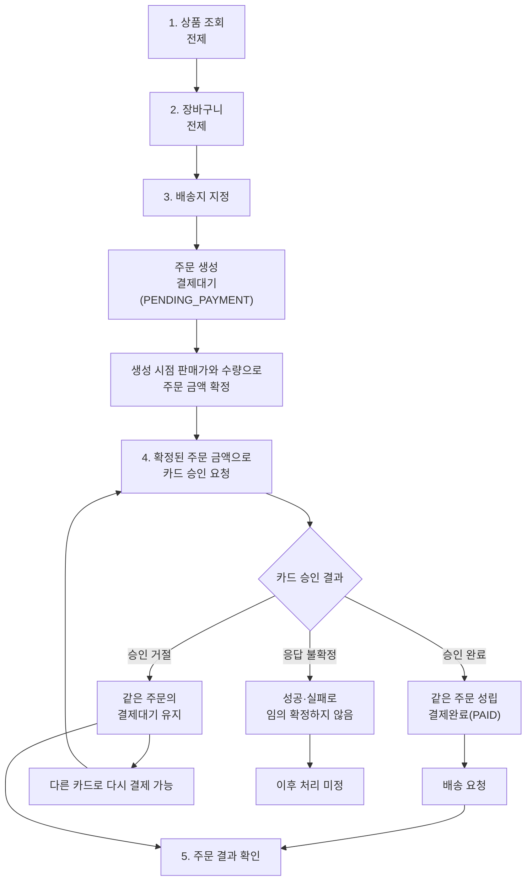

# 주문한다 요구사항 정의서

## 1. 사용자 스토리

> 고객으로서, 장바구니의 상품에 배송지를 지정하고 주문 생성 시 확정된 금액으로 카드 승인을 받아 주문 결과를 확인하고 싶다.

## 2. 범위와 제외

### 2.1 기본 흐름

1. 상품 조회
2. 장바구니
3. 배송지 지정
4. 결제
5. 주문 결과 확인

상품 조회와 장바구니는 주문 기능을 시작하기 위한 전제이다. 상세 범위는 배송지 지정부터 주문 결과 확인까지다.

결과 확인에 별도의 주문 확인 통지가 포함되는지와 그 통지 주체는 확정하지 않는다.

### 2.2 상세 범위

- 배송지 지정과 확정
- 주문 생성
- 주문 생성 시점의 판매가와 주문 금액 확정
- 결제대기 상태 처리
- 카드 승인 요청
- 승인 완료, 승인 거절 및 응답 불확정 결과 처리
- 승인 거절 후 다른 카드로 같은 주문에 다시 결제
- 승인 완료에 따른 주문 성립과 결제완료 상태
- 승인 완료 뒤 배송 요청
- 주문 결과 확인
- 본인 주문에 대한 접근 제한

### 2.3 전제 및 연계 대상

- 상품 조회와 장바구니는 전제 범위다.
- 상품 시스템은 판매가를 제공하고 재고를 판단한다.
- 결제 시스템은 카드 승인 결과를 제공한다.
- 배송 시스템은 배송 요청을 수신한다.

### 2.4 제외 범위

- 화면과 사용자 인터페이스
- 결제 이후의 취소, 환불, 반품 및 교환
- 배송 진행
- 카드 외 결제 수단
- 배송비
- 쿠폰과 할인

다음은 기능 제외가 아니라 이 문서에서 작성하지 않는 산출물이다.

- 데이터 모델
- 기술 설계
- 코드와 구현 방식
- 구체적인 검사 구현

## 3. 기능과 흐름

### 3.1 주요 기능

1. 고객이 배송지를 확정하면 주문을 생성한다.
2. 생성된 주문의 상태를 `결제대기(PENDING_PAYMENT)`로 둔다.
3. 주문 생성 시점의 판매가와 수량으로 주문 금액을 확정한다.
4. 확정된 주문 금액으로 카드 승인을 요청한다.
5. 카드 승인 결과를 처리한다.
   - 승인 완료: 같은 주문이 성립하고 `결제완료(PAID)`가 된다.
   - 승인 거절: 같은 주문을 `결제대기`로 유지하며 청구 완료로 보지 않는다.
   - 응답 불확정: 성공이나 실패로 임의 확정하지 않는다.
6. 승인 거절 후 같은 주문에 다른 카드로 다시 승인을 요청할 수 있다.
7. 카드 승인 완료 뒤 배송 시스템에 배송을 요청한다.
8. 고객은 자신의 주문 결과를 확인할 수 있다.

재고 판단 시점과 승인 전후의 재고 부족 처리는 정해지지 않았다. 따라서 재고 판단을 다음 확정 흐름에 선행하거나 후행하는 단계로 배치하지 않는다.

## 4. 업무 규칙

### BR-01 주문 생성

- 고객이 배송지를 확정하면 주문을 생성한다.
- 주문의 최초 상태는 `결제대기(PENDING_PAYMENT)`다.
- 주문자와 수령인은 같은 사람으로 본다.

### BR-02 주문 금액

- 주문 항목 금액은 `주문 생성 시점 판매가 × 수량`이다.
- 주문 금액은 모든 주문 항목 금액의 합이다.
- 주문 생성 후 판매가가 변경되어도 같은 주문의 판매가와 주문 금액은 바뀌지 않는다.
- 카드 승인 요청 금액은 주문 생성 시 확정된 주문 금액이다.

### BR-03 결제대기 주문의 변경 제한

- 결제대기 중에는 상품, 수량 및 배송지를 변경할 수 없다.
- 이를 변경하려면 새로 주문해야 한다.
- 변경 거절의 응답 코드와 화면 표현은 정하지 않는다.

### BR-04 카드 결제와 주문 성립

- 결제 수단은 카드만 허용한다.
- 카드 승인이 완료되면 같은 주문이 성립하고 상태는 `결제완료(PAID)`가 된다.
- 카드 승인 거절은 청구 완료가 아니다.
- 승인이 거절돼도 주문을 취소하지 않고 `결제대기`로 유지한다.
- 고객은 승인 거절 후 같은 주문에 다른 카드로 다시 결제할 수 있다.

### BR-05 결제 응답 불확정

- 결제 시스템의 응답을 확정할 수 없으면 실패로 바꾸지 않는다.
- 성공으로도 임의 확정하지 않는다.
- 이후 처리와 재결제 허용 여부는 미정이다.
- 이는 영구적으로 아무 처리도 하지 않는다는 정책이 아니라, 미정 정책을 구현자가 임의로 결정하지 않아야 한다는 제약이다.

### BR-06 재고

- 재고는 상품 시스템의 판단을 그대로 따른다.
- 주문 기능은 재고를 별도로 확보하지 않는다.
- 재고 판단 시점과 승인 전후 재고 부족 처리는 미정이다.
- 승인 뒤 재고가 없을 때의 승인 취소 또는 주문 상태 변경 여부도 미정이다.

### BR-07 배송 요청

- 카드 승인 전이나 승인 거절 직후에는 배송을 요청하지 않는다.
- 카드 승인 완료 뒤 배송 시스템에 배송을 요청한다.
- 확인된 대표 상황에서 배송 요청 횟수는 다음과 같다.
  - 정상 승인: 1회
  - 주문 생성 후 가격이 변경된 뒤 승인: 1회
  - 승인 거절 직후: 0회
  - 카드 X 거절 후 카드 Y 승인까지: 총 1회
- 배송 요청 실패 후 처리는 미정이다.

### BR-08 주문 접근

- 고객은 본인의 주문만 조회하거나 변경을 요청할 권한이 있다.
- 타인의 주문에 대한 조회와 변경 요청은 거절한다.
- 본인의 주문이라도 결제대기 중에는 상품, 수량 및 배송지를 변경할 수 없다.
- 인증 방식, 거절 응답 코드 및 화면 표현은 정하지 않는다.

## 5. 용어

다음 표기는 공통 업무 용어이며 클래스나 속성 설계를 뜻하지 않는다.

| 한글 용어 | 공통 표기 | 정의 |
|---|---|---|
| 주문 | Order | 배송지 확정으로 생성되고 카드 승인 결과에 따라 성립 여부가 결정되는 주문 |
| 주문 항목 | OrderItem | 주문에 포함된 개별 상품과 수량 |
| 판매가 | salePrice | 주문 금액 계산에 사용하는 주문 생성 시점의 상품 판매가 |
| 주문 금액 | totalAmount | 항목별 `주문 생성 시점 판매가 × 수량`을 모두 합한 금액 |
| 결제대기 | PENDING_PAYMENT | 주문은 생성됐지만 카드 승인이 완료되지 않은 상태 |
| 결제완료 | PAID | 카드 승인이 완료되어 주문이 성립한 상태 |
| 승인 요청 금액 | — | 결제 시스템에 카드 승인을 요청하는 금액으로, 확정된 주문 금액과 같다. |
| 승인 거절 | — | 카드 승인이 거절된 결과. 청구 완료가 아니며 주문은 결제대기로 유지된다. |
| 응답 불확정 | — | 결제 시스템의 응답을 성공 또는 실패로 확정할 수 없는 상황 |
| 배송 요청 | — | 카드 승인 완료 뒤 배송 시스템에 전달하는 요청 |

## 6. 품질 및 접근 요구사항

### QR-01 실습 정상 품질 시험 기준

- 외부 상품·결제·배송 시스템은 정상 응답하는 테스트 대역으로 둔다.
- 각 외부 시스템의 응답 시간은 1초 이내로 둔다.
- 카드 결제 요청 100건을 동시에 실행한다.
- 기본 흐름 4의 요청부터 흐름 5의 결과 수신까지 측정한다.
- 100건 중 95건 이상이 3초 이내에 완료돼야 한다.

이는 실습의 정상 품질 시험 조건이며 운영 환경의 성능 보장 수치가 아니다.

### QR-02 금액 일관성

- 주문 생성 시 확정한 판매가와 주문 금액은 이후 판매가 변경의 영향을 받지 않아야 한다.
- 각 카드 승인 요청 금액은 같은 주문에서 확정된 주문 금액과 같아야 한다.

### QR-03 결제 및 배송 결과의 일관성

- 승인 거절을 청구 완료나 주문 취소로 처리하지 않아야 한다.
- 결제 응답 불확정을 성공이나 실패로 임의 확정하지 않아야 한다.
- 승인 완료 전에는 배송 요청이 발생하지 않아야 한다.
- 대표 정상 승인 상황에서는 배송 요청이 정확히 1회 발생해야 한다.

### QR-04 주문 접근 기준

- 고객은 본인의 주문만 조회하거나 변경을 요청할 수 있어야 한다.
- 타인의 주문에 대한 조회 및 변경 요청은 거절해야 한다.
- 본인의 주문이라도 `결제대기` 상태의 상품, 수량 및 배송지는 변경할 수 없어야 한다.
- 인증 방식, 거절 응답 코드 및 화면은 이 문서에서 정하지 않는다.

## 7. 대표 상황별 수용 기준

네 상황에는 다음 시험 예를 공통으로 사용한다.

- 상품: 펜
- 수량: 2개
- 주문 생성 시 판매가: 개당 1,000원
- 주문 금액: 2,000원
- 배송지: 서울
- 카드 X: 승인 거절
- 카드 Y: 승인 완료
- 가격 변경 상황의 변경 후 판매가: 개당 1,200원

### AC-01 정상 승인

**전제**

- 장바구니에 펜 2개가 있고 판매가는 개당 1,000원이다.
- 고객이 배송지를 서울로 확정해 주문을 생성했다.
- 주문 금액은 2,000원이고 상태는 `결제대기`다.

**사건**

- 고객이 카드 Y로 결제하고 카드 승인이 완료된다.

**기대 결과**

| 관찰 항목 | 기대 결과 |
|---|---|
| 동일 주문 여부 | 생성된 같은 주문이 유지된다. |
| 주문 금액 | 2,000원 |
| 승인 요청 금액 | 2,000원 |
| 상태 | `결제완료(PAID)` |
| 배송 요청 횟수 | 1회 |

### AC-02 주문 생성 후 가격 변경과 승인

**전제**

- 펜 2개를 개당 1,000원으로 주문했다.
- 주문 금액은 2,000원이고 상태는 `결제대기`다.
- 주문 생성 후 상품 시스템의 판매가가 개당 1,200원으로 변경됐다.

**사건**

- 고객이 카드 Y로 결제하고 카드 승인이 완료된다.

**기대 결과**

| 관찰 항목 | 기대 결과 |
|---|---|
| 동일 주문 여부 | 가격 변경 전에 생성된 같은 주문이 유지된다. |
| 주문 금액 | 2,000원으로 유지된다. |
| 승인 요청 금액 | 2,000원 |
| 상태 | `결제완료(PAID)` |
| 배송 요청 횟수 | 1회 |

변경된 판매가를 적용한 2,400원으로 주문 금액이나 승인 요청 금액을 바꾸지 않는다.

### AC-03 카드 승인 거절

**전제**

- 펜 2개를 개당 1,000원으로 주문했다.
- 주문 금액은 2,000원이고 상태는 `결제대기`다.

**사건**

- 고객이 카드 X로 결제하고 카드 승인이 거절된다.

**기대 결과**

| 관찰 항목 | 기대 결과 |
|---|---|
| 동일 주문 여부 | 생성된 같은 주문이 유지되며 취소되지 않는다. |
| 주문 금액 | 2,000원 |
| 승인 요청 금액 | 2,000원 |
| 상태 | `결제대기(PENDING_PAYMENT)` |
| 배송 요청 횟수 | 0회 |

승인 거절은 청구 완료가 아니다.

### AC-04 카드 X 거절 후 카드 Y 승인

**전제**

- 펜 2개를 개당 1,000원으로 주문했다.
- 주문 금액은 2,000원이고 상태는 `결제대기`다.

**사건**

1. 같은 주문에 카드 X로 승인을 요청한다.
2. 카드 X의 승인이 거절된다.
3. 같은 주문에 카드 Y로 다시 승인을 요청한다.
4. 카드 Y의 승인이 완료된다.

**기대 결과**

| 관찰 항목 | 카드 X 거절 직후 | 카드 Y 승인 완료 후 |
|---|---|---|
| 동일 주문 여부 | 원래 주문과 같은 주문 | 원래 주문과 같은 주문 |
| 주문 금액 | 2,000원 | 2,000원 |
| 승인 요청 금액 | 2,000원 | 2,000원 |
| 상태 | `결제대기(PENDING_PAYMENT)` | `결제완료(PAID)` |
| 누적 배송 요청 횟수 | 0회 | 총 1회 |

## 8. 미결정 질문

### H. 비회원 주문

- 비회원 주문을 허용하는가?
- 허용한다면 비회원이 결제대기 주문을 다시 찾을 때 어떻게 본인을 확인하는가?

### B. 결제대기 기한

- 결제대기 주문에 기한을 두는가?
- 기한을 둔다면 언제부터 얼마 동안인가?
- 기한이 지나면 주문을 취소, 삭제, 보존하거나 다른 상태로 변경하는가?
- 기한이 지난 뒤 결제를 차단하는가?

정책이 정해질 때까지 구현자가 만료, 취소, 삭제 또는 결제 차단을 임의로 결정하지 않는다.

### F. 결제 응답 불확정

- 불확정 결과를 어떤 방법으로 확인하며 책임 주체는 누구인가?
- 결과가 확정되기 전에 재결제를 허용하는가?
- 재결제를 허용할 경우 중복 승인 가능성을 어떻게 처리하는가?
- 불확정 상황에 어떤 상태나 표시를 적용하는가?

정책이 정해질 때까지 성공이나 실패를 임의로 확정하지 않는다. 이를 영구적인 무동작 정책으로 해석하지 않는다.

### E. 재고 판단과 재고 부족

- 재고는 언제 판단하는가?
- 승인 전에 재고가 부족하면 어떻게 처리하는가?
- 승인 뒤 재고가 부족하면 어떻게 처리하는가?
- 일부 주문 항목만 재고가 없으면 어떻게 처리하는가?
- 승인 취소 또는 주문 상태 변경이 필요한가?

재고 판단은 답이 정해질 때까지 확정된 결제 흐름의 선행 또는 후행 단계로 배치하지 않는다.

### G. 배송 요청 실패

- 배송 요청이 실패하면 주문과 카드 승인을 어떻게 처리하는가?
- 배송 요청을 다시 시도하는가?
- 재요청의 주체, 횟수 및 방식은 무엇인가?
- 중복 배송 요청을 어떻게 식별하고 방지하는가?

### I. 주문 확인 통지

- 주문 확인 통지가 필요한가?
- 주문 기능과 다른 시스템 중 어느 쪽이 통지를 담당하는가?
- 통지한다면 대상, 시점 및 채널은 무엇인가?
- 통지에 실패하면 어떻게 처리하는가?

기본 흐름의 주문 결과 확인만으로 별도의 통지 의무나 주체를 확정하지 않는다.

### 그 밖의 미결정 질문

- 장바구니가 비어 있거나 수량이 유효하지 않으면 어떻게 처리하는가?
- 주문 생성 시 판매가를 가져올 수 없으면 어떻게 처리하는가?
- 중복 주문·결제·배송 요청을 어떻게 식별하고 처리하는가?
- 외부 시스템의 시간 초과와 장애를 어떤 기준으로 판단하는가?
- 주문 및 외부 연계 이력을 얼마나 보존하는가?
- 개인정보, 배송지 및 카드 관련 정보에 어떤 인증·보안·보존 기준을 적용하는가?
- 실습 시험 기준을 제외한 운영 성능, 처리량, 가용성 및 복구 목표는 무엇인가?