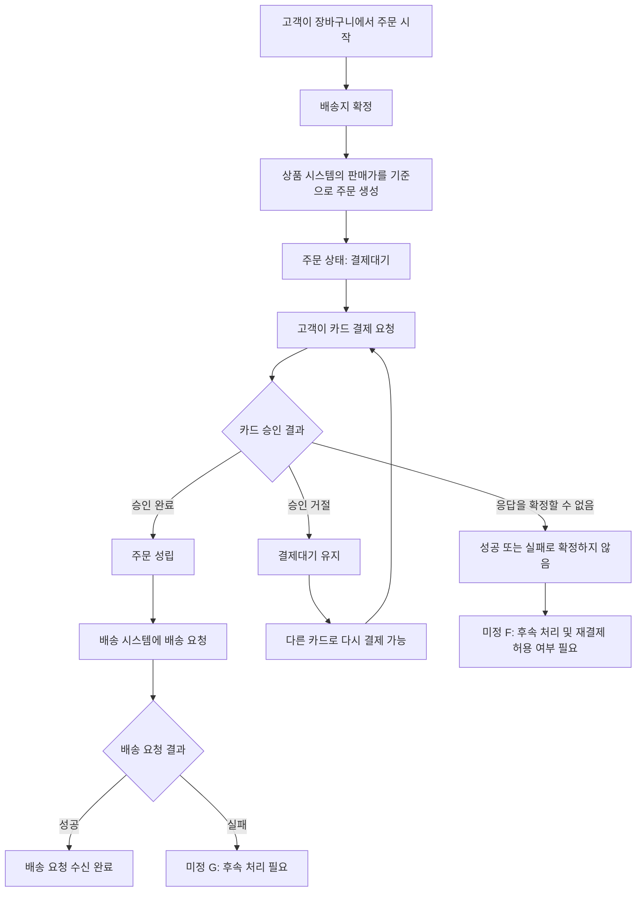

# 주문 기능 요구사항 정의서 초안

## 1. 목적

고객이 장바구니에서 주문을 시작하여 배송지를 확정하고, 카드 결제 승인을 받아 주문이 성립하기까지의 요구사항을 정의한다.

이 문서는 제공된 업무 조건만 반영한다. 확정되지 않은 정책은 결정하지 않고 미정 사항과 확인 질문으로 남긴다.

## 2. 사용자 스토리

> 고객으로서 장바구니의 상품과 배송지를 기준으로 주문을 생성하고 카드 결제 승인을 받아 주문을 성립시키고 싶다.

## 3. 기능과 업무 흐름

### 3.1 주요 기능

1. 고객이 장바구니에서 주문을 시작한다.
2. 고객이 배송지를 확정한다.
3. 시스템이 주문을 생성하고 주문 당시 판매가를 기준으로 주문 금액을 확정한다.
4. 생성된 주문을 `결제대기` 상태로 둔다.
5. 고객이 카드 결제를 요청한다.
6. 카드 승인이 완료되면 주문이 성립한다.
7. 카드 승인 뒤 배송 시스템에 배송을 요청한다.

### 3.2 흐름

재고 확인의 시점과 호출 흐름은 입력에서 정해지지 않았으므로 도식에서 특정 단계로 배치하지 않았다.

## 4. 업무 규칙

### 4.1 주문 생성

- 고객이 배송지를 확정한 때 주문을 생성한다.
- 생성된 주문의 상태는 `결제대기`이다.
- 주문자와 수령인은 같은 사람으로 취급한다.
- 비회원 주문 허용 여부는 미정이다.
- 비회원 주문을 허용할 경우 결제대기 주문을 다시 찾을 때의 본인 확인 방법도 미정이다.

### 4.2 주문 금액

- 주문 금액은 각 주문 항목의 `주문 생성 시점 판매가 × 수량`을 모두 합한 값이다.
- 주문 생성 시점의 판매가는 상품 시스템에서 제공하는 판매가를 따른다.
- 주문이 생성된 뒤 판매가가 변경되어도 주문 금액은 변경하지 않는다.
- 카드 결제 시 주문 생성 때 확정된 주문 금액을 청구한다.
- 배송비, 쿠폰 및 할인은 주문 금액 계산 범위에서 제외한다.

### 4.3 결제대기 주문

- 결제대기 중인 주문의 상품, 수량 및 배송지는 변경할 수 없다.
- 상품, 수량 또는 배송지를 바꾸려면 새 주문을 생성해야 한다.
- 카드 결제가 거절되어도 주문을 취소하지 않고 결제대기로 유지한다.
- 승인 거절 뒤 고객은 다른 카드로 다시 결제할 수 있다.
- 결제대기 기한과 기한 경과 후 처리는 미정이다.
- 기한 경과 시 만료, 취소, 삭제 또는 결제 차단 여부를 임의로 결정하지 않는다.

### 4.4 결제와 주문 성립

- 지원하는 결제 수단은 카드뿐이다.
- 카드 승인이 완료된 때 주문이 성립한다.
- 결제 시스템의 응답을 확정할 수 없는 경우 승인 성공이나 실패로 임의 확정하지 않는다.
- 응답을 확정할 수 없을 때의 후속 처리와 재결제 허용 여부는 미정이다.

### 4.5 재고

- 재고에 관한 판단은 상품 시스템의 결과를 그대로 따른다.
- 주문 기능은 재고를 별도로 확보하지 않는다.
- 카드 승인 뒤 재고가 없다고 판단된 경우의 처리는 미정이다.
- 이 경우 카드 승인 취소나 주문 상태 변경을 임의로 수행하지 않는다.

### 4.6 배송 요청

- 배송 시스템에는 카드 승인이 완료된 뒤에만 배송을 요청한다.
- 카드 승인 전에는 배송을 요청하지 않는다.
- 카드 승인 뒤 배송 요청이 실패했을 때의 처리는 미정이다.
- 배송 요청 실패 시 다음 사항을 임의로 결정하지 않는다.

  - 카드 승인 취소 여부
  - 주문 상태 변경 여부
  - 재요청 여부
  - 재요청 주체와 방식

- 주문 확인 통지의 발송 주체는 미정이다.

## 5. 용어

| 용어 | 정의 |
|---|---|
| 고객 | 장바구니에서 주문을 시작하고 배송지를 확정하며 카드 결제를 요청하는 주체 |
| 장바구니 | 고객이 주문하려는 상품과 수량을 담아 두는 대상 |
| 주문 항목 | 주문에 포함된 개별 상품과 수량 및 주문 생성 시점의 단가 |
| 주문 | 배송지가 확정되었을 때 생성되는 주문 대상 |
| 주문 생성 | 고객이 배송지를 확정하여 주문이 생기는 것 |
| 결제대기 | 주문이 생성되었으나 카드 승인이 완료되지 않은 주문 상태 |
| 주문 금액 | 각 주문 항목의 주문 생성 시점 판매가에 수량을 곱한 값을 모두 합한 금액 |
| 카드 승인 | 결제 시스템이 카드 결제를 승인한 결과 |
| 승인 거절 | 결제 시스템이 카드 결제를 거절한 확정 결과 |
| 응답 확정 불가 | 결제 시스템의 응답을 승인 성공 또는 실패로 판단할 수 없는 상황 |
| 주문 성립 | 카드 승인이 완료된 상태 또는 사건 |
| 재고 판단 | 상품 시스템이 해당 상품의 재고 가능 여부를 판단하는 것 |
| 배송 요청 | 카드 승인 뒤 배송 시스템에 배송 처리를 요청하는 것 |

`주문 성립` 이후 주문에 부여할 상태의 명칭은 입력에서 정해지지 않았으므로 별도 상태명을 정의하지 않는다.

## 6. 품질 요구사항

### 6.1 금액 일관성

- 주문 생성 시 확정된 주문 항목의 단가와 주문 금액은 이후 상품 판매가가 변경되어도 바뀌지 않아야 한다.
- 카드 결제 요청 금액은 해당 주문에 확정된 주문 금액과 같아야 한다.

### 6.2 상태 및 결과의 정확성

- 카드 승인 완료 전에는 주문을 성립된 것으로 처리하지 않아야 한다.
- 승인 거절을 받은 주문은 결제대기 상태로 유지되어야 한다.
- 확정할 수 없는 결제 응답을 승인 성공이나 승인 실패로 변환하지 않아야 한다.
- 미정 정책에 해당하는 상황에서 시스템이 만료, 취소, 삭제, 승인 취소 또는 상태 변경을 임의로 수행하지 않아야 한다.

### 6.3 외부 시스템 결과의 보존

- 판매가와 재고 판단은 상품 시스템의 결과를 따라야 한다.
- 카드 승인 결과는 결제 시스템의 확정된 결과를 따라야 한다.
- 배송 요청은 카드 승인 완료 뒤에만 이루어져야 한다.

### 6.4 변경 방지

- 결제대기 주문의 상품, 수량 및 배송지는 변경되지 않아야 한다.
- 변경이 필요한 경우 기존 주문을 수정하는 대신 새 주문을 생성해야 한다.

성능, 가용성, 보안, 개인정보 보호, 감사 기록, 장애 복구 목표 및 외부 시스템 응답시간에 관한 수치는 입력에서 제공되지 않았으므로 미정이다.

## 7. 수용 기준

### AC-01 주문 생성

- Given 고객이 장바구니에서 주문을 시작했고
- When 고객이 배송지를 확정하면
- Then 주문이 생성되고
- And 주문 상태는 결제대기가 된다.

### AC-02 주문 금액 계산

- Given 장바구니에 하나 이상의 주문 항목이 있고
- When 배송지 확정으로 주문이 생성되면
- Then 주문 금액은 각 항목의 주문 생성 시점 판매가에 수량을 곱한 값의 합계가 된다.

장바구니가 비어 있을 수 있는지와 빈 장바구니의 처리 정책은 별도 확인이 필요하다.

### AC-03 판매가 변경

- Given 주문이 생성되어 주문 금액이 확정되었고
- When 상품 시스템의 판매가가 변경되면
- Then 해당 주문의 항목 단가와 주문 금액은 변경되지 않는다.
- And 카드 결제에는 주문 생성 때 확정된 금액을 사용한다.

### AC-04 결제대기 주문 변경 방지

- Given 주문이 결제대기 상태이고
- When 고객이 상품, 수량 또는 배송지를 변경하려 하면
- Then 기존 주문은 변경되지 않는다.
- And 변경된 내용으로 주문하려면 새 주문을 생성해야 한다.

### AC-05 카드 승인 완료

- Given 주문이 결제대기 상태이고
- When 결제 시스템의 카드 승인이 완료되면
- Then 주문이 성립한다.
- And 그 이후에만 배송 시스템에 배송을 요청한다.

### AC-06 카드 승인 거절

- Given 주문이 결제대기 상태이고
- When 카드 승인이 거절되면
- Then 주문을 취소하지 않는다.
- And 주문을 결제대기 상태로 유지한다.
- And 고객은 다른 카드로 다시 결제할 수 있다.

### AC-07 결제 응답 확정 불가

- Given 카드 결제가 요청되었고
- When 결제 시스템의 응답을 성공 또는 실패로 확정할 수 없으면
- Then 시스템은 그 응답을 승인 성공으로 확정하지 않는다.
- And 시스템은 그 응답을 승인 실패로 확정하지 않는다.
- And 미정 정책이 확정될 때까지 후속 처리와 재결제 허용 여부를 임의로 결정하지 않는다.

### AC-08 재고 판단

- Given 주문 처리 중 재고 판단이 필요하고
- When 상품 시스템이 재고 결과를 제공하면
- Then 주문 기능은 그 판단을 그대로 따른다.
- And 주문 기능은 재고를 별도로 확보하지 않는다.

재고 확인 시점과 재고 부족 시 주문 진행 여부가 정해져야 이 기준을 구체적인 시나리오로 확장할 수 있다.

### AC-09 승인 뒤 재고 부족

- Given 카드 승인이 완료되었고
- When 상품 시스템이 재고가 없다고 판단하면
- Then 카드 승인을 임의로 취소하지 않는다.
- And 주문 상태를 임의로 변경하지 않는다.
- And 미정 정책에 따른 후속 처리를 임의로 만들어 내지 않는다.

### AC-10 배송 요청 실패

- Given 카드 승인이 완료되어 배송 시스템에 배송을 요청했고
- When 배송 요청이 실패하면
- Then 카드 승인을 임의로 취소하지 않는다.
- And 주문 상태를 임의로 변경하지 않는다.
- And 재요청 주체와 방식을 임의로 결정하지 않는다.

### AC-11 카드 외 결제 수단

- Given 고객이 주문 결제를 진행하려 할 때
- Then 지원되는 결제 수단은 카드로 한정된다.
- And 카드 외 결제 수단은 이 기능의 범위에 포함되지 않는다.

## 8. 범위

### 8.1 포함 범위

- 장바구니에서 주문 시작
- 배송지 확정
- 주문 생성
- 주문 항목 단가 및 주문 금액 확정
- 결제대기 상태 관리
- 카드 결제 요청 및 승인 결과 처리
- 카드 승인 거절 뒤 다른 카드로 재결제
- 카드 승인 완료에 따른 주문 성립
- 상품 시스템의 판매가 및 재고 판단 연계
- 카드 승인 뒤 배송 시스템에 배송 요청

### 8.2 제외 범위

- 화면 및 사용자 인터페이스
- 기술 설계
- 카드 결제 이후의 취소 및 환불
- 반품 및 교환
- 배송 진행
- 카드 외 결제 수단
- 배송비
- 쿠폰 및 할인
- 주문 기능 자체의 재고 확보

## 9. 미정 사항과 확인 질문

### 미정 H: 비회원 주문

1. 비회원 주문을 허용하는가?
2. 허용한다면 비회원이 결제대기 주문을 다시 찾을 때 어떤 정보로 본인을 확인하는가?
3. 회원 주문만 허용한다면 주문 시작 또는 주문 생성 시점 중 언제 회원 여부를 확인하는가?

### 미정 B: 결제대기 기한

1. 결제대기 주문에 기한을 두는가?
2. 기한이 있다면 언제부터 얼마 동안인가?
3. 기한이 지나면 주문을 만료, 취소 또는 삭제하는가?
4. 기한이 지난 주문의 결제를 차단하는가?
5. 기한 경과 사실을 고객에게 알릴 필요가 있는가?

### 미정 F: 결제 응답 확정 불가

1. 응답을 확정할 수 없는 주문을 어떤 상태나 표시로 관리하는가?
2. 결제 시스템에 승인 결과를 다시 조회하는가?
3. 결과 확인의 주체와 시점은 무엇인가?
4. 결과가 확인되기 전에 고객의 재결제를 허용하는가?
5. 중복 승인이 발생할 가능성에 대한 처리 정책은 무엇인가?

### 미정 E: 승인 뒤 재고 부족

1. 재고는 주문 흐름의 어느 시점에 확인하는가?
2. 카드 승인 전에 재고가 없으면 결제 요청을 막는가?
3. 카드 승인 뒤 재고가 없으면 주문을 어떻게 처리하는가?
4. 이때 카드 승인 취소가 필요한가?
5. 고객에게 재고 부족을 알리는 주체와 방식은 무엇인가?

### 미정 G: 배송 요청 실패

1. 배송 요청 실패 시 재요청하는가?
2. 재요청한다면 어느 시스템 또는 담당자가 수행하는가?
3. 재요청 횟수와 시점은 어떻게 정하는가?
4. 배송 요청 실패 중 주문을 어떤 상태나 표시로 관리하는가?
5. 배송 요청 실패 시 카드 승인을 유지하는가?
6. 고객 또는 운영 담당자에게 실패 사실을 알리는가?

### 미정 I: 주문 확인 통지

1. 주문 성립 후 고객에게 주문 확인 통지를 보내는가?
2. 이 시스템이 직접 보내는가, 다른 시스템의 통지로 대신하는가?
3. 통지가 필요하다면 채널, 발송 시점, 내용 및 실패 처리 기준은 무엇인가?

### 추가 확인이 필요한 사항

1. 장바구니가 비어 있을 때 주문 시작 또는 주문 생성을 허용하는가?
2. 주문 가능한 최소·최대 수량이 있는가?
3. 상품 시스템에서 판매가를 받지 못한 경우 주문을 생성하는가?
4. 주문 생성 시점에 상품 판매가 또는 판매 가능 여부가 변경되면 어느 결과를 적용하는가?
5. 주문 금액의 통화, 세금 포함 여부 및 금액 반올림 규칙은 무엇인가?
6. 배송지에 필요한 항목과 유효성 판단 기준은 무엇인가?
7. 동일한 배송지 확정 요청이 반복될 때 주문이 중복 생성되지 않도록 해야 하는가?
8. 동일한 카드 결제 요청이 반복될 때 중복 승인을 어떻게 판단하고 처리하는가?
9. 카드 승인 완료 후 사용할 주문 상태의 명칭은 무엇인가?
10. 배송 시스템에 전달해야 하는 주문 및 배송 정보의 범위는 무엇인가?
11. 외부 시스템 장애 또는 응답 지연 시 고객과 운영 담당자에게 어떤 결과를 보여주거나 알려야 하는가?
12. 성능, 가용성, 보안, 개인정보 보호, 감사 기록 및 장애 복구에 적용할 품질 기준은 무엇인가?