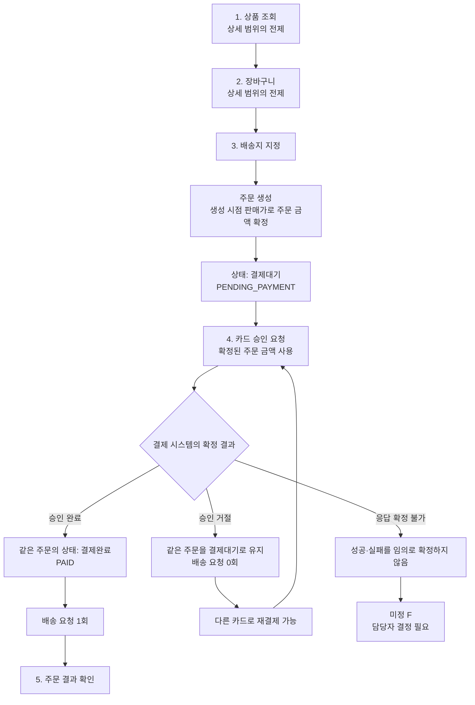

# 주문 기능 요구사항 정의서 초안

## 1. 목적과 적용 범위

고객이 장바구니에서 주문을 시작하여 배송지를 확정하고, 카드 승인을 받아 주문이 성립한 결과를 확인하기까지의 요구사항을 정의한다.

기본 흐름은 다음과 같다.

1. 상품 조회
2. 장바구니
3. 배송지 지정
4. 결제
5. 주문 결과 확인

상품 조회와 장바구니는 이 문서의 전제이며, 상세 범위는 배송지 지정부터 주문 결과 확인까지다. 결과 확인은 주문 확인 통지의 발송 여부나 주체를 확정하지 않는다.

이 문서는 제공된 업무 조건과 추가로 확인된 자료만 반영한다. 기술 설계·모델·코드는 주문 기능의 제외 범위가 아니라, 이번 문서에서 작성하지 않는 별도 산출물이다.

## 2. 사용자 스토리

> 고객으로서 장바구니의 상품과 수량을 바탕으로 배송지를 확정하고, 확정된 주문 금액으로 카드 승인을 받아 주문 결과를 확인하고 싶다.

## 3. 기능과 흐름

### 3.1 기능

1. 고객이 장바구니에서 주문을 시작한다.
2. 고객이 배송지를 확정한다.
3. 시스템이 주문 생성 시점의 판매가로 주문 금액을 계산하여 주문을 생성한다.
4. 생성된 주문의 상태를 결제대기(`PENDING_PAYMENT`)로 둔다.
5. 고객이 해당 주문의 확정 금액으로 카드 승인을 요청한다.
6. 카드가 거절되면 같은 주문을 결제대기로 유지하고, 다른 카드로 다시 결제할 수 있게 한다.
7. 카드 승인이 완료되면 같은 주문을 결제완료(`PAID`)로 변경하여 주문을 성립시킨다.
8. 카드 승인 완료 뒤 배송 시스템에 배송을 요청한다.
9. 고객이 주문 결과를 확인할 수 있게 한다.

### 3.2 업무 흐름

재고 판단 시점은 확정되지 않았으므로 흐름의 특정 단계에 배치하지 않는다.

## 4. 확정된 업무 규칙

### 4.1 주문 생성과 변경

- 고객이 배송지를 확정하면 주문을 생성한다.
- 주문 생성 직후 상태는 결제대기(`PENDING_PAYMENT`)다.
- 주문자와 수령인은 같은 사람으로 본다.
- 결제대기 주문의 상품, 수량 및 배송지는 변경할 수 없다.
- 상품, 수량 또는 배송지를 바꾸려면 새로 주문해야 한다.

### 4.2 주문 금액

- 주문 금액은 각 주문 항목의 `주문 생성 시점 판매가 × 수량`을 모두 더한 값이다.
- 주문 생성 뒤 상품의 판매가가 바뀌어도 주문 항목의 단가와 주문 금액은 바뀌지 않는다.
- 카드 승인 요청 금액은 주문 생성 때 확정된 주문 금액이다.
- 배송비, 쿠폰 및 할인은 범위에서 제외한다.

### 4.3 결제와 주문 성립

- 결제 수단은 카드로 한정한다.
- 카드 승인이 완료되면 주문이 성립하고, 같은 주문의 상태는 결제완료(`PAID`)가 된다.
- 카드 거절은 청구 완료가 아니다.
- 카드가 거절되면 같은 주문을 취소하지 않고 결제대기로 유지한다.
- 거절 뒤 다른 카드로 같은 주문의 결제를 다시 요청할 수 있다.
- 결제 응답을 확정할 수 없으면 성공이나 실패로 임의 확정하지 않는다. 이후 처리는 미정 F에 대한 담당자 결정이 필요하다.

### 4.4 재고와 배송

- 재고 판단은 상품 시스템의 판단을 그대로 따른다.
- 주문 기능은 재고를 별도로 확보하지 않는다.
- 배송 요청은 카드 승인 완료 뒤에만 한다.
- 정상 승인된 주문에는 배송 요청이 1회 발생한다.
- 승인 거절 직후에는 배송 요청이 발생하지 않는다.
- 카드 X 거절 뒤 카드 Y가 승인된 경우, 해당 주문의 배송 요청은 전체 과정에서 총 1회다.
- 승인 뒤 재고 부족과 배송 요청 실패의 최종 처리는 아직 정해지지 않았다.

## 5. 기본 용어

| 한글 표기 | 공통 표기 | 정의 |
|---|---|---|
| 주문 | Order | 배송지가 확정될 때 생성되고 카드 승인 결과에 따라 성립하는 주문 대상 |
| 주문 항목 | OrderItem | 주문에 포함된 개별 상품, 수량 및 주문 생성 시점 판매가에 관한 항목 |
| 판매가 | salePrice | 상품 시스템이 제공하는 상품의 판매 가격 |
| 주문 금액 | totalAmount | 각 주문 항목의 주문 생성 시점 판매가에 수량을 곱하여 합산한 금액 |
| 결제대기 | PENDING_PAYMENT | 주문이 생성되었지만 카드 승인이 완료되지 않은 상태 |
| 결제완료 | PAID | 카드 승인이 완료되어 주문이 성립한 상태 |
| 승인 요청 금액 | — | 카드 승인 요청에 사용하는 주문의 확정 금액 |
| 승인 거절 | — | 결제 시스템이 카드 승인을 거절한 확정 결과 |
| 응답 확정 불가 | — | 결제 응답을 승인 성공 또는 실패로 판단할 수 없는 상황 |
| 배송 요청 | — | 카드 승인 완료 뒤 배송 시스템에 배송 처리를 요청하는 것 |

공통 영문 표기는 용어 표기이며 클래스나 속성 설계를 의미하지 않는다.

## 6. 대표 상황별 수용 기준

네 상황은 모두 펜 2개, 주문 생성 시 판매가 각 1,000원, 배송지 서울을 기본 예로 사용한다. 주문 생성 시 확정되는 주문 금액은 2,000원이다.

각 상황에서는 다음 항목을 함께 관찰한다.

- 처음 생성된 주문과 결제 결과가 같은 주문에 관한 것인지
- 주문 금액
- 카드 승인 요청 금액
- 최종 주문 상태
- 누적 배송 요청 횟수

### 상황 1: 정상 승인

**전제**

- 장바구니에 판매가 1,000원인 펜 2개가 있다.
- 고객이 배송지를 서울로 확정한다.
- 카드 Y는 승인된다.

**사건**

- 주문을 생성하고 카드 Y로 결제를 요청한다.

**기대 결과**

| 관찰 항목 | 기대값 |
|---|---|
| 동일 주문 여부 | 생성된 주문과 승인 결과의 주문이 같은 주문이다. |
| 주문 금액 | 2,000원 |
| 승인 요청 금액 | 2,000원 |
| 상태 | 결제완료(`PAID`) |
| 배송 요청 횟수 | 1회 |

### 상황 2: 주문 생성 뒤 가격 변경 후 승인

**전제**

- 장바구니에 판매가 1,000원인 펜 2개가 있다.
- 고객이 배송지를 서울로 확정하여 주문을 생성한다.
- 주문 생성 뒤 상품 시스템의 펜 판매가가 1,200원으로 변경된다.
- 카드 Y는 승인된다.

**사건**

- 가격 변경 뒤 생성된 주문을 카드 Y로 결제한다.

**기대 결과**

| 관찰 항목 | 기대값 |
|---|---|
| 동일 주문 여부 | 가격 변경 전 생성된 주문과 승인 결과의 주문이 같은 주문이다. 새 주문을 만들지 않는다. |
| 주문 금액 | 2,000원으로 유지 |
| 승인 요청 금액 | 2,000원 |
| 상태 | 결제완료(`PAID`) |
| 배송 요청 횟수 | 1회 |

### 상황 3: 카드 승인 거절

**전제**

- 장바구니에 판매가 1,000원인 펜 2개가 있다.
- 고객이 배송지를 서울로 확정하여 주문을 생성한다.
- 카드 X는 거절된다.

**사건**

- 생성된 주문을 카드 X로 결제한다.

**기대 결과**

| 관찰 항목 | 기대값 |
|---|---|
| 동일 주문 여부 | 생성된 주문과 거절 결과의 주문이 같은 주문이다. |
| 주문 금액 | 2,000원으로 유지 |
| 승인 요청 금액 | 2,000원 |
| 상태 | 결제대기(`PENDING_PAYMENT`) |
| 배송 요청 횟수 | 0회 |

카드 거절은 청구 완료가 아니며, 주문은 취소되지 않는다.

### 상황 4: 카드 X 거절 뒤 카드 Y 승인

**전제**

- 장바구니에 판매가 1,000원인 펜 2개가 있다.
- 고객이 배송지를 서울로 확정하여 주문을 생성한다.
- 카드 X는 거절되고 카드 Y는 승인된다.

**사건**

1. 같은 주문을 카드 X로 결제한다.
2. 카드 X가 거절된 뒤 같은 주문을 카드 Y로 다시 결제한다.

**기대 결과**

| 관찰 항목 | 카드 X 거절 직후 | 카드 Y 승인 뒤 |
|---|---:|---:|
| 동일 주문 여부 | 처음 생성된 주문과 같다. | 처음 생성된 주문 및 X 거절 주문과 같다. |
| 주문 금액 | 2,000원 | 2,000원 |
| 승인 요청 금액 | 2,000원 | 2,000원 |
| 상태 | 결제대기(`PENDING_PAYMENT`) | 결제완료(`PAID`) |
| 누적 배송 요청 횟수 | 0회 | 총 1회 |

## 7. 품질 및 접근 기준

### 7.1 정상 흐름 성능 시험 기준

다음 조건은 실습의 정상 품질 시험 기준이며 운영 환경의 성능 보장 수치가 아니다.

- 외부 상품·결제·배송 시스템은 정상 응답하는 테스트 대역으로 둔다.
- 각 외부 시스템은 1초 이내에 응답한다.
- 카드 결제 요청 100건을 동시에 실행한다.
- 기본 흐름 4의 결제 요청부터 흐름 5의 주문 결과 수신까지 측정한다.
- 100건 중 95건 이상이 3초 이내에 결과를 수신해야 한다.

### 7.2 금액과 상태의 일관성

- 주문 생성 시 확정된 단가와 주문 금액은 이후 판매가 변경으로 바뀌지 않아야 한다.
- 카드 승인 요청 금액은 주문 금액과 같아야 한다.
- 카드 승인 완료 전에는 주문을 결제완료로 처리하지 않아야 한다.
- 승인 거절 주문은 결제대기로 유지되어야 한다.
- 응답 확정 불가를 승인 성공이나 실패로 바꾸지 않아야 한다.

### 7.3 배송 요청 기준

- 카드 승인 전에는 배송을 요청하지 않아야 한다.
- 정상 승인된 같은 주문에는 배송 요청이 1회 발생해야 한다.
- 승인 거절 직후에는 배송 요청이 0회여야 한다.
- 카드 X 거절 뒤 카드 Y가 승인된 같은 주문에는 전체 과정에서 배송 요청이 총 1회여야 한다.

### 7.4 접근 기준

- 고객은 본인의 주문만 조회하거나 변경을 요청할 권한이 있다.
- 타인의 주문에 대한 조회 또는 변경 요청은 거절해야 한다.
- 본인의 주문이라도 결제대기 상태의 상품, 수량 및 배송지는 변경할 수 없다.
- 인증 방식, 거절 응답 코드 및 화면 표현은 정하지 않는다.

### 7.5 미정 분기에 대한 수용 기준의 한계

미정 정책을 구현자가 임의로 결정하지 말라는 제약은 운영 중 해당 분기를 영구적으로 아무 처리도 하지 않는 정책을 의미하지 않는다.

다음 상황은 담당자가 후속 정책을 결정하기 전까지 최종 수용 기준이 완성되지 않은 상태다.

- 결제 응답 확정 불가
- 카드 승인 뒤 재고 부족
- 배송 요청 실패
- 결제대기 기한 경과
- 주문 확인 통지

정책이 확정되기 전에는 성공·실패, 승인 취소, 주문 상태 변경, 재시도 또는 영구 무동작 중 어느 하나를 최종 동작으로 간주해서는 안 된다.

## 8. 범위와 산출물 구분

### 8.1 상세 범위

- 배송지 지정
- 주문 생성
- 주문 생성 시점 판매가와 수량을 이용한 주문 금액 확정
- 결제대기 상태 관리
- 카드 승인 요청과 확정 결과 처리
- 카드 거절 뒤 같은 주문에 대한 다른 카드 재결제
- 카드 승인 완료에 따른 결제완료 처리와 주문 성립
- 카드 승인 뒤 배송 요청
- 주문 결과 확인

### 8.2 전제

- 상품 조회
- 장바구니
- 상품 시스템에서 제공하는 판매가
- 상품 시스템의 재고 판단
- 운영 중인 결제 시스템의 카드 승인
- 운영 중인 배송 시스템의 배송 요청 수신

### 8.3 기능 제외 범위

- 결제 이후의 취소 및 환불
- 반품 및 교환
- 배송 진행
- 카드 외 결제 수단
- 배송비
- 쿠폰 및 할인
- 주문 기능 자체의 재고 확보

### 8.4 이번 문서에서 작성하지 않는 산출물

다음은 주문 기능 자체의 제외 범위가 아니라 이번 요구사항 문서에서 작성하지 않는 산출물이다.

- 화면 및 사용자 인터페이스 설계
- 업무·도메인·데이터 모델
- 기술 및 상세 설계
- 클래스와 속성 정의
- 구현 코드

## 9. 미정 사항

### 미정 H: 비회원 주문

- 비회원 주문을 허용하는가?
- 허용한다면 비회원이 결제대기 주문을 다시 찾을 때 본인을 어떻게 확인하는가?

### 미정 B: 결제대기 기한

- 결제대기 주문에 기한을 두는가?
- 기한이 있다면 언제부터 얼마 동안인가?
- 기한이 지나면 주문을 어떻게 처리하는가?
- 기한이 지난 주문의 결제를 허용하는가?

### 미정 F: 결제 응답 확정 불가

- 응답을 확정할 수 없는 경우 이후 처리는 무엇인가?
- 결제 결과를 다시 확인하는 주체와 방식은 무엇인가?
- 결과 확정 전에 재결제를 허용하는가?
- 중복 승인이 확인되면 어떻게 처리하는가?

담당자 결정 전에는 이 분기의 최종 수용 기준을 완성할 수 없다.

### 미정 E: 승인 뒤 재고 부족

- 재고를 주문 흐름의 어느 시점에 판단하는가?
- 승인 전에 재고가 부족하면 어떻게 처리하는가?
- 승인 뒤 재고가 부족하면 주문과 카드 승인을 어떻게 처리하는가?
- 고객에게 알리는 주체와 방식은 무엇인가?

재고 판단 시점은 도식에서 고정하지 않는다. 담당자 결정 전에는 승인 뒤 재고 부족 분기의 최종 수용 기준을 완성할 수 없다.

### 미정 G: 배송 요청 실패

- 배송 요청 실패 시 재요청하는가?
- 재요청한다면 주체, 시점 및 횟수는 무엇인가?
- 주문 상태와 카드 승인은 어떻게 처리하는가?
- 고객이나 운영 담당자에게 실패를 알리는가?

담당자 결정 전에는 배송 요청 실패 분기의 최종 수용 기준을 완성할 수 없다.

### 미정 I: 주문 확인 통지

- 주문 확인 통지가 필요한가?
- 필요하다면 이 시스템이 보내는가, 다른 시스템의 통지로 대신하는가?
- 통지 채널, 시점, 내용 및 실패 처리는 무엇인가?

주문 결과 확인 요구는 유지하되, 이를 별도 통지로 제공한다고 확정하지 않는다.

### 그 밖의 미정 사항

다음 항목은 입력에 근거가 없으므로 새 정책으로 확정하지 않는다.

- 빈 장바구니 처리
- 최소·최대 주문 수량
- 판매가를 받지 못했을 때의 처리
- 판매 가능 여부가 바뀌었을 때의 처리
- 통화, 세금 포함 여부 및 반올림 규칙
- 배송지 항목과 유효성 기준
- 반복된 배송지 확정 요청에 대한 중복 주문 처리
- 반복된 결제 요청에 대한 중복 승인 처리
- 배송 시스템에 전달할 정보
- 외부 시스템 장애 및 응답 지연 처리
- 운영 환경의 성능·가용성·복구 목표
- 인증 방식, 응답 코드 및 화면 표현