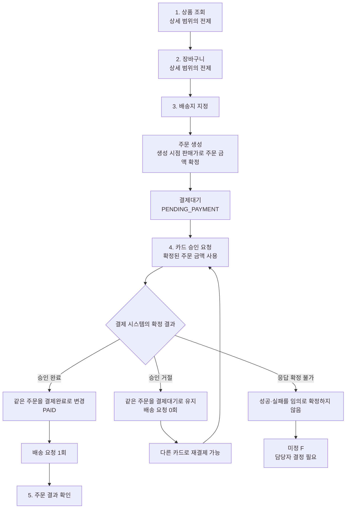

# 주문 기능 요구사항 정의서 보완본

## 1. 목적과 범위

고객이 장바구니의 상품을 바탕으로 배송지를 확정하고, 카드 승인을 받아 주문이 성립한 결과를 확인하기까지의 요구사항을 정의한다.

기본 흐름은 다음과 같다.

1. 상품 조회
2. 장바구니
3. 배송지 지정
4. 결제
5. 주문 결과 확인

1~2는 전제이고 상세 범위는 3~5다. 결과 확인은 별도 주문 확인 통지의 발송 여부나 주체를 확정하지 않는다.

화면 및 사용자 인터페이스는 기능 범위에서 제외한다. 기술 설계·모델·코드는 기능 제외가 아니라 이번 문서에서 작성하지 않는 별도 산출물이다. 외부 상품·결제·배송 시스템은 연계 대상으로만 다루며, 그 내부 기능을 재구현하지 않는다.

## 2. 사용자 스토리

> 고객으로서 장바구니의 상품과 수량을 바탕으로 배송지를 확정하고, 확정된 주문 금액으로 카드 승인을 받아 주문 결과를 확인하고 싶다.

## 3. 기능과 흐름

### 3.1 기능

1. 고객이 장바구니에서 주문을 시작한다.
2. 고객이 배송지를 확정한다.
3. 주문 생성 시점의 판매가로 주문 금액을 계산하여 주문을 생성한다.
4. 생성된 주문의 상태를 결제대기(`PENDING_PAYMENT`)로 둔다.
5. 고객이 확정된 주문 금액으로 카드 승인을 요청한다.
6. 카드가 거절되면 같은 주문을 결제대기로 유지하고 다른 카드로 다시 결제할 수 있게 한다.
7. 카드 승인이 완료되면 같은 주문을 결제완료(`PAID`)로 변경하여 주문을 성립시킨다.
8. 카드 승인 완료 뒤 배송 시스템에 배송을 요청한다.
9. 고객이 주문 결과를 확인할 수 있게 한다.

### 3.2 업무 흐름

재고 판단 시점은 확정되지 않았으므로 흐름의 특정 단계에 배치하지 않는다.

## 4. 확정된 업무 규칙

### 4.1 주문 생성과 변경

- 배송지가 확정되면 주문을 생성한다.
- 생성 직후 주문 상태는 결제대기(`PENDING_PAYMENT`)다.
- 주문자와 수령인은 같은 사람으로 본다.
- 결제대기 주문의 상품, 수량 및 배송지는 변경할 수 없다.
- 이를 바꾸려면 새로 주문해야 한다.

### 4.2 주문 금액

- 주문 금액은 각 주문 항목의 `주문 생성 시점 판매가 × 수량`을 합한 값이다.
- 주문 생성 뒤 판매가가 변경되어도 주문 항목의 단가와 주문 금액은 바뀌지 않는다.
- 카드 승인 요청 금액은 주문 생성 때 확정된 주문 금액이다.
- 배송비, 쿠폰 및 할인은 범위에서 제외한다.

### 4.3 결제와 주문 성립

- 결제 수단은 카드뿐이다.
- 카드 승인이 완료되면 주문이 성립하고 같은 주문의 상태가 결제완료(`PAID`)가 된다.
- 카드 거절은 청구 완료가 아니다.
- 카드가 거절되면 같은 주문을 취소하지 않고 결제대기로 유지한다.
- 거절 뒤 다른 카드로 같은 주문의 결제를 다시 요청할 수 있다.
- 결제 응답을 확정할 수 없으면 성공이나 실패로 임의 확정하지 않는다. 후속 처리는 미정 F다.

### 4.4 재고와 배송

- 재고 판단은 상품 시스템의 판단을 그대로 따른다.
- 주문 기능은 재고를 별도로 확보하지 않는다.
- 배송 요청은 카드 승인 완료 뒤에만 한다.
- 정상 승인된 주문의 배송 요청은 1회다.
- 승인 거절 직후의 배송 요청은 0회다.
- 카드 X 거절 뒤 카드 Y가 승인된 경우 같은 주문의 배송 요청은 총 1회다.
- 승인 뒤 재고 부족과 배송 요청 실패의 최종 처리는 정해지지 않았다.

## 5. 기본 용어

| 한글 표기 | 공통 표기 | 정의 |
|---|---|---|
| 주문 | Order | 배송지 확정으로 생성되고 카드 승인 결과에 따라 성립하는 대상 |
| 주문 항목 | OrderItem | 주문에 포함된 상품, 수량 및 주문 생성 시점 판매가에 관한 항목 |
| 판매가 | salePrice | 상품 시스템이 제공하는 상품의 판매 가격 |
| 주문 금액 | totalAmount | 각 항목의 주문 생성 시점 판매가에 수량을 곱해 합산한 금액 |
| 결제대기 | PENDING_PAYMENT | 주문이 생성됐지만 카드 승인이 완료되지 않은 상태 |
| 결제완료 | PAID | 카드 승인이 완료되어 주문이 성립한 상태 |
| 승인 요청 금액 | — | 카드 승인 요청에 사용하는 확정된 주문 금액 |
| 승인 거절 | — | 결제 시스템이 카드 승인을 거절한 확정 결과 |
| 응답 확정 불가 | — | 결제 응답을 승인 성공이나 실패로 판단할 수 없는 상황 |
| 배송 요청 | — | 카드 승인 완료 뒤 배송 시스템에 배송 처리를 요청하는 것 |

영문 표기는 공통 용어이며 클래스나 속성 설계를 의미하지 않는다.

## 6. 대표 상황별 수용 기준

모든 상황은 판매가가 개당 1,000원인 펜 2개와 배송지 서울을 사용한다. 주문 생성 시 주문 금액은 2,000원이다.

### 상황 1: 정상 승인

**전제:** 카드 Y는 승인된다.

**사건:** 배송지 확정으로 주문을 생성하고 카드 Y에 승인을 요청한다.

| 관찰 항목 | 기대 결과 |
|---|---|
| 동일 주문 여부 | 생성된 주문과 승인 결과가 같은 주문이다. |
| 주문 금액 | 2,000원 |
| 승인 요청 금액 | 2,000원 |
| 최종 상태 | 결제완료(`PAID`) |
| 누적 배송 요청 횟수 | 1회 |

### 상황 2: 주문 생성 뒤 가격 변경 후 같은 주문 승인

**전제:** 카드 Y는 승인된다.

**사건 순서**

1. 펜의 판매가가 개당 1,000원일 때 배송지를 확정하여 주문을 생성한다.
2. 주문 금액이 2,000원으로 확정된다.
3. 주문 생성 뒤 상품 시스템의 펜 판매가가 개당 1,200원으로 변경된다.
4. 가격 변경 전에 생성된 같은 주문에 대해 카드 Y로 승인을 요청한다.

| 관찰 항목 | 기대 결과 |
|---|---|
| 동일 주문 여부 | 가격 변경 전에 생성된 주문과 승인 결과가 같은 주문이다. 새 주문을 만들지 않는다. |
| 주문 금액 | 2,000원으로 유지 |
| 승인 요청 금액 | 2,000원 |
| 최종 상태 | 결제완료(`PAID`) |
| 누적 배송 요청 횟수 | 1회 |

### 상황 3: 카드 승인 거절

**전제:** 카드 X는 거절된다.

**사건:** 생성된 주문을 카드 X로 결제한다.

| 관찰 항목 | 기대 결과 |
|---|---|
| 동일 주문 여부 | 생성된 주문과 거절 결과가 같은 주문이다. |
| 주문 금액 | 2,000원으로 유지 |
| 승인 요청 금액 | 2,000원 |
| 최종 상태 | 결제대기(`PENDING_PAYMENT`) |
| 누적 배송 요청 횟수 | 0회 |

카드 거절은 청구 완료가 아니며 주문은 취소되지 않는다.

### 상황 4: 카드 X 거절 뒤 카드 Y 승인

**전제:** 카드 X는 거절되고 카드 Y는 승인된다.

**사건**

1. 같은 주문에 대해 카드 X로 승인을 요청한다.
2. 거절된 뒤 같은 주문에 대해 카드 Y로 다시 승인을 요청한다.

| 관찰 항목 | 카드 X 거절 직후 | 카드 Y 승인 뒤 |
|---|---:|---:|
| 동일 주문 여부 | 처음 생성된 주문과 같다. | 처음 생성된 주문 및 X 거절 주문과 같다. |
| 주문 금액 | 2,000원 | 2,000원 |
| 승인 요청 금액 | 2,000원 | 2,000원 |
| 상태 | 결제대기(`PENDING_PAYMENT`) | 결제완료(`PAID`) |
| 누적 배송 요청 횟수 | 0회 | 총 1회 |

## 7. 품질 및 접근 기준

### 7.1 정상 흐름 성능 시험

다음은 실습의 시험 조건이며 운영 환경의 성능 보장 수치가 아니다.

- 외부 상품·결제·배송 시스템은 정상 응답하는 테스트 대역으로 둔다.
- 각 외부 시스템은 1초 이내에 응답한다.
- 카드 결제 요청 100건을 동시에 실행한다.
- 흐름 4의 결제 요청부터 흐름 5의 결과 수신까지 측정한다.
- 100건 중 95건 이상이 3초 이내에 결과를 수신해야 한다.

### 7.2 일관성 및 배송 요청

- 주문 생성 시 확정된 단가와 주문 금액은 이후 판매가 변경으로 바뀌지 않아야 한다.
- 승인 요청 금액은 주문 금액과 같아야 한다.
- 카드 승인 완료 전에는 주문을 결제완료로 처리하지 않아야 한다.
- 승인 거절 주문은 결제대기로 유지되어야 한다.
- 응답 확정 불가를 승인 성공이나 실패로 바꾸지 않아야 한다.
- 카드 승인 전에는 배송을 요청하지 않아야 한다.
- 정상 승인에는 배송 요청이 1회 발생해야 한다.
- X 거절 뒤 Y 승인에는 같은 주문에 대해 배송 요청이 총 1회 발생해야 한다.

### 7.3 접근 기준

- 고객은 본인의 주문만 조회하거나 변경을 요청할 권한이 있다.
- 타인의 주문 조회·변경 요청은 거절한다.
- 본인이라도 결제대기 주문의 상품·수량·배송지는 변경할 수 없다.
- 인증 방식, 응답 코드 및 화면은 정하지 않는다.

### 7.4 미정 분기의 수용 기준

구현자가 미정 정책을 결정하지 말라는 제약은 영구 무동작 정책을 뜻하지 않는다.

다음 분기는 담당자가 정책을 결정하기 전까지 최종 수용 기준이 완성되지 않은 상태다.

- 결제 응답 확정 불가
- 카드 승인 뒤 재고 부족
- 배송 요청 실패
- 결제대기 기한 경과
- 주문 확인 통지

정책 확정 전에는 성공·실패, 승인 취소, 주문 상태 변경, 재시도 또는 영구 무동작 중 어느 것도 최종 정책으로 간주하지 않는다.

## 8. 범위 및 산출물 구분

### 8.1 상세 범위

- 배송지 지정
- 주문 생성 및 주문 금액 확정
- 결제대기 상태 관리
- 카드 승인 요청과 확정 결과 처리
- 카드 거절 뒤 같은 주문의 다른 카드 재결제
- 승인 완료에 따른 결제완료 처리와 주문 성립
- 승인 완료 뒤 배송 요청
- 주문 결과 확인

### 8.2 전제 및 외부 연계

- 상품 조회와 장바구니는 상세 범위의 전제다.
- 상품 시스템에서 판매가와 재고 판단을 제공받는다.
- 결제 시스템에서 카드 승인 결과를 제공받는다.
- 배송 시스템에 배송을 요청한다.
- 외부 상품·결제·배송 시스템의 내부 기능은 이 주문 기능에서 재구현하지 않는다.

### 8.3 기능 제외 범위

- 화면 및 사용자 인터페이스
- 결제 이후의 취소 및 환불
- 반품 및 교환
- 배송 진행
- 카드 외 결제 수단
- 배송비
- 쿠폰 및 할인
- 주문 기능 자체의 재고 확보
- 외부 상품·결제·배송 시스템 내부 기능의 재구현

### 8.4 이번 문서에서 작성하지 않는 산출물

- 업무·도메인·데이터 모델
- 기술 및 상세 설계
- 클래스와 속성 정의
- 구현 코드

## 9. 미정 사항

추가 업무 결정이 없으므로 다음 사항은 계속 미정으로 유지한다.

- **H 비회원 주문:** 허용 여부와 결제대기 주문 재조회 시 본인 확인 방법
- **B 결제대기 기한:** 기한, 기산점, 기한 경과 후 처리 및 결제 허용 여부
- **F 응답 확정 불가:** 결과 확인 방식, 후속 처리, 재결제 및 중복 승인 처리
- **E 재고:** 판단 시점, 승인 전 부족 처리, 승인 뒤 부족 시 주문·카드 처리
- **G 배송 요청 실패:** 재요청 여부·주체·시점·횟수, 주문 상태와 카드 승인 처리
- **I 주문 확인 통지:** 필요 여부, 발송 주체·채널·시점·내용·실패 처리

재고 판단 시점과 승인 전 재고 부족 처리도 미정이다. 이 밖에 입력에 근거가 없는 빈 장바구니 처리, 수량 제한, 금액 반올림, 배송지 유효성, 중복 요청, 장애 처리, 운영 품질 목표, 인증 방식 및 응답 코드 역시 새 정책으로 확정하지 않는다.