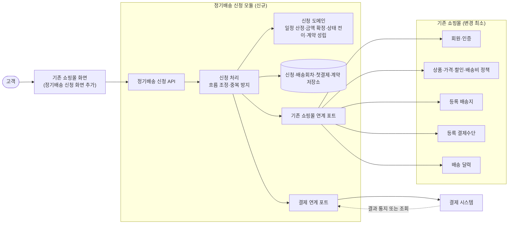
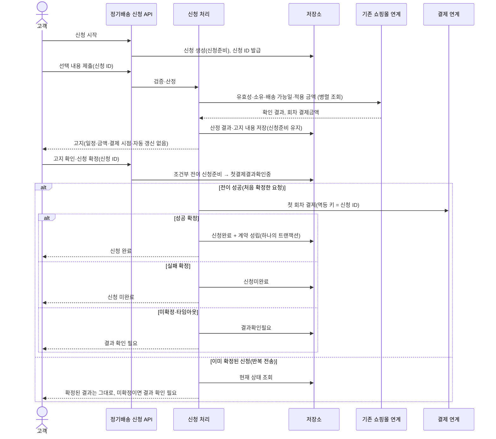

# 정기배송 최초 신청 구조 제안

## 1. 구조 개요

이 기능은 기존 쇼핑몰에 **정기배송 신청 모듈 하나를 새로 붙이는 구조**로 만듭니다. 새 모듈이 직접 맡는 일은 다음 세 가지입니다.

- 신청의 상태와 규칙: 일정 산정, 금액 확정, 상태 전이, 중복 방지
- 계약 성립
- 고지 내용 생성

회원·상품·배송지·결제수단·배송 달력·가격 정책은 기존 쇼핑몰에 묻고, 그 내부 구조는 복제하지 않습니다(업무 규칙 11). 첫 결제는 결제 연계를 거쳐 실행합니다.

## 2. 책임

| 구성 요소 | 책임 | 하지 않는 일 |
|---|---|---|
| 정기배송 신청 API | 신청 시작, 선택 내용 제출, 고지 조회, 신청 확정 요청을 받음. 요청자가 신청의 주인인지 확인함(품질 2) | 업무 규칙 판단 |
| 신청 처리 | 검증 → 산정 → 고지 → 확정 → 결제 → 결과 반영의 순서를 조정함. 동일 신청이면 결제를 다시 호출하지 않음 | 날짜·금액 계산 자체 |
| 신청 도메인 | 계약 종료일 계산(월말 처리, 종료일 제외), 배송회차와 결제 시점 산정, 회차 결제금액 고정, 상태 전이(신청준비 → 첫결제결과확인중 → 신청완료/신청미완료/결과확인필요), 성공 확인 시 계약 1건 성립 | 외부 호출 |
| 기존 쇼핑몰 연계 포트 | 회원·상품·배송지·결제수단의 유효성과 소유 관계, 첫 배송일의 배송 가능 여부, 신청 시점의 적용 금액을 묻고 받음. 기존 개념과 응답을 신청 도메인의 용어로 바꿈 | 기존 정책을 다시 구현함 |
| 결제 연계 포트 | 첫 회차 금액 결제를 요청하고, 응답을 성공 확정/실패 확정/결과 미확정 셋으로 해석함. 타임아웃도 미확정으로 봄 | 후속 회차 결제 |
| 저장소 | 신청과 고지 내용, 배송회차, 첫결제, 계약을 저장함. 상태 변경과 계약 성립을 하나의 원자적 단위로 처리함 | — |

## 3. 기존 기능과의 경계

- **참조만 하는 것:** 회원·상품·배송지·결제수단은 식별자로만 참조합니다. 정기배송 모듈에 사본 모델을 만들지 않습니다.
- **스냅샷으로 고정하는 것:** 신청 시점에 산정한 회차 결제금액과 고지 내용은 정기배송 쪽에 저장합니다. 이후 상품 가격이 바뀌어도 계약 금액이 그대로여야 하기 때문입니다(규칙 7, 수용 기준 「금액 유지」).
- **기존 정책에 맡기는 것:** 배송 가능일 판단, 가격·할인·배송비 산정, 인증, 부하 초과 처리, 보안·개인정보·기록 보존은 기존 정책을 그대로 따릅니다.
- **범위 밖:** 후속 회차 결제 실행, 배송 실행, 배송 불가일 조정, 계약 변경·해지는 다루지 않습니다. 계약이 회차별 결제 예정일만 남겨 두면 이후 운영 기능이 이 정보를 읽어 쓸 수 있습니다.

## 4. 신청 확정과 중복 방지 흐름

신청을 시작할 때 서버가 **신청 ID**를 발급하고, 이 ID를 동일 신청의 기준으로 쓰는 안을 전제로 그렸습니다. 결제가 중복되지 않게 하는 방법은 두 가지를 함께 씁니다.

- 결제 전에 저장소에서 상태를 조건부로 전이합니다. `신청준비`일 때만 `첫결제결과확인중`으로 바뀌므로, 같은 신청의 두 번째 요청은 결제를 다시 호출하지 못합니다.
- 결제 시스템에 보내는 멱등 키를 신청 ID에서 만듭니다.

`결과확인필요` 상태는 결제 시스템의 통지나 조회로만 `신청완료` 또는 `신청미완료`로 바뀝니다. 결과가 성공이면 이때도 같은 트랜잭션에서 계약을 성립시킵니다.

**성능 기준(품질 1):** 확정 요청 안에서는 결제 한 번(1초 이내)만 동기로 기다리고, 기존 쇼핑몰 조회는 병렬로 처리합니다. 이렇게 하면 3초 안에 들어올 여유가 생깁니다. 결제 타임아웃이 이 예산 안에 들어와야 하며, 타임아웃이 나면 `결과확인필요`로 처리합니다.

## 5. 결정이 필요한 사항

1. **배치:** 기존 쇼핑몰 안의 모듈로 둘까요, 별도 서비스로 분리할까요? 배포 단위와 장애 격리를 어디까지 원하는지에 따라 연계 포트의 구현 방식(내부 호출인지 원격 API인지)이 달라집니다.
2. **결제 경로:** 첫 결제를 기존 쇼핑몰의 결제 모듈을 거쳐 요청할까요, 결제 시스템을 직접 호출할까요? 그리고 그 결제 경로가 **멱등 키**를 지원하나요? 지원하지 않으면 중복 결제를 막는 책임이 모두 정기배송 쪽 저장소로 옵니다.
3. **결과 확정 방식:** `결과확인필요`는 결제 시스템의 통지(웹훅)로 해소할까요, 정기배송 쪽이 주기적으로 조회할까요, 둘 다 쓸까요? 해소 결과를 고객에게 화면 재조회로만 알릴지, 알림까지 보낼지도 정해 주세요.
4. **동일 신청 식별:** 서버가 신청 ID를 발급하는 안(제안안)으로 갈까요, 클라이언트가 만든 멱등 키를 쓸까요? 미확정 상태로 남은 `신청준비`를 언제까지 유효하게 둘지도 필요합니다.
5. **금액 산정 시점:** "신청 시점"은 고지 시점인가요, 확정 시점인가요? 고지한 뒤 확정하기 전에 가격·할인이 바뀌면 다시 고지할까요, 고지 금액을 그대로 지킬까요?
6. **첫 회차와 일반 주문의 관계:** 첫 회차를 기존 주문 기능의 주문으로도 만들어 주문 내역·배송·환불 흐름에 태울까요, 정기배송 안에서만 기록할까요? 경계가 가장 크게 달라지는 결정입니다.
7. **스냅샷 범위:** 금액 말고도 배송지 주소와 상품명 같은 고지 당시 내용을 그대로 보관할까요(고지 증빙), 식별자만 보관할까요?
8. **기존 쇼핑몰의 제공 범위:** 배송 달력과 가격 산정(가격·할인·배송비 합산)을 조회하는 API가 이미 있나요? 소유 확인을 한 번에 해 주는 창구가 있나요? 없다면 기존 쇼핑몰 쪽에도 조회 기능을 추가해야 합니다.
9. **결제 타임아웃 값:** 3초 기준 안에서 결제 응답을 몇 초까지 기다린 뒤 `결과확인필요`로 처리할까요?

위 결정이 정해지면 그에 맞춰 연계 포트의 구현 방식과 저장 구조를 구체화하겠습니다.