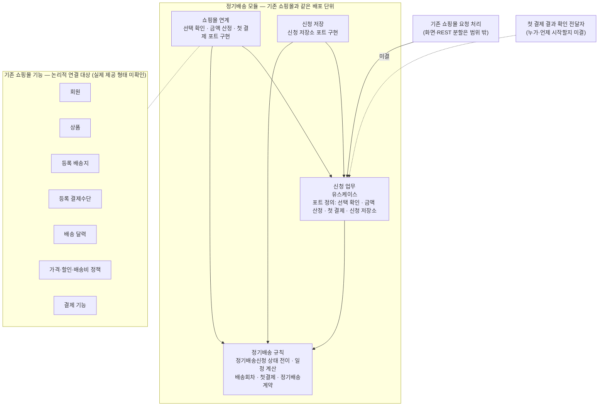

# 정기배송 최초 신청: 아키텍처와 패키지 구조

## 1. 아키텍처

**기존 쇼핑몰과 같은 배포 단위 안에 정기배송 모듈 하나를 둡니다.** 모듈 안은 업무와 구현 두 영역으로만 나눕니다.

- **업무 영역**: 신청 흐름과 업무 규칙을 둡니다. 외부 기능을 직접 알지 않고, 필요한 기능을 **포트**(업무가 요구하는 인터페이스)로만 정의합니다.
- **구현 영역**: 그 포트를 기존 쇼핑몰 기능과 기존 저장소로 구현합니다.

이 방식은 포트·어댑터의 의존 역전을 모듈 안에서 최소한으로 적용한 것입니다. 이렇게 나누는 이유는 미확인 항목이 모두 구현 영역에 있기 때문입니다. 기존 기능의 실제 제공 형태, 결제 기능의 멱등 키 지원 여부, 첫 회차를 일반 주문에 태울지가 여기에 해당합니다. 이 항목이 정해져도 업무 흐름과 규칙은 바뀌지 않습니다.

별도 서비스, 메시지 브로커, 새 저장소는 쓰지 않습니다. 저장은 기존 쇼핑몰의 데이터베이스를 씁니다.

## 2. 패키지 다이어그램

**화살표 읽는 법**

| 표기 | 뜻 |
|---|---|
| `A ──▶ B` (실선) | **코드 의존**입니다. A의 코드가 B의 타입이나 인터페이스를 참조합니다. 호출 순서가 아닙니다. |
| `A ··▶ B` "미결" | 코드 의존이 생길 자리지만, 누가 언제 호출할지는 정하지 않았습니다. |
| `A ··· 그룹` (화살표 없음) | 논리적 연결 대상입니다. 기존 기능이 단일 API인지 여러 기능인지 정하지 않습니다. |

**실행 시 호출 방향과 코드 의존은 반대일 수 있습니다.** 실행 중에는 신청 업무가 포트를 통해 쇼핑몰 연계와 신청 저장을 호출합니다. 하지만 코드에서는 연계와 저장이 신청 업무의 포트를 구현하므로 의존 화살표가 연계·저장에서 신청 업무로 향합니다. 신청 업무에서 연계나 저장으로 가는 화살표는 없습니다.

**의존 규칙**

- `정기배송 규칙`은 밖으로 나가는 의존이 없습니다. 날짜 계산과 상태 전이는 외부 기능 없이 수용 기준으로 시험할 수 있습니다.
- `신청 업무`는 `정기배송 규칙`만 참조합니다.
- `쇼핑몰 연계`와 `신청 저장`은 서로 참조하지 않습니다.
- 기존 쇼핑몰의 요청 처리는 `신청 업무`의 유스케이스와 그 입출력만 참조합니다. 규칙 객체를 직접 다루지 않습니다.
- 순환 의존은 없습니다.

## 3. 패키지별 책임

### 신청 업무

신청 절차를 조정하고, 업무에 필요한 외부 계약을 포트로 정의합니다.

| 유스케이스 | 책임 |
|---|---|
| 신청 시작 | 신청 식별자를 발급하고 `신청준비`로 저장합니다. |
| 선택 확인과 고지 | 선택 확인 포트로 유효성·소유 관계·첫 배송일의 배송 가능 여부를 확인합니다. 금액 산정 포트로 회차 결제금액을 **한 번** 산정하고, 규칙에 일정 계산을 맡긴 뒤 고지할 내용을 신청에 기록합니다. 부적합하면 선택 내용 확인을 요청합니다. |
| 신청 확정 | 고지 확인 뒤 `신청준비 → 첫결제결과확인중` 전이를 저장합니다. 그다음 첫 결제를 한 번 요청하고, 결과에 따라 신청을 완료·미완료·결과확인필요로 둡니다. |
| 첫 결제 결과 반영 | 확정된 결과를 받는 자리입니다. `결과확인필요` 또는 `첫결제결과확인중`인 신청을 완료나 미완료로 확정합니다. 누가 언제 호출할지는 미결입니다. |
| 신청 결과 조회 | 저장된 상태와 고지 내용을 돌려줍니다. |

모든 유스케이스는 요청한 회원이 신청자인지 먼저 확인합니다. 회원 인증은 기존 쇼핑몰이 처리하고, 이 패키지는 인증된 회원 식별자를 받아 신청자와 비교합니다.

**포트별 업무 계약**

- **선택 확인**: 회원·상품·배송지·결제수단의 유효성과 소유 관계를 확인하고, 첫 배송일의 배송 가능 여부를 확인합니다. 결과는 적합 또는 항목별 부적합입니다. 구현이 기존 기능을 몇 번 호출하는지는 계약에 포함하지 않습니다.
- **금액 산정**: 상품과 수량을 받아, 기존 정책으로 산정한 회차 결제금액을 돌려줍니다.
- **첫 결제**
  - 요청: 신청 식별자, 금액, 결제수단 식별자를 넘기고 `성공(거래 참조)`, `실패 확정`, `미확정` 중 하나를 받습니다.
  - 결과 조회: 신청 식별자로 같은 세 결과 중 하나를 받습니다.
  - 확정할 수 없는 응답(무응답, 판정 불가 오류)은 **반드시 `미확정`**으로 돌려줍니다. 실패로 바꾸지 않습니다.
- **신청 저장소**: 신청 식별자로 저장하고 조회합니다. `신청준비 → 첫결제결과확인중` 전이는 같은 신청에서 **한 번만 성공**해야 합니다. 이를 어떻게 구현할지(조건부 갱신, DB 제약 등)는 정하지 않습니다.

**중복 결제 방지는 이 모듈이 맡습니다.** 결제 기능의 멱등 지원을 가정하지 않습니다. 신청 확정은 상태 전이를 먼저 저장한 뒤에만 결제를 요청합니다. 같은 신청 식별자로 다시 전송되면 전이가 성공하지 않습니다. 이때는 결제를 다시 부르지 않고 저장된 결과를 돌려주며, 결과가 아직 없으면 결과 확인이 필요하다고 안내합니다. 결제 기능이 멱등 키를 지원한다고 확인되면, 연계 구현이 신청 식별자를 그 키로 넘기면 됩니다. 이 경우 바뀌는 곳은 연계뿐입니다.

외부 호출은 데이터베이스 트랜잭션 안에 넣지 않습니다. 트랜잭션은 상태 전이 저장과 결과 반영 저장을 각각 감쌉니다.

### 정기배송 규칙

도메인 모델의 개념과 규칙을 그대로 구현합니다.

- **정기배송신청**은 다섯 상태와 그 전이를 통제합니다. 첫 결제 성공을 확인하기 전에는 계약을 만들지 않고, 완료나 미완료로 확정된 신청은 다시 처리하지 않습니다.
- **일정 계산**은 계약 종료일과 월말 처리, 종료일 전 회차 목록, 회차별 결제 시점과 결제 예정일을 정합니다. 기준은 실습 2의 규칙과 수용 기준입니다.
- **첫결제**는 금액과 결과를 기록하고, 신청 식별자에 연결됩니다.
- **정기배송계약**은 신청 식별자에 연결된 최대 한 건입니다. 고지한 회차와 금액을 그대로 확정하고, 자동 갱신은 하지 않습니다.

### 쇼핑몰 연계

선택 확인, 금액 산정, 첫 결제 포트를 기존 쇼핑몰 기능으로 구현합니다. 기존 기능의 형태가 확인되면 이 패키지 안에서만 맞춥니다. 내부 클래스를 기능별로 나눌 수는 있지만, 하위 패키지로 나누지는 않습니다.

### 신청 저장

신청 저장소 포트를 기존 쇼핑몰 데이터베이스로 구현합니다. 저장 범위는 다음과 같습니다.

| 대상 | 저장 정보 |
|---|---|
| 신청 | 신청 식별자, 신청일, 상태, 회원·상품·배송지·결제수단 **식별자**, 수량, 계약기간, 배송 주기, 첫 배송일, 종료예정일, 회차 결제금액 |
| 배송회차 | 회차 번호, 예정 배송일, 결제 시점, 결제 예정일 |
| 첫결제 | 신청 식별자, 금액, 결과, 결제 기능이 준 거래 참조 |
| 계약 | 신청 식별자, 시작일, 종료일, 계약기간, 배송 주기, 회차 결제금액, 자동 갱신 없음 |

상품명, 주소, 결제수단 정보의 사본은 저장하지 않습니다. 고지 화면에 표시할 때 식별자로 기존 기능에서 조회합니다.

**연계와 저장을 나눈 이유**: 연계는 아직 확인되지 않은 기존 기능의 형태에 따라 바뀌고, 저장은 이 모듈이 소유한 데이터의 구조에 따라 바뀝니다. 바뀌는 이유가 달라서 나눴습니다.

## 4. 나누지 않은 것

- **유스케이스별 패키지, 개념별 패키지(신청·계약·결제)**: 모두 한 신청의 생애 안에 있고 함께 바뀌므로 나누지 않습니다.
- **계약 패키지**: 이번 범위에서 계약은 신청이 성립시키는 결과일 뿐이고, 운영 상태가 없어 따로 두지 않습니다.
- **요청 처리(컨트롤러) 패키지**: 화면·REST 분할이 범위 밖이므로 이 모듈에 두지 않습니다.
- **이벤트 발행 구조와 결과 확인 스케줄러**: 결과 확인 방식과 운영 복구가 범위 밖이라 두지 않습니다.

## 5. 지난 제안에서 바뀐 점

- "신청 확정 시점에 금액 재산정 권장", "고지안 유효기간", "단일 조회 API로 묶기"를 철회합니다. 금액은 고지할 때 한 번 산정하고, 기존 기능이 단일 API라고 가정하지 않습니다.
- 고지안을 독립 개체로 두지 않습니다. 고지한 조건, 회차, 금액은 신청에 기록합니다.
- 결제사 멱등 지원을 전제로 하지 않습니다. 중복 결제는 저장소의 단일 전이로 막습니다.

## 6. 미결 사항

각 항목이 정해질 때 바뀌는 패키지를 함께 적었습니다. 업무 흐름이나 규칙까지 바뀌는 항목은 두 번째뿐입니다.

1. **결과 확인을 누가 언제 시작할지**: `첫 결제 결과 반영`을 호출하는 주체입니다. 콜백, 폴링, 운영 복구 중 무엇을 쓸지에 따라 정해집니다. 바뀌는 곳: 모듈 밖의 호출자, 필요하면 쇼핑몰 연계.
2. **첫 회차를 기존 주문 기능에 태울지**: 정하면 신청 업무에 포트 하나와 흐름 한 단계가 추가되고, 쇼핑몰 연계에 그 구현이 추가됩니다. 정기배송 규칙은 바뀌지 않습니다.
3. **결제 기능의 멱등 키 지원과 결과 조회 수단**: 바뀌는 곳: 쇼핑몰 연계.
4. **기존 기능의 실제 제공 형태(API, 내부 구조)**: 바뀌는 곳: 쇼핑몰 연계.
5. **신청 식별자 전달 방식과 단일 전이의 DB 구현**: 바뀌는 곳: 요청 처리, 신청 저장.
6. **`신청준비`의 유효기간**: 정하면 정기배송 규칙의 상태 전이에 반영합니다.

이 구조에서 추가로 정하실 사항은 없습니다. 위 미결 항목은 지금 정하지 않아도 패키지 경계와 의존 방향이 바뀌지 않습니다.