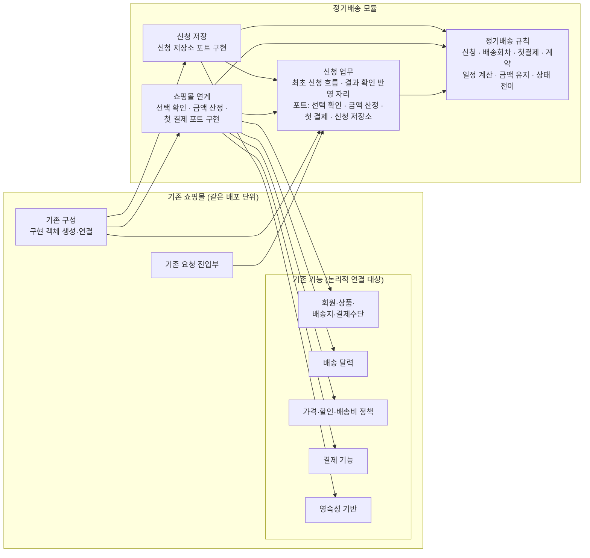

# 정기배송 최초 신청: 연계 계약과 책임

## 1. 이번에 바뀐 점

- 패키지를 네 개로 확정했습니다: **신청 업무 · 정기배송 규칙 · 쇼핑몰 연계 · 신청 저장**. 앞 응답에서 하나였던 `infrastructure`를 쇼핑몰 연계와 신청 저장으로 나눴고, 더 쪼개지는 않습니다.
- 앞 응답에서는 계약 저장 포트가 따로 있었습니다. 이제는 **신청 저장소 포트**가 계약 저장까지 맡습니다. 그래서 결제 결과 기록과 계약 성립이 하나의 반영 단위가 됩니다.
- 신청 저장소 포트에 **첫 결제 시작 조건부 전이**를 추가했습니다. 동시에 재전송이 와도 결제 요청은 이 전이가 성공한 한 곳에서만 나갑니다.
- 날짜·금액·상태 규칙은 앞 산출물(실습 2 요구사항 정의서, 실습 3 도메인 모델)을 따르며 여기서 다시 나열하지 않습니다.

## 2. 패키지 다이어그램

화살표 `A --> B`는 **A의 코드가 B의 타입이나 포트를 참조한다**는 뜻입니다(코드 의존). 실행 중 호출 순서는 화살표로 그리지 않습니다.

`기존 기능` 안의 다섯 노드는 논리적인 연결 대상일 뿐입니다. 실제로 API가 하나인지, 컴포넌트가 몇 개인지는 정하지 않았습니다.

**실행 중 호출 방향과 코드 의존은 반대입니다.**

| 관계 | 실행 중 호출 | 코드 의존 |
|---|---|---|
| 신청 업무 ↔ 쇼핑몰 연계 | 신청 업무 → (포트) → 쇼핑몰 연계 → 기존 기능 | 쇼핑몰 연계 → 신청 업무(포트를 구현) |
| 신청 업무 ↔ 신청 저장 | 신청 업무 → (포트) → 신청 저장 → 영속성 기반 | 신청 저장 → 신청 업무(포트를 구현) |

포트는 신청 업무 패키지에 있습니다. 정기배송 규칙은 어떤 패키지에도 의존하지 않습니다.

## 3. 포트별 요청 · 결과 · 판단 주체

### 3.1 선택 확인 포트 (구현: 쇼핑몰 연계)

| 구분 | 내용 |
|---|---|
| 요청 | 회원 식별자, 상품 식별자·수량, 배송지 식별자, 결제수단 식별자, 첫 배송일 |
| 결과 | 항목별 판정: 유효함·본인 소유·배송 가능 / 부적합(항목 표시) |
| 판단 주체 | 판정은 **기존 쇼핑몰**이 합니다. 연계는 그 판정을 결과 형태로 바꾸기만 합니다. 판정에 따라 `신청준비`를 유지할지 고지로 넘어갈지는 **신청 업무**가 정합니다. 첫 배송일의 최소 일자 규칙은 **정기배송 규칙**이 판단합니다. |

### 3.2 금액 산정 포트 (구현: 쇼핑몰 연계)

| 구분 | 내용 |
|---|---|
| 요청 | 회원 식별자, 상품 식별자·수량, 배송지 식별자 |
| 결과 | 회차 결제금액(고지에 필요한 가격·할인·배송비 구성 포함) / 산정 불가 |
| 판단 주체 | 금액은 **기존 정책**이 산정합니다. 그 금액을 고지하고 계약 기간 동안 유지하는 것은 **정기배송 규칙**입니다. |

**선택 확인과 금액 산정을 따로 둔 이유**

- 결과의 성격이 다릅니다. 선택 확인은 합격·불합격 판정이고 저장하지 않습니다. 금액 산정은 값을 만들고, 그 값은 고지와 계약에 고정되어 저장됩니다.
- 순서 조건이 있습니다. 금액은 선택이 유효할 때만 의미가 있으므로, 부적합이면 산정하지 않습니다.
- 기존 쇼핑몰에서 판정 기능과 가격 정책이 같은 기능이라고 가정하지 않습니다.

### 3.3 첫 결제 포트 (구현: 쇼핑몰 연계 → 기존 결제 기능)

| 기능 | 요청 | 결과 |
|---|---|---|
| 결제 요청 | 신청 식별자(요청 참조), 회원 식별자, 결제수단 식별자, 첫 회차 금액 | 성공 확정(거래 참조) / 실패 확정 / 결과 확인 불가 |
| 결과 확인 | 신청 식별자(+ 알고 있다면 거래 참조) | 성공 확정 / 실패 확정 / 결과 확인 불가 |

- **결과 확인은 새 청구를 만들지 않습니다.** 이전 요청의 결과만 확인합니다.
- 실제 승인 여부는 **기존 결제 기능**이 판단합니다. 받은 응답을 세 결과로 바꾸는 일은 **쇼핑몰 연계**가 맡습니다. 어느 응답을 "확정"으로 볼 수 있는지 규격으로 입증되지 않았다면 모두 **결과 확인 불가**로 바꿉니다. 응답이 없거나 해석할 수 없는 경우를 실패로 바꾸지 않습니다.
- 그 결과로 어떤 상태 전이를 할지는 **정기배송 규칙**의 상태 규칙에 따라 **신청 업무**가 정합니다.

### 3.4 신청 저장소 포트 (구현: 신청 저장)

| 기능 | 요청 | 결과 |
|---|---|---|
| 신청 · 고지 내용 저장 · 조회 | 회원 식별자 + 신청 식별자, 선택 내용, 고지한 조건·금액·예정 회차 | 본인의 신청만 반환, 다른 회원의 신청은 "없음" |
| **첫 결제 시작 전이** | 신청 식별자, 기대 상태 `신청준비`, 고객이 확인한 고지가 현재 저장된 고지와 같다는 조건 | **시작됨**(이 호출에만 결제 요청 권한) / **이미 시작됨·종결**(현재 상태와 저장된 결과) |
| 실패 · 미확정 반영 | 신청 식별자, 기대 상태, 첫 결제 결과 | 반영됨 / 이미 반영됨(기존 결과) |
| **성공 반영** | 신청 식별자, 기대 상태(`첫결제결과확인중` 또는 `결과확인필요`), 성공 결과(거래 참조) | 반영됨(계약 포함) / 이미 완료(기존 계약) |

- 어떤 전이를 허용할지는 **정기배송 규칙**이 판단합니다. 같은 신청에 대한 동시 전이 중 하나만 성공하도록 보장하는 것은 **신청 저장**의 책임입니다.
- 회원·상품·배송지·결제수단은 식별자로만 저장하고, 개인정보 사본은 만들지 않습니다.

## 4. 동시 재전송에서 중복 청구를 막는 책임

"조회해 보고 아직 결제 전이면 결제한다"는 방식으로는 막을 수 없습니다. 동시에 들어온 두 요청이 둘 다 `신청준비`를 읽을 수 있기 때문입니다. 그래서 책임을 다음처럼 나눕니다.

1. **신청 저장**은 한 신청에 대해 `신청준비 → 첫결제결과확인중` 전이가 동시 호출 가운데 **한 번만 성공**하도록 보장합니다. 이 성공이 곧 결제 요청 권한입니다. 별도의 업무 상태를 새로 만들지 않고, 도메인 모델에 이미 있는 전이를 조건부로 실행합니다.
2. **신청 업무**는 이 전이에서 `시작됨`을 받은 경우에만 첫 결제 포트의 결제 요청을 호출합니다. `이미 시작됨·종결`을 받으면 결제하지 않습니다. 결과가 확정되었으면 기존 결과를, 아직이면 결과 확인 필요를 안내합니다.
3. **신청 업무는 결제 요청을 재시도하지 않습니다.** 결과를 알 수 없으면 결과 확인만 사용합니다.

이렇게 하면 정기배송 쪽에서는 제공자의 멱등 지원 없이도 결제 요청이 신청당 한 번만 나갑니다. 다만 연계 구간 안의 재전송(예: 클라이언트의 자동 재시도)이나 응답 유실 뒤의 판정은 제공자 규격에 달려 있습니다(6장).

DBMS, 락, SQL 같은 구현 방식은 정하지 않습니다.

## 5. 성공 반영은 한 단위

첫 결제 성공이 확인되면 신청 저장소 포트의 **성공 반영** 한 번으로 아래 세 가지를 함께 반영합니다.

- 첫 결제 결과(성공, 거래 참조) 기록
- 고지한 조건·회차·금액으로 정기배송 계약 성립
- 신청 상태를 `신청완료`로 변경

셋 중 일부만 반영되는 경우는 허용하지 않습니다. 기대 상태 조건이 있어서, 같은 성공을 다시 반영해도 계약은 하나만 남습니다. 결제 결과 기록과 계약 저장을 별도 호출로 나누지 않습니다.

실패 확정이나 결과 확인 불가를 반영할 때도 결과 기록과 상태 변경을 한 번에 반영합니다.

**결과 확인을 받을 자리**는 신청 업무의 "첫 결제 결과 반영" 사용 사례입니다. 이 사용 사례는 신청 식별자를 받아 결과 확인을 호출하고 위 반영 기능을 사용합니다. 이 사용 사례를 **누가 언제 시작할지**(고객의 재조회, 콜백 수신, 그 밖의 방식)는 미결로 둡니다.

## 6. 업무 계약과 구현 전에 확인할 규격

| 포트 | 업무에서 필요한 계약 (지금 확정) | 구현 전에 확인할 규격 (미확인) |
|---|---|---|
| 선택 확인 | 항목별 유효·소유·배송 가능 판정 | 기존 기능의 실제 제공 형태와 호출 단위, 부적합 사유의 표현 |
| 금액 산정 | 회차 결제금액과 고지에 필요한 구성 | 기존 정책이 고정 금액을 그대로 반환하는지, 어떤 입력이 필요한지 |
| 첫 결제 | 성공 확정·실패 확정·결과 확인 불가를 구분, 결과 확인은 새 청구 없음 | 요청 참조(멱등 키) 지원 여부, 우리 참조로 결과를 조회할 수 있는지, 어떤 오류가 실패 "확정"인지, "요청 기록 없음"을 실패로 볼 수 있는지, 연계 구간의 자동 재시도 여부 |
| 신청 저장소 | 본인 범위 조회, 조건부 전이의 단일 성공, 결과·계약·상태의 한 단위 반영 | 기존 영속성 기반에서 조건부 전이와 원자적 반영을 구현할 방법 |

- 첫 결제 행의 규격이 입증되기 전에는 **실제 결제 연동을 완료로 보지 않습니다**. 그 전까지는 포트의 대역 구현(가짜 구현)으로 업무 흐름만 검증합니다.
- 규격을 확인한 결과는 쇼핑몰 연계 구현에만 영향을 줍니다. 포트 계약과 패키지 구조는 바뀌지 않습니다.

## 7. 남은 미결 사항

- 결과 확인 반영을 누가 언제 시작할지
- 첫 회차를 기존 주문 기능에 태울지 여부
- 신청 식별자의 전달 방식, DB 제약 구현
- `신청준비`의 유효기간

이번 범위 밖으로 둔 것: REST 주소, 새 도메인 객체, 콜백·폴링·재시도 주기, 운영 복구.