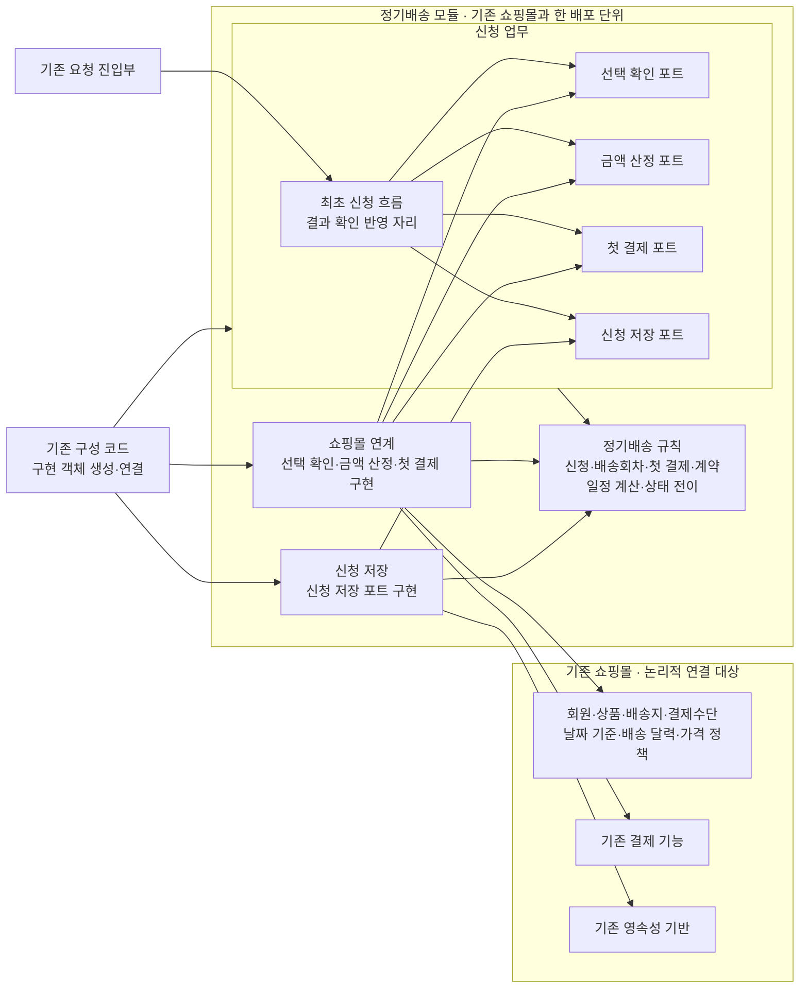

# 정기배송 최초 신청 구조의 일관성 검토

## 1. 검토 결론

대표 수용 기준과 상태 머신에 비추어 보면, 지금 구조로 업무 결과는 나온다. 다만 앞 응답에서 일곱 곳이 어긋났다. 아래와 같이 고친 뒤에 각 기준을 확인했다.

| # | 어긋난 곳 | 수정 |
|---|---|---|
| 1 | 앞 응답은 세 패키지와 세 연계 계약으로 썼다. 채택한 구조는 네 패키지와 네 포트다. | 네 패키지(신청 업무·정기배송 규칙·쇼핑몰 연계·신청 저장)와 네 포트(선택 확인·금액 산정·첫 결제·신청 저장)로 되돌리고 도식을 다시 그린다. |
| 2 | 앞 응답에서 "첫 결제 처리 권한의 획득 여부"를 신청과 별도의 저장 항목으로 두었다. 이렇게 하면 사실상 새 상태가 생긴다. | 조건부 전이는 상태 머신의 `신청준비 → 첫결제결과확인중` 전이 그 자체로 한다. 신청이 `신청준비`일 때만 전이와 결제 요청 식별 정보 기록을 한 번에 성공시키고, 별도 플래그는 두지 않는다. |
| 3 | 앞 응답에서는 같은 신청을 다시 보내면 "기존 결과 확인으로 진행"하도록 했다. 이는 반복 전달과 결과 확인을 섞은 것이다. | 반복 전달은 저장된 상태에 따라 안내만 하고, 결제·결과 확인 포트를 부르지 않는다. 결과 확인은 신청 업무에 둔 별도의 **결과 확인 반영** 자리에서만 일어나며, 누가 언제 시작할지는 미결이다. |
| 4 | 앞 응답에서 결과 반영에는 조건이 없었다. 그래서 결과 확인이 겹치면 계약이 두 번 성립할 틈이 있었다. | 결과 반영도 조건부 전이로 한다. 신청이 `첫결제결과확인중` 또는 `결과확인필요`일 때만 적용한다. 성공 반영은 결제 결과·계약·`신청완료`를 한 단위로 처리한다. 이미 종료된 신청이면 변경 없이 기존 결과를 돌려준다. |
| 5 | 앞 응답은 "신청일 + 3일" 판정을 기존 쇼핑몰 책임으로 두었다. 이 판정은 정기배송의 업무 규칙이다. | 선택 확인 포트가 기존 날짜 기준에 따른 신청일과 배송 달력 판정을 돌려주고, 3일 하한 판정은 정기배송 규칙이 한다. |
| 6 | 앞 응답에는 신청 확정 때 금액을 다시 산정하지 않는다는 점이 드러나지 않았다. | 금액 산정 포트는 고지를 만들 때만 부른다. 신청 확정과 결과 반영은 저장된 고지 금액만 쓴다. |
| 7 | 앞 응답에서 선택 확인과 금액 산정을 하나의 계약으로 합쳤다. | 다시 분리한다. 둘은 결과의 성격(판정과 산정값)이 다르다. 선택 확인이 실패하면 금액 산정을 부르지 않으며, 금액 산정은 고지할 때 한 번만 부른다. 분리해 두어야 이 규칙을 포트 단위로 확인할 수 있다. |

결제 결과를 기록하기 전에 처리가 중단되면 신청은 `첫결제결과확인중`에 남는다. 이 경우에도 새 상태는 필요 없다. 같은 신청을 다시 보내면 "결과 확인 필요"만 안내한다. 결과 확인 반영이 일어나면 상태 머신에 이미 있는 `첫결제결과확인중 → 신청완료 / 신청미완료 / 결과확인필요` 전이로 정리된다.

## 2. 패키지 다이어그램 (수정)

`A --> B`는 **A의 코드가 B의 타입·인터페이스를 참조하는 코드 의존**이다. 호출 순서와 외부 호출 흐름은 표시하지 않는다. 실행 중에는 신청 업무가 포트를 통해 연계·저장 구현을 호출하지만, 코드 의존은 그 반대로 연계·저장 구현이 포트를 향한다.

허용하지 않는 의존은 다음과 같다.

- 정기배송 규칙에서 다른 패키지로 향하는 의존
- 신청 업무에서 쇼핑몰 연계·신청 저장·기존 쇼핑몰 구현으로 향하는 의존
- 쇼핑몰 연계와 신청 저장 사이의 의존
- 기존 쇼핑몰에서 정기배송 내부로 향하는 의존 (진입부가 신청 업무를 부르는 것과 구성 코드만 예외)
- 모든 순환

## 3. 포트별 요청·결과·판단 주체 (수정분만)

| 포트 | 요청 | 결과 | 결과를 판단하는 주체 |
|---|---|---|---|
| 선택 확인 | 회원, 상품·수량, 배송지, 결제수단, 첫 배송일 | 항목별 적합·부적합과 사유, 기존 기준의 신청일, 배송 달력 허용 여부, 기술 오류 구분 | 기존 쇼핑몰이 판정하고, 3일 하한과 진행 여부는 정기배송 규칙·신청 업무가 판단 |
| 금액 산정 | 상품·수량과 기존 정책에 필요한 문맥 | 회차별 최종 결제금액 | 기존 가격·할인·배송비 정책 |
| 첫 결제 | 신청 식별자, 결제 요청 식별 정보, 결제수단, 첫 회차 금액 | 성공 확정 · 실패 확정 · 결과 확인 불가 | 쇼핑몰 연계가 기존 결제 응답을 세 결과로 변환하고, 확정할 수 없는 응답은 결과 확인 불가로 둠 |
| 첫 결제 (결과 확인) | 신청 식별자, 저장된 결제 요청 식별 정보 | 같은 세 결과, 새 청구 없음 | 쇼핑몰 연계 |
| 신청 저장 | 신청 생성·조회(신청 식별자 + 신청자), 고지 저장, 결제 시작 조건부 전이, 결과 반영 조건부 전이 | 전이 성공, 또는 전이 없이 현재 상태 | 저장 구현이 원자성을 보장하고, 전이를 허용할지는 정기배송 규칙이 판단 |

## 4. 수용 기준·상태 머신 대조

| 기준 | 지금 구조에서 결과가 나오는 경로 | 판정 |
|---|---|---|
| 일정 계산 | 정기배송 규칙이 첫 배송일 2027-11-03, 3개월, 2주로 종료일 2028-02-03(제외)과 7회 일정을 계산한다. | 충족 |
| 월말 계산 | 정기배송 규칙이 첫 배송일 2027-01-31, 3개월로 종료일 2027-04-30을 계산한다. 배송 달력 판정은 선택 확인 결과로 받는다. | 충족 |
| 금액 유지 | 금액 산정 포트가 고지할 때 10,000원을 한 번 돌려준다. 이 금액이 고지에 저장되고, 계약은 저장된 고지 금액을 그대로 옮긴다. 이후 산정 결과가 바뀌어도 확정 경로는 금액 산정 포트를 부르지 않는다. | 수정 6 반영 후 충족 |
| 결제 성공 | 결제 시작 조건부 전이로 `첫결제결과확인중`이 되고, 결제는 성공 확정을 돌려준다. 성공 반영 한 단위로 결제 결과·계약 1건·`신청완료`가 함께 기록되고, "신청 완료"를 안내한다. | 충족 |
| 결제 실패 | 결과 반영으로 `신청미완료`가 되고 계약은 없다. 다시 보내면 "미완료, 별개 신규 신청 필요"를 안내한다. | 충족 |
| 결제 미확정 | 결과 반영으로 `결과확인필요`가 되고, "결과 확인 필요"를 안내한다. 이후 결과 확인 반영에서 성공 또는 실패로 정당하게 전이한다. | 수정 3·4 반영 후 충족 |
| 반복 전달 | 결제 시작 조건부 전이가 실패하고 현재 상태가 돌아온다. 그 상태에 따라 기존 결과 또는 "결과 확인 필요"만 안내하며, 결제·결과 확인 포트는 부르지 않는다. | 수정 3 반영 후 충족 |
| 동시 전달 | 조건부 전이는 한 요청만 성공시키고, 결제를 요청할 수 있는 것은 그 요청뿐이다. 나머지 요청은 상태에 따른 안내를 받는다. | 충족 (원자성은 저장 구현이 입증해야 함) |
| 본인 정보 접근 | 신청 조회는 신청 식별자와 로그인 회원으로 한다. 다른 회원의 신청은 조회되지 않으며 상태 변화도 없다. 남의 배송지·결제수단은 선택 확인이 부적합으로 판정해 `신청준비`를 유지하고 결제하지 않는다. | 충족 |
| 상태 머신 | `신청준비` 자기 전이는 선택 변경과 부적합 판정이다. 결제 시작은 조건부 전이 하나로 한다. 세 결과 전이와 `결과확인필요`의 두 전이는 결과 반영 조건부 전이로 하며, 종료 상태에서는 변경이 일어나지 않는다. | 수정 2·4 반영 후 일치 |

## 5. 외부 시스템 없이 확인하는 방법

### 업무 결과 검증: 네 포트의 대역

신청 업무와 정기배송 규칙은 실제 코드를 쓰고, 네 포트만 대역으로 바꾼다.

- **일정·월말 기준**: 대역도 필요 없다. 정기배송 규칙에 날짜를 넣고 결과를 대조한다.
- **나머지 기준**: 대역이 돌려줄 값을 기준마다 정한다. 예를 들면 결제 대역은 성공, 실패, 확인 불가 중 하나를 돌려주고, 선택 확인 대역은 본인 소유가 아니라고 판정하고, 금액 산정 대역은 10,000원을 돌려준 뒤 나중에 12,000원을 돌려준다.
- **관찰할 값**: 신청 상태, 계약 수와 금액, 첫 결제 요청 횟수, 결과 확인 요청 횟수, 금액 산정 호출 횟수, 안내 결과다.
- **동시 전달**: 저장 대역이 조건부 전이를 계약대로 한 번만 성공시키게 하고, 두 요청을 겹쳐 보낸다. 결제 요청이 1회인지 확인한다.

이 검증이 입증하는 것은 **신청 업무가 포트 결과를 올바르게 쓰는지**뿐이다. 다음 세 가지는 대역으로 입증되지 않는다.

- 실제 저장소에서 조건부 전이가 원자적인지
- 실제 저장소에서 성공 반영이 한 단위로 처리되는지
- 실제 결제가 중복 승인되지 않는지

### 구조 검증: 코드 의존과 순환

업무 결과와 별개로, 2절에서 정한 허용·금지 의존과 순환이 없다는 점을 정적 의존 검사로 확인한다. 이 검사는 대역 검증이 통과해도 따로 해야 한다. 업무 결과가 맞아도 신청 업무가 저장 구현을 직접 참조할 수 있기 때문이다. 검사 도구는 아직 정하지 않는다.

### 성능: 별도 측정이 필요

품질 요구사항(동시 100건, 각 외부 연계 1초 이내일 때 전체의 95% 이상이 3초 이내)은 대역 검증으로 입증할 수 없고, 지금 충족했다고 보지도 않는다. 1초 응답 조건을 재현한 연계 환경에서 실제로 측정해야 한다.

구조에서 측정해야 할 위험은 하나다. 선택 확인과 금액 산정은 쇼핑몰 연계가 여러 기존 기능을 부르는 경우가 있다. 이 호출들이 차례로 이어지면 각각 1초 이내여도 합계가 기준을 넘을 수 있다.

## 6. 실제 연결 전에 확인할 핵심 규격

| 포트 | 핵심 규격 |
|---|---|
| 선택 확인 | 기존 기능이 업무 부적합과 기술 오류를 구분해 돌려주는지, 기존 날짜 기준의 신청일을 얻을 수 있는지 |
| 금액 산정 | 가격·할인·배송비를 반영한 회차별 최종 금액을 한 번에 얻을 수 있는지 |
| 첫 결제 | 기존 결제 기능에 중복 승인을 막는 수단이 있는지, 새 청구 없이 기존 요청 결과를 조회할 수 있는지, 응답을 세 결과로 구분할 수 있는지. 이 셋을 입증하기 전에는 결제 연동이 끝난 것으로 보지 않는다. |
| 신청 저장 | 기존 영속성 기반으로 두 조건부 전이를 원자적으로 처리하고, 성공 반영을 한 단위로 처리할 수 있는지 |

남은 미결 사항은 앞에서 정한 그대로다. 결과 확인 반영을 누가 언제 시작할지, 첫 회차를 일반 주문과 연결할지, 키 전달 방식과 DB 제약 구현이 그것이다.