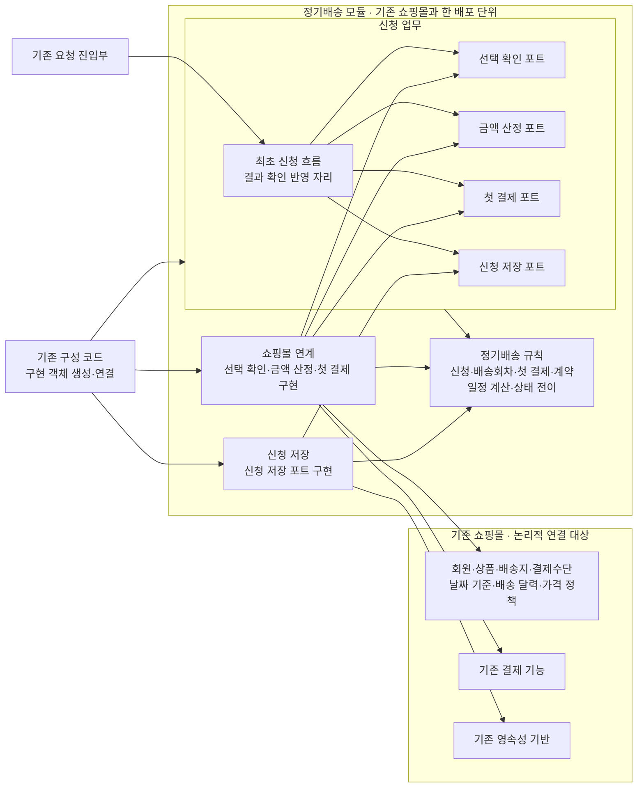

# 실습 4 정기배송 최초 신청 아키텍처

업무 규칙, 날짜·금액 조건, 상태 전이와 수용 기준은 **실습 2 요구사항 정의서**와 **실습 3 도메인 모델**을 따른다. 이 문서는 그 규칙을 어느 패키지가 맡고, 패키지끼리 어떻게 의존하는지만 정한다.

## 1. 아키텍처 선택과 패키지

**선택:** 정기배송 모듈을 기존 쇼핑몰과 같은 배포 단위 안에 두고, 포트로 의존 방향을 뒤집는다.

**이유**

- 범위가 최초 신청 하나다. 별도 서비스나 새 인프라를 둘 근거가 없다.
- 업무 흐름과 규칙이 결제·저장·기존 쇼핑몰의 구현 방식에 묶이지 않는다.
- 포트를 대역으로 바꾸면 실제 외부 시스템 없이도 업무 결과를 확인할 수 있다.

| 패키지 | 책임 | 두지 않는 것 |
|---|---|---|
| 신청 업무 | 최초 신청 흐름을 조정하고 네 포트를 소유한다. 결과 확인을 반영할 자리를 둔다. 본인 신청만 다루도록 접근을 통제한다. | 저장·연계 구현, 기존 정책의 계산 |
| 정기배송 규칙 | 신청·배송회차·첫 결제·계약을 다룬다. 일정 계산, 첫 배송일 하한 판정, 상태 전이 허용을 맡는다. | 다른 패키지에 대한 의존 |
| 쇼핑몰 연계 | 선택 확인·금액 산정·첫 결제 포트를 구현한다. 기존 기능을 조합하고, 그 응답을 업무 결과로 바꾼다. | 상태 전이, 계약 성립 판단 |
| 신청 저장 | 신청 저장 포트를 구현한다. 조건부 전이가 원자적으로 일어나도록 보장하고, 성공을 한 단위로 반영한다. | 전이를 허용할지 판단하는 일 |

## 2. 패키지 다이어그램

`A --> B`는 **A의 코드가 B의 타입이나 인터페이스를 참조한다**는 코드 의존이다. 호출 순서나 외부 호출 흐름은 나타내지 않는다. 실행 중에는 신청 업무가 포트를 거쳐 연계·저장 구현을 호출하지만, 코드 의존은 반대로 구현에서 포트를 향한다.

기존 쇼핑몰의 각 상자는 논리적 연결 대상이다. 단일 API나 단일 컴포넌트를 뜻하지 않는다.

## 3. 의존 규칙

**허용**

- 기존 요청 진입부 → 신청 업무
- 신청 업무 → 정기배송 규칙
- 쇼핑몰 연계·신청 저장 → 신청 업무의 포트, 정기배송 규칙, 각자 필요한 기존 기능
- 기존 구성 코드 → 세 패키지(구현 객체를 생성하고 연결할 때만)

**금지**

- 정기배송 규칙에서 다른 패키지로 향하는 의존
- 신청 업무에서 쇼핑몰 연계·신청 저장·기존 쇼핑몰 구현으로 향하는 의존
- 쇼핑몰 연계와 신청 저장 사이의 의존
- 기존 쇼핑몰에서 정기배송 내부로 향하는 의존(진입부와 구성 코드는 예외)
- 모든 순환

## 4. 세 연계 계약

| 연계 계약 | 포트 | 목적 | 담당 경계 |
|---|---|---|---|
| 쇼핑몰 확인 | 선택 확인, 금액 산정 | 선택 대상의 유효성·소유 관계와 배송 달력 허용 여부를 판정한다. 기존 정책으로 회차별 최종 금액을 산정한다. | 판정과 산정은 기존 쇼핑몰이 한다. 3일 하한 판정과 진행 여부는 정기배송 규칙과 신청 업무가 정한다. 금액 산정은 고지할 때 한 번만 부르고, 선택 확인이 부적합이면 부르지 않는다. 두 포트는 결과의 성격(판정과 산정값)이 달라서 나누었다. |
| 첫 결제 | 첫 결제 | 첫 회차 결제를 요청한다. 결과 확인은 새 청구 없이 기존 요청만 확인한다. | 쇼핑몰 연계가 응답을 **성공 확정·실패 확정·결과 확인 불가**로 바꾼다. 확정할 수 없는 응답은 실패로 바꾸지 않는다. |
| 신청 저장 | 신청 저장 | 신청 전체(고지 조건·예정 회차·첫 결제 결과·계약)를 신청 식별자와 신청자 기준으로 저장하고 조회한다. | 두 조건부 전이를 원자적으로 처리하는 것은 저장 구현의 책임이다. 전이를 허용할지는 정기배송 규칙이 판단한다. |

**두 조건부 전이**(새 업무 상태를 추가하지 않는다)

- **결제 시작:** 신청이 `신청준비`일 때만 `첫결제결과확인중`으로 전이하고, 결제 요청 식별 정보를 함께 기록한다. 동시에 들어온 요청 중 이 전이에 성공한 하나만 첫 결제를 요청한다.
- **결과 반영:** 신청이 `첫결제결과확인중`이나 `결과확인필요`일 때만 결과를 반영한다. 성공이면 결제 결과·계약 1건·`신청완료`를 한 단위로 기록한다. 이미 종료된 신청은 바꾸지 않는다.

**반복 전달과 결과 확인은 구분한다.** 같은 신청이 다시 오면 저장된 상태에 따라 안내만 하고, 결제 포트는 부르지 않는다. 상태가 바뀌는 것은 결과 확인 반영을 거칠 때뿐이며, 이는 상태 머신에 정의된 전이다.

**실제로 연결하기 전에 확인할 핵심 규격**

- 쇼핑몰 확인: 기존 기능이 업무상 부적합과 기술 오류를 구분해 주는지 확인한다. 기존 기준의 신청일과 최종 회차 금액을 얻을 수 있는지도 확인한다.
- 첫 결제: 중복 승인을 막는 수단, 새 청구 없이 결과를 조회하는 수단, 세 결과를 구분할 수 있는지를 확인한다. 셋이 입증되기 전에는 결제 연동을 완료로 보지 않는다.
- 신청 저장: 기존 영속성 기반으로 두 조건부 전이와 성공 반영을 원자적으로 처리할 수 있는지 확인한다.

## 5. 외부 시스템 없이 하는 검증

| 방향 | 방법 | 입증하는 것 | 입증하지 못하는 것 |
|---|---|---|---|
| 업무 결과 | 신청 업무와 정기배송 규칙은 실제 코드를 쓰고, 네 포트만 대역으로 바꾼다. 일정·월말 기준은 대역 없이 규칙만으로 확인한다. | 실습 2의 대표 수용 기준과 실습 3의 상태 머신대로 결과가 나오는지. 관찰 대상은 신청 상태, 계약 수와 금액, 결제 요청 횟수, 금액 산정 호출 횟수, 안내 결과다. | 실제 저장소의 원자성, 실제 결제의 중복 승인 방지 |
| 구조 | 정적 의존 검사로 3절의 허용·금지 의존과 순환을 확인한다. | 업무 결과가 맞더라도 의존 규칙이 깨지지 않았는지 | 업무 결과 |
| 성능 | 각 외부 연계가 1초 안에 응답하는 연계 환경에서 동시 100건으로 실측한다. | 실습 2의 품질 요구사항 충족 여부 | 대역 검증으로는 입증할 수 없다. 아직 충족했다고 보지 않는다. |

대표 예: 결제 대역이 결과 확인 불가를 돌려주면 신청은 `결과확인필요`가 되고 계약은 생기지 않는다. 같은 신청을 다시 보내도 결제 요청 횟수는 1회 그대로다.

## 6. 남은 미결 사항

- **결과 확인 반영의 시작 주체와 시점:** 콜백·폴링·재시도와 운영 복구는 이번 범위 밖이다.
- **첫 회차와 일반 주문의 연결:** 이번 범위에서는 정기배송 안에서만 기록한다.
- **신청 식별자 전달 방식과 DB 제약 구현:** 업무 계약만 정했고 기술 구현은 정하지 않았다.
- **신청준비의 유효기간:** 지금 정하지 않기로 했다.
- **결제 제공자의 멱등·조회·오류 규격:** 지원 여부가 확인되지 않아 결제 연동 완료를 판단할 수 없다.
- **의존 검사 도구:** 구조 검증의 방향만 정했다.
- **성능 실측:** 대역으로 입증할 수 없어 연계 환경에서 측정해야 한다.