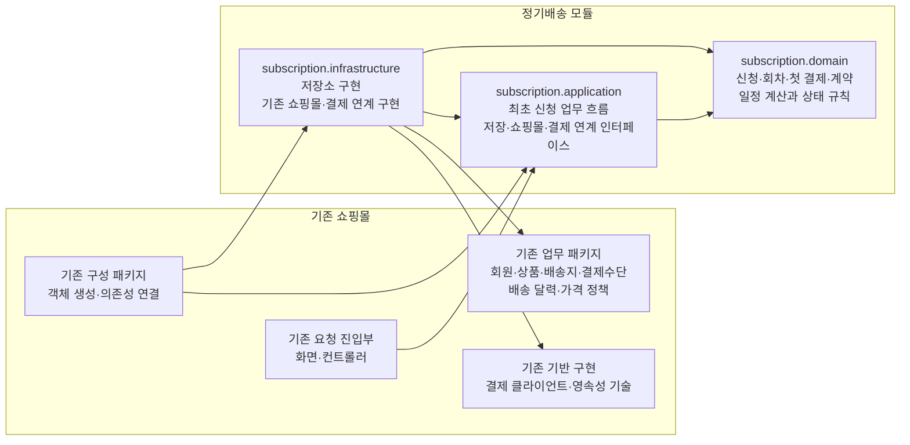

# 정기배송 최초 신청 아키텍처 및 패키지 구조

## 1. 아키텍처 선택

기존 쇼핑몰과 같은 배포 단위에 포함되는 **모듈러 모놀리스의 정기배송 모듈**로 구성한다.

정기배송 모듈 내부에는 다음 세 경계만 둔다.

- `application`: 최초 신청 업무 흐름과 외부 기능 사용 계약
- `domain`: 신청·계약의 업무 규칙과 상태
- `infrastructure`: 저장 및 외부 연계 계약의 구현

화면이나 기존 쇼핑몰의 요청 진입부는 정기배송 `application`을 호출한다. 기존 회원·상품·배송지·결제수단·배송 달력·가격 정책은 복제하지 않고 기존 쇼핑몰 모듈을 사용한다.

별도 서비스, 메시지 브로커, 전용 데이터베이스 같은 새로운 배포 단위나 인프라는 도입하지 않는다.

## 2. 패키지 다이어그램

아래 화살표 `A --> B`는 **A 패키지의 코드가 B 패키지의 타입이나 인터페이스를 참조하는 컴파일 시점 코드 의존**을 뜻한다. 업무 처리 순서나 런타임 외부 호출 순서를 나타내지 않는다.



`domain`은 다른 패키지에 의존하지 않는다. `application`은 `domain`에만 의존하며, 저장과 외부 연계에 필요한 인터페이스를 직접 소유한다. `infrastructure`가 이 인터페이스들을 구현하므로 의존 방향이 업무 규칙을 향한다.

`application.port`, `domain.model`, `adapter.payment` 같은 하위 패키지는 현재 구조 결정에 필수적이지 않으므로 별도 패키지로 세분화하지 않는다. 구현 규모가 커질 때 같은 책임 안에서 정리할 수 있다.

## 3. 패키지별 책임

### `subscription.domain`

정기배송 최초 신청에 고유한 업무 개념과 불변 규칙을 담당한다.

포함할 개념은 다음과 같다.

- `정기배송신청`
- `배송회차`
- `첫결제`
- `정기배송계약`
- 계약기간과 배송 주기
- 신청 상태와 첫 결제 결과
- 계약 종료일 및 배송회차 계산 규칙

주요 책임은 다음과 같다.

- 첫 배송일을 계약 시작일로 사용한다.
- 첫 배송일에 계약 개월 수를 더해 계약 종료일을 계산한다.
- 같은 날짜가 없는 달에는 말일을 적용한다.
- 계약 종료일을 제외하고 2주 또는 4주 간격의 배송회차를 계산한다.
- 첫 회차와 이후 회차의 결제 시점을 구분한다.
- 고지한 회차별 결제금액을 계약 성립 시 그대로 확정한다.
- 신청 상태에 허용되는 전이만 수행한다.
- 첫 결제 성공이 확인된 경우에만 계약 성립을 허용한다.
- 한 신청에서 첫 결제와 계약이 각각 하나를 초과하지 않도록 업무 규칙을 표현한다.
- 실패가 확정된 신청은 다시 결제하지 않고 종료한다.
- 결과 미확정을 실패로 취급하지 않는다.

회원, 상품, 배송지, 결제수단의 내부 구조나 기존 가격·배송 정책은 이 패키지에 구현하지 않는다. 해당 결과는 식별자와 판정값 또는 산정값으로 전달받는다.

### `subscription.application`

정기배송 최초 신청의 업무 흐름을 조정한다.

주요 책임은 다음과 같다.

- 서버가 발급한 신청 식별자로 신청 절차를 시작한다.
- 로그인 회원과 신청 식별자의 관계를 확인한다.
- 기존 쇼핑몰에 선택 대상의 유효성과 소유 관계 확인을 요청한다.
- 기존 배송 달력에 첫 배송일의 배송 가능 여부 확인을 요청한다.
- 기존 가격 정책에 회차별 결제금액 산정을 요청한다.
- 도메인을 사용해 계약 조건과 배송회차를 계산한다.
- 고객에게 고지할 조건·금액·예정 회차를 저장한다.
- 고객의 고지 확인 후에만 첫 결제를 요청한다.
- 신청 식별자에 연결된 기존 첫 결제 처리 여부를 확인한다.
- 첫 결제 결과에 따라 신청 상태를 변경한다.
- 성공이 확인된 경우 고지한 내용으로 계약을 성립시킨다.
- 동일 신청 식별자의 반복 요청에는 기존 결과를 반환한다.
- 실패가 확정된 신청에는 별개의 신규 신청이 필요하다는 결과를 반환한다.
- 회원이 자신의 신청 정보에만 접근하도록 사용 사례 수준에서 통제한다.

이 패키지는 다음과 같은 **필요 기능 중심의 연계 인터페이스**를 소유한다.

| 연계 인터페이스 | 필요한 의미 |
|---|---|
| 신청 저장 | 신청, 고지한 조건, 예정 회차 및 현재 상태 저장·조회 |
| 계약 저장 | 신청 식별자에 연결된 계약 저장·조회 |
| 기존 쇼핑몰 확인 | 회원·상품·배송지·결제수단의 유효성과 소유 관계 확인 |
| 배송 가능일 확인 | 기존 배송 달력에 따른 첫 배송일 허용 여부 확인 |
| 금액 산정 | 기존 가격·할인·배송비 정책이 적용된 회차별 최종 금액 산정 |
| 첫 결제 | 신청 식별자와 첫 회차 금액으로 결제를 요청하고 성공·실패·미확정 결과 반환 |
| 결제 결과 확인 | 기존 결제 요청의 결과를 새 청구 없이 확인 |

인터페이스는 업무에 필요한 의미만 규정한다. REST, 내부 메서드 호출, 결제 제공자 API 형태 같은 기술 규격은 포함하지 않는다.

### `subscription.infrastructure`

`application`이 정의한 저장 및 외부 연계 인터페이스를 구현한다.

주요 책임은 다음과 같다.

- 신청과 신청 상태를 저장하고 조회한다.
- 고지한 계약 조건·금액·예정 회차를 저장하고 조회한다.
- 첫 결제 요청 식별 정보와 확인된 결과를 저장한다.
- 신청 식별자에 연결된 성립 계약을 저장하고 조회한다.
- 기존 쇼핑몰의 회원·상품·배송지·결제수단 기능을 호출한다.
- 기존 배송 달력과 가격 산정 기능을 호출한다.
- 기존 결제 클라이언트를 통해 첫 결제를 요청한다.
- 결제 결과 확인 기능이 정해지면 해당 규격을 연계 인터페이스에 맞게 변환한다.
- 외부 시스템의 응답을 도메인이나 응용 계층이 사용하는 성공·실패·미확정 결과로 변환한다.

이 패키지에는 업무 상태 전이, 배송회차 계산 또는 계약 성립 판단을 두지 않는다.

결제 제공자의 중복 방지와 결과 확인 규격이 아직 없으므로 특정 기능을 지원한다고 가정하지 않는다. 다만 구현은 다음 업무 의미를 충족해야 한다.

- 동일 신청 식별자의 반복 전달로 추가 청구하지 않는다.
- 결과를 알 수 없는 기존 요청을 실패로 바꾸지 않는다.
- 결과 확인 과정에서는 새 결제를 요청하지 않는다.

제공자 규격이 확정되면 이 의미를 제공자 기능만으로 보장할 수 있는지, 정기배송 저장 정보와 결합해야 하는지를 `infrastructure` 구현에서 결정한다.

## 4. 기존 쇼핑몰과의 경계

| 관심사 | 정기배송 모듈 | 기존 쇼핑몰 |
|---|---|---|
| 회원 | 신청자 식별과 자신의 신청에 대한 접근 통제 | 회원 존재 및 유효성 판단 |
| 상품 | 선택한 상품 식별자와 수량을 신청에 연결 | 상품 존재와 신청 가능 여부 판단 |
| 배송지 | 선택 배송지를 신청에 연결 | 회원 소유와 유효성 판단 |
| 결제수단 | 선택 결제수단을 신청에 연결 | 회원 소유와 사용 가능 여부 판단 |
| 날짜 정책 | 종료일과 배송회차 계산 | 신청일 기준 및 첫 배송일 가능 여부 판단 |
| 금액 | 산정된 회차별 금액을 고지하고 계약에 고정 | 가격·할인·배송비 정책 적용 및 최종 금액 산정 |
| 첫 결제 | 요청 여부와 결과에 따른 신청 상태 결정 | 실제 결제 실행과 거래 결과 제공 |
| 계약 | 성공 확인 시 고지 내용으로 계약 성립 | 정기배송 계약을 생성하지 않음 |
| 일반 주문 | 생성하거나 변경하지 않음 | 기존 주문 기능과 정책 유지 |

정기배송 모듈은 기존 쇼핑몰 정책의 계산 방식을 재구현하지 않는다. 기존 기능에서 받은 판정과 금액을 정기배송 신청 및 계약의 근거로 사용한다.

## 5. 의존 방향에 대한 판단

핵심 의존 방향은 다음과 같다.

```text
기존 요청 진입부 → application → domain
                            ↑
                    infrastructure
```

- 요청 진입부는 정기배송 사용 사례만 호출한다.
- `application`은 정기배송 업무 규칙을 실행하기 위해 `domain`을 사용한다.
- `application`은 구체적인 저장소, 기존 쇼핑몰 구현 또는 결제 클라이언트를 직접 참조하지 않는다.
- `infrastructure`는 `application`의 연계 인터페이스를 구현하므로 `application`에 의존한다.
- `infrastructure`는 값 변환과 저장을 위해 필요한 경우 `domain` 타입을 참조한다.
- 기존 구성 패키지가 구현 객체를 생성하고 `application`에 연결한다.
- `domain`에서 `application`, `infrastructure`, 기존 쇼핑몰 패키지로 향하는 의존은 허용하지 않는다.

이 구조를 사용하면 기존 쇼핑몰과 한 배포 단위를 유지하면서도 최초 신청의 업무 규칙이 결제사·데이터베이스·기존 쇼핑몰 구현 방식에 종속되지 않는다.

## 6. 신청 처리 책임 배치

업무 처리 순서는 패키지 다이어그램의 화살표와 별개이며 다음과 같다.

1. `application`이 서버 발급 신청 식별자로 신청을 준비한다.
2. 기존 쇼핑몰 연계를 통해 선택 대상, 소유 관계, 배송 가능 여부와 금액을 확인한다.
3. `domain`이 계약 종료일과 배송회차를 계산한다.
4. `application`이 고지한 조건·금액·예정 회차를 저장한다.
5. 고객의 고지 확인을 받는다.
6. `application`이 같은 신청 식별자의 첫 결제 처리 여부를 확인한다.
7. 아직 요청되지 않은 경우에만 첫 결제 연계를 사용한다.
8. 성공이면 `domain`이 계약 성립을 허용하고 고지한 내용으로 계약을 저장한다.
9. 실패가 확정되면 계약 없이 신청을 미완료로 확정한다.
10. 결과가 확인되지 않으면 계약을 만들지 않고 결과 확인 필요 상태로 둔다.
11. 동일 신청 식별자가 다시 전달되면 추가 결제나 계약을 만들지 않고 저장된 상태에 따른 결과를 반환한다.

## 7. 이번 구조의 범위

포함하는 저장 정보는 다음으로 제한한다.

- 정기배송 신청과 상태
- 고객에게 고지한 계약 조건과 회차별 금액
- 계산된 예정 배송회차
- 첫 결제 요청 식별 정보와 확인된 결과
- 성공 시 성립한 정기배송 계약

다음 사항은 이번 구조의 책임에서 제외한다.

- 두 번째 회차 이후 결제 실행
- 실제 주문 및 배송 생성
- 배송 진행과 계약 운영 상태
- 계약 변경·해지·환불·만료 처리
- 배송 불가일의 사후 조정
- 결제 콜백·폴링·재시도 주기
- 장애 복구와 운영자 처리 절차
- 화면 또는 REST API의 세부 분할
- 데이터베이스 제약과 구체적인 키 전달 방식
- 구현 코드와 새로운 인프라 도입

결제 제공자 규격이 확정되기 전까지 남는 설계 과제는 **첫 결제 연계 구현이 신청 식별자를 기준으로 중복 청구 방지와 기존 거래 결과 확인이라는 업무 계약을 어떻게 충족할지** 확인하는 것이다. 이는 패키지 구조를 변경할 사안이 아니라 `subscription.infrastructure` 구현을 확정할 때 해결할 외부 연계 과제다.