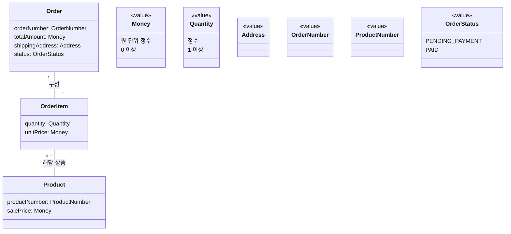

# “주문한다” 정적 분석 모델 수정안

이번 수정안은 요구사항과 추가 답변에서 확인된 업무 개념만 포함한다. 서비스, 저장소, 외래 키, 컬렉션 자료구조, 객체 참조 방향, 상태 전이와 외부 시스템 내부 구조는 정하지 않는다.

## 1. 용어집

| 한글 용어 | 영문 이름 | 정의 |
|---|---|---|
| 주문 | `Order` | 배송지가 지정되어 생성된 거래 기록. 하나 이상의 주문 항목, 확정된 주문 금액, 배송지, 주문번호와 주문 상태를 가진다. |
| 주문 항목 | `OrderItem` | 주문에 포함된 상품, 수량과 주문 생성 시 확정된 단가를 나타낸다. |
| 상품 | `Product` | 상품 시스템이 관리하는 주문 대상. `ProductNumber`로 식별되며 현재 판매가를 가진다. |
| 금액 | `Money` | 원 단위의 0 이상 정수 금액이다. |
| 수량 | `Quantity` | 1 이상의 정수로 표현되는 상품 수량이다. 구체적인 상한은 정하지 않는다. |
| 배송지 | `Address` | 주문 생성 시 확정되는 배송지 값이다. 세부 항목은 이번 모델에서 정하지 않는다. |
| 주문번호 | `OrderNumber` | 동일 주문을 식별하는 값이다. 형식과 생성 규칙은 정하지 않는다. |
| 상품번호 | `ProductNumber` | 상품 시스템의 상품을 식별하는 값이다. 형식은 정하지 않는다. |
| 주문 상태 | `OrderStatus` | 주문의 현재 상태를 나타내는 값이다. 현재 요구사항에서 확인된 값은 `PENDING_PAYMENT`와 `PAID`이나, 가능한 상태 전체가 확정된 것은 아니다. |
| 판매가 | `salePrice` | 상품 시스템이 제공하는 상품의 현재 판매가다. |
| 주문 단가 | `unitPrice` | 주문 생성 시점의 `salePrice`를 주문 항목에 확정한 금액이다. |
| 주문 금액 | `totalAmount` | 모든 주문 항목의 `unitPrice × quantity`를 합한 금액이다. |
| 배송지 속성 | `shippingAddress` | 주문에 확정된 `Address` 값이다. |
| 결제대기 | `PENDING_PAYMENT` | 주문은 생성됐지만 카드 승인이 완료되지 않은 것으로 확인된 상태 값이다. |
| 결제완료 | `PAID` | 카드 승인이 완료되어 주문이 성립한 것으로 확인된 상태 값이다. |

## 2. 개념, 속성 및 관계

### `Order`

- `orderNumber: OrderNumber`
- `totalAmount: Money`
- `shippingAddress: Address`
- `status: OrderStatus`
- 하나 이상의 `OrderItem`으로 구성된다.
- 본인 주문인지 판단할 수 있어야 한다. 다만 주문 주체의 구체적인 타입과 식별 정보는 정해지지 않았다.

### `OrderItem`

- `quantity: Quantity`
- `unitPrice: Money`
- 정확히 하나의 `Order`에 포함된다.
- 정확히 하나의 `Product`에 해당한다.

`OrderItem`에 별도의 `productNumber` 속성을 중복해서 두지 않는다. 어떤 상품의 항목인지는 `Product`와의 관계로 표현하고, 그 상품의 식별 값은 `Product.productNumber`로 표현한다.

### `Product`

- `productNumber: ProductNumber`
- `salePrice: Money`
- 하나의 상품은 여러 주문의 주문 항목에 해당할 수 있다.
- 상품명, 설명, 재고 등은 현재 주문 분석 모델의 근거가 없으므로 포함하지 않는다.

### 값 개념

- `Money`: 원 단위의 0 이상 정수
- `Quantity`: 1 이상의 정수
- `Address`: 세부 구조가 정해지지 않은 배송지 값
- `OrderNumber`: 형식이 정해지지 않은 주문 식별 값
- `ProductNumber`: 형식이 정해지지 않은 상품 식별 값
- `OrderStatus`: 현재 확인된 값은 `PENDING_PAYMENT`, `PAID`

## 3. 클래스 다이어그램

관계선에는 탐색 또는 참조 방향을 뜻하는 화살표를 사용하지 않았다. `Order`와 `OrderItem` 사이에도 구현상의 포함 방식이나 생명주기 결합을 단정할 수 있는 합성 표기를 사용하지 않았다.



`OrderStatus`에 적은 두 값은 현재 요구사항에서 확인된 값이다. 이 표기는 시스템의 가능한 상태가 두 개뿐이라는 의미가 아니다.

## 4. 다이어그램과 같은 내용을 읽을 수 있는 목록

1. `Order`는 `OrderNumber` 타입의 `orderNumber`를 하나 가진다.
2. `Order`는 `Money` 타입의 `totalAmount`를 하나 가진다.
3. `Order`는 `Address` 타입의 `shippingAddress`를 하나 가진다.
4. `Order`는 `OrderStatus` 타입의 `status`를 하나 가진다.
5. 하나의 `Order`는 하나 이상의 `OrderItem`으로 구성된다.
6. 하나의 `OrderItem`은 정확히 하나의 `Order`에 포함된다.
7. `OrderItem`은 `Quantity` 타입의 `quantity`를 하나 가진다.
8. `OrderItem`은 `Money` 타입의 `unitPrice`를 하나 가진다.
9. 하나의 `OrderItem`은 정확히 하나의 `Product`에 해당한다.
10. 하나의 `Product`는 0개 이상의 `OrderItem`에 해당할 수 있다.
11. `Product`는 `ProductNumber` 타입의 `productNumber`를 하나 가진다.
12. `Product`는 `Money` 타입의 `salePrice`를 하나 가진다.
13. `Money`는 원 단위의 0 이상 정수다.
14. `Quantity`는 1 이상의 정수다.
15. 현재 확인된 `OrderStatus` 값은 `PENDING_PAYMENT`와 `PAID`다. 가능한 상태 전체는 아직 확정되지 않았다.

이 관계들은 업무상 다중성만 나타낸다. 어느 객체가 다른 객체를 저장하거나 참조하는지, 어떤 방향으로 탐색하는지는 나타내지 않는다.

## 5. 불변 조건

### 5.1 주문 항목 존재

```text
Order에 포함된 OrderItem 수 >= 1
```

### 5.2 금액 범위

```text
Product.salePrice >= 0원
OrderItem.unitPrice >= 0원
Order.totalAmount >= 0원
```

모든 금액은 원 단위 정수다.

### 5.3 수량 범위

```text
OrderItem.quantity는 1 이상의 정수다.
```

구체적인 상한은 없다기보다, 이번 모델에서 정하지 않은 것이다.

### 5.4 주문 금액 계산

```text
Order.totalAmount
= Σ(OrderItem.unitPrice × OrderItem.quantity)
```

합산 대상은 해당 `Order`를 구성하는 모든 `OrderItem`이다.

### 5.5 주문 단가의 의미

```text
OrderItem.unitPrice
= 해당 OrderItem이 속한 Order를 생성할 때의
  해당 Product.salePrice
```

`unitPrice`는 상품의 현재 판매가가 아니라 주문 생성 시 확정된 단가다.

### 5.6 가격 확정

```text
Order 생성 후 Product.salePrice가 변경되더라도
기존 OrderItem.unitPrice와 Order.totalAmount는 변하지 않는다.
```

이는 주문에 가격 스냅숏이 확정된다는 업무 제약이다. 가격을 복사하거나 별도 테이블에 저장한다는 구현 방식을 뜻하지 않는다.

### 5.7 배송지 존재와 확정

```text
Order.shippingAddress는 반드시 존재한다.
```

```text
status = PENDING_PAYMENT인 기존 Order의
shippingAddress는 변경되지 않는다.
```

### 5.8 결제대기 주문의 내용 고정

```text
status = PENDING_PAYMENT인 기존 Order에서는
OrderItem의 구성, 각 OrderItem.quantity 및
각 OrderItem.unitPrice가 변경되지 않는다.
```

이는 상태 전이를 정의하지 않고, 해당 상태로 표현되는 주문에 적용되는 정적 제약만 나타낸다.

### 5.9 카드 승인 요청 금액

```text
카드 승인 요청 금액 = Order.totalAmount
```

이는 주문 정적 모델의 속성은 아니지만, 확정된 주문 금액과 외부 결제 요청 금액 사이의 요구사항 제약이다. 결제 서비스나 결제 이력 개념을 추가하지 않고 별도 연계 규칙으로 남긴다.

### 5.10 주문자와 수령인

요구사항상 주문자와 수령인은 같은 사람이어야 한다. 그러나 주문자, 수령인 또는 고객을 나타내는 구체적인 타입과 속성이 정해지지 않았으므로 현재 구조에는 넣지 않는다.

### 5.11 본인 주문 접근

조회 또는 변경 요청은 본인 주문에 대해서만 인정되어야 한다. 다만 본인 여부를 판정하는 데 필요한 회원·비회원 정책과 식별 모델이 정해지지 않았으므로 `Customer`, `Member`, `customerId` 같은 개념이나 속성은 추가하지 않는다.

## 6. 초안에서 수정한 판단과 근거

1. `unitPrice`의 의미를 확정했다.

   상품의 현재 가격은 `Product.salePrice`, 주문 생성 시 확정된 단가는 `OrderItem.unitPrice`로 구분한다. 이는 추가 답변과 요구사항의 가격 고정 규칙에 근거한다.

2. `Money`와 `Quantity`의 제약을 확정했다.

   `Money`는 원 단위의 0 이상 정수, `Quantity`는 1 이상의 정수로 반영했다. 통화 속성, 소수점 및 반올림 규칙은 필요하지 않으므로 질문 목록에서 제거했다.

3. `OrderItem.productNumber`를 제거했다.

   초안에서는 `OrderItem`이 `Product`와 관계를 가지면서 `productNumber`도 별도 속성으로 가져 같은 연결을 중복 표현했다. 수정안에서는 상품 식별을 `Product.productNumber`로만 표현한다. 이는 외래 키와 같은 구현 구조로 오해될 가능성도 줄인다.

4. 방향 화살표와 합성 관계를 제거했다.

   화살표는 객체의 참조 또는 탐색 방향으로 해석될 수 있고, 합성 표기는 생명주기나 소유 구현을 암시할 수 있다. 요구사항에서 확정된 것은 관계와 다중성이므로 방향 없는 일반 관계로 표현했다.

5. 값 타입 연결선을 제거했다.

   `Money`, `Quantity`, `Address` 등의 사용은 속성 선언에서 이미 드러난다. 모든 값 타입을 별도 관계선으로 연결하면 같은 내용을 중복 표현하고 핵심 관계가 흐려지므로, 도식의 선은 `Order`–`OrderItem`–`Product` 관계에만 사용했다.

6. `OrderStatus`를 완결된 열거형으로 단정하지 않았다.

   `PENDING_PAYMENT`와 `PAID`는 현재 확인된 값이지만, 결제 응답 미확정, 재고 부족 및 배송 실패 정책이 남아 있다. 따라서 두 값만 가능한 완전한 상태 목록으로 모델링하지 않았다.

7. 구체적인 주문 주체 개념을 추가하지 않았다.

   본인 주문 확인은 요구사항으로 유지했지만 `Customer`, `Member`, `customerId` 같은 구체 타입과 속성에는 근거가 없다. 정적 구조에 추측으로 추가하지 않고 미정 제약으로 남겼다.

8. 결제 이력 개념을 추가하지 않았다.

   승인 결과와 요청 금액을 확인해야 한다는 요구는 있지만 보존 구조, 결제 시도의 다중성 및 미확정 응답 정책이 결정되지 않았다. 따라서 `Payment`, `PaymentAttempt`, `Authorization` 같은 개념은 만들지 않았다.

9. 재결제에 관한 이력 제약을 핵심 불변 조건에서 제외했다.

   “같은 주문으로 재결제한다”는 요구는 유효하지만, 결제 시도 개념 없이 이전 거절부터 다음 승인까지의 이력을 정적 구조로 표현하면 근거 없는 모델이 생긴다. 같은 주문을 유지한다는 요구는 보존하되, 결제 이력의 구조는 확정하지 않는다.

## 7. 계속 미정인 사항

- `Address`의 세부 항목
- `OrderNumber`와 `ProductNumber`의 형식
- 같은 상품이 여러 주문 항목에 있을 때의 병합 여부
- 회원·비회원 허용 여부와 본인 확인 방식
- 주문자 및 수령인을 표현할 구체적인 개념
- 결제 이력과 승인 결과의 보존 구조
- 결제 응답 미확정 정책
- 결제대기 기한과 만료 정책
- 재고 판단 시점과 재고 부족 처리
- 배송 요청 실패 처리
- 현재 확인된 값 이외의 `OrderStatus`
- 주문 결과 별도 통지 여부와 담당 시스템