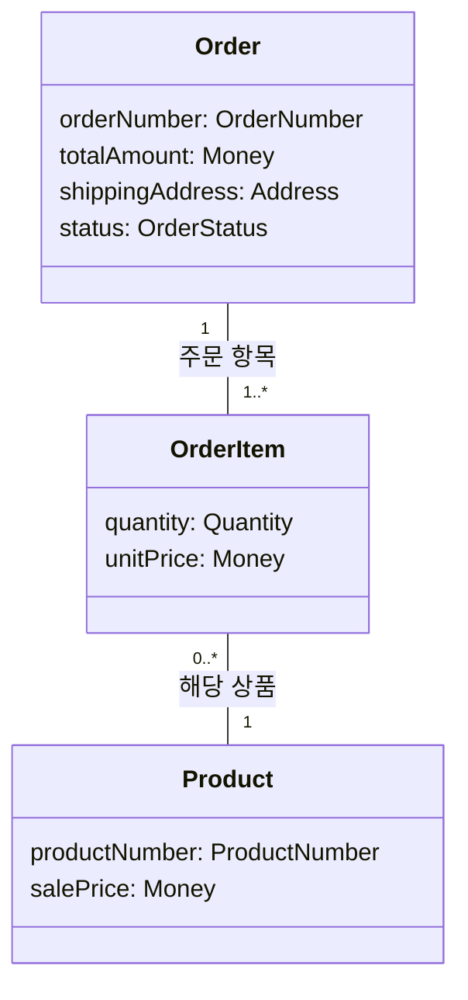

# “주문한다” 정적 분석 모델 검증안

단가 확정 시점은 장바구니 적재 시점이 아니라 `Order` 생성 시점이다. 따라서 `OrderItem.unitPrice`와 현재 `Product.salePrice`의 관계는 항상 성립하는 불변 조건이 아니라 생성 시점 조건이다.

## 1. 용어와 개념

| 용어 | 영문 이름 | 의미 |
|---|---|---|
| 주문 | `Order` | 배송지가 지정되어 생성된 거래 기록 |
| 주문 항목 | `OrderItem` | 주문에 포함된 상품, 수량 및 주문 생성 시 확정된 단가 |
| 상품 | `Product` | 상품 시스템이 관리하는 주문 대상 |
| 금액 | `Money` | 원 단위의 0 이상 정수 |
| 수량 | `Quantity` | 1 이상의 정수. 상한은 정하지 않음 |
| 배송지 | `Address` | 주문에 확정된 배송지 값. 세부 항목은 정하지 않음 |
| 주문번호 | `OrderNumber` | 주문 식별 값. 형식은 정하지 않음 |
| 상품번호 | `ProductNumber` | 상품 식별 값. 형식은 정하지 않음 |
| 주문 상태 | `OrderStatus` | 주문의 현재 상태를 나타내는 값 |
| 판매가 | `salePrice` | 상품의 현재 판매가 |
| 주문 단가 | `unitPrice` | 주문 생성 시점의 `salePrice`로 확정된 단가 |
| 주문 금액 | `totalAmount` | 주문에 포함된 모든 항목의 `unitPrice × quantity` 합계 |
| 배송지 속성 | `shippingAddress` | 주문 생성 시 확정된 배송지 |

현재 확인된 `OrderStatus` 값은 `PENDING_PAYMENT`와 `PAID`다. 이것이 가능한 상태 전체라는 의미는 아니다.

## 2. 개념과 속성

### `Order`

- `orderNumber: OrderNumber`
- `totalAmount: Money`
- `shippingAddress: Address`
- `status: OrderStatus`
- 하나 이상의 `OrderItem`과 관계를 맺는다.

### `OrderItem`

- `quantity: Quantity`
- `unitPrice: Money`
- 정확히 하나의 `Order`에 속한다.
- 정확히 하나의 `Product`에 해당한다.

### `Product`

- `productNumber: ProductNumber`
- `salePrice: Money`
- 0개 이상의 `OrderItem`에 해당할 수 있다.

본인 주문 확인은 필요한 요구지만 주문 주체의 구체적인 개념과 속성은 정해지지 않았으므로 모델에 추가하지 않는다.

## 3. 클래스 다이어그램

값은 속성 타입으로만 표현한다. 관계선은 업무상 관계와 개수만 나타내며 참조·탐색 방향이나 저장 방식을 뜻하지 않는다.



## 4. 다이어그램을 읽는 목록

1. 하나의 `Order`에는 `OrderItem`이 1개 이상 있다.
2. 하나의 `OrderItem`은 정확히 하나의 `Order`에 속한다.
3. 하나의 `OrderItem`은 정확히 하나의 `Product`에 해당한다.
4. 하나의 `Product`는 `OrderItem` 0개 이상에 해당할 수 있다.
5. `Order`는 `orderNumber`, `totalAmount`, `shippingAddress`, `status`를 각각 하나씩 가진다.
6. `OrderItem`은 `quantity`와 `unitPrice`를 각각 하나씩 가진다.
7. `Product`는 `productNumber`와 현재 `salePrice`를 각각 하나씩 가진다.

같은 상품의 항목을 합칠지는 정하지 않았으므로, 한 주문 안에서 같은 `Product`에 해당하는 `OrderItem`이 여러 개 존재하는 것을 금지하지 않는다.

## 5. 조건의 구분

### 5.1 항상 성립하는 불변 조건

유효한 주문을 어느 시점에 보더라도 성립해야 한다.

```text
Order에 속한 OrderItem 수 >= 1
```

```text
Order.totalAmount
= Σ(OrderItem.unitPrice × OrderItem.quantity)
```

```text
Money 값은 원 단위의 0 이상 정수다.
```

따라서 다음 값은 모두 0 이상 정수다.

```text
Product.salePrice
OrderItem.unitPrice
Order.totalAmount
```

```text
OrderItem.quantity는 1 이상의 정수다.
```

```text
Order.shippingAddress는 존재한다.
```

### 5.2 주문 생성 시점에 성립하는 조건

`unitPrice`는 주문 생성 순간의 판매가와 같아야 한다.

```text
OrderItem.unitPrice
= 해당 Order를 생성하는 시점의 해당 Product.salePrice
```

이는 생성 이후에도 `unitPrice = 현재 salePrice`가 계속 성립해야 한다는 뜻이 아니다.

주문을 생성할 때 금액도 다음과 같이 확정된다.

```text
생성된 Order.totalAmount
= Σ(생성된 각 OrderItem.unitPrice × quantity)
```

### 5.3 생성 전후 또는 변경 전후를 비교하는 조건

주문 생성 이후 상품의 현재 판매가가 바뀌어도 기존 주문의 확정 가격은 바뀌지 않는다.

```text
Product.salePrice(before) ≠ Product.salePrice(after)일 수 있다.

기존 OrderItem.unitPrice(before)
= 기존 OrderItem.unitPrice(after)

기존 Order.totalAmount(before)
= 기존 Order.totalAmount(after)
```

`PENDING_PAYMENT`인 기존 주문에서는 주문 내용과 배송지도 변경되지 않는다.

```text
OrderItem 구성(before) = OrderItem 구성(after)
각 OrderItem.quantity(before) = quantity(after)
각 OrderItem.unitPrice(before) = unitPrice(after)
shippingAddress(before) = shippingAddress(after)
```

이 조건은 상태가 어떻게 바뀌는지 또는 외부 시스템을 어떤 순서로 호출하는지를 정의하지 않는다.

## 6. 대표 주문에 대입한 확인

대표 주문은 다음과 같다.

```text
상품: 펜
quantity = 2
주문 생성 시 Product.salePrice = 1,000원
shippingAddress = 서울
```

### 관계의 개수

- `Order` 수: 1
- 해당 `Order`의 `OrderItem` 수: 1
- 해당 `OrderItem`의 `Product` 수: 1

따라서 다음 다중성을 만족한다.

```text
Order당 OrderItem 수 = 1 >= 1
OrderItem당 Order 수 = 1
OrderItem당 Product 수 = 1
```

### 값의 범위

```text
salePrice = 1,000원 >= 0
unitPrice = 1,000원 >= 0
quantity = 2 >= 1
totalAmount = 2,000원 >= 0
```

모든 금액은 원 단위 정수이고 수량도 정수이므로 범위 조건을 만족한다.

### 생성 시점 조건

```text
unitPrice
= 주문 생성 시 salePrice
= 1,000원
```

```text
totalAmount
= unitPrice × quantity
= 1,000원 × 2
= 2,000원
```

`shippingAddress`는 서울로 존재하므로 배송지 존재 조건도 만족한다.

### 판매가 변경 전후 비교

상품의 현재 판매가가 이후 1,200원이 된 경우:

| 값 | 주문 생성 직후 | 판매가 변경 후 |
|---|---:|---:|
| `Product.salePrice` | 1,000원 | 1,200원 |
| 기존 `OrderItem.unitPrice` | 1,000원 | 1,000원 |
| 기존 `OrderItem.quantity` | 2 | 2 |
| 기존 `Order.totalAmount` | 2,000원 | 2,000원 |
| 기존 `Order.shippingAddress` | 서울 | 서울 |

변경 후에는 다음 등식이 성립할 필요가 없다.

```text
기존 OrderItem.unitPrice = 현재 Product.salePrice
1,000원 ≠ 1,200원
```

반면 주문 자체의 합계 등식은 계속 성립한다.

```text
기존 Order.totalAmount
= 기존 OrderItem.unitPrice × quantity
= 1,000원 × 2
= 2,000원
```

## 7. 수정한 판단과 근거

- `unitPrice = salePrice`를 일반 불변 조건에서 생성 시점 조건으로 옮겼다. 두 값은 주문 생성 순간에만 같으며 이후 판매가 변경을 허용하기 때문이다.
- 합계 등식은 항상 성립하는 불변 조건으로 유지했다. `totalAmount`는 현재 판매가가 아니라 확정된 `unitPrice`로 계산되기 때문이다.
- 가격 고정과 `PENDING_PAYMENT` 주문의 변경 금지는 전후 값을 비교하는 조건으로 분리했다. 한 시점의 값 범위만으로는 “변경되지 않는다”를 표현할 수 없기 때문이다.
- 다이어그램에서는 `Order`, `OrderItem`, `Product`만 개념으로 표현했다. `Money`, `Quantity`, `Address` 등은 속성 타입과 제약 목록으로 충분하다.
- 결제 이력, 회원·비회원, 주소 구조, 식별자 형식, 중복 항목 병합 및 수량 상한은 합의대로 확정하지 않았다.
- 카드 승인, 재고 판단, 배송 요청의 절차와 상태 전이는 정적 모델에 포함하지 않았다.

## 8. 남은 질문

추가 질문은 없다. 기존 업무 미정 사항과 이번 모델에서 정하지 않기로 한 항목은 그대로 유지한다.