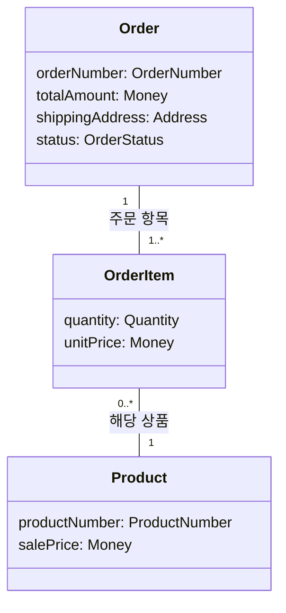

# “주문한다” 정적 업무 모델

## 1. 용어와 속성

| 개념 | 속성 | 업무 의미 |
|---|---|---|
| 주문 `Order` | `orderNumber: OrderNumber` | 주문을 식별하는 값 |
|  | `totalAmount: Money` | 주문 항목별 확정 단가와 수량으로 계산한 주문 금액 |
|  | `shippingAddress: Address` | 주문 생성 시 확정된 배송지 |
|  | `status: OrderStatus` | 주문의 현재 상태를 나타내는 값 |
| 주문 항목 `OrderItem` | `quantity: Quantity` | 주문한 상품의 수량 |
|  | `unitPrice: Money` | 주문 생성 시점의 `salePrice`로 확정된 단가 |
| 상품 `Product` | `productNumber: ProductNumber` | 상품을 식별하는 값 |
|  | `salePrice: Money` | 상품의 현재 판매가 |

값의 의미는 다음과 같다.

- `Money`: 원 단위의 0 이상 정수
- `Quantity`: 1 이상의 정수
- `Address`: 주문에 확정된 배송지 값
- `OrderNumber`: 주문 식별 값
- `ProductNumber`: 상품 식별 값
- `OrderStatus`: 주문의 현재 상태 값. 현재 확인된 값은 `PENDING_PAYMENT`와 `PAID`이며, 가능한 상태 전체가 확정된 것은 아니다.

## 2. 세 개념의 클래스 도식과 관계 목록

관계선은 업무상 관계와 개수만 나타낸다. 참조 방향, 저장 방식 또는 생명주기 구현을 뜻하지 않는다.



관계와 속성을 목록으로 읽으면 다음과 같다.

1. 하나의 `Order`에는 `OrderItem`이 1개 이상 있다.
2. 하나의 `OrderItem`은 정확히 하나의 `Order`에 속한다.
3. 하나의 `OrderItem`은 정확히 하나의 `Product`에 해당한다.
4. 하나의 `Product`는 0개 이상의 `OrderItem`과 관계를 맺을 수 있다.
5. `Order`는 `orderNumber`, `totalAmount`, `shippingAddress`, `status`를 각각 하나씩 가진다.
6. `OrderItem`은 `quantity`, `unitPrice`를 각각 하나씩 가진다.
7. `Product`는 `productNumber`, `salePrice`를 각각 하나씩 가진다.

같은 주문에서 동일 상품에 해당하는 주문 항목을 병합할지, 중복 항목을 허용할지는 정하지 않았다.

## 3. 조건과 대표 예

### 값 조건

```text
Product.salePrice, OrderItem.unitPrice, Order.totalAmount는
원 단위의 0 이상 정수다.

OrderItem.quantity는 1 이상의 정수다.

Order.shippingAddress는 존재한다.

Order에 속한 OrderItem 수는 1개 이상이다.
```

### 항상 성립하는 계산 조건

유효한 주문에서는 현재 `Product.salePrice`가 아니라 확정된 `OrderItem.unitPrice`를 사용하여 합계를 계산한다.

```text
Order.totalAmount
= Σ(OrderItem.unitPrice × OrderItem.quantity)
```

### 주문 생성 시점 조건

각 주문 항목의 단가는 장바구니에 상품을 넣은 시점이 아니라 주문을 생성하는 시점에 확정된다.

```text
OrderItem.unitPrice
= 해당 Order 생성 시점의 해당 Product.salePrice
```

```text
Order.totalAmount
= 생성된 모든 OrderItem의
  Σ(unitPrice × quantity)
```

`shippingAddress`도 주문 생성 시점에 확정된다.

### 생성 이후 변경 전후 조건

상품의 현재 판매가가 변경되더라도 기존 주문의 확정 단가와 주문 금액은 변하지 않는다.

```text
Product.salePrice(before)와 Product.salePrice(after)는 다를 수 있다.

기존 OrderItem.unitPrice(before)
= 기존 OrderItem.unitPrice(after)

기존 Order.totalAmount(before)
= 기존 Order.totalAmount(after)
```

`PENDING_PAYMENT`인 기존 주문에서는 다음 내용이 변경되지 않는다.

```text
OrderItem 구성(before) = OrderItem 구성(after)

각 OrderItem.quantity(before)
= 각 OrderItem.quantity(after)

각 OrderItem.unitPrice(before)
= 각 OrderItem.unitPrice(after)

shippingAddress(before)
= shippingAddress(after)
```

### 대표 주문 확인

```text
상품: 펜
OrderItem 수: 1
quantity: 2
주문 생성 시 salePrice: 1,000원
unitPrice: 1,000원
totalAmount: 2,000원
shippingAddress: 서울
```

관계와 값 조건을 만족한다.

```text
Order당 OrderItem 수 = 1 >= 1
OrderItem당 Order 수 = 1
OrderItem당 Product 수 = 1

salePrice = 1,000원 >= 0
unitPrice = 1,000원 >= 0
quantity = 2 >= 1
totalAmount = 2,000원 >= 0
```

생성 시점 조건과 합계 등식도 성립한다.

```text
unitPrice
= 주문 생성 시 salePrice
= 1,000원

totalAmount
= unitPrice × quantity
= 1,000원 × 2
= 2,000원
```

이후 현재 판매가가 1,200원으로 변경된 경우:

| 값 | 주문 생성 직후 | 판매가 변경 후 |
|---|---:|---:|
| `Product.salePrice` | 1,000원 | 1,200원 |
| 기존 `OrderItem.unitPrice` | 1,000원 | 1,000원 |
| 기존 `OrderItem.quantity` | 2 | 2 |
| 기존 `Order.totalAmount` | 2,000원 | 2,000원 |
| 기존 `Order.shippingAddress` | 서울 | 서울 |

변경 후 기존 `unitPrice`가 현재 `salePrice`와 같을 필요는 없지만, 주문의 합계 등식은 계속 성립한다.

```text
기존 unitPrice 1,000원 ≠ 현재 salePrice 1,200원

기존 totalAmount
= 기존 unitPrice × quantity
= 1,000원 × 2
= 2,000원
```

## 4. 이번에 정하지 않은 항목과 기존 업무 미정

### 정적 모델에서 구체화하지 않은 항목

- 회원 주문과 비회원 주문의 허용 범위
- 주문 주체와 본인 확인을 표현할 구체 타입 및 식별 정보
- 결제 이력과 승인 결과의 보존 구조
- `OrderNumber`와 `ProductNumber`의 형식 및 생성 규칙
- `Address`의 세부 항목
- 동일 상품 주문 항목의 병합 여부와 중복 허용 여부
- `Quantity`의 구체적인 상한
- 현재 확인된 값 이외의 `OrderStatus`

본인 주문에 대해서만 조회 또는 변경 요청의 권한을 인정하고 다른 고객의 주문 요청은 거절해야 한다. 다만 이를 표현할 `Customer`, `Member`, 식별자 등의 구체 개념은 확정하지 않는다.

### 기존 업무 미정

- 결제대기 기한과 만료 정책
- 결제 응답을 확정할 수 없을 때의 처리와 재결제 허용 여부
- 재고 판단 시점
- 승인 전 재고 부족 처리
- 카드 승인 뒤 재고 부족 처리
- 배송 요청 실패 처리와 재요청 기준
- 주문 결과의 별도 통지 여부와 담당 시스템

이 미정 사항으로부터 새로운 개념, 정책 또는 상태를 도출하지 않는다.