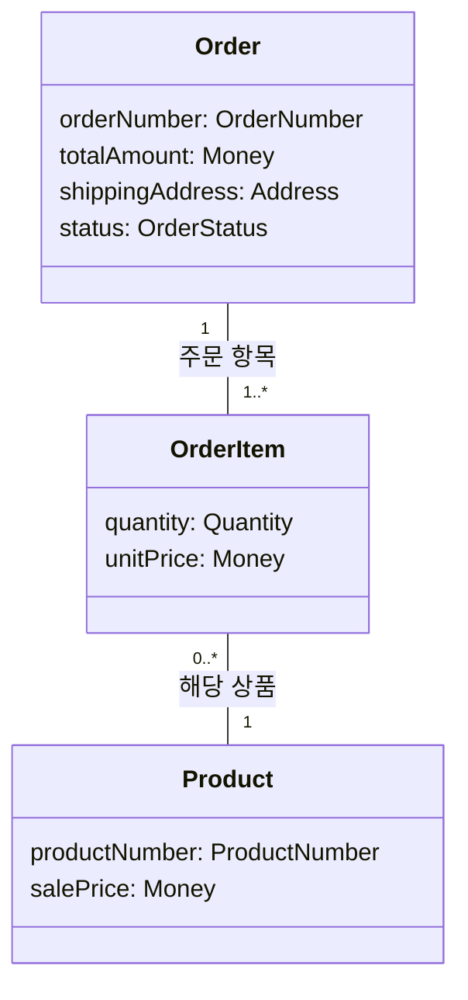

# “주문한다” 정적 업무 모델

주문은 생성 시점의 판매가와 배송지를 확정하고, 하나 이상의 주문 항목에 대한 확정 단가와 수량의 합계로 주문 금액을 유지한다.

## 1. 용어와 속성

- 주문 `Order`
  - `orderNumber: OrderNumber`: 주문 식별 값
  - `totalAmount: Money`: 주문 항목별 확정 단가와 수량으로 계산한 주문 금액
  - `shippingAddress: Address`: 주문 생성 시 확정된 배송지
  - `status: OrderStatus`: 주문의 현재 상태

- 주문 항목 `OrderItem`
  - `quantity: Quantity`: 주문한 상품의 수량
  - `unitPrice: Money`: 주문 생성 시점의 `salePrice`로 확정된 단가

- 상품 `Product`
  - `productNumber: ProductNumber`: 상품 식별 값
  - `salePrice: Money`: 상품의 현재 판매가

- `Money`: 원 단위의 0 이상 정수
- `Quantity`: 1 이상의 정수
- `Address`: 주문에 확정된 배송지 값
- `OrderNumber`: 주문 식별 값
- `ProductNumber`: 상품 식별 값
- `OrderStatus`: 주문의 현재 상태 값. 현재 확인된 값은 `PENDING_PAYMENT`와 `PAID`이며 가능한 상태 전체가 확정된 것은 아니다.

## 2. 클래스 도식과 관계

관계선은 업무상 관계와 개수만 나타내며 연관 방향이나 저장 방식을 정하지 않는다.



1. 하나의 `Order`에는 `OrderItem`이 1개 이상 있다.
2. 하나의 `OrderItem`은 정확히 하나의 `Order`에 속한다.
3. 하나의 `OrderItem`은 정확히 하나의 `Product`에 해당한다.
4. 하나의 `Product`는 0개 이상의 `OrderItem`과 관계를 맺을 수 있다.

## 3. 조건과 대표 예

- `salePrice`, `unitPrice`, `totalAmount`는 원 단위의 0 이상 정수다.
- `quantity`는 1 이상의 정수다.
- 하나의 `Order`에는 `OrderItem`이 1개 이상 있고 `shippingAddress`가 존재한다.
- 유효한 주문에서는 다음 합계 등식이 항상 성립한다.

  ```text
  Order.totalAmount
  = Σ(OrderItem.unitPrice × OrderItem.quantity)
  ```

- `unitPrice`는 장바구니에 담은 시점이 아니라 `Order` 생성 시점의 해당 `Product.salePrice`로 확정된다.
- 생성 이후 현재 `salePrice`가 변경되어도 기존 `unitPrice`와 `totalAmount`는 변하지 않는다.
- `PENDING_PAYMENT`인 기존 주문에서는 주문 항목의 구성, 각 항목의 `quantity`와 `unitPrice`, `shippingAddress`가 변경되지 않는다.

대표 주문과 판매가 변경 전후는 다음과 같다.

| 값 | 주문 생성 직후 | 판매가 변경 후 |
|---|---:|---:|
| 상품 | 펜 | 펜 |
| `OrderItem` 수 | 1 | 1 |
| `Product.salePrice` | 1,000원 | 1,200원 |
| `OrderItem.unitPrice` | 1,000원 | 1,000원 |
| `OrderItem.quantity` | 2 | 2 |
| `Order.totalAmount` | 2,000원 | 2,000원 |
| `Order.shippingAddress` | 서울 | 서울 |

생성 시점에는 `unitPrice = salePrice = 1,000원`이고, `totalAmount = 1,000원 × 2 = 2,000원`이다. 이후 현재 판매가가 1,200원으로 바뀌어도 기존 주문은 확정 단가 1,000원과 총액 2,000원을 유지한다.

## 4. 정하지 않은 항목과 기존 업무 미정

본인 주문에 대해서만 조회 또는 변경 요청의 권한을 인정하며 다른 고객의 주문 요청은 거절한다. 주문자와 수령인은 같은 사람으로 본다. 다만 회원·비회원 여부와 주문 주체, 본인 확인, 주문자 및 수령인을 나타낼 구체 타입이나 식별 정보는 정하지 않는다.

정적 모델에서 다음 사항은 정하지 않는다.

- `OrderNumber`와 `ProductNumber`의 형식 및 생성 규칙
- `Address`의 세부 항목
- `Quantity`의 구체적인 상한
- 동일 상품 주문 항목의 병합 여부와 중복 허용 여부
- 결제 이력과 승인 결과의 보존 구조
- 현재 확인된 값 이외의 `OrderStatus`

기존 업무 미정은 다음과 같다.

- 결제대기 기한과 만료 정책
- 결제 응답을 확정할 수 없을 때의 처리와 재결제 허용 여부
- 재고 판단 시점과 승인 전 재고 부족 처리
- 카드 승인 뒤 재고 부족 처리
- 배송 요청 실패 처리와 재요청 기준
- 주문 결과의 별도 통지 여부와 담당 시스템

이 미정 사항으로부터 허용 또는 금지 정책, 새로운 개념이나 상태를 도출하지 않는다.