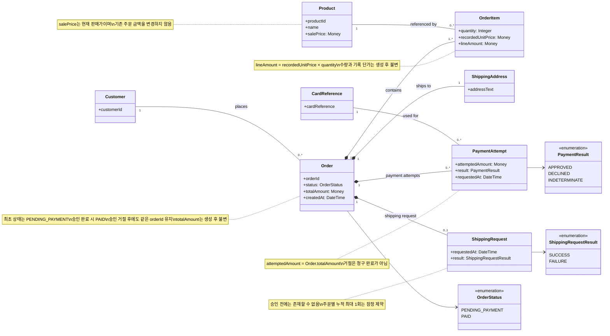

# 주문 기능 정적 모델 정의서 — 초안

## 1. 목적과 범위

이 문서는 승인된 주문 기능 정의서를 바탕으로 ‘주문한다’ 기능의 정적 개념 모델을 정의한다.

이 모델은 업무 개념, 속성, 관계, 다중성 및 불변 조건을 표현한다. 데이터베이스 테이블, API 형식, 프로그램 클래스 및 외부 시스템의 내부 모델을 결정하지 않는다.

## 2. 구분 기준

- **규칙**: 승인된 기능 정의서에서 확정된 업무 제약이다.
- **가정**: 정적 모델을 완성하기 위해 도입한 해석이며 추가 승인이 필요하다.
- **미정**: 승인된 정의서에서 정책이나 최종 수용 기준이 확정되지 않은 사항이다.

## 3. 용어와 개념

| 개념 | 표기 | 정의 | 구분 |
|---|---|---|---|
| 고객 | `Customer` | 주문을 생성하고 본인 주문을 조회하거나 변경 요청하는 주체 | 규칙 |
| 주문 | `Order` | 고객이 배송지를 확정할 때 생성되는 업무 기록 | 규칙 |
| 주문 항목 | `OrderItem` | 주문에 포함된 상품, 수량 및 주문 생성 시 기록된 단가 | 규칙 |
| 상품 | `Product` | 상품 시스템에서 식별되고 판매가가 제공되는 주문 대상 | 규칙 |
| 배송지 | `ShippingAddress` | 주문 생성 전에 고객이 확정한 배송 목적지 | 규칙 |
| 결제 시도 | `PaymentAttempt` | 특정 주문 금액에 대해 카드 승인을 요청한 한 번의 시도 | 가정 |
| 카드 정보 | `CardReference` | 승인 요청에 사용된 카드를 식별하기 위한 개념 | 가정 |
| 배송 요청 | `ShippingRequest` | 카드 승인 완료 후 배송 시스템에 전달하는 요청 | 규칙 |
| 판매가 | `salePrice` | 상품 시스템이 제공하는 현재 판매 가격 | 규칙 |
| 기록 단가 | `recordedUnitPrice` | 주문 생성 시 주문 항목에 복사하여 고정한 단가 | 가정 |
| 주문 항목 금액 | `lineAmount` | 기록 단가에 수량을 곱한 금액 | 규칙 |
| 주문 금액 | `totalAmount` | 주문에 속한 모든 주문 항목 금액의 합계 | 규칙 |
| 결제대기 | `PENDING_PAYMENT` | 주문은 생성됐지만 카드 승인이 완료되지 않은 상태 | 규칙 |
| 결제완료 | `PAID` | 카드 승인이 완료되어 주문이 성립한 상태 | 규칙 |
| 승인 | `APPROVED` | 카드 승인이 허용된 확정 결과 | 규칙 |
| 승인 거절 | `DECLINED` | 카드 승인이 허용되지 않은 확정 결과이며 청구 완료가 아닌 결과 | 규칙 |
| 응답 불확정 | `INDETERMINATE` | 승인과 거절 중 어느 결과인지 확정할 수 없는 상황 | 규칙 |

`recordedUnitPrice`, `PaymentAttempt`, `CardReference`, `ShippingRequest`의 영문 명칭은 모델의 명료성을 위해 임시로 부여했다. 승인된 구현 명칭이 아니다.

## 4. 개념 및 속성

### 4.1 고객 (`Customer`)

| 속성 | 의미 | 필수 여부 | 구분 |
|---|---|---:|---|
| `customerId` | 고객을 구별하는 식별자 | 필수 | 가정 |

고객의 인증 방법과 비회원 고객의 식별 방식은 미정이다.

### 4.2 주문 (`Order`)

| 속성 | 의미 | 필수 여부 | 변경 여부 | 구분 |
|---|---|---:|---|---|
| `orderId` | 주문을 구별하는 식별자 | 필수 | 불변 | 규칙 |
| `status` | `PENDING_PAYMENT` 또는 `PAID` | 필수 | 조건부 변경 | 규칙 |
| `totalAmount` | 모든 주문 항목 금액의 합계 | 필수 | 생성 후 불변 | 규칙 |
| `createdAt` | 주문이 생성된 시점 | 필수 | 불변 | 가정 |

주문은 배송지가 확정될 때 생성되며 최초 상태는 `PENDING_PAYMENT`다. 승인 거절과 재결제를 거치더라도 같은 `orderId`를 유지한다.

### 4.3 주문 항목 (`OrderItem`)

| 속성 | 의미 | 필수 여부 | 변경 여부 | 구분 |
|---|---|---:|---|---|
| `quantity` | 주문한 상품 수량 | 필수 | 생성 후 불변 | 규칙 |
| `recordedUnitPrice` | 주문 생성 시점에 기록한 상품 단가 | 필수 | 생성 후 불변 | 규칙·명칭 가정 |
| `lineAmount` | `recordedUnitPrice × quantity` | 필수 | 생성 후 불변 | 규칙 |

주문 항목을 별도로 식별하는 식별자의 필요 여부는 미정이다.

### 4.4 상품 (`Product`)

| 속성 | 의미 | 필수 여부 | 변경 여부 | 구분 |
|---|---|---:|---|---|
| `productId` | 상품 시스템에서 상품을 구별하는 식별자 | 필수 | 불변으로 간주 | 가정 |
| `name` | 상품 표시 명칭 | 이 모델에서는 선택 | 변경 가능 | 가정 |
| `salePrice` | 상품 시스템이 제공하는 현재 판매 가격 | 필수 | 변경 가능 | 규칙 |

`Product.salePrice`가 변경되어도 기존 `OrderItem.recordedUnitPrice`, `lineAmount` 및 `Order.totalAmount`는 변경되지 않는다.

### 4.5 배송지 (`ShippingAddress`)

| 속성 | 의미 | 필수 여부 | 변경 여부 | 구분 |
|---|---|---:|---|---|
| `addressText` | 확정된 배송지를 표현하는 값 | 필수 | 주문 생성 후 불변 | 규칙·표현 가정 |

주소의 상세 구성과 주소 식별 방식은 기술·데이터 설계에서 결정한다.

### 4.6 결제 시도 (`PaymentAttempt`)

| 속성 | 의미 | 필수 여부 | 변경 여부 | 구분 |
|---|---|---:|---|---|
| `attemptedAmount` | 해당 승인 요청에 사용한 금액 | 필수 | 불변 | 규칙 |
| `result` | `APPROVED`, `DECLINED` 또는 `INDETERMINATE` | 필수 | 미정 | 규칙·가정 |
| `requestedAt` | 승인 요청 시점 | 필수 | 불변 | 가정 |

`PaymentAttempt`를 독립 개념으로 두는 것은 여러 카드 승인 시도를 같은 주문과 연결하기 위한 모델링 가정이다. 불확정 응답이 이후 확정 결과로 갱신되는지, 별도 대사 결과를 갖는지는 미정이다.

### 4.7 카드 정보 (`CardReference`)

| 속성 | 의미 | 필수 여부 | 구분 |
|---|---|---:|---|
| `cardReference` | 승인 요청에서 카드를 구별하기 위한 참조값 | 필수 | 가정 |

실제 카드번호, 토큰, 카드사 승인번호 등 구체적인 카드 정보는 이 모델의 범위가 아니다.

### 4.8 배송 요청 (`ShippingRequest`)

| 속성 | 의미 | 필수 여부 | 구분 |
|---|---|---:|---|
| `requestedAt` | 배송을 요청한 시점 | 필수 | 가정 |
| `result` | 배송 요청의 성공 또는 실패 결과 | 필수 | 가정 |

배송 요청 실패 후 상태, 재시도, 최종 실패 및 중복 요청 식별 방식은 미정이다.

## 5. 관계와 양 끝 다중성

| 관계 | 한쪽 다중성 | 반대쪽 다중성 | 의미 | 구분 |
|---|---:|---:|---|---|
| 고객—주문 | 고객 `1` | 주문 `0..*` | 각 주문은 정확히 한 고객의 주문이며 고객은 여러 주문을 가질 수 있다 | 규칙 |
| 주문—주문 항목 | 주문 `1` | 주문 항목 `1..*` | 주문은 하나 이상의 주문 항목으로 구성되고 각 항목은 정확히 한 주문에 속한다 | 규칙·최소 1개 가정 |
| 주문 항목—상품 | 주문 항목 `0..*` | 상품 `1` | 각 주문 항목은 정확히 한 상품을 가리키며 한 상품은 여러 주문 항목에서 참조될 수 있다 | 규칙 |
| 주문—배송지 | 주문 `1` | 배송지 `1` | 각 주문에는 생성 전에 확정된 배송지가 정확히 하나 존재한다 | 규칙 |
| 주문—결제 시도 | 주문 `1` | 결제 시도 `0..*` | 주문 생성 직후에는 시도가 없을 수 있고 거절 후 여러 시도가 발생할 수 있다 | 규칙·개념화 가정 |
| 결제 시도—카드 정보 | 결제 시도 `0..*` | 카드 정보 `1` | 각 결제 시도에는 정확히 하나의 카드가 사용된다 | 규칙·개념화 가정 |
| 주문—배송 요청 | 주문 `1` | 배송 요청 `0..1` | 승인 전에는 없고 정상 승인 후 전체 과정에서 최대 한 번 발생한다 | 규칙 |

관계 표에서 왼쪽 개념의 다중성은 하나의 오른쪽 인스턴스와 연결될 수 있는 왼쪽 인스턴스 수를, 오른쪽 다중성은 하나의 왼쪽 인스턴스와 연결될 수 있는 오른쪽 인스턴스 수를 뜻한다.

## 6. 불변 조건

다음 표기에서 `self`는 해당 조건의 기준이 되는 인스턴스를 뜻한다.

### 6.1 주문 구성

1. 모든 주문에는 정확히 한 명의 고객이 연결되어야 한다.

   `Order.customer->size() = 1`

2. 모든 주문에는 정확히 하나의 확정된 배송지가 있어야 한다.

   `Order.shippingAddress->size() = 1`

3. 주문에는 하나 이상의 주문 항목이 있어야 한다.

   `Order.items->size() >= 1`

4. 모든 주문 항목은 정확히 하나의 주문과 하나의 상품에 연결되어야 한다.

   `OrderItem.order->size() = 1`  
   `OrderItem.product->size() = 1`

### 6.2 수량과 금액

5. 주문 항목의 수량은 양의 정수여야 한다.

   `OrderItem.quantity > 0`

6. 주문 항목 금액은 기록 단가와 수량의 곱이어야 한다.

   `OrderItem.lineAmount = OrderItem.recordedUnitPrice × OrderItem.quantity`

7. 주문 금액은 모든 주문 항목 금액의 합이어야 한다.

   `Order.totalAmount = Order.items.lineAmount->sum()`

8. 결제 시도의 승인 요청 금액은 해당 주문의 확정 주문 금액과 같아야 한다.

   `PaymentAttempt.attemptedAmount = PaymentAttempt.order.totalAmount`

9. 주문 생성 이후 다음 값은 상품의 현재 판매가가 변해도 바뀌지 않아야 한다.

   - `OrderItem.recordedUnitPrice`
   - `OrderItem.lineAmount`
   - `Order.totalAmount`

10. 주문 생성 이후 상품, 수량 및 배송지는 같은 주문 안에서 변경할 수 없다.

### 6.3 상태와 결제

11. 주문의 최초 상태는 `PENDING_PAYMENT`여야 한다.

12. 명시적으로 거절된 결제 시도는 주문을 `PAID`로 만들 수 없다.

13. 모든 확정 결제 결과가 거절이고 승인 결과가 없다면 주문 상태는 `PENDING_PAYMENT`여야 한다.

14. 주문이 `PAID`이려면 해당 주문에 승인된 결제 시도가 존재해야 한다.

   `Order.status = PAID implies Order.paymentAttempts->exists(result = APPROVED)`

15. 승인된 결제 시도가 확인되면 같은 주문의 상태가 `PAID`가 되고 주문이 성립한다.

16. 응답이 불확정인 결제 시도를 승인 또는 거절로 임의 간주해서는 안 된다.

17. 승인 거절 후 재결제하더라도 새 주문을 생성하지 않으며 기존 `orderId`를 유지해야 한다.

### 6.4 배송 요청

18. 승인된 결제 시도가 없는 주문에는 배송 요청이 존재해서는 안 된다.

   `Order.shippingRequest->notEmpty() implies Order.paymentAttempts->exists(result = APPROVED)`

19. `PENDING_PAYMENT` 주문에는 배송 요청이 존재해서는 안 된다.

   `Order.status = PENDING_PAYMENT implies Order.shippingRequest->isEmpty()`

20. 한 주문에 연결될 수 있는 배송 요청은 최대 하나다.

   `Order.shippingRequest->size() <= 1`

21. 카드 X가 거절되고 카드 Y가 승인된 경우에도 같은 주문에 대한 누적 배송 요청은 한 번이어야 한다.

배송 요청 실패 후 재시도가 새로운 `ShippingRequest`인지 같은 요청의 재전송인지는 미정이므로, 조건 20은 현재 승인된 “정상 승인 시 한 번” 규칙을 표현한 잠정 모델이다.

### 6.5 권한

22. 고객은 자신과 연결된 주문만 조회하거나 변경을 요청할 수 있다.

   `requester = Order.customer`

23. 주문과 연결되지 않은 고객의 조회 및 변경 요청은 거절해야 한다.

24. 본인이라도 `PENDING_PAYMENT` 주문의 상품, 수량 또는 배송지를 변경할 수 없다.

25. 상품, 수량 또는 배송지를 바꾸려면 별도의 새 주문을 생성해야 한다.

## 7. 대표 주문의 가격 변경 전후

### 7.1 주문 생성 시점

| 대상 | 값 |
|---|---:|
| 상품 | 펜 |
| `Product.salePrice` | 1,000원 |
| `OrderItem.quantity` | 2 |
| `OrderItem.recordedUnitPrice` | 1,000원 |
| `OrderItem.lineAmount` | 2,000원 |
| `Order.totalAmount` | 2,000원 |
| 배송지 | 서울 |
| 주문 상태 | `PENDING_PAYMENT` |

계산:

`1,000원 × 2개 = 2,000원`

### 7.2 주문 생성 후 판매가 상승

상품 시스템의 현재 판매가만 다음과 같이 변한다.

`Product.salePrice: 1,000원 → 1,200원`

기존 주문의 값은 변하지 않는다.

| 값 | 가격 변경 전 | 가격 변경 후 |
|---|---:|---:|
| `Product.salePrice` | 1,000원 | 1,200원 |
| `OrderItem.recordedUnitPrice` | 1,000원 | 1,000원 |
| `OrderItem.quantity` | 2 | 2 |
| `OrderItem.lineAmount` | 2,000원 | 2,000원 |
| `Order.totalAmount` | 2,000원 | 2,000원 |
| 카드 Y 승인 요청 금액 | — | 2,000원 |

따라서 카드 승인 요청 금액은 현재 판매가를 다시 계산한 2,400원이 아니라, 주문 생성 시 확정된 2,000원이다.

### 7.3 카드 거절 후 재결제

| 순서 | 사건 | 주문 식별자 | 요청 금액 | 주문 상태 | 누적 배송 요청 |
|---:|---|---|---:|---|---:|
| 1 | 주문 생성 | 동일 주문 A | — | `PENDING_PAYMENT` | 0 |
| 2 | 카드 X 승인 요청 | 동일 주문 A | 2,000원 | `PENDING_PAYMENT` | 0 |
| 3 | 카드 X 거절 | 동일 주문 A | 2,000원 | `PENDING_PAYMENT` | 0 |
| 4 | 카드 Y 승인 요청 | 동일 주문 A | 2,000원 | `PENDING_PAYMENT` | 0 |
| 5 | 카드 Y 승인 | 동일 주문 A | 2,000원 | `PAID` | 1 |

## 8. 규칙·가정·미정 목록

### 8.1 확정 규칙

- 배송지 확정 시 주문을 생성한다.
- 주문에는 고객, 확정 배송지 및 주문 항목이 존재한다.
- 최초 주문 상태는 `PENDING_PAYMENT`다.
- 주문 생성 시 항목 단가와 주문 금액을 기록한다.
- 기록 단가, 수량 및 주문 금액은 주문 생성 후 판매가가 변해도 바뀌지 않는다.
- 카드 승인 요청에는 확정된 주문 금액을 사용한다.
- 승인 거절은 청구 완료가 아니다.
- 승인 거절 후 같은 주문에서 다른 카드로 재결제할 수 있다.
- 재결제 과정에서 같은 주문 식별자를 유지한다.
- 승인 완료 시 주문은 `PAID`가 되고 성립한다.
- 승인 전이나 승인 거절 직후에는 배송을 요청하지 않는다.
- 정상 승인 시 배송 요청은 전체 과정에서 한 번 발생한다.
- 본인 주문만 조회하거나 변경을 요청할 수 있다.
- 결제대기 주문의 상품, 수량 및 배송지는 변경할 수 없다.

### 8.2 모델링 가정

- 고객, 상품 및 주문에는 각각 업무상 식별자가 존재한다.
- 주문은 하나 이상의 주문 항목을 포함한다.
- 결제 요청 한 번을 `PaymentAttempt`라는 별도 개념으로 표현한다.
- 서로 다른 카드로 재결제한 사실을 표현하기 위해 카드 참조 개념을 둔다.
- 생성 시 기록한 항목 단가의 임시 명칭을 `recordedUnitPrice`로 사용한다.
- 주문 생성 시점을 `createdAt`, 승인 요청 시점을 `requestedAt`으로 표현한다.
- 배송지의 내부 구조를 정하지 않고 하나의 `addressText`로 축약한다.
- 배송 요청의 발생 사실을 `ShippingRequest` 인스턴스로 표현한다.
- 주문 생성 후 주문 항목과 배송지는 해당 주문에 종속되며 교체되지 않는다.

### 8.3 미정 사항

- 비회원 주문 허용 여부와 고객 식별 방법
- 인증 및 본인 확인 방법
- 결제대기 기한과 기한 경과 후 주문 처리
- 기한 경계에서 진행 중인 승인 요청의 처리
- 불확정 결제 응답의 최종 상태와 결과 갱신 방식
- 불확정 응답의 대사, 재결제 및 중복 승인 처리
- 여러 결제 시도 중 승인 결과가 둘 이상 발생했을 때의 처리
- 결제 시도와 중복 결제 요청의 식별 방법
- 재고 판단의 시점과 호출 횟수
- 승인 전후 재고 부족 처리
- 배송 요청 실패 시 주문 상태와 재시도 방식
- 배송 재시도를 동일 요청으로 볼지 새 요청으로 볼지 여부
- 중복 배송 요청의 식별 방법
- 변경을 위해 새 주문을 생성했을 때 기존 결제대기 주문의 처리
- 주문 확인 통지의 담당 시스템과 발송 시점
- 외부 시스템의 지연·일시 오류와 명시적 거절의 구분 기준
- 주문 항목 자체의 식별자 필요 여부
- 기록 단가 및 모델 개념들의 최종 영문 명칭

## 9. 클래스 다이어그램 원본

## 10. 모델 해석상의 경계

이 정적 모델은 주문에 필요한 업무 개념과 제약을 설명한다. 다음 사항은 이 모델만으로 결정하지 않는다.

- 개념별 저장 여부와 데이터베이스 테이블 구조
- 속성의 물리 자료형과 통화·반올림 방식
- 외부 상품·결제·배송 시스템의 API
- 트랜잭션과 동시성 제어
- 이벤트 발행 및 메시지 전달 방식
- 개인정보와 카드정보 저장 방식
- 오류 코드와 화면 표현
- 미정 사항에 대한 임시 성공·실패 정책

특히 `INDETERMINATE`와 배송 요청 실패는 확정된 종결 상태가 아니다. 관련 정책이 승인되기 전까지 해당 상황의 상태 전이와 추가 불변 조건은 정의하지 않는다.