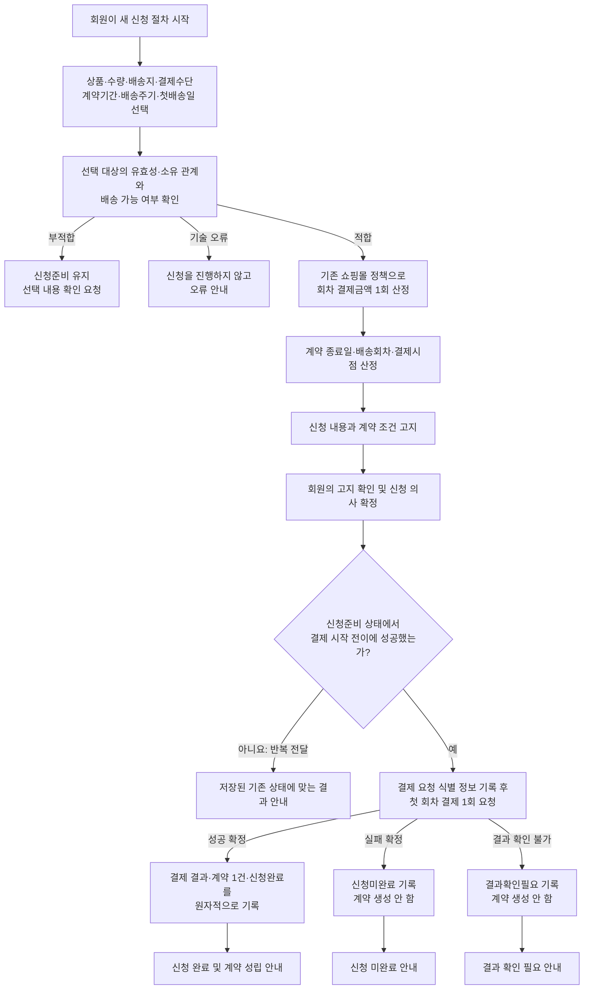

# 정기배송 최초 신청 작업 명세서 초안

## 1. 작업 목표

기존 회원이 상품 한 종류와 수량, 본인의 등록 배송지·결제수단, 계약기간, 배송 주기, 첫 배송일을 선택하여 정기배송을 신청할 수 있게 한다.

신청 내용을 사전에 고지하고 회원이 최종 확정하면 첫 회차 결제를 한 번만 실행한다. 결제 성공이 확인된 경우에만 계약을 성립시키며, 실패 또는 결과 미확정 상태를 구분하여 안내한다.

정기배송 모듈은 기존 쇼핑몰과 같은 배포 단위에 두고 다음 구조를 따른다.

- `신청 업무`: 최초 신청 흐름 조정 및 포트 소유
- `정기배송 규칙`: 일정, 금액, 상태 전이 및 계약 성립 규칙
- `쇼핑몰 연계`: 기존 쇼핑몰의 선택 확인, 금액 산정, 결제 기능 연결
- `신청 저장`: 신청, 회차, 결제 결과 및 계약 저장

---

## 2. 업무 흐름

---

## 3. 이번 작업에 포함할 범위

### 3.1 신청 준비와 선택 내용 확인

- 새 신청 절차를 시작하고 신청 식별자를 부여한다.
- 신청자는 기존 쇼핑몰의 인증된 기존 회원을 사용한다.
- 한 신청에서 다음 항목을 입력받는다.
  - 상품 한 종류
  - 양의 정수 수량
  - 회원이 등록한 배송지
  - 회원이 등록한 결제수단
  - 계약기간: 3개월 또는 6개월
  - 배송 주기: 2주 또는 4주
  - 첫 배송일
- 다음 사항은 기존 쇼핑몰 기능을 통해 확인한다.
  - 회원과 상품의 유효성
  - 배송지와 결제수단의 유효성
  - 배송지와 결제수단이 신청자 소유인지
  - 첫 배송일이 기존 배송 달력에서 허용되는지
- 정기배송 규칙에서 첫 배송일이 신청일로부터 3일 이후인지 확인한다.
- 부적합한 선택은 `신청준비` 상태를 유지하고 첫 결제를 실행하지 않는다.
- 다른 회원의 배송지, 결제수단 및 신청 정보에 대한 접근을 차단한다.

### 3.2 계약 조건과 배송회차 계산

- 첫 배송일을 계약 시작일로 정한다.
- 계약 종료일은 첫 배송일에 3개월 또는 6개월을 더해 계산한다.
- 종료 월에 같은 일자가 없으면 그달의 말일을 사용한다.
- 계약 종료일은 계약기간과 배송회차에 포함하지 않는다.
- 첫 배송일을 첫 회차로 한다.
- 이후 2주 또는 4주 간격으로 예정 배송일을 계산한다.
- 계약 종료일보다 이른 예정 배송일만 포함한다.
- 회차번호는 1부터 연속해서 부여한다.
- 첫 회차는 신청 시 결제로 표시하며 결제 예정일을 두지 않는다.
- 두 번째 이후 회차의 결제 예정일은 예정 배송일 3일 전으로 계산한다.

### 3.3 금액 산정 및 고지

- 선택 내용이 유효한 경우에만 기존 쇼핑몰의 금액 산정 기능을 호출한다.
- 신청 시점의 상품 가격, 할인 및 배송비 정책으로 최종 회차 결제금액을 산정한다.
- 금액 산정은 고지 내용을 만들 때 한 번만 실행한다.
- 산정된 회차 결제금액을 모든 배송회차와 계약에 동일하게 확정한다.
- 신청 후 상품 가격이나 일반 주문 정책이 변해도 확정 금액을 다시 계산하지 않는다.
- 회원의 신청 확정 전에 다음 내용을 고지한다.
  - 상품과 수량
  - 배송지와 결제수단
  - 계약기간, 계약 시작일 및 계약 종료일
  - 배송 주기와 첫 배송일
  - 총 배송 횟수와 회차별 예정 배송일
  - 첫 회차 결제금액
  - 모든 회차에 적용되는 결제금액
  - 첫 회차와 이후 회차의 결제 시점
  - 금액이 계약기간 동안 유지된다는 사실
  - 자동 갱신되지 않고 계약기간 종료 시 종료된다는 사실

### 3.4 첫 결제와 신청 결과 처리

- 회원이 고지 내용을 확인하고 신청 의사를 확정한 뒤에만 첫 결제를 시작한다.
- 신청이 `신청준비` 상태일 때만 결제 시작 전이를 허용한다.
- 결제 요청 전에 결제 요청 식별 정보를 신청과 함께 기록한다.
- 조건부 상태 전이에 성공한 요청 하나만 결제 포트를 호출한다.
- 결제 응답은 다음 세 결과로 구분한다.
  - 성공 확정
  - 실패 확정
  - 결과 확인 불가
- 성공 확정 시 다음 내용을 하나의 원자적 저장 단위로 반영한다.
  - 첫 결제 결과
  - 고지된 일정과 금액을 가진 계약 1건
  - `신청완료` 상태
- 실패 확정 시 계약을 생성하지 않고 `신청미완료`로 기록한다.
- 결과 확인 불가 시 계약을 생성하지 않고 `결과확인필요`로 기록한다.
- 결과를 확정할 수 없는 기술 오류나 시간 초과를 임의로 결제 실패로 변환하지 않는다.

### 3.5 동일 신청의 반복 전달 방지

- 동일 신청은 선택 내용의 조합이 아니라 한 번 발급된 신청 식별자로 판별한다.
- 같은 신청 식별자를 사용한 반복 요청은 신규 신청으로 처리하지 않는다.
- 반복 요청 시 새로운 금액 산정, 결제, 계약 생성 또는 배송회차 추가를 실행하지 않는다.
- 이미 결과가 확정된 경우 저장된 기존 결과를 반환한다.
- `첫결제결과확인중` 또는 `결과확인필요`이면 결과 확인이 필요하다고 안내한다.
- 별도로 시작하여 새로운 신청 식별자가 발급된 신청은 입력 내용이 같아도 신규 신청으로 허용한다.

신청 식별자의 실제 전달 방식은 미정이므로, 위 항목은 아래 결정 사항이 확정된 후 구현한다.

### 3.6 저장과 동시성

- 신청자, 입력 선택, 고지 조건, 배송회차, 회차 결제금액, 결제 요청 식별 정보, 결제 결과, 신청 상태 및 성립 계약을 저장한다.
- 신청은 신청 식별자와 신청자 기준으로 조회한다.
- 저장 구현은 다음 조건부 전이를 원자적으로 보장한다.
  - `신청준비 → 첫결제결과확인중`
  - `첫결제결과확인중/결과확인필요 → 신청완료/신청미완료`
- 성공 결과 반영 시 계약 생성과 신청 상태 변경이 일부만 저장되지 않게 한다.
- 종료 상태인 `신청완료`와 `신청미완료`에는 뒤늦은 결과가 상태 변화를 일으키지 않게 한다.
- 신청당 계약은 최대 1건만 존재하도록 저장소 수준의 제약을 둔다.

저장 기술과 구체적인 제약 방식은 기존 영속성 구조를 확인한 후 정한다.

### 3.7 요청 진입부와 결과 표현

다음 업무 동작을 기존 요청 진입부에서 호출할 수 있게 한다.

- 새 신청 절차 시작
- 선택 내용 검증 및 고지 정보 산출
- 고지 확인 후 신청 확정과 첫 결제 실행
- 본인의 신청 결과 조회
- 결제 결과 확인 후 상태를 반영할 수 있는 업무 진입점

마지막 항목은 업무 진입점까지만 이번 구조에 마련한다. 누가 언제 호출할지는 미정으로 남긴다.

---

## 4. 상태별 응답 원칙

| 신청 상태 또는 결과 | 회원에게 제공할 결과 | 추가 결제 | 계약 |
|---|---|---:|---:|
| 선택 내용 부적합 | 선택 내용 확인 요청 | 없음 | 없음 |
| `신청준비` | 신청 확정 전 상태 | 없음 | 없음 |
| `첫결제결과확인중` | 결제 결과 처리 중 또는 확인 필요 | 없음 | 없음 |
| `결과확인필요` | 완료·실패로 단정하지 않고 결과 확인 필요 안내 | 새 청구 없음 | 없음 |
| `신청완료` | 신청 완료 및 계약 정보 | 없음 | 1건 |
| `신청미완료` | 첫 결제 실패로 신청 미완료 | 없음 | 없음 |
| 반복 전달 | 저장된 기존 상태와 결과 | 없음 | 추가 생성 없음 |

---

## 5. 구현 작업 단위

### 작업 1. 정기배송 규칙 정의

- 계약기간과 배송 주기의 허용값을 표현한다.
- 첫 배송일 하한, 계약 종료일 및 월말 보정 규칙을 구현 대상으로 정의한다.
- 배송회차와 후속 회차 결제 예정일 산정 규칙을 정의한다.
- 상태별 허용 전이와 계약 성립 조건을 정의한다.
- 정기배송 규칙 패키지는 다른 패키지에 의존하지 않게 한다.

### 작업 2. 신청 업무 흐름 구성

- 선택 확인, 금액 산정, 첫 결제 및 신청 저장 포트를 정의한다.
- 신청 준비, 고지, 신청 확정, 기존 결과 반환 흐름을 조정한다.
- 신청자와 저장된 신청 소유자가 일치할 때만 조회·변경을 허용한다.
- 부적합, 기술 오류 및 결제 결과 미확정을 서로 다른 업무 결과로 표현한다.

### 작업 3. 쇼핑몰 확인 연계

- 기존 회원·상품·배송지·결제수단 확인 기능을 조합한다.
- 배송지와 결제수단의 신청자 소유 관계를 확인한다.
- 기존 배송 달력으로 첫 배송일 허용 여부를 확인한다.
- 업무상 부적합과 연계 기술 오류를 구분한다.

### 작업 4. 금액 산정 연계

- 기존 쇼핑몰 정책으로 한 회차의 최종 결제금액을 산정한다.
- 가격, 할인 및 배송비가 모두 반영된 최종 금액을 받는다.
- 신청에 저장된 금액이 이후 가격 조회 결과에 의해 변경되지 않게 한다.

### 작업 5. 첫 결제 연계

- 저장된 결제 요청 식별자를 기존 결제 기능에 전달한다.
- 같은 결제 요청 식별자의 중복 승인을 막는다.
- 결제 응답을 성공 확정, 실패 확정, 결과 확인 불가로 변환한다.
- 결과 조회 시 새 청구를 만들지 않고 기존 결제 요청만 확인한다.

결제 제공자가 멱등 처리와 기존 요청 조회를 지원하는지 확인되기 전에는 이 작업을 완료 처리하지 않는다.

### 작업 6. 신청 저장 구현

- 신청과 배송회차, 결제 정보 및 계약을 저장한다.
- 결제 시작 경쟁에서 한 요청만 성공하게 한다.
- 결제 성공 반영과 계약 생성을 원자적으로 처리한다.
- 신청당 계약 최대 1건과 결제 요청 식별자의 중복 방지를 저장소에서 보장한다.
- 반복 전달 시 기존 신청 상태를 조회하여 반환한다.

### 작업 7. 기존 진입부 및 구성 연결

- 기존 인증 회원 정보를 신청 업무에 전달한다.
- 구체 연계·저장 구현을 신청 업무의 포트에 연결한다.
- 기존 구성 코드를 제외하고 신청 업무가 구체 구현을 참조하지 않게 한다.
- 기존 쇼핑몰 내부가 정기배송 규칙이나 구현에 역으로 의존하지 않게 한다.

---

## 6. 완료 조건

다음 사항이 모두 충족되어야 최초 신청 기능 구현이 완료된 것으로 본다.

### 업무 결과

- 허용된 계약기간과 배송 주기만 신청할 수 있다.
- 첫 배송일 하한, 월말 보정 및 종료일 제외 규칙이 적용된다.
- 대표 일정 사례에서 총 7개의 배송회차가 계산된다.
- 신청 시 확정된 회차 결제금액이 전체 계약에 유지된다.
- 첫 결제 성공이 확인된 경우에만 계약 1건이 성립한다.
- 결제 실패와 결과 미확정이 서로 다르게 처리된다.
- 동일 신청의 반복 전달로 결제나 계약이 추가되지 않는다.
- 별개의 신규 신청은 제한하지 않는다.
- 회원은 본인의 배송지, 결제수단 및 신청만 사용할 수 있다.

### 구조

- 신청 업무는 네 포트를 통해서만 연계·저장 구현을 사용한다.
- 정기배송 규칙은 다른 패키지에 의존하지 않는다.
- 쇼핑몰 연계와 신청 저장은 서로 의존하지 않는다.
- 패키지 사이에 순환 의존이 없다.

### 동시성 및 성능

- 동시에 같은 신청이 전달되어도 첫 결제 요청과 계약은 각각 최대 1건이다.
- 외부 연계가 각각 1초 안에 응답하는 환경에서 동시 신청 100건을 실행했을 때 전체 요청의 95% 이상이 3초 안에 결과를 받는다.
- 성능 기준은 실제 연계 환경에서 측정한 경우에만 충족으로 판정한다.

---

## 7. 이번 작업에서 제외할 범위

- 두 번째 이후 회차의 실제 결제 실행
- 배송 주문 생성 및 출고 처리
- 실제 배송 상태와 배송 완료 관리
- 배송 불가일 발생 시 예정일 조정
- 계약 변경, 일시정지, 재개 및 해지
- 계약기간 연장 및 자동 갱신
- 첫 결제 실패 후 같은 신청의 재결제
- 상품 추가·삭제 또는 여러 상품을 묶은 정기배송
- 일반 주문과 첫 배송회차의 연결
- 신청 완료 후 배송지나 결제수단 변경
- 고객에게 보내는 이메일, 문자, 푸시 등 알림
- 콜백 수신기, 주기적 폴링, 재시도 작업 및 운영 복구 자동화
- 기존 회원·상품·배송지·결제수단·배송 달력·가격 정책 자체의 변경
- 운영시간, 가용성, 기록 보존, 개인정보 보호 정책의 신규 정의
- 별도 서비스 분리 또는 새로운 인프라 도입
- `신청준비` 상태 데이터의 자동 만료 및 삭제

---

## 8. 확인 전에는 구현하지 않을 미정 사항

| 미정 사항 | 확인 전 처리 |
|---|---|
| 신청 식별자의 생성 위치와 전달 방식 | 요청 API 및 멱등 처리 형식을 확정하지 않는다. |
| 고지 조회와 신청 확정의 요청 분리 방식 | 진입부 계약을 확정하지 않는다. |
| 고지 후 확정 전 가격·선택 조건 변경 처리 | 재검증·재산정 여부를 임의로 정하지 않는다. |
| 신청일의 기준 시각과 시간대 | 첫 배송일의 3일 하한 판정을 구현하지 않는다. |
| 신청일이 날짜인지 정확한 시각인지 | 날짜 경계 처리 방식을 확정하지 않는다. |
| 결제 제공자의 멱등 규격 | 실제 첫 결제 연계를 완료 처리하지 않는다. |
| 기존 결제 요청의 결과 조회 규격 | `결과확인필요` 이후 외부 연계를 구현하지 않는다. |
| 결제 결과 확인의 시작 주체와 시점 | 콜백·폴링·수동 조회를 추가하지 않는다. |
| 기술 오류와 업무상 부적합을 구분하는 기존 쇼핑몰 규격 | 오류를 임의로 선택 부적합으로 처리하지 않는다. |
| 기존 정책 기준의 신청일과 최종 금액 취득 방식 | 별도 계산이나 추정 로직을 만들지 않는다. |
| 저장소의 조건부 갱신·고유 제약·트랜잭션 지원 방식 | 원자성 구현 방식을 확정하지 않는다. |
| 결제 호출 직후 프로세스가 중단된 경우의 복구 방식 | 자동 재청구나 자동 실패 처리를 추가하지 않는다. |
| 응답에서 배송지·결제수단을 표시할 수준 | 민감 정보를 임의 형식으로 노출하지 않는다. |
| 구조 의존 검사 도구 | 새 검사 도구나 빌드 의존성을 추가하지 않는다. |
| 성능 측정 환경과 구간 | 성능 요구사항을 충족했다고 판정하지 않는다. |

---

## 9. 명세 확정을 위해 결정이 필요한 사항

1. **신청 식별자는 어떻게 전달합니까?**  
   권장안은 새 신청 시작 시 서버가 신청 식별자를 발급하고, 이후 고지 조회·신청 확정·반복 요청에서 동일 식별자를 사용하도록 하는 방식입니다. HTTP 멱등 키처럼 클라이언트가 생성하는 방식도 가능한지 결정해야 합니다.

2. **고지와 신청 확정을 두 단계 요청으로 분리합니까?**  
   권장안은 `고지 정보 산출`과 `고지 확인 후 신청 확정`을 분리하는 것입니다. 한 요청 안에서 모두 처리하면 회원이 고지 내용을 확인했다는 사실을 어떻게 표현할지 별도 규칙이 필요합니다.

3. **고지 후 신청 확정까지 상품·배송지·정책이 변경되면 어떻게 합니까?**  
   다음 중 하나를 정해야 합니다.
   - 고지 시 계산한 내용을 일정 시간 동안 그대로 사용
   - 확정 시 선택 유효성만 다시 확인하고 금액은 유지
   - 확정 시 선택과 금액을 모두 다시 확인하며 변경 시 재고지

4. **신청일과 ‘3일 후’의 기준은 무엇입니까?**  
   쇼핑몰 영업 시간대 기준의 달력 날짜인지, 요청 시각으로부터 정확히 72시간 이후인지 결정해야 합니다. 요구사항 문맥상 `Asia/Seoul` 기준 달력 날짜 계산이 자연스럽지만 확인이 필요합니다.

5. **금액 산정 결과의 유효기간이 있습니까?**  
   신청준비를 무기한 유지할 수 있으므로 고지 후 며칠 뒤에도 같은 금액으로 결제할 수 있는지, 일정 시간이 지나면 재고지해야 하는지 결정해야 합니다.

6. **첫 결제 요청의 중복 방지는 어디까지 보장됩니까?**  
   기존 결제 기능이 결제 요청 식별자에 대한 멱등 승인과 기존 요청 결과 조회를 지원하는지 확인이 필요합니다. 지원하지 않는다면 이번 구조만으로는 프로세스 중단 상황의 중복 승인을 완전히 방지할 수 없습니다.

7. **`결과확인필요` 이후 결과 반영은 누가 시작합니까?**  
   최초 신청 범위에서는 업무 진입점만 마련할지, 다음 중 하나까지 포함할지 결정해야 합니다.
   - 결제 시스템 콜백
   - 운영자 또는 고객의 명시적 결과 조회
   - 주기적 폴링
   - 별도 복구 작업

8. **결제 호출이 끝났지만 결과 저장 전에 장애가 발생하면 최초 응답을 무엇으로 합니까?**  
   권장안은 성공이나 실패로 추정하지 않고 `결과확인필요`로 안내하는 것입니다. 다만 저장된 상태와 결제 시스템 결과를 복구하는 운영 방식이 함께 결정되어야 합니다.

9. **신청 미완료 데이터는 보존합니까?**  
   첫 결제 실패 후 계약은 만들지 않지만 신청과 결제 시도 기록을 기존 기록 보존 정책에 따라 유지할지 확인해야 합니다.

10. **고객에게 표시할 배송지와 결제수단 정보의 마스킹 기준은 무엇입니까?**  
    기존 쇼핑몰의 표시 형식을 그대로 사용할지 확인이 필요합니다.

11. **첫 회차에 대한 일반 주문 생성은 확실히 후속 작업으로 분리합니까?**  
    현재 초안은 정기배송 계약과 예정 회차만 기록하고 일반 주문은 만들지 않는 것으로 범위를 정했습니다.

12. **성능의 ‘결과 수신’은 어떤 응답까지 측정합니까?**  
    결제 결과 미확정을 즉시 `결과확인필요`로 반환한 시점까지인지, 최종 성공·실패 확정까지인지 결정해야 합니다. 현재 초안은 최초 요청에 대한 세 가지 결과 중 하나를 반환한 시점까지로 해석했습니다.