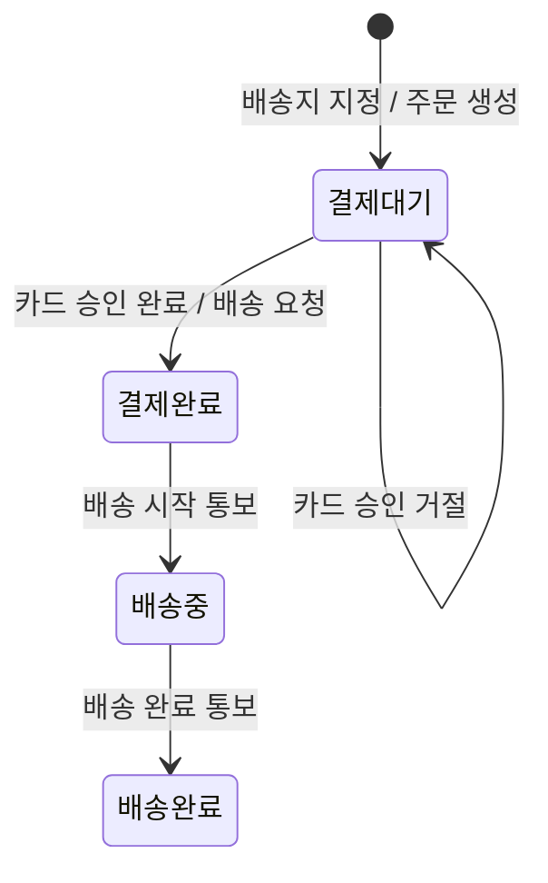
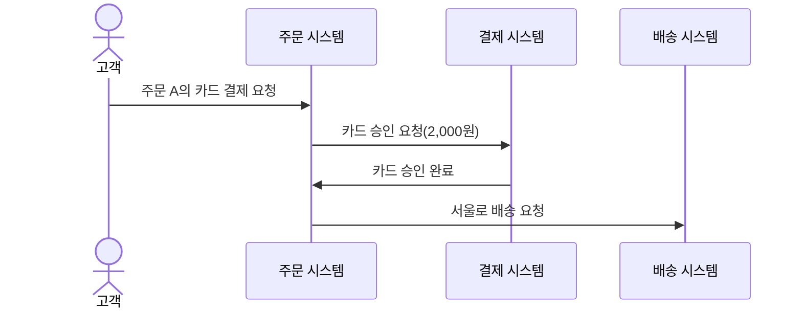

# “주문한다” 동적 업무 모델 보완안

## 도입

이 모델은 실습 3의 요구 범위에서 같은 주문이 사건에 따라 어떻게 바뀌는지 보여 준다. 다루는 범위는 주문 생성, 카드 승인·거절, 같은 주문의 재결제, 승인 뒤의 배송 요청이다.

- `배송중`과 `배송완료`는 같은 주문의 생애주기를 이해하기 위한 **참고 상태**다. 실습 3은 배송 진행을 기능 제외 범위로 두므로, 이 두 상태 때문에 실습 3의 요구 범위가 넓어지지 않는다.
- 취소는 이 모델의 범위 밖이다.
- 대표 예는 모두 같은 주문 A를 쓴다. 주문 A는 펜 2개, 확정 단가 1,000원, 총액 2,000원, 배송지 서울이다. "주문 A"는 예를 들기 위한 이름이며 주문 번호 형식은 정하지 않는다.

## 상태 기계

### 주문 생애주기 상태 기계

- 네 상태는 각각 한 번만 선언했다. `결제대기`와 `결제완료`가 실습 3의 요구 범위이고, `배송중`과 `배송완료`는 생애주기 참고 범위다.
- 배송 요청은 카드 승인 완료 사건에 대한 반응이다. 배송 요청 자체는 상태 전이가 아니다.
- 결제 응답을 확정할 수 없는 경우에는 전이를 그리지 않았다. 승인이나 거절로 간주하지 않는다는 규칙만 정해졌고, 그 뒤의 처리는 아직 정하지 않았다.

## 전이 목록

| 현재 상태(코드) | 사건 | 다음 상태(코드) | 반응 | 범위 |
|---|---|---|---|---|
| 초기 진입(이전 상태 없음) | 배송지 지정 | 결제대기 (`PENDING_PAYMENT`) | 주문 A 생성: 펜 2개, 단가 1,000원, 총액 2,000원, 서울 확정 | 실습 3 |
| 결제대기 (`PENDING_PAYMENT`) | 카드 승인 완료 | 결제완료 (`PAID`) | 서울로 배송 요청 1회 발생 | 실습 3 |
| 결제대기 (`PENDING_PAYMENT`) | 카드 승인 거절 | 결제대기 (`PENDING_PAYMENT`) | 배송 요청 없음, 같은 주문 A 유지 | 실습 3 |
| 결제완료 (`PAID`) | 배송 시작 통보 | 배송중 (`IN_DELIVERY`) | — | 생애주기 참고 |
| 배송중 (`IN_DELIVERY`) | 배송 완료 통보 | 배송완료 (`DELIVERED`) | — | 생애주기 참고 |

- 거절 뒤 재결제가 승인되는 것은 새로운 전이가 아니다. 같은 주문 A에 둘째 행(카드 승인 완료)이 적용된다. 주문 A의 식별, 펜 2개, 단가 1,000원, 총액 2,000원, 배송지 서울은 그대로다.
- "배송 요청 1회"는 배송 요청이라는 업무 사건이 한 번 일어난다는 뜻이다. 그 사건을 어디에 어떻게 남기는지, 운영상 중복을 막거나 다시 시도하는 기준은 정하지 않는다.

## 정상 승인 시퀀스

### 카드 승인 완료와 배송 요청

1. 고객이 `결제대기`인 주문 A의 카드 결제를 요청한다.
2. 주문 시스템이 확정 총액 2,000원으로 카드 승인을 요청한다.
3. 카드 승인 완료가 주문 시스템에 전달된다.
4. 이 사건의 반응으로 주문 A는 `결제완료`가 되고, 서울로 배송 요청이 1회 일어난다.

도식은 참여자 사이에 오가는 업무 사건만 보여 준다.

- 화살표는 사건의 선후 관계만 나타낸다. 실선이라고 해서 동기 호출을 뜻하지 않으며, 동기·비동기 전달 방식은 정하지 않는다.
- 상태 변화는 도식에 그리지 않았다. 전이는 상태 기계와 전이 목록에서 다룬다.
- 고객은 이후 주문 A의 결제완료 결과를 확인한다. 다만 어떤 경로로 확인하는지, 별도 통지가 있는지, 누가 통지하는지는 정하지 않았으므로 도식에 그리지 않았다.
- 배송 시작·완료 통보는 생애주기 참고 범위이므로 이 장면에 넣지 않았다.

## 규칙의 대표 예

| 예 | 전제 | 사건 | 결과 |
|---|---|---|---|
| 1. 승인 | 주문 A가 `결제대기` | 카드 Y에 2,000원 승인 요청 → 승인 완료 | 같은 주문 A가 `결제완료`가 되고 서울로 배송 요청 1회 |
| 2. 판매가 변경 뒤 승인 | 주문 A가 `결제대기`, 현재 판매가 개당 1,200원 | 카드 Y에 2,000원 승인 요청 → 승인 완료 | 승인 요청 금액은 2,000원이고 주문 A가 `결제완료`가 되며 배송 요청 1회 |
| 3. 거절 | 주문 A가 `결제대기` | 카드 X에 2,000원 승인 요청 → 거절 | `결제대기` 자기 전이, 배송 요청 0회, 다른 카드로 재결제 가능 |
| 4. 거절 뒤 재결제 | 카드 X가 거절된 주문 A가 `결제대기`, 배송 요청 0회 | 같은 주문 A를 카드 Y에 2,000원으로 다시 승인 요청 → 승인 완료 | 새 주문 없이 주문 A가 `결제완료`, 카드 X 거절부터 카드 Y 승인까지 배송 요청 총 1회 |

각 예에서 바뀌지 않는 값은 다음과 같다.

| 예 | 주문 식별 | 상품·수량 | 확정 단가 | 총액 | 배송지 |
|---|---|---|---|---|---|
| 1. 승인 | 주문 A | 펜 2개 | 1,000원 | 2,000원 | 서울 |
| 2. 판매가 변경 뒤 승인 | 주문 A | 펜 2개 | 1,000원 (현재 판매가 1,200원과 무관) | 2,000원 | 서울 |
| 3. 거절 | 주문 A | 펜 2개 | 1,000원 | 2,000원 | 서울 |
| 4. 거절 뒤 재결제 | 주문 A | 펜 2개 | 1,000원 | 2,000원 | 서울 |

## 금지·참고 조건·미정·범위 밖

### 확정된 요구에 근거한 금지

- 카드 승인 완료 없이 `결제대기`에서 `결제완료`로 전이할 수 없다.
- 카드 승인이 거절되면 `결제완료`로 전이할 수 없다.
- 결제 응답을 확정할 수 없으면 승인 완료로도, 거절로도 간주할 수 없다.
- 카드 승인이 완료되기 전에는 배송을 요청할 수 없다. 거절되면 배송을 요청하지 않는다.
- `결제대기` 주문의 상품, 수량, 배송지는 바꿀 수 없다. 생성 뒤 판매가가 바뀌어도 확정 단가, 총액, 승인 요청 금액은 바뀌지 않는다.
- 거절 뒤의 재결제를 새 주문으로 대신할 수 없다.

### 생애주기 참고 범위의 전이 조건

다음은 이번 모델에서 합의한 참고 조건이다. 실습 3의 요구나 수용 기준이 아니다.

- 배송 요청만으로는 `배송중`이 되지 않는다. `결제완료`에서 `배송중`으로는 배송 시작 통보가 있어야 전이한다.
- `배송중`에서 `배송완료`로는 배송 완료 통보가 있어야 전이한다.
- 통보가 오지 않거나 늦을 때처럼 배송 진행의 다른 경우는 다루지 않는다.

### 결정하지 않고 남겨 두는 정책

- 결제대기 기한과 만료 처리
- 결제 응답을 확정할 수 없을 때의 후속 처리와 재결제 허용 여부
- 재고를 판단하는 시점, 승인 전·후 재고가 부족할 때의 처리
- 회원·비회원 여부와 본인 확인 방법
- 배송 요청이 실패할 때의 처리, 운영상 중복 방지와 재시도 기준
- 주문 결과를 별도로 통지할지 여부와 담당 주체

금지는 이미 정해진 규칙에 어긋나는 변화다. 미정은 허용할지 금지할지 판단할 정책이 아직 없는 사안이므로 새로운 상태나 전이로 메우지 않는다.

### 범위 밖

- 취소. 주문 성립 이후의 환불·반품·교환도 범위 밖이다.

## 이번 점검

**고친 점**

- 시퀀스의 마지막 결과 화살표를 없앴다. 결과 확인 경로와 통지 주체는 미정이라고 본문에 적었다.
- 주문 시스템이 자기 자신에게 보내던 상태 전이 화살표를 없앴다. 상태 변화는 사건의 반응으로 본문에서 설명한다.
- "배송 요청 1회 기록"을 "배송 요청 1회 발생"으로 고쳐, 사건이 한 번 일어난다는 뜻만 남겼다.
- 전이 목록 첫 행을 "초기 진입(이전 상태 없음)"으로 고쳤다.

**바로잡은 모순**

- 상태 표기를 실습 3 용어집과 같게 `결제대기`·`결제완료`(띄어 쓰지 않음)로 맞췄다. 참고 상태도 같은 방식으로 `배송중`·`배송완료`라고 적었다.
- 상태 기계의 라벨에서 반응이 아닌 말("재결제 가능", "배송 중")을 지우고 사건과 반응만 남겼다.

**채운 빠짐**

- "응답 미확정을 승인이나 거절로 간주하지 않는다"는 이미 확정된 규칙이므로 금지 목록에 넣었다. 그 뒤의 처리는 미정으로 남겼다.
- 판매가 변경 뒤 승인 예에서도 승인 요청 금액이 2,000원임을 적었다.

**확인이 필요한 질문**

본인 주문만 조회하거나 변경 요청할 수 있다는 규칙이 카드 결제 요청에도 적용되는가? 원문은 이를 직접 말하지 않는다. 그래서 이번 모델에서는 결제 요청에 본인 주문 조건을 확정하지 않았다.