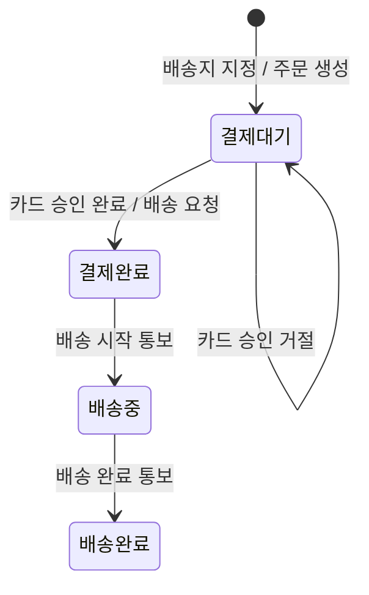
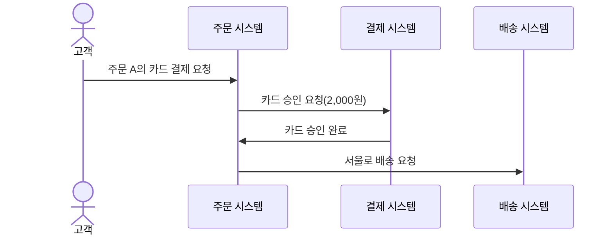

# “주문한다” 동적 업무 모델

## 도입

이 모델은 실습 3의 요구 범위에서 같은 주문이 사건에 따라 어떻게 바뀌는지 보여 준다. 범위는 주문 생성, 카드 승인·거절, 같은 주문의 재결제, 승인 뒤의 배송 요청이다.

- `배송중`과 `배송완료`는 같은 주문의 생애주기를 이해하기 위한 **참고 상태**다. 이 두 상태를 넣었다고 실습 3의 요구 범위가 넓어지지는 않는다.
- 취소는 범위 밖이다.
- 대표 예는 모두 같은 주문 A를 쓴다. 주문 A는 펜 2개, 확정 단가 1,000원, 총액 2,000원, 배송지 서울이다. "주문 A"는 예를 들기 위해 붙인 이름이며, 주문 번호 형식은 정하지 않는다.

## 상태 기계

### 주문 생애주기 상태 기계

- `결제대기`와 `결제완료`는 실습 3의 요구 범위이고, `배송중`과 `배송완료`는 생애주기 참고 범위다.
- 배송 요청은 카드 승인 완료 사건에 대한 반응이다. 배송 요청 자체는 상태 전이가 아니다.
- 결제 응답을 확정할 수 없는 경우는 전이로 그리지 않는다. 승인이나 거절로 간주하지 않는다는 규칙만 정해졌고, 그 뒤의 처리는 정하지 않았다.

## 전이 목록

| 현재 상태 | 사건 | 다음 상태 | 범위 |
|---|---|---|---|
| 초기 진입(이전 상태 없음) | 배송지 지정 | 결제대기 | 실습 3 |
| 결제대기 | 카드 승인 완료 | 결제완료 | 실습 3 |
| 결제대기 | 카드 승인 거절 | 결제대기 | 실습 3 |
| 결제완료 | 배송 시작 통보 | 배송중 | 생애주기 참고 |
| 배송중 | 배송 완료 통보 | 배송완료 | 생애주기 참고 |

상태 코드: 결제대기 `PENDING_PAYMENT`, 결제완료 `PAID`, 배송중 `IN_DELIVERY`, 배송완료 `DELIVERED`

사건별 반응은 다음과 같다.

- **배송지 지정:** 주문 A 생성. 펜 2개·단가 1,000원·총액 2,000원·서울 확정
- **카드 승인 완료:** 서울로 배송 요청 1회 발생
- **카드 승인 거절:** 배송 요청 없음. 같은 주문 A 유지
- **배송 시작 통보, 배송 완료 통보:** 정한 반응 없음

- 거절 뒤의 재결제가 승인되는 경우에 새로운 전이가 생기지는 않는다. 같은 주문 A에 둘째 행(카드 승인 완료)이 적용된다.
- "배송 요청 1회"는 배송 요청이라는 업무 사건이 한 번 일어난다는 뜻이다. 그 사건을 어디에 어떻게 남기는지, 운영상 중복을 막거나 다시 시도하는 기준은 정하지 않는다.

## 정상 승인 시퀀스

### 카드 승인 완료와 배송 요청

1. 고객이 `결제대기`인 주문 A의 카드 결제를 요청한다.
2. 주문 시스템이 확정 총액 2,000원으로 카드 승인을 요청한다.
3. 카드 승인 완료가 주문 시스템에 전달된다.
4. 이 사건에 대한 반응으로 주문 A가 `결제완료`가 되고, 서울로 배송 요청이 한 번 일어난다.

도식에는 참여자 사이에 오가는 업무 사건만 그렸다.

- 화살표는 사건이 일어나는 순서만 나타낸다. 실선이라고 동기 호출을 뜻하지는 않으며, 동기·비동기 전달 방식은 정하지 않는다.
- 상태 변화는 상태 기계와 전이 목록에서 다룬다.
- 고객은 이후 주문 A의 결제완료 결과를 확인한다. 확인 경로, 별도 통지 여부, 통지 주체는 정하지 않았으므로 도식에 넣지 않았다.
- 배송 시작·완료 통보는 생애주기 참고 범위이므로 이 장면에 넣지 않았다.

## 규칙의 대표 예

네 예 모두 주문 A의 식별, 펜 2개, 확정 단가 1,000원, 총액 2,000원, 배송지 서울이 바뀌지 않는다. 예마다 「유지되는 값」 줄에서 확인할 수 있다.

### 1. 승인

- **전제:** 주문 A, `결제대기`
- **사건:** 카드 Y에 2,000원 승인 요청 → 승인 완료
- **결과:** `결제완료`, 서울로 배송 요청 1회
- **유지되는 값:** 주문 A · 펜 2개 · 확정 단가 1,000원 · 총액 2,000원 · 서울

### 2. 판매가 변경 뒤 승인

- **전제:** 주문 A, `결제대기`, 현재 판매가 개당 1,200원
- **사건:** 카드 Y에 2,000원 승인 요청 → 승인 완료
- **결과:** 승인 요청 금액 2,000원, `결제완료`, 배송 요청 1회
- **유지되는 값:** 주문 A · 펜 2개 · 확정 단가 1,000원(현재 판매가와 무관) · 총액 2,000원 · 서울

### 3. 거절

- **전제:** 주문 A, `결제대기`
- **사건:** 카드 X에 2,000원 승인 요청 → 거절
- **결과:** `결제대기` 자기 전이, 배송 요청 0회, 다른 카드로 재결제 가능
- **유지되는 값:** 주문 A · 펜 2개 · 확정 단가 1,000원 · 총액 2,000원 · 서울

### 4. 거절 뒤 재결제

- **전제:** 카드 X가 거절된 주문 A, `결제대기`, 배송 요청 0회
- **사건:** 같은 주문 A를 카드 Y에 2,000원으로 다시 승인 요청 → 승인 완료
- **결과:** 새 주문 없음, 주문 A가 `결제완료`, 카드 X 거절부터 카드 Y 승인까지 배송 요청 총 1회
- **유지되는 값:** 주문 A · 펜 2개 · 확정 단가 1,000원 · 총액 2,000원 · 서울

## 금지·참고 조건·미정·범위 밖

### 확정된 요구에 근거한 금지

- 카드 승인 완료 없이 `결제대기`에서 `결제완료`로 전이할 수 없다.
- 카드 승인이 거절되면 `결제완료`로 전이할 수 없다.
- 결제 응답을 확정할 수 없으면 승인 완료로도, 거절로도 간주할 수 없다.
- 카드 승인이 완료되기 전에는 배송을 요청할 수 없다. 거절되면 배송을 요청하지 않는다.
- `결제대기` 주문의 상품, 수량, 배송지는 바꿀 수 없다. 주문 생성 뒤 판매가가 바뀌어도 확정 단가, 총액, 승인 요청 금액은 바뀌지 않는다.
- 거절 뒤의 재결제를 새 주문으로 대신할 수 없다.

### 생애주기 참고 범위의 전이 조건

아래는 이번 모델에서 합의한 참고 조건이며, 실습 3의 요구나 수용 기준이 아니다.

- 배송 요청만으로는 `배송중`이 되지 않는다. `결제완료`에서 `배송중`으로 가려면 배송 시작 통보가 있어야 한다.
- `배송중`에서 `배송완료`로 가려면 배송 완료 통보가 있어야 한다.
- 통보가 오지 않거나 늦는 경우처럼 배송 진행 중의 다른 경우는 다루지 않는다.

### 결정하지 않고 남겨 두는 정책

- 결제대기 기한과 만료 처리
- 결제 응답을 확정할 수 없을 때의 후속 처리와 재결제 허용 여부
- 재고 판단 시점과 승인 전·후 재고 부족 시 처리
- 회원·비회원 여부와 본인 확인 방법
- 본인 주문 조건이 카드 결제 요청에도 적용되는지 여부
- 배송 요청이 실패할 때의 처리, 운영상 중복 방지와 재시도 기준
- 주문 결과를 별도로 통지할지 여부와 담당 주체

금지는 이미 정해진 규칙에 어긋나는 변화다. 미정은 허용할지 금지할지 판단할 정책이 아직 없는 사안이다. 따라서 미정 사안을 새로운 상태나 전이로 메우지 않는다.

### 범위 밖

- 취소, 그리고 주문 성립 이후의 환불·반품·교환