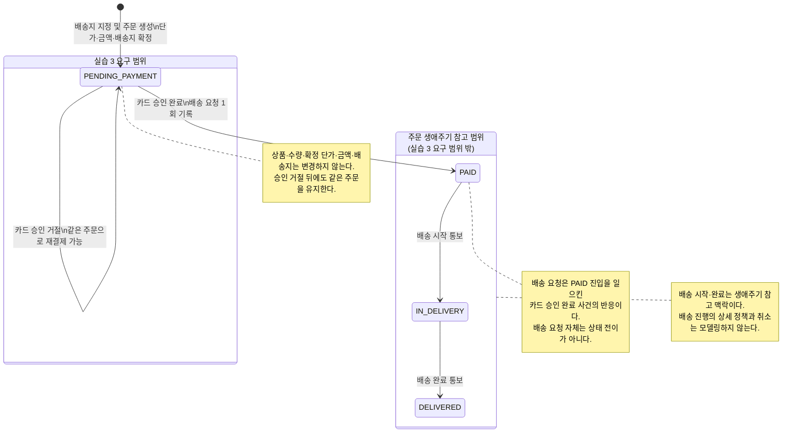
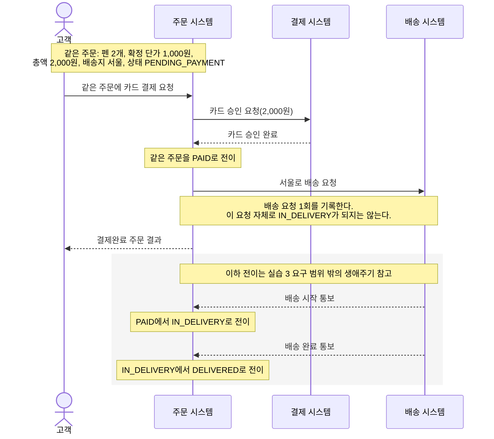
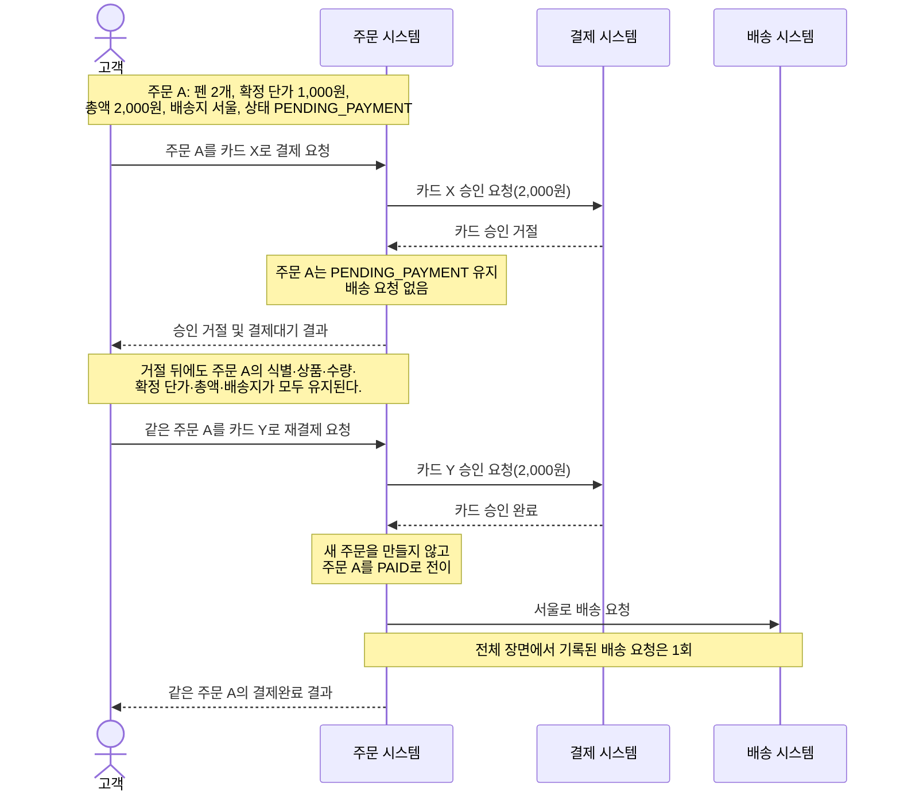

# “주문한다” 동적 업무 모델 보완안

이 모델은 실습 3의 요구 범위인 주문 생성, 카드 승인·거절, 재결제와 배송 요청을 중심으로 한다. `IN_DELIVERY`와 `DELIVERED`는 같은 주문 생애주기를 이해하기 위한 범위 밖 참고 상태이며, 실습 3의 요구 범위를 확대하지 않는다.

시퀀스의 참여자는 분석 수준의 업무 주체다. 화살표는 업무 사건의 선후 관계만 나타내며 동기·비동기 전달 방식이나 기술 연동 구조를 정하지 않는다.

## 1. 상태 기계

`PAID → IN_DELIVERY`는 배송 요청을 했을 때가 아니라 배송 시작 통보를 받았을 때 발생한다. 정상 승인 예에서 “배송 요청 1회”는 해당 업무 요청을 한 번 기록한다는 의미다. 운영상의 중복 방지, 전달 실패, 재시도 또는 복구 정책은 포함하지 않는다.

## 2. 전이 목록

| 현재 상태 | 대표 사건 | 다음 상태 | 반응 또는 결과 | 범위 |
|---|---|---|---|---|
| 주문 없음 | 배송지를 지정하여 주문 생성 | `PENDING_PAYMENT` | 주문 생성 시점 단가, 총액, 배송지를 확정한다. | 실습 3 |
| `PENDING_PAYMENT` | 카드 승인 완료 | `PAID` | 같은 주문이 성립하고 확정된 서울 배송지로 배송 요청 1회를 기록한다. | 실습 3 |
| `PENDING_PAYMENT` | 카드 승인 거절 | `PENDING_PAYMENT` | 배송을 요청하지 않으며 같은 주문을 다른 카드로 재결제할 수 있다. | 실습 3 |
| `PAID` | 배송 시작 통보 | `IN_DELIVERY` | 주문이 배송 중임을 나타낸다. | 생애주기 참고 |
| `IN_DELIVERY` | 배송 완료 통보 | `DELIVERED` | 주문의 배송이 완료됐음을 나타낸다. | 생애주기 참고 |

전이별 해석은 다음과 같다.

- 주문 생성 시 펜 2개의 확정 단가는 개당 1,000원, 총액은 2,000원, 배송지는 서울로 확정된다.
- 카드 승인 완료는 `PENDING_PAYMENT → PAID` 전이를 일으킨다.
- 배송 요청은 이 승인 사건에 대한 반응이며 별도의 주문 상태 전이를 일으키지 않는다.
- 카드 승인 거절은 `PENDING_PAYMENT`의 자기 전이다. 주문을 없애거나 새 주문으로 바꾸지 않는다.
- 거절 뒤에도 같은 주문의 식별, 상품인 펜, 수량 2개, 확정 단가 1,000원, 총액 2,000원 및 배송지 서울이 유지된다.
- 배송 요청을 기록했다는 사실만으로 `IN_DELIVERY`가 되지 않는다. 배송 시작 통보가 있어야 전이한다.
- `IN_DELIVERY`와 `DELIVERED`는 주문 생애주기의 참고 상태일 뿐 실습 3의 기능 범위에는 포함되지 않는다.
- 취소 상태와 취소 전이는 계속 범위 밖이다.

## 3. 정상 승인 시퀀스

이 시퀀스는 정상 승인 장면의 업무 순서를 나타낸다.

1. 고객이 `PENDING_PAYMENT`인 같은 주문의 카드 결제를 요청한다.
2. 주문 시스템이 확정된 주문 금액 2,000원으로 카드 승인을 요청한다.
3. 결제 시스템이 승인 완료를 통보한다.
4. 같은 주문이 `PAID`로 전이한다.
5. 승인 사건의 반응으로 서울에 대한 배송 요청 1회를 기록한다.
6. 고객이 결제완료 결과를 확인한다.
7. 이후 배송 시작 및 완료 통보에 따른 전이는 생애주기 참고 범위다.

## 4. 승인 거절 뒤 재결제 시퀀스

이 시퀀스는 거절과 재결제의 업무 순서를 나타낸다.

1. 고객이 주문 A를 카드 X로 결제한다.
2. 카드 X의 승인이 거절된다.
3. 주문 A는 `PENDING_PAYMENT`로 유지되며 배송 요청은 기록되지 않는다.
4. 주문 A의 식별, 상품, 수량, 확정 단가, 총액 및 배송지는 바뀌지 않는다.
5. 고객이 주문 A를 카드 Y로 재결제한다.
6. 승인 요청 금액은 여전히 2,000원이다.
7. 카드 Y가 승인되면 새 주문을 만들지 않고 주문 A를 `PAID`로 전이한다.
8. 서울로의 배송 요청 1회를 기록한다.

## 5. 대표 예

### 정상 승인

- 초기 상태: 주문 A는 `PENDING_PAYMENT`다.
- 확정 내용: 펜 2개, 개당 1,000원, 총액 2,000원, 배송지 서울이다.
- 사건: 카드 Y에 2,000원 승인을 요청하고 승인 완료 통보를 받는다.
- 전이: `PENDING_PAYMENT → PAID`
- 반응: 같은 주문 A에 대해 서울로의 배송 요청 1회를 기록한다.
- 결과: 고객은 주문 A의 결제완료 결과를 확인한다.
- 비전이: 배송 요청 자체는 `PAID → IN_DELIVERY` 전이를 일으키지 않는다.

### 승인 거절

- 초기 상태: 주문 A는 `PENDING_PAYMENT`다.
- 사건: 카드 X의 승인 거절 통보를 받는다.
- 전이: `PENDING_PAYMENT → PENDING_PAYMENT`
- 결과: 배송 요청은 없고 같은 주문을 다른 카드로 재결제할 수 있다.
- 유지되는 값: 주문 A의 식별, 펜 2개, 확정 단가 1,000원, 총액 2,000원 및 배송지 서울이다.

### 거절 뒤 재결제 성공

- 초기 상태: 카드 X가 거절된 주문 A는 `PENDING_PAYMENT`다.
- 사건: 카드 Y로 같은 주문 A의 2,000원 승인을 다시 요청하고 승인 완료 통보를 받는다.
- 전이: `PENDING_PAYMENT → PAID`
- 결과: 새 주문을 만들지 않으며 서울로의 배송 요청은 전체 장면에서 1회 기록된다.

### 범위 밖 생애주기 참고

- 초기 상태: 주문 A는 `PAID`다.
- 사건: 배송 시작 통보를 받는다.
- 전이: `PAID → IN_DELIVERY`
- 후속 사건: 배송 중 배송 완료 통보를 받는다.
- 전이: `IN_DELIVERY → DELIVERED`
- 범위: 두 전이는 같은 주문 생애주기의 참고 맥락이며 실습 3의 요구 범위에 포함되지 않는다.

## 6. 금지된 전이와 미정 정책의 차이

금지된 전이는 이미 정해진 업무 규칙에 어긋나므로 허용하지 않는 변화다.

- 카드 승인 완료 없이 `PENDING_PAYMENT → PAID`로 전이할 수 없다.
- 카드 승인 거절로 `PAID`가 될 수 없다.
- 배송 요청만으로 `PAID → IN_DELIVERY`로 전이할 수 없다.
- 배송 시작 통보 없이 `IN_DELIVERY`가 될 수 없다.
- 배송 완료 통보 없이 `IN_DELIVERY → DELIVERED`로 전이할 수 없다.
- 승인 거절 뒤 재결제를 위해 기존 주문을 변경하거나 새 주문으로 대체할 수 없다.
- `PENDING_PAYMENT` 주문의 상품, 수량, 확정 단가, 총액 및 배송지를 변경할 수 없다.

미정 정책은 허용 또는 금지 여부를 아직 판단할 근거가 없는 사안이다. 임의의 상태나 전이로 보완하지 않는다.

- 비회원 주문과 본인 확인 방법
- `PENDING_PAYMENT`의 기한과 만료 처리
- 결제 응답 미확정 시의 후속 처리와 재결제 허용 여부
- 재고 판단 시점 및 승인 전·후 재고 부족 처리
- 배송 요청 실패와 재요청·복구 기준
- 별도 주문 결과 통지 여부와 담당 주체
- 운영상의 배송 요청 중복 방지 및 재시도 정책

따라서 “카드 승인 없이 `PAID`가 된다”는 확정된 규칙에 반하는 금지 전이지만, “결제 응답 미확정 후 재결제한다”는 금지된 전이가 아니라 아직 결정하지 않은 정책이다. 취소는 미정 정책을 보충해 모델링할 대상이 아니라 이번 모델의 범위 밖으로 유지한다.