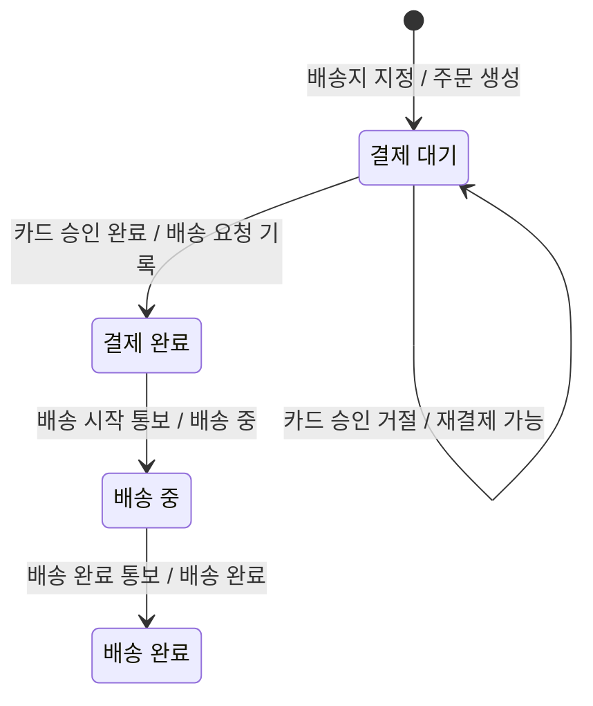
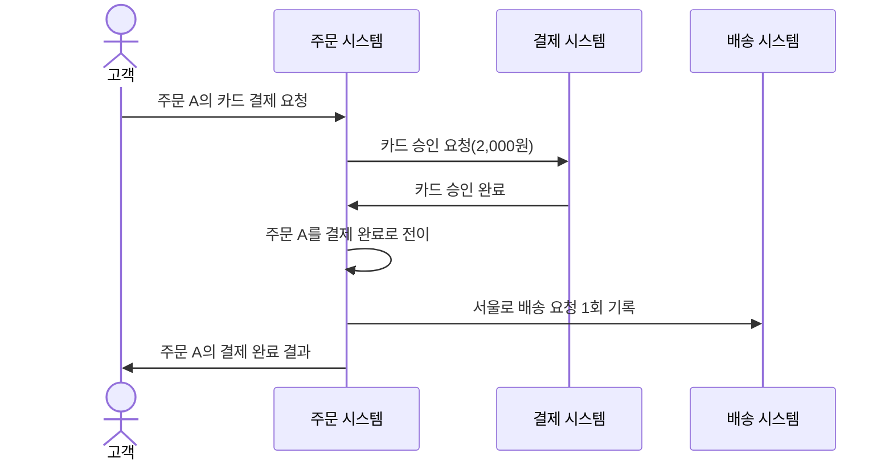

# “주문한다” 동적 업무 모델 보완안

## 도입

실습 3 범위는 주문 생성, 카드 승인·거절, 재결제 및 승인에 따른 배송 요청까지다. `배송 중`과 `배송 완료`는 같은 주문 생애주기를 보여 주는 참고 상태이며 실습 3의 요구 범위를 확대하지 않는다. 취소는 범위 밖이다.

## 상태 기계

### 주문 생애주기 상태 기계

- `결제 대기`와 `결제 완료`까지가 실습 3의 중심 범위다.
- `배송 중`과 `배송 완료`는 범위 밖의 생애주기 참고 상태다.
- 배송 요청은 카드 승인 완료로 `결제 완료`에 진입할 때 기록하는 반응이다.
- 배송 요청 자체는 상태 전이가 아니며, 이후 배송 시작 통보를 받아야 `배송 중`으로 전이한다.

## 전이 목록

| 현재 상태(코드) | 사건 | 다음 상태(코드) | 짧은 반응 | 범위 |
|---|---|---|---|---|
| 주문 없음 | 배송지를 지정하여 주문 생성 | 결제 대기 (`PENDING_PAYMENT`) | 단가·금액·배송지 확정 | 실습 3 |
| 결제 대기 (`PENDING_PAYMENT`) | 카드 승인 완료 | 결제 완료 (`PAID`) | 배송 요청 1회 기록 | 실습 3 |
| 결제 대기 (`PENDING_PAYMENT`) | 카드 승인 거절 | 결제 대기 (`PENDING_PAYMENT`) | 배송 없이 재결제 가능 | 실습 3 |
| 결제 완료 (`PAID`) | 배송 시작 통보 | 배송 중 (`IN_DELIVERY`) | 배송 중으로 표시 | 생애주기 참고 |
| 배송 중 (`IN_DELIVERY`) | 배송 완료 통보 | 배송 완료 (`DELIVERED`) | 배송 완료로 표시 | 생애주기 참고 |

승인 거절 뒤에도 같은 주문의 식별, 상품, 수량, 확정 단가, 총액 및 배송지가 유지된다. 배송 요청 1회는 기록된 업무 요청이 한 번이라는 뜻이며, 운영상의 중복 방지나 재시도 정책을 뜻하지 않는다.

## 정상 승인 시퀀스

### 정상 카드 승인과 배송 요청

이 도식은 업무 사건의 선후 관계만 나타낸다. 실선 화살표는 동기 호출을 의미하지 않으며, 동기·비동기 전달 방식은 정하지 않는다.

주문 A는 펜 2개, 확정 단가 1,000원, 총액 2,000원, 배송지 서울인 동일한 주문이다. 배송 요청만으로 주문이 `배송 중`이 되지는 않는다.

## 규칙의 대표 예

| 예 | 전제 | 사건 | 결과 |
|---|---|---|---|
| 승인 | 주문 A는 `PENDING_PAYMENT`; 펜 2개, 단가 1,000원, 총액 2,000원, 서울 | 카드 Y의 2,000원 승인 완료 | 같은 주문이 `PAID`가 되고 서울 배송 요청 1회를 기록한다. |
| 판매가 변경 뒤 승인 | 주문 A의 확정 금액은 2,000원이고 현재 판매가는 개당 1,200원으로 변경됨 | 카드 Y의 2,000원 승인 완료 | 확정 단가와 총액은 유지되고 같은 주문이 `PAID`가 된다. |
| 거절 | 주문 A는 `PENDING_PAYMENT` | 카드 X의 승인 거절 | `PENDING_PAYMENT` 자기 전이이며 배송 요청 없이 같은 주문을 유지한다. |
| 거절 뒤 재결제 | 카드 X가 거절된 주문 A는 `PENDING_PAYMENT` | 같은 주문을 카드 Y로 2,000원 재요청하여 승인 완료 | 새 주문 없이 주문 A가 `PAID`가 되고 전체 장면의 배송 요청은 1회다. |

거절 뒤에도 주문 A의 식별, 펜 2개, 확정 단가 1,000원, 총액 2,000원 및 배송지 서울은 바뀌지 않는다.

## 금지된 전이와 미정 정책

### 확정된 규칙상 금지

- 카드 승인 완료 없이 `PENDING_PAYMENT`에서 `PAID`로 전이할 수 없다.
- 카드 승인이 거절됐는데 `PAID`로 전이할 수 없다.
- 카드 승인 완료 전에 배송을 요청할 수 없다.
- 배송 요청만으로 `PAID`에서 `IN_DELIVERY`로 전이할 수 없다.
- 배송 시작 통보 없이 `IN_DELIVERY`가 될 수 없다.
- 배송 완료 통보 없이 `IN_DELIVERY`에서 `DELIVERED`로 전이할 수 없다.
- 거절 뒤 재결제 과정에서 기존 주문의 식별, 상품, 수량, 확정 단가, 총액 또는 배송지를 변경할 수 없다.
- 거절 뒤 재결제를 새 주문으로 대체할 수 없다.

### 결정하지 않고 보존하는 정책

- 결제 대기 기한과 만료 처리
- 결제 응답 미확정 시 후속 처리와 재결제 허용 여부
- 재고 판단 시점과 승인 전·후 재고 부족 처리
- 회원·비회원 여부와 본인 확인 방법
- 배송 요청 실패, 중복 방지, 재시도 및 복구 기준
- 별도 주문 결과 통지 여부와 담당 주체

금지는 이미 확정된 규칙에 어긋나는 행위다. 미정은 허용 또는 금지를 판단할 정책 자체가 아직 없는 사안이므로 새로운 상태나 전이로 해석하지 않는다. 취소는 미정 항목이 아니라 이번 모델의 범위 밖이다.