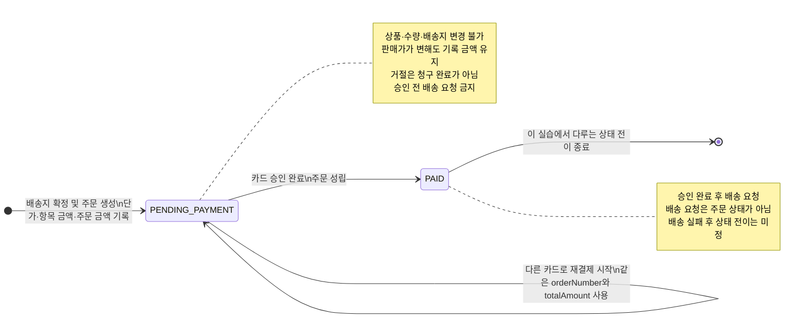
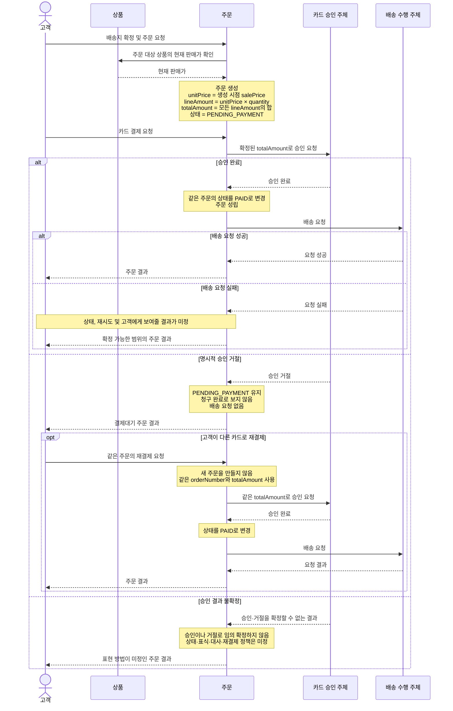

# 주문 기능 동적 관점 초안

## 1. 모델링 범위

이 초안은 `Order`, `OrderItem`, `Product`의 시간에 따른 변화를 다음 관점에서 설명한다.

- 주문 생성과 금액 확정
- 카드 승인·거절·재결제
- 주문 상태 전이
- 승인 후 배송 요청
- 주문 조회·변경 요청의 업무 판단

카드 승인 주체와 배송 수행 주체는 업무 상호작용 상대방으로만 표현한다. 소프트웨어 서비스, 저장소, API, 메시지, 트랜잭션 및 기술 연동 방식은 정의하지 않는다.

---

## 2. 주요 사건

### 확정된 사건

1. 고객이 배송지를 확정한다.
2. 주문이 생성된다.
3. 주문 생성 시 상품의 현재 판매가가 주문 항목의 `unitPrice`로 기록된다.
4. `lineAmount`와 `totalAmount`가 확정된다.
5. 고객이 카드 결제를 요청한다.
6. 확정된 `totalAmount`로 카드 승인이 요청된다.
7. 카드 승인이 명시적으로 거절된다.
8. 고객이 같은 주문에 다른 카드로 재결제를 요청한다.
9. 카드 승인이 완료된다.
10. 주문이 성립하고 상태가 `PAID`로 변경된다.
11. 배송이 요청된다.
12. 고객이 주문 결과를 확인한다.
13. 고객이 주문 조회 또는 변경을 요청한다.

### 결과 처리가 미정인 사건

- 카드 승인 결과를 승인 또는 거절로 확정할 수 없다.
- 재고 부족이 확인된다.
- 배송 요청이 실패한다.
- 결제대기 기한이 경과한다.
- 둘 이상의 카드 승인이 발생한다.
- 중복 결제 요청 또는 중복 배송 요청이 발견된다.

이 사건들은 존재 가능성만 보존한다. 현재 자료만으로 상태나 후속 전이를 확정하지 않는다.

---

## 3. 주문 상태와 전이

확인된 주문 상태는 다음 두 가지다.

- `PENDING_PAYMENT`: 주문은 생성됐지만 카드 승인이 완료되지 않음
- `PAID`: 카드 승인이 완료되어 주문이 성립함

주문 생성 전은 아직 `Order`가 존재하지 않는 흐름상의 시점이며 주문 상태로 보지 않는다.

### 상태 기계



다이어그램에 넣지 않은 전이는 다음과 같다.

- 승인 결과 불확정: 새로운 주문 상태를 임의로 만들지 않는다. 기존 상태 유지 여부, 별도 표식 및 재결제 허용 여부도 미정이다.
- 결제대기 기한 경과: 기한과 후속 상태가 미정이다.
- 배송 요청 실패: `PAID` 유지 여부, 다른 상태로의 전이 및 재시도 정책이 미정이다.
- 취소·환불·반품·교환: 현재 범위 밖이다.

### 전이 목록

| 현재 상태 | 사건 | 조건 또는 결과 | 다음 상태 | 동반 업무 |
|---|---|---|---|---|
| 주문 없음 | 배송지 확정 | 주문 항목을 하나 이상 구성한다는 교육 예제 가정 | `PENDING_PAYMENT` | 단가와 주문 금액 기록 |
| `PENDING_PAYMENT` | 카드 승인 거절 | 명시적인 거절 결과 | `PENDING_PAYMENT` | 배송 요청 없음 |
| `PENDING_PAYMENT` | 다른 카드로 재결제 | 앞선 결과가 명시적 거절 | `PENDING_PAYMENT` | 같은 주문번호와 주문 금액 사용 |
| `PENDING_PAYMENT` | 카드 승인 완료 | 승인 결과가 확정됨 | `PAID` | 주문 성립 및 배송 요청 |
| `PENDING_PAYMENT` | 승인 결과 불확정 | 승인·거절을 확정할 수 없음 | 미정 | 임의로 승인 또는 거절 처리 금지 |
| `PAID` | 배송 요청 성공 | 정상 승인 경로 | `PAID` | 고객이 주문 결과 확인 |
| `PAID` | 배송 요청 실패 | 실패가 확인됨 | 미정 | 상태·재시도·결과 표시 모두 미정 |

`PAID → PAID`를 배송 성공 전이로 그리지 않은 이유는 배송 성공이 주문 상태를 변경한다는 근거가 없기 때문이다.

---

## 4. 분석 수준 업무 상호작용



이 다이어그램의 `상품`, `카드 승인 주체`, `배송 수행 주체`는 업무 참여자다. 내부 시스템 구성이나 호출 구조를 뜻하지 않는다.

---

## 5. 같은 상호작용을 목록으로 읽기

### 5.1 주문 생성

1. 고객이 장바구니 상품에 대한 배송지를 확정한다.
2. 주문이 생성된다.
3. 각 주문 항목은 해당 시점의 `Product.salePrice`를 `unitPrice`로 기록한다.
4. 각 항목의 `lineAmount`를 `unitPrice × quantity`로 계산한다.
5. 모든 `lineAmount`를 합산하여 `Order.totalAmount`를 확정한다.
6. 주문 상태를 `PENDING_PAYMENT`로 정한다.
7. 이후 판매가가 바뀌어도 이 주문의 기록 단가와 금액은 바뀌지 않는다.

### 5.2 정상 승인

1. 고객이 카드 결제를 요청한다.
2. 카드 승인 요청 금액은 현재 판매가가 아니라 확정된 `Order.totalAmount`다.
3. 승인이 완료되면 같은 주문을 `PAID`로 변경한다.
4. 이때 주문이 성립한다.
5. 승인 완료 후 배송을 요청한다.
6. 정상 경로에서는 배송 요청이 한 번 발생한다.
7. 고객이 주문 결과를 확인한다.

### 5.3 명시적 승인 거절

1. 카드 승인 주체가 승인 거절을 확정한다.
2. 주문은 `PENDING_PAYMENT`를 유지한다.
3. 승인 거절을 청구 완료로 보지 않는다.
4. 배송을 요청하지 않는다.
5. 고객은 결제대기 결과를 확인한다.

### 5.4 거절 후 재결제

1. 고객이 다른 카드로 재결제를 요청한다.
2. 새 주문을 생성하지 않는다.
3. 같은 `orderNumber`를 유지한다.
4. 최초 주문 생성 때 확정한 `totalAmount`를 다시 사용한다.
5. 다른 카드가 승인되면 같은 주문을 `PAID`로 변경한다.
6. 전체 정상 승인 과정에서 배송 요청은 누적 한 번이다.

### 5.5 승인 결과 불확정

1. 카드 승인 결과가 승인인지 거절인지 확정되지 않는다.
2. 이를 승인 또는 거절로 임의 해석하지 않는다.
3. 새로운 주문 상태를 임의로 추가하지 않는다.
4. 기존 상태 유지 여부, 별도 표식, 대사, 재결제 허용 및 고객에게 보여줄 결과는 담당자의 결정이 필요하다.

### 5.6 조회 및 변경 요청

1. 고객이 주문 조회 또는 변경을 요청한다.
2. 해당 주문이 고객 본인의 주문인지 판단한다.
3. 본인 주문이 아니면 요청을 거절한다.
4. 본인 주문이면 조회할 수 있다.
5. 본인 주문이라도 `PENDING_PAYMENT` 상태에서 상품·수량·배송지를 변경할 수 없다.
6. 이 세 값을 바꾸려면 새 주문을 생성해야 한다.
7. 새 주문을 만들었을 때 기존 결제대기 주문을 어떻게 처리할지는 미정이다.

본인 여부의 확인 방법과 주문자 정보 구조는 확정하지 않는다.

---

## 6. 대표 업무 규칙 예

### 가격 변경 후 승인

- 주문 생성 시 펜의 판매가: 1,000원
- 수량: 2개
- 기록 단가: 1,000원
- 주문 금액: 2,000원
- 생성 후 현재 판매가: 1,200원

```text
기존 주문의 항목 금액
= 기록 단가 1,000원 × 수량 2
= 2,000원

카드 승인 요청 금액
= 기존 주문의 totalAmount
= 2,000원
```

현재 판매가를 적용한 2,400원으로 기존 주문을 다시 계산하지 않는다.

### 카드 X 거절 후 카드 Y 승인

| 순서 | 사건 | 주문 동일성 | 상태 | 승인 요청 금액 | 누적 배송 요청 |
|---:|---|---|---|---:|---:|
| 1 | 주문 생성 | 같은 주문 시작 | `PENDING_PAYMENT` | — | 0회 |
| 2 | 카드 X 승인 요청 | 같은 주문 | `PENDING_PAYMENT` | 2,000원 | 0회 |
| 3 | 카드 X 거절 | 같은 주문 | `PENDING_PAYMENT` | 2,000원 | 0회 |
| 4 | 카드 Y 재결제 요청 | 같은 주문 | `PENDING_PAYMENT` | 2,000원 | 0회 |
| 5 | 카드 Y 승인 | 같은 주문 | `PAID` | 2,000원 | 1회 |

여기서 배송 요청 1회는 이 정상 재결제 사례의 기대값이다. 배송 실패와 재시도가 있는 경우까지 주문별 최대 한 번이라고 일반화하지 않는다.

---

## 7. 결정이 필요한 질문

동적 모델을 완성하려면 다음 정책 결정이 필요하다.

1. 승인 결과 불확정 시 주문은 어떤 상태 또는 표식을 가지는가?
2. 불확정 상태에서 재결제를 허용하는가?
3. 불확정 결과의 대사는 누가 언제 수행하며, 뒤늦은 승인·거절을 어떻게 반영하는가?
4. 둘 이상의 승인이 발생하면 주문 상태와 후속 처리를 어떻게 결정하는가?
5. 결제대기 기한은 얼마이며, 기한 경과 시 어떤 전이가 발생하는가?
6. 기한 경계에서 진행 중인 승인 요청은 어떻게 처리하는가?
7. 배송 요청 실패 후에도 주문을 `PAID`로 유지하는가?
8. 배송 요청을 재시도한다면 횟수와 종료 조건은 무엇인가?
9. 배송 실패 또는 승인 불확정 때 고객에게 어떤 주문 결과를 보여주는가?
10. 재고는 어느 시점에 몇 번 판단하며, 승인 전후 재고 부족은 어떻게 처리하는가?
11. 변경을 위해 새 주문을 만들면 기존 `PENDING_PAYMENT` 주문은 어떻게 처리하는가?
12. 중복 결제 요청과 중복 배송 요청을 판별하고 방지할 업무 책임은 어디에 있는가?