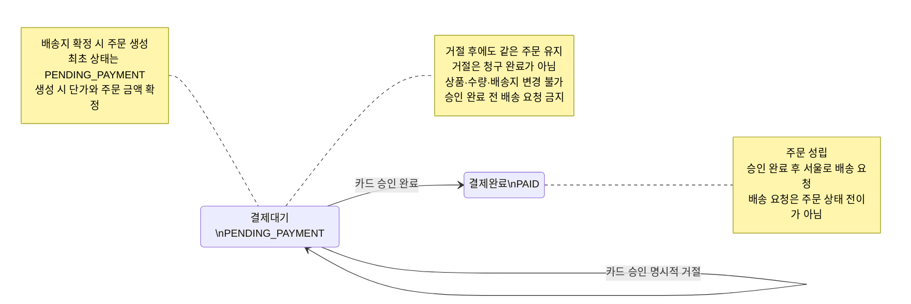
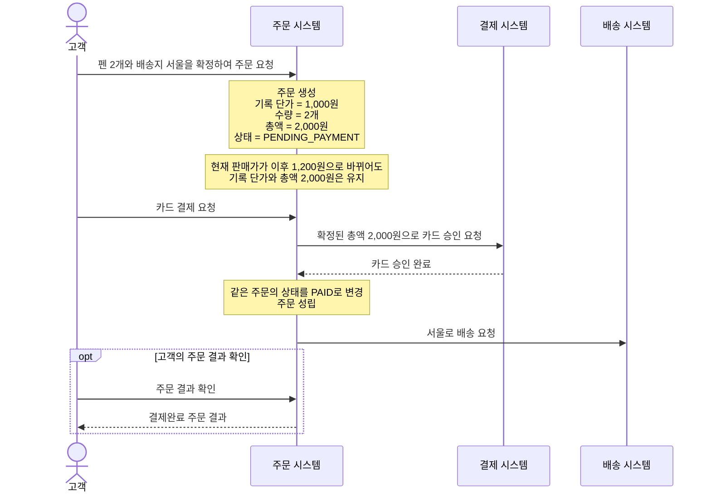

# 주문 기능 동적 관점 수정안

## 1. 수정 범위와 해석 경계

이 초안은 확정된 두 문서에 근거하여 다음 동적 관점만 다룬다.

- 주문 생성과 주문 금액 확정
- 카드 승인 완료 및 명시적 거절에 따른 주문 상태 변화
- 같은 주문에서의 카드 재결제
- 카드 승인 완료 후 배송 요청
- 주문 조회·변경 요청의 업무 판단

소프트웨어 서비스, 저장소, API, 메시지, 트랜잭션 및 기술 연동 방식은 정의하지 않는다.

또한 다음과 같이 해석한다.

- 주문 생성 전은 `Order`가 존재하지 않으므로 주문 상태가 아니다.
- 다른 카드로 재결제를 요청하는 행위 자체는 주문 상태 전이가 아니다.
- 배송 요청과 배송 성공은 주문 상태 전이가 아니다.
- `PAID`를 이 모델의 종료 상태로 확정하지 않는다.
- `PENDING_PAYMENT`와 `PAID`가 전체 주문 상태 목록이라고 확정하지 않는다.

---

## 2. 사건·상태·전이

### 2.1 대표 사건

확정된 범위의 대표 사건은 다음과 같다.

1. 고객이 배송지를 확정한다.
2. 주문이 생성된다.
3. 생성 시점의 판매가가 주문 항목의 기록 단가로 정해진다.
4. 항목 금액과 주문 금액이 확정된다.
5. 고객이 카드 결제를 요청한다.
6. 결제 시스템에 확정된 주문 금액으로 카드 승인을 요청한다.
7. 카드 승인이 완료된다.
8. 카드 승인이 명시적으로 거절된다.
9. 고객이 같은 주문에 다른 카드로 재결제를 요청한다.
10. 카드 승인 완료 후 서울로 배송을 요청한다.
11. 고객이 주문 결과를 확인한다.
12. 고객이 주문 조회 또는 변경을 요청한다.

다음 사건은 발생할 수 있지만 후속 처리가 확정되지 않았다.

- 카드 승인 결과를 승인 또는 거절로 확정할 수 없는 응답
- 배송 요청 실패
- 결제대기 기한 경과
- 재고 부족 확인
- 중복 결제 또는 둘 이상의 승인 확인

### 2.2 확인된 주문 상태

- `PENDING_PAYMENT`: 주문은 생성됐지만 카드 승인이 완료되지 않은 상태
- `PAID`: 카드 승인이 완료되어 주문이 성립한 상태

### 2.3 상태 기계



다이어그램에는 주문이 존재하는 동안 확인된 전이만 나타냈다. 따라서 주문 생성 전 상태, `PAID` 이후 종료점, 재결제 요청, 배송 성공은 상태 전이로 표현하지 않았다.

### 2.4 전이 목록

| 현재 상태 | 사건 | 조건 | 다음 상태 | 업무 결과 |
|---|---|---|---|---|
| `PENDING_PAYMENT` | 카드 승인 명시적 거절 | 승인 거절이 확정됨 | `PENDING_PAYMENT` | 청구 완료로 보지 않으며 배송을 요청하지 않음 |
| `PENDING_PAYMENT` | 카드 승인 완료 | 승인이 확정됨 | `PAID` | 같은 주문이 성립하고 이후 배송을 요청함 |

다음 행위와 사건은 상태 전이 목록에 추가하지 않는다.

- 다른 카드로 재결제 요청: 카드 승인을 다시 시도하게 하는 행위이며 그 자체로 주문 상태를 바꾸지 않는다.
- 배송 요청 및 배송 성공: 주문 상태를 바꾼다는 근거가 없다.
- 승인 결과 불확정: 다음 주문 상태나 기존 상태 유지 정책이 확정되지 않았다.
- 배송 요청 실패: 후속 주문 상태와 재시도 정책이 확정되지 않았다.

---

## 3. 정상 승인 장면의 분석 수준 시퀀스

다음 시퀀스는 정상 승인 장면 하나만 표현한다. 참여자는 고객, 주문 시스템, 결제 시스템, 배송 시스템으로 한정한다.



이 다이어그램이 확정하는 선후 관계는 다음과 같다.

1. 주문 생성 시 기록 단가와 주문 총액을 확정한다.
2. 확정된 총액으로 카드 승인을 요청한다.
3. 카드 승인 완료 후 주문 상태를 `PAID`로 변경한다.
4. `PAID`가 된 뒤 서울로 배송을 요청한다.

고객의 결과 확인은 포함했지만 별도 통지의 존재나 발송 시점은 정하지 않는다. 또한 결과 확인과 배송 요청 사이의 필수적인 세부 선후 관계로 일반화하지 않는다.

---

## 4. 같은 내용을 목록으로 읽기

### 4.1 주문 생성과 금액 확정

1. 고객이 펜 2개와 배송지 서울을 확정한다.
2. 배송지 확정에 따라 주문이 생성된다.
3. 주문의 최초 상태는 `PENDING_PAYMENT`다.
4. 주문 생성 시점의 펜 판매가 1,000원을 주문 항목의 기록 단가로 남긴다.
5. 항목 금액은 `1,000원 × 2개 = 2,000원`이다.
6. 이 사례의 주문 항목은 하나이므로 주문 총액은 2,000원이다.
7. 주문 생성 후 현재 판매가가 1,200원으로 올라도 기존 주문의 기록 단가와 총액은 바뀌지 않는다.

### 4.2 정상 승인과 배송 요청

1. 고객이 카드 결제를 요청한다.
2. 주문 시스템은 현재 판매가로 금액을 다시 계산하지 않는다.
3. 확정된 주문 총액 2,000원으로 카드 승인을 요청한다.
4. 결제 시스템이 카드 승인 완료를 반환한다.
5. 같은 주문의 상태가 `PENDING_PAYMENT`에서 `PAID`로 바뀐다.
6. 카드 승인 완료로 주문이 성립한다.
7. 주문이 `PAID`가 된 뒤 배송 시스템에 서울로 배송을 요청한다.
8. 고객은 주문 결과를 확인할 수 있다.
9. 별도 통지의 담당과 발송 시점은 확정하지 않는다.

### 4.3 카드 승인 거절

1. 결제 시스템이 카드 승인을 명시적으로 거절한다.
2. 주문은 같은 `orderNumber`를 유지한다.
3. 주문 상태는 `PENDING_PAYMENT`에 머문다.
4. 거절을 청구 완료로 취급하지 않는다.
5. 배송을 요청하지 않는다.

### 4.4 다른 카드로 재결제

1. 명시적으로 거절된 주문에 대해 고객이 다른 카드로 재결제를 요청할 수 있다.
2. 재결제 요청 자체는 주문 상태 전이가 아니다.
3. 새 주문을 생성하지 않는다.
4. 같은 `orderNumber`를 유지한다.
5. 최초 주문 생성 때 확정한 총액을 사용한다.
6. 새 카드의 승인이 완료되면 `PENDING_PAYMENT`에서 `PAID`로 전이한다.
7. 승인 완료 뒤 배송을 요청한다.

### 4.5 조회와 변경 요청

1. 고객이 주문 조회 또는 변경을 요청한다.
2. 본인의 주문인지 판단한다.
3. 타인의 주문이면 조회와 변경 요청을 거절한다.
4. 본인 주문이면 조회할 수 있다.
5. 본인 주문이라도 `PENDING_PAYMENT` 상태에서는 상품·수량·배송지를 변경할 수 없다.
6. 해당 값을 바꾸려면 새 주문을 생성해야 한다.
7. 본인 확인 방법과 새 주문 생성 후 기존 주문의 처리는 아직 정하지 않는다.

---

## 5. 대표 업무 규칙

### 5.1 판매가 변경 후에도 확정 금액 유지

주문 생성 시 값은 다음과 같다.

| 항목 | 값 |
|---|---:|
| 상품 | 펜 |
| 생성 시 판매가 | 1,000원 |
| 기록 단가 | 1,000원 |
| 수량 | 2개 |
| 항목 금액 | 2,000원 |
| 주문 총액 | 2,000원 |
| 배송지 | 서울 |
| 최초 상태 | `PENDING_PAYMENT` |

주문 생성 후 현재 판매가가 1,200원으로 변경되어도 다음 계산을 유지한다.

```text
기존 주문의 항목 금액
= 기록 단가 1,000원 × 수량 2개
= 2,000원

기존 주문의 총액
= 2,000원

카드 승인 요청 금액
= 확정된 주문 총액
= 2,000원
```

현재 판매가를 적용한 2,400원으로 기존 주문이나 카드 승인 요청 금액을 다시 계산하지 않는다.

### 5.2 카드 X 거절 후 카드 Y 재결제

| 순서 | 사건 또는 행위 | 주문 동일성 | 주문 상태 | 승인 요청 금액 | 누적 배송 요청 |
|---:|---|---|---|---:|---:|
| 1 | 주문 생성 | 같은 주문 시작 | `PENDING_PAYMENT` | — | 0회 |
| 2 | 카드 X 승인 요청 | 같은 주문 | `PENDING_PAYMENT` | 2,000원 | 0회 |
| 3 | 카드 X 승인 거절 | 같은 주문 | `PENDING_PAYMENT` | 2,000원 | 0회 |
| 4 | 카드 Y로 재결제 요청 | 같은 주문 | `PENDING_PAYMENT` | — | 0회 |
| 5 | 카드 Y 승인 요청 | 같은 주문 | `PENDING_PAYMENT` | 2,000원 | 0회 |
| 6 | 카드 Y 승인 완료 | 같은 주문 | `PAID` | 2,000원 | 0회 |
| 7 | 서울로 배송 요청 | 같은 주문 | `PAID` | — | 1회 |

카드 Y 재결제 요청은 별도 상태 전이가 아니다. 실제 상태 변화는 카드 Y의 승인이 완료될 때 발생한다.

배송 요청 1회는 이 정상 재결제 사례의 기대값이다. 배송 요청 실패와 재시도를 포함한 모든 경우에 주문별 최대 한 번이라는 정책으로 확대하지 않는다.

---

## 6. 확정하지 않고 남겨 둘 질문

1. 카드 승인 응답을 승인 또는 거절로 확정할 수 없을 때 주문 상태는 어떻게 다루는가?
2. 불확정 응답을 주문 상태와 별개의 표식으로 남기는가?
3. 불확정 응답이 있는 동안 같은 주문의 재결제를 허용하는가?
4. 불확정 결과는 누가 언제 대사하며, 뒤늦게 확인된 승인 또는 거절을 어떻게 반영하는가?
5. 불확정 응답 이후 둘 이상의 승인이 확인되면 어떻게 처리하는가?
6. 배송 요청이 실패한 경우 주문은 `PAID`를 유지하는가, 다른 상태로 전이하는가?
7. 배송 요청 실패 시 재시도하는가?
8. 재시도한다면 횟수, 간격 및 종료 조건은 무엇인가?
9. 배송 요청 실패 때 고객에게 어떤 주문 결과를 보여주는가?
10. 주문 결과의 별도 통지가 필요하다면 담당과 발송 시점은 무엇인가?
11. 상품, 수량 또는 배송지를 바꾸기 위해 새 주문을 생성했을 때 기존 `PENDING_PAYMENT` 주문은 어떻게 처리하는가?
12. 결제대기 기한과 기한 경과 후의 상태 전이는 무엇인가?
13. 재고는 어느 시점에 몇 번 판단하며, 승인 전후 재고 부족은 어떻게 처리하는가?