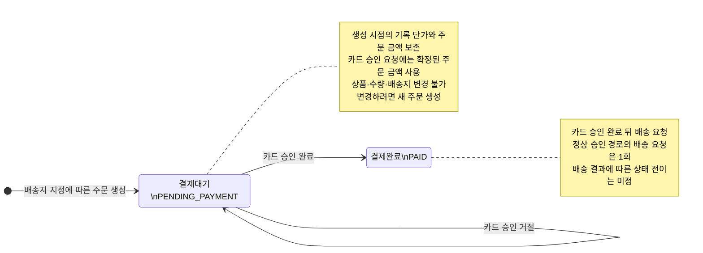
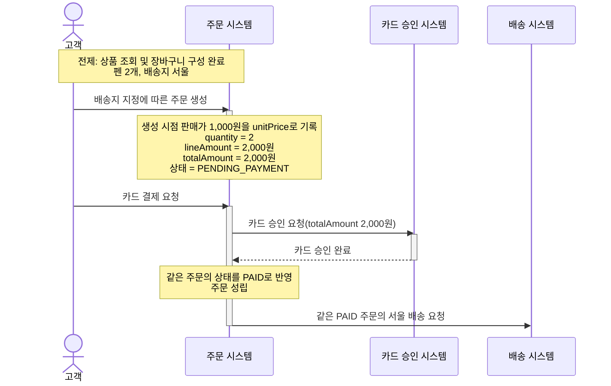

# 주문한다 — 동적 모델

## 1. 범위와 해석 원칙

이 문서는 주문 기능 정의서와 주문 기능 정적 모델 정의서에서 확인된 사건, 주문 상태, 상태 전이, 정상 승인 시퀀스, 금지 사항, 대표 사례와 미정 질문을 정리한다.

- 확정된 주문 상태 전이는 `배송지 지정에 따른 주문 생성`, `카드 승인 거절`, `카드 승인 완료`만 표현한다.
- 카드 승인 요청과 재결제 요청은 상태를 변경하는 사건이 아니라 업무 행위로 다룬다.
- 카드 승인 결과 미확정, 배송 요청 성공 및 배송 요청 실패는 확정된 주문 상태 전이로 표현하지 않는다.
- 재고 판단은 시점, 횟수와 승인 전후 처리 방법이 정해지지 않았으므로 특정 순서에 배치하지 않는다.
- `PENDING_PAYMENT`와 `PAID`는 확인된 상태 값일 뿐 전체 주문 상태 목록으로 확정하지 않는다.
- 외부 상품·결제·배송 시스템의 내부 동작은 다루지 않는다.

## 2. 사건과 업무 행위 목록

### 2.1 선행 사건

| 사건 또는 행위 | 의미 | 동적 모델에서의 취급 |
|---|---|---|
| 상품 조회 | 고객이 주문할 상품을 조회한다. | 주문 흐름의 전제이며 상세 동작은 범위 밖이다. |
| 장바구니 구성 | 고객이 상품과 수량을 장바구니에 담는다. | 주문 흐름의 전제이며 상세 동작은 범위 밖이다. |

### 2.2 확정된 상태 전이 사건

| 사건 | 현재 상태 | 결과 상태 | 의미 |
|---|---|---|---|
| 배송지 지정에 따른 주문 생성 | 주문 없음 | `PENDING_PAYMENT` | 배송지가 확정되면 주문을 생성한다. 생성 시점의 판매가를 기록 단가로 보존하고 주문 금액을 확정한다. |
| 카드 승인 거절 | `PENDING_PAYMENT` | `PENDING_PAYMENT` | 명시적 거절을 청구 완료로 취급하지 않고 같은 주문과 상태를 유지한다. |
| 카드 승인 완료 | `PENDING_PAYMENT` | `PAID` | 같은 주문이 결제완료 상태가 되고 주문이 성립한다. |

### 2.3 상태 전이로 표현하지 않는 업무 행위와 외부 결과

| 사건 또는 행위 | 확정된 내용 | 상태 전이로 표현하지 않는 이유 |
|---|---|---|
| 생성 시점 단가 기록 | 각 주문 항목에 주문 생성 시점의 `Product.salePrice`를 `unitPrice`로 기록한다. | 주문 생성에 포함되는 계산·기록 행위다. |
| 주문 금액 확정 | `lineAmount = unitPrice × quantity`, `totalAmount = 모든 lineAmount의 합`으로 확정한다. | 주문 생성에 포함되는 계산·기록 행위다. |
| 카드 승인 요청 | 확정된 `Order.totalAmount`를 사용한다. | 요청 자체로 주문 상태가 바뀐다고 정의되지 않았다. |
| 다른 카드로 재결제 요청 | 명시적으로 거절된 주문에 대해 새 주문을 만들지 않고 같은 주문과 확정 금액으로 다시 승인 요청한다. | 요청 자체로 주문 상태가 바뀐다고 정의되지 않았다. |
| 카드 승인 결과 미확정 | 승인 또는 거절로 임의 확정하지 않는다. | 주문 상태·표식과 후속 처리가 미정이다. |
| 배송 요청 | 카드 승인 완료 뒤 같은 `PAID` 주문의 배송지로 요청한다. 정상 승인 경로에서는 한 번 발생한다. | 배송 요청에 따른 주문 상태 변경이 정의되지 않았다. |
| 배송 요청 성공 | 성공 이후 주문 상태 변경은 정의되지 않았다. | 확정된 상태 전이가 없다. |
| 배송 요청 실패 | 실패 이후 상태, 재시도와 최종 처리가 미정이다. | 확정된 상태 전이가 없다. |
| 주문 결과 확인 | 고객이 주문 결과를 확인한다. | 배송 요청과의 구체적인 선후 및 별도 통지 방식이 확정되지 않았다. |
| 본인 주문 조회 요청 | 본인 주문에 대해서만 허용한다. | 상태 변경이 아닌 권한 판단이다. |
| 타인 주문 조회 요청 | 거절한다. | 상태 변경이 아닌 권한 판단이다. |
| 본인 주문 변경 요청 | 본인 여부와 변경 제한을 판단한다. | 상태 변경이 아닌 권한·변경 제한 판단이다. |
| 타인 주문 변경 요청 | 거절한다. | 상태 변경이 아닌 권한 판단이다. |
| 결제대기 주문의 상품·수량·배송지 변경 요청 | 본인 주문이라도 거절한다. 변경하려면 새 주문을 생성해야 한다. | 기존 주문의 확정 상태 전이가 아니다. |
| 상품 판매가 변경 | 기존 주문의 `unitPrice`, `lineAmount`, `totalAmount`를 변경하지 않는다. | 외부 상품의 현재 가격 변화이며 주문 상태 사건이 아니다. |

재고 판단은 업무 과정에서 발생할 수 있지만 판단 시점, 호출 횟수, 호출 순서와 승인 전후 재고 부족 처리가 모두 미정이므로 위 흐름의 특정 위치에 배치하지 않는다.

## 3. 상태 목록

### 3.1 확인된 주문 상태

| 상태 | 의미 | 진입 또는 유지 조건 |
|---|---|---|
| `PENDING_PAYMENT` | 주문은 생성됐지만 카드 승인이 완료되지 않은 상태 | `배송지 지정에 따른 주문 생성`으로 진입한다. `카드 승인 거절` 뒤에도 같은 주문이 이 상태를 유지한다. |
| `PAID` | 카드 승인이 완료되어 주문이 성립한 상태 | `카드 승인 완료`로 같은 주문이 이 상태에 진입한다. |

`PENDING_PAYMENT`와 `PAID`가 `OrderStatus`의 전체 상태 값이라는 뜻은 아니다.

### 3.2 주문 상태로 확정하지 않는 상황

| 상황 | 현재 확정된 내용 |
|---|---|
| 카드 승인 결과 미확정 | 승인이나 거절로 보지 않는다. 별도 주문 상태를 임의로 추가하지 않는다. |
| 배송 요청 성공 | 주문 상태 변경이 정의되지 않았다. |
| 배송 요청 실패 | 주문 상태와 후속 처리가 미정이다. |
| 결제대기 기한 경과 | 기한과 경과 후 처리 및 상태가 미정이다. |
| 재고 부족 | 판단 시점과 승인 전후 처리가 미정이다. |
| 주문 결과 확인 또는 별도 통지 | 이를 나타내는 주문 상태가 정의되지 않았다. |

## 4. 주문 상태 기계 Mermaid 원본

카드 승인 요청과 다른 카드로의 재결제 요청은 상태 기계에 자기 전이로 추가하지 않는다. 두 요청 자체에는 상태 변화가 정의되지 않았기 때문이다.

카드 승인 결과 미확정과 배송 요청 성공·실패도 확정된 주문 상태 전이가 아니므로 상태 기계에 포함하지 않는다. `PAID` 이후의 취소·환불·반품·교환과 배송 진행 역시 범위 밖이므로 `PAID`를 종료 상태로 확정하지 않는다.

## 5. 정상 승인 시퀀스 Mermaid 원본

다음 시퀀스는 펜 2개, 기록 단가 1,000원, 확정 총액 2,000원, 배송지 서울인 주문의 정상 승인 경로를 나타낸다.

재고 판단은 시점과 호출 순서가 미정이므로 넣지 않는다. 배송 요청의 성공 응답, 주문 시스템의 별도 고객 통지나 결과 제공, 고객의 결과 확인과 배송 요청 사이의 추가 선후도 확정되지 않았으므로 표현하지 않는다.

배송 요청은 카드 승인 완료 뒤에만 발생한다. 승인 전이나 카드 승인 거절 직후에는 배송을 요청하지 않는다.

## 6. 확정 전이 목록

| 번호 | 전이 이름 | 현재 상태 | 다음 상태 | 확정된 동작과 제약 |
|---:|---|---|---|---|
| T1 | 배송지 지정에 따른 주문 생성 | 주문 없음 | `PENDING_PAYMENT` | 배송지가 확정되면 새 주문을 생성한다. 생성 시점의 판매가를 각 항목의 `unitPrice`로 기록하고 `lineAmount`와 `totalAmount`를 확정한다. |
| T2 | 카드 승인 거절 | `PENDING_PAYMENT` | `PENDING_PAYMENT` | 명시적 거절을 청구 완료로 취급하지 않는다. 같은 `orderNumber`, 주문 항목, 배송지와 확정 금액을 유지하며 배송을 요청하지 않는다. |
| T3 | 카드 승인 완료 | `PENDING_PAYMENT` | `PAID` | 같은 주문을 결제완료로 변경하고 주문을 성립시킨다. 그 뒤 같은 주문의 확정된 배송지로 배송을 요청한다. 정상 승인 경로의 배송 요청은 한 번이다. |

## 7. 전이 목록에서 제외한 행위와 상황

| 행위 또는 상황 | 확정된 제약 | 제외 사유 |
|---|---|---|
| 카드 승인 요청 | 확정된 `totalAmount`를 승인 요청 금액으로 사용한다. | 요청 자체에는 상태 변화가 없다. |
| 카드 승인 거절 뒤 다른 카드로 재결제 요청 | 새 주문을 만들지 않고 같은 주문 식별자와 확정 금액을 사용한다. | 요청 자체에는 상태 변화가 없다. |
| 카드 승인 결과 미확정 | 승인 또는 거절로 임의 확정하지 않는다. | 상태·표식과 후속 처리가 미정이다. |
| 배송 요청 성공 | 성공 결과에 따른 주문 상태 변화가 정의되지 않았다. | 확정 전이가 아니다. |
| 배송 요청 실패 | 실패 시 상태, 재시도와 최종 처리가 미정이다. | 확정 전이가 아니다. |
| 주문 결과 확인 | 고객이 주문 결과를 확인한다. | 결과 확인의 구체적인 선후와 통지 방식이 확정되지 않았다. |
| 상품 판매가 변경 | 기존 주문의 기록 단가와 금액을 변경하지 않는다. | 주문 상태 전이가 아니다. |
| 주문 조회 및 변경 요청 | 본인 여부와 변경 제한을 판단한다. | 상태 전이가 아닌 접근 제어다. |

## 8. 금지 목록

| 금지 사항 | 근거가 되는 확정 제약 |
|---|---|
| 카드 승인 요청만으로 주문을 `PAID`로 변경해서는 안 된다. | `PAID` 전이는 카드 승인 완료 시 발생한다. |
| 카드 승인 완료 전에 배송을 요청해서는 안 된다. | 배송 요청은 카드 승인 완료 뒤 발생한다. |
| 카드 승인 거절 직후 배송을 요청해서는 안 된다. | 거절 뒤 같은 주문은 `PENDING_PAYMENT`로 유지된다. |
| 카드 승인 거절을 청구 완료로 취급해서는 안 된다. | 승인 거절은 청구 완료가 아니다. |
| 카드 승인 거절 뒤 재결제를 새 주문으로 처리해서는 안 된다. | 다른 카드 재결제는 같은 주문을 사용한다. |
| 거절과 재결제 과정에서 기존 주문 식별자를 바꿔서는 안 된다. | 같은 주문은 같은 `orderNumber`를 유지한다. |
| 주문 생성 후 현재 판매가로 기존 주문 금액을 다시 계산해서는 안 된다. | 생성 시점의 `unitPrice`, `lineAmount`, `totalAmount`를 보존한다. |
| 카드 승인 요청에 현재 판매가로 다시 계산한 금액을 사용해서는 안 된다. | 승인 요청에는 확정된 `Order.totalAmount`를 사용한다. |
| 카드 승인 결과 미확정을 승인이나 거절로 임의 처리해서는 안 된다. | 결과가 확정되지 않으면 성공이나 실패로 임의 확정하지 않는다. |
| 카드 승인 요청이나 재결제 요청을 상태 변화가 있다는 이유 없이 자기 전이로 추가해서는 안 된다. | 두 요청 자체에는 상태 변화가 정의되지 않았다. |
| 배송 성공이나 실패를 새로운 주문 상태 또는 확정 전이로 임의 추가해서는 안 된다. | 배송 결과에 따른 상태와 후속 처리가 미정이다. |
| 본인이라도 `PENDING_PAYMENT` 주문의 상품, 수량 또는 배송지를 변경해서는 안 된다. | 변경하려면 새 주문을 생성해야 한다. |
| 타인의 주문 조회 또는 변경 요청을 허용해서는 안 된다. | 고객은 본인의 주문만 조회하거나 변경을 요청할 수 있다. |
| 정상 경로의 배송 요청 1회 기대값을 배송 실패와 재시도를 포함한 전역 최대 1회 제약으로 확대해서는 안 된다. | 배송 실패 후 재시도 정책이 미정이다. |

## 9. 대표 사례

대표 사례의 공통 값은 다음과 같다.

| 항목 | 값 |
|---|---:|
| 상품 | 펜 |
| 수량 | 2개 |
| 주문 생성 시 판매가 | 개당 1,000원 |
| 기록 단가 `unitPrice` | 개당 1,000원 |
| 항목 금액 `lineAmount` | 2,000원 |
| 확정 주문 금액 `totalAmount` | 2,000원 |
| 배송지 | 서울 |
| 거절 카드 | 카드 X |
| 승인 카드 | 카드 Y |

### 9.1 정상 승인

| 순서 | 사건 또는 행위 | 주문 상태 | 승인 요청 금액 | 누적 배송 요청 |
|---:|---|---|---:|---:|
| 1 | 배송지 지정에 따른 주문 생성 | `PENDING_PAYMENT` | — | 0회 |
| 2 | 카드 Y 승인 요청 | `PENDING_PAYMENT` | 2,000원 | 0회 |
| 3 | 카드 승인 완료 | `PAID` | 2,000원 | 0회 |
| 4 | 같은 `PAID` 주문의 서울 배송 요청 | `PAID` | — | 1회 |

기대 결과:

- 기록 단가: 1,000원
- 확정 주문 금액: 2,000원
- 최종 확인 상태: `PAID`
- 배송 요청: 승인 완료 뒤 1회

배송 요청 성공 응답과 그에 따른 상태 변화는 이 사례에서 확정하지 않는다.

### 9.2 주문 생성 후 판매가 변경

1. 판매가가 1,000원일 때 펜 2개와 서울 배송지로 주문을 생성한다.
2. 주문 항목의 `unitPrice`는 1,000원, `lineAmount`는 2,000원, 주문의 `totalAmount`는 2,000원으로 확정된다.
3. 주문 생성 후 `Product.salePrice`가 1,200원으로 오른다.
4. 기존 주문의 `unitPrice`, `lineAmount`, `totalAmount`는 바뀌지 않는다.
5. 카드 Y 승인 요청에는 현재 판매가로 다시 계산한 2,400원이 아니라 확정된 2,000원을 사용한다.
6. 카드 승인 완료 뒤 같은 주문을 `PAID`로 반영하고 서울 배송을 요청한다.

| 값 | 주문 생성 시 | 판매가 변경 후 |
|---|---:|---:|
| `Product.salePrice` | 1,000원 | 1,200원 |
| 기존 주문의 `unitPrice` | 1,000원 | 1,000원 |
| 기존 주문의 `quantity` | 2 | 2 |
| 기존 주문의 `lineAmount` | 2,000원 | 2,000원 |
| 기존 주문의 `totalAmount` | 2,000원 | 2,000원 |
| 카드 Y 승인 요청 금액 | — | 2,000원 |
| 배송지 | 서울 | 서울 |

기대 결과:

- 최종 확인 상태: `PAID`
- 승인 요청 금액: 2,000원
- 누적 배송 요청: 1회

### 9.3 카드 승인 거절

| 순서 | 사건 또는 행위 | 주문 상태 | 승인 요청 금액 | 누적 배송 요청 |
|---:|---|---|---:|---:|
| 1 | 서울 배송지로 주문 생성 | `PENDING_PAYMENT` | — | 0회 |
| 2 | 카드 X 승인 요청 | `PENDING_PAYMENT` | 2,000원 | 0회 |
| 3 | 카드 승인 거절 | `PENDING_PAYMENT` | 2,000원 | 0회 |

기대 결과:

- 카드 X의 명시적 거절을 청구 완료로 취급하지 않는다.
- 같은 주문 식별자를 유지한다.
- 기록 단가 1,000원과 확정 주문 금액 2,000원을 유지한다.
- 배송지는 서울로 유지한다.
- 배송을 요청하지 않는다.

### 9.4 카드 X 거절 후 카드 Y 재결제

아래의 `ORD-예시-A`는 동일 주문을 설명하기 위한 값이며 주문번호 형식을 정하지 않는다.

| 순서 | 사건 또는 행위 | 설명용 `orderNumber` | 기록 단가 | 확정 주문 금액 | 배송지 | 주문 상태 | 누적 배송 요청 |
|---:|---|---|---:|---:|---|---|---:|
| 1 | 배송지 지정에 따른 주문 생성 | `ORD-예시-A` | 1,000원 | 2,000원 | 서울 | `PENDING_PAYMENT` | 0회 |
| 2 | 카드 X 승인 요청 | `ORD-예시-A` | 1,000원 | 2,000원 | 서울 | `PENDING_PAYMENT` | 0회 |
| 3 | 카드 승인 거절 | `ORD-예시-A` | 1,000원 | 2,000원 | 서울 | `PENDING_PAYMENT` | 0회 |
| 4 | 카드 Y로 재결제 요청 | `ORD-예시-A` | 1,000원 | 2,000원 | 서울 | `PENDING_PAYMENT` | 0회 |
| 5 | 카드 승인 완료 | `ORD-예시-A` | 1,000원 | 2,000원 | 서울 | `PAID` | 0회 |
| 6 | 같은 `PAID` 주문의 서울 배송 요청 | `ORD-예시-A` | 1,000원 | 2,000원 | 서울 | `PAID` | 1회 |

기대 결과:

- 카드 X 거절 전후와 카드 Y 승인 후 모두 같은 주문이다.
- 카드 X와 카드 Y의 승인 요청 금액은 각각 2,000원이다.
- 재결제를 위해 새 주문을 만들지 않는다.
- 전체 과정의 배송 요청은 카드 Y 승인 완료 뒤 한 번이다.

이 사례의 누적 배송 요청 1회를 배송 실패와 재시도가 포함된 모든 상황에서 주문별 배송 요청이 최대 한 번이라는 정책으로 확대하지 않는다.

### 9.5 카드 승인 결과 미확정

카드 승인 결과를 승인과 거절 중 어느 것으로도 확정할 수 없다면 다음 내용만 적용한다.

- 승인 완료로 간주하여 `PAID`로 전이시키지 않는다.
- 명시적 거절로 간주하여 거절 후 재결제 흐름을 자동 적용하지 않는다.
- 배송을 요청할 수 있는 승인 완료 근거가 있다고 간주하지 않는다.
- 상태 또는 별도 표식, 대사, 재결제 허용 여부와 중복 승인 처리는 미정 질문으로 남긴다.

## 10. 미정 질문

미정 질문은 담당자가 결정하기 전까지 최종 수용 기준이 완성되지 않았다는 의미다. 현재 문서에서는 임의로 허용하거나 금지하지 않는다.

### 10.1 주문자와 권한

1. 비회원 주문을 허용하는가?
2. 회원과 비회원을 포함한 주문자를 어떤 방식으로 식별하는가?
3. 주문이 본인 주문인지 어떤 방식으로 확인하는가?
4. 인증 및 본인 확인은 어느 시스템이 어떤 정보로 수행하는가?
5. 본인 주문 관계를 정적 모델에 추가한다면 어떤 개념과 속성으로 표현하는가?

### 10.2 주문 식별과 항목 구성

6. `OrderNumber`와 `ProductNumber`의 형식, 생성 주체와 유일성 범위는 무엇인가?
7. 주문 항목 자체에 별도 식별자가 필요한가?
8. 같은 상품을 한 주문의 여러 항목으로 중복해서 담을 수 있는가?
9. 같은 상품의 중복 항목을 하나로 병합해야 하는가?
10. 수량의 구체적인 상한은 얼마인가?
11. 금액의 구체적인 상한은 얼마인가?
12. `Address`는 어떤 세부 항목으로 구성되는가?
13. 주소를 값으로 보존할 것인가, 별도 식별자로 참조할 것인가?

### 10.3 주문 상태와 결제대기

14. `PENDING_PAYMENT`와 `PAID` 외에 필요한 주문 상태 값은 무엇인가?
15. 결제대기 기한은 얼마인가?
16. 결제대기 기한이 지나면 주문을 어떻게 처리하는가?
17. 기한 경계에서 이미 진행 중인 승인 요청은 어떻게 처리하는가?
18. 상품, 수량 또는 배송지를 변경하기 위해 새 주문을 만들면 기존 결제대기 주문은 어떻게 처리하는가?

### 10.4 카드 승인 결과 미확정과 결제 이력

19. 카드 승인 결과가 미확정일 때 주문에 어떤 상태 또는 표식을 남기는가?
20. 미확정 결과의 대사는 누가, 언제, 어떤 기준으로 수행하는가?
21. 미확정 결과가 있는 동안 재결제를 허용하는가?
22. 미확정 결과 이후 중복 승인이 확인되면 어떻게 처리하는가?
23. 승인과 거절 결과를 포함한 결제 이력을 보존해야 하는가?
24. 결제 이력을 보존한다면 어떤 구조와 식별자를 사용하는가?
25. 서로 다른 카드로 이루어진 재결제를 어떤 정보로 구분하는가?
26. 중복 결제 요청의 식별과 방지 책임은 어느 시스템에 있는가?
27. 여러 결제 요청에서 둘 이상의 승인 결과가 발생하면 어떻게 처리하는가?
28. 외부 시스템의 지연·일시 오류와 명시적 승인 거절을 어떤 기준으로 구분하는가?

### 10.5 재고

29. 재고를 어느 시점에 판단하는가?
30. 주문과 결제 과정에서 재고를 몇 번 확인하는가?
31. 카드 승인 전에 재고 부족이 확인되면 어떻게 처리하는가?
32. 카드 승인 후 재고 부족이 확인되면 어떻게 처리하는가?

### 10.6 배송 요청

33. 배송 요청 성공 시 별도의 주문 상태 또는 표식이 필요한가?
34. 배송 요청 실패 시 주문 상태를 어떻게 처리하는가?
35. 배송 요청 실패 시 재시도하는가?
36. 재시도한다면 횟수, 간격과 종료 조건은 무엇인가?
37. 재시도 후에도 실패하면 최종적으로 어떻게 처리하는가?
38. 배송 재시도를 같은 요청의 재전송으로 보는가, 새로운 요청으로 보는가?
39. 중복 배송 요청을 어떤 식별자로 판별하고 방지하는가?
40. 정상 경로의 누적 1회 기대값과 실패 재시도를 함께 만족시키기 위한 배송 요청 이력 구조는 무엇인가?

### 10.7 주문 결과 확인과 통지

41. 주문 확인을 위한 별도 통지가 필요한가?
42. 별도 통지가 필요하다면 어느 시스템이 담당하는가?
43. 별도 통지를 어느 시점에 발송하는가?
44. 주문 결과 확인과 배송 요청 사이에 확정해야 할 선후 관계가 있는가?
45. 카드 승인 결과 미확정 시 고객에게 어떤 주문 결과를 보여주는가?
46. 배송 요청 실패 시 고객에게 어떤 주문 결과를 보여주는가?