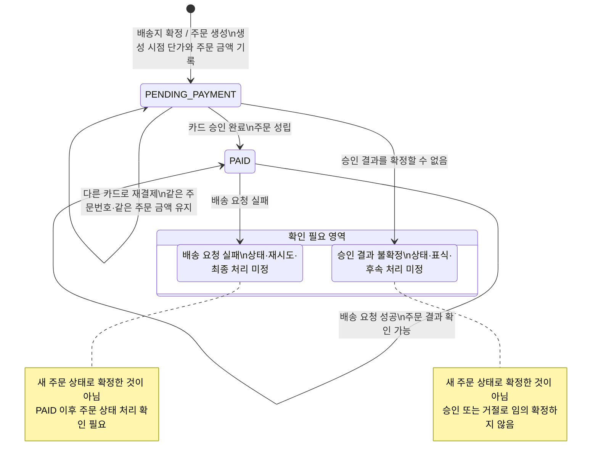
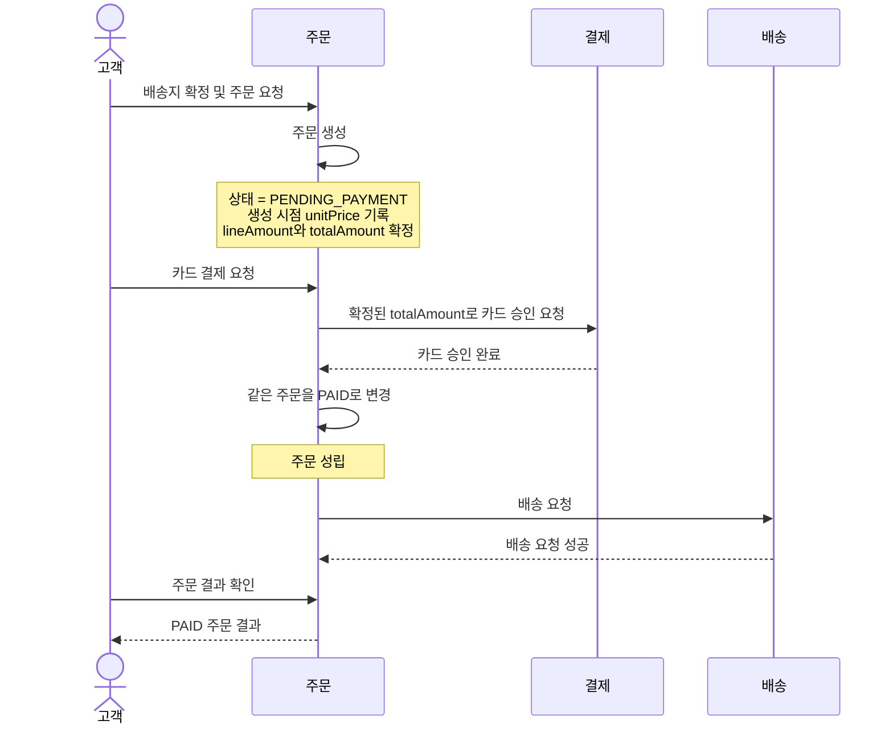

# 주문 기능 동적 모델 초안

## 1. 사건·상태 목록

### 1.1 확인된 주문 상태

| 상태 | 의미 | 근거 |
|---|---|---|
| `PENDING_PAYMENT` | 주문은 생성됐지만 카드 승인이 완료되지 않은 상태 | 주문 최초 상태이며, 명시적 승인 거절 후에도 유지 |
| `PAID` | 카드 승인이 완료되어 주문이 성립한 상태 | 승인 완료 시 같은 주문이 전이 |

- 위 두 상태가 전체 주문 상태 목록인지는 **확인 필요**하다.
- 재결제는 별도의 주문 상태가 아니다.
- 승인 거절, 판매가 변경, 배송 요청 성공은 새로운 주문 상태가 아니다.
- 결제 결과 불확정 및 배송 요청 실패에 대응하는 주문 상태나 표식은 **확인 필요**하므로 추가하지 않는다.

### 1.2 사건과 조건

| 사건 | 주요 조건·결과 |
|---|---|
| 배송지 확정 | 주문을 생성할 수 있는 사건 |
| 주문 생성 | 주문번호, 주문 항목의 `unitPrice`, `lineAmount`, `totalAmount`를 기록하고 `PENDING_PAYMENT`로 시작 |
| 판매가 변경 | 기존 주문의 기록 단가, 항목 금액 및 주문 금액을 변경하지 않음 |
| 카드 승인 요청 | 확정된 `Order.totalAmount`를 사용 |
| 카드 승인 완료 | 같은 주문을 `PAID`로 변경하고 주문을 성립시킴 |
| 카드 승인 거절 | 같은 주문을 `PENDING_PAYMENT`로 유지하고 배송을 요청하지 않음 |
| 다른 카드로 재결제 선택 | 새 주문을 만들지 않고 같은 주문번호와 주문 금액으로 다시 승인 요청 |
| 승인 결과 불확정 | 승인이나 거절로 임의 확정하지 않음. 상태·표식과 후속 처리는 **확인 필요** |
| 배송 요청 | 카드 승인 완료 후 정상 경로에서 한 번 발생 |
| 배송 요청 성공 | 고객이 주문 결과를 확인할 수 있음. 별도 주문 상태 전이는 정의되지 않음 |
| 배송 요청 실패 | 상태, 재시도 및 최종 실패 처리는 **확인 필요** |
| 주문 조회 요청 | 본인 주문에 대해서만 허용 |
| 주문 변경 요청 | 타인 주문은 거절. 본인의 `PENDING_PAYMENT` 주문도 상품·수량·배송지를 변경할 수 없음 |
| 변경을 위한 새 주문 생성 | 기존 주문을 수정하지 않고 새 주문을 생성하지만, 기존 결제대기 주문의 처리는 **확인 필요** |

## 2. 상태 기계 Mermaid 원본

`UNCERTAIN`과 `DELIVERY_FAILURE`는 주문 상태가 아니라 미정 분기를 표시하기 위한 도식상의 영역이다.

## 3. 전이 표

| 현재 상태 | 사건 | 조건 | 다음 상태 | 업무 결과 |
|---|---|---|---|---|
| 주문 없음 | 배송지 확정 및 주문 생성 | 장바구니에 상품과 수량이 있고 배송지가 확정됨 | `PENDING_PAYMENT` | 주문번호를 부여하고 생성 시점의 `salePrice`를 `unitPrice`로 기록. `lineAmount`와 `totalAmount` 확정 |
| `PENDING_PAYMENT` | 판매가 변경 | 주문 생성 후 `Product.salePrice`가 변경됨 | `PENDING_PAYMENT` | 기존 `unitPrice`, `lineAmount`, `totalAmount`는 변경되지 않음 |
| `PENDING_PAYMENT` | 카드 승인 요청 | 카드 결제이며 승인 요청 금액이 확정된 `totalAmount`임 | `PENDING_PAYMENT` | 카드 승인 결과를 기다림. 요청 중 별도 상태·표식은 **확인 필요** |
| `PENDING_PAYMENT` | 카드 승인 완료 | 승인 결과가 명시적으로 확정됨 | `PAID` | 같은 주문이 성립하며 배송 요청 발생 |
| `PENDING_PAYMENT` | 카드 승인 거절 | 거절 결과가 명시적으로 확정됨 | `PENDING_PAYMENT` | 청구 완료로 취급하지 않고 배송을 요청하지 않음 |
| `PENDING_PAYMENT` | 다른 카드로 재결제 | 앞선 결과가 명시적 거절이고 고객이 재결제를 선택함 | `PENDING_PAYMENT` | 새 주문을 만들지 않음. 같은 주문번호와 `totalAmount`로 다시 승인 요청 |
| `PENDING_PAYMENT` | 승인 결과 불확정 | 승인과 거절 중 어느 결과인지 확정할 수 없음 | **확인 필요** | 승인 또는 거절로 임의 확정하지 않음. 상태·표식·대사·재결제 허용 여부는 미정 |
| `PENDING_PAYMENT` | 상품·수량·배송지 변경 요청 | 본인의 주문임 | `PENDING_PAYMENT` | 같은 주문의 변경을 거절. 변경하려면 새 주문 필요 |
| `PENDING_PAYMENT` | 상품·수량·배송지 변경 요청 | 타인의 주문임 | `PENDING_PAYMENT` | 요청 거절 |
| `PAID` | 배송 요청 | 정상 카드 승인이 완료됨 | `PAID` | 정상 경로에서 배송 요청 한 번 발생 |
| `PAID` | 배송 요청 성공 | 배송 요청이 성공함 | `PAID` | 고객이 주문 결과를 확인. 별도 상태는 정의되지 않음 |
| `PAID` | 배송 요청 실패 | 배송 요청이 실패함 | **확인 필요** | 주문 상태, 재시도, 최종 실패 처리 및 고객에게 보여줄 결과가 미정 |
| `PENDING_PAYMENT` 또는 `PAID` | 주문 조회 요청 | 본인 주문임 | 현재 상태 유지 | 주문 조회 허용 |
| `PENDING_PAYMENT` 또는 `PAID` | 주문 조회·변경 요청 | 타인의 주문임 | 현재 상태 유지 | 요청 거절 |
| `PAID` | 취소·환불·반품·교환 요청 | 주문 성립 이후 요청 | 범위 밖 | 이번 동적 모델에서 정의하지 않음 |

## 4. 정상 카드 승인 시퀀스 Mermaid 원본

이 시퀀스는 업무상 상호작용만 나타낸다. API, 동기·비동기 통신, 저장 순서, 메시지 전달 방식 및 통지 정책은 결정하지 않는다.

## 5. 대표 사례

### 5.1 주문 생성 후 판매가 변경

1. 펜 2개의 현재 판매가가 개당 1,000원일 때 서울 배송지로 주문을 생성한다.
2. `unitPrice`는 1,000원, `lineAmount`와 `totalAmount`는 2,000원으로 기록된다.
3. 주문 상태는 `PENDING_PAYMENT`다.
4. 이후 현재 `salePrice`가 개당 1,200원으로 상승한다.
5. 기존 주문의 `unitPrice`, `lineAmount`, `totalAmount`는 변하지 않는다.
6. 카드 승인 요청 금액은 현재 판매가로 다시 계산한 2,400원이 아니라 기존 `totalAmount`인 2,000원이다.
7. 승인 완료 시 같은 주문이 `PAID`가 되고 배송 요청이 한 번 발생한다.

### 5.2 카드 승인 거절

1. `PENDING_PAYMENT` 주문에 카드 X로 2,000원 승인을 요청한다.
2. 카드 X가 명시적으로 승인을 거절한다.
3. 주문은 같은 주문번호와 `totalAmount`를 유지한다.
4. 상태는 `PENDING_PAYMENT`로 유지된다.
5. 거절은 청구 완료로 취급하지 않는다.
6. 배송을 요청하지 않는다.
7. 외부 지연이나 일시 오류를 명시적 거절로 볼 수 있는지는 **확인 필요**하다.

### 5.3 거절 후 다른 카드로 재결제

1. 같은 주문에서 카드 X의 명시적 거절이 확정된다.
2. 고객이 카드 Y로 재결제를 선택한다.
3. 새 주문을 생성하지 않고 기존 주문번호를 유지한다.
4. 재결제 전후 주문 상태는 `PENDING_PAYMENT`이며, 재결제 자체를 새 상태로 만들지 않는다.
5. 카드 Y에도 기존 `totalAmount`인 2,000원으로 승인을 요청한다.
6. 카드 Y가 승인되면 같은 주문을 `PAID`로 변경한다.
7. 카드 X 거절부터 카드 Y 승인까지 누적 배송 요청은 한 번이다.
8. 불확정 결과가 남아 있는 상황에서도 재결제를 허용할지는 **확인 필요**하다.

## 6. 미정 질문

1. `PENDING_PAYMENT`와 `PAID` 외에 실제로 필요한 주문 상태는 무엇인가?
2. 카드 승인 요청이 진행 중일 때 별도의 상태나 표식이 필요한가?
3. 승인 결과가 불확정일 때 현재 주문 상태와 별도 표식을 어떻게 관리하는가?
4. 승인 결과 불확정 시 대사는 누가, 언제, 어떤 기준으로 수행하는가?
5. 불확정 결과가 남아 있는 동안 재결제를 허용하는가?
6. 불확정 결과 이후 중복 승인이 확인되면 어떻게 처리하는가?
7. 여러 결제 요청에서 둘 이상의 승인이 발생하면 어떻게 처리하는가?
8. 외부 시스템의 지연·일시 오류와 명시적 승인 거절을 어떤 기준으로 구분하는가?
9. 중복 결제 요청의 식별과 방지 책임은 어느 시스템에 있는가?
10. 결제대기 기한은 얼마이며 기한 경과 후 주문을 어떻게 처리하는가?
11. 결제대기 기한 경계에서 이미 진행 중인 승인 요청은 어떻게 처리하는가?
12. 상품·수량·배송지 변경을 위해 새 주문을 만들면 기존 `PENDING_PAYMENT` 주문은 어떻게 처리하는가?
13. 재고는 주문·결제 흐름의 어느 시점에 몇 번 판단하는가?
14. 승인 전 재고 부족과 승인 후 재고 부족을 각각 어떻게 처리하는가?
15. 배송 요청 실패 시 주문 상태를 변경하는가?
16. 배송 요청 실패 시 재시도하는가?
17. 재시도한다면 횟수, 간격 및 종료 조건은 무엇인가?
18. 재시도 후에도 실패하면 최종적으로 어떻게 처리하는가?
19. 배송 재시도를 같은 요청의 재전송으로 볼지 새로운 요청으로 볼지 어떻게 정하는가?
20. 중복 배송 요청은 어떤 기준으로 식별하고 방지하는가?
21. 결제 결과 불확정 또는 배송 요청 실패 시 고객에게 어떤 주문 결과를 보여주는가?
22. 주문 결과 통지는 어느 시스템이 어느 시점에 담당하는가?
23. 주문자와 본인 주문 여부를 어떤 정보와 방식으로 식별하는가?
24. 결제 승인·거절 및 재결제 이력을 보존해야 하는가? 보존한다면 필요한 업무 정보와 식별 기준은 무엇인가?