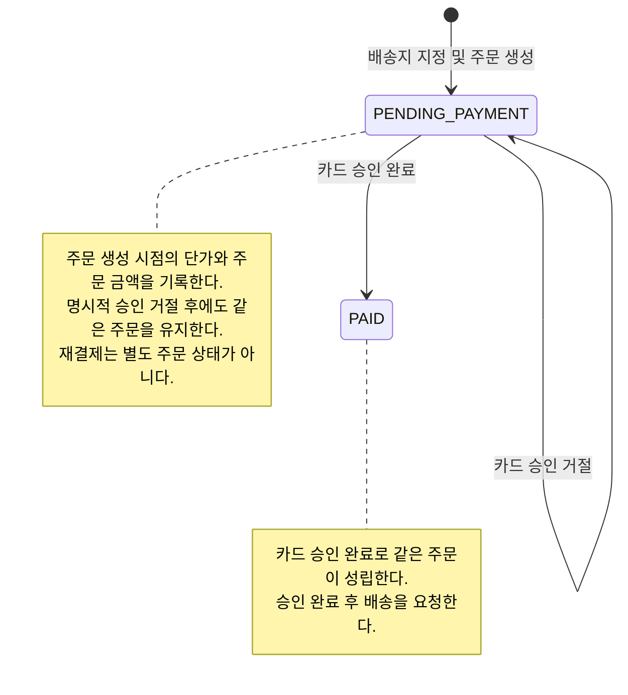
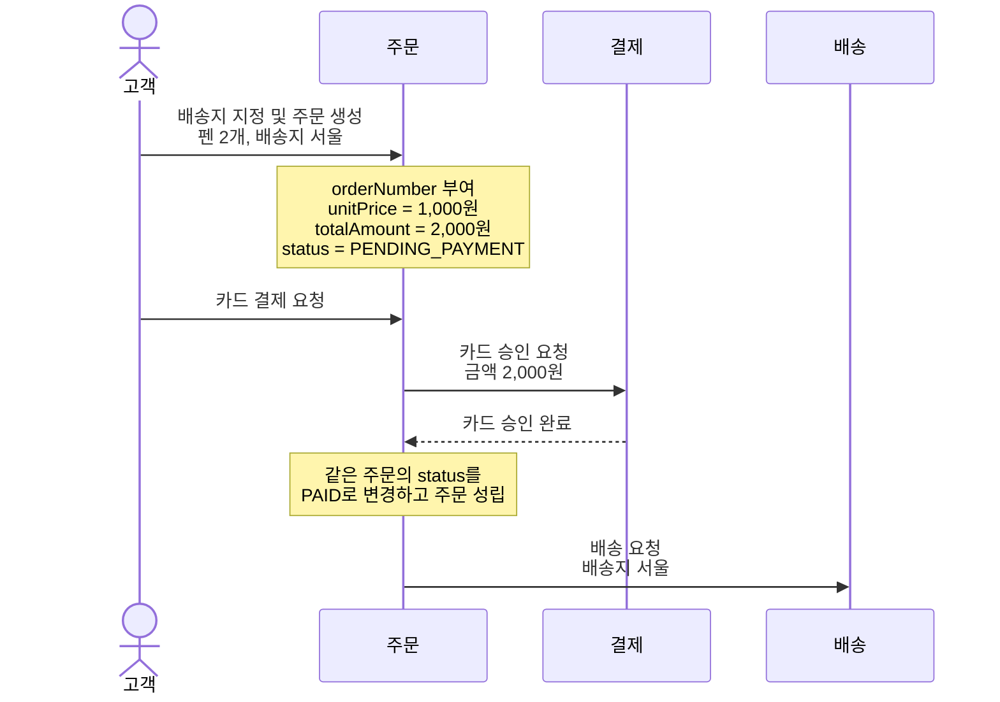

# 주문한다 — 동적 모델

## 1. 목적과 범위

이 문서는 실습 3 「주문 기능 정의서 — 주문한다」와 실습 4 「주문 기능 정적 모델 정의서 — 최종안」만을 근거로 주문 기능의 동적 모델을 정리한다.

다음 범위만 다룬다.

- 배송지 지정에 따른 주문 생성과 최초 상태 진입
- 카드 승인 거절과 승인 완료에 따른 주문 상태 전이
- 주문 생성 후 판매가 변경 시 주문 금액 보존
- 명시적 승인 거절 후 같은 주문에서 이루어지는 재결제
- 카드 승인 완료 후 배송 요청
- 본인 주문 접근과 결제대기 주문의 변경 제한

결제 결과 미확정, 배송 요청 실패, 재시도, 별도 통지 등 선행 문서에서 정책이 확정되지 않은 사항은 상태나 처리 절차로 추가하지 않고 미정 질문으로 남긴다.

이 문서는 구현 객체, 저장소, API, 메시지 전달 방식, 통신 기술, 트랜잭션 또는 외부 시스템의 내부 동작을 설계하지 않는다.

---

## 2. 사건·상태 목록

### 2.1 확인된 주문 상태

| 상태 | 의미 | 근거 |
|---|---|---|
| `PENDING_PAYMENT` | 주문은 생성됐지만 카드 승인이 완료되지 않은 상태 | 주문의 최초 확인 상태이며 명시적 카드 승인 거절 후에도 유지 |
| `PAID` | 카드 승인이 완료되어 주문이 성립한 상태 | 카드 승인 완료 시 같은 주문이 전이 |

- `PENDING_PAYMENT`와 `PAID`가 전체 주문 상태 목록인지는 **확인 필요**하다.
- 재결제는 별도의 주문 상태가 아니다.
- 판매가 변경, 카드 승인 요청, 배송 요청 및 배송 요청 성공은 주문 상태가 아니다.
- 결제 결과 미확정이나 배송 요청 실패에 대응하는 주문 상태 또는 표식은 **확인 필요**하므로 추가하지 않는다.

### 2.2 상태 전이를 일으키는 확인된 사건

상태 기계와 전이 표에서는 다음 세 사건명을 동일하게 사용한다.

| 사건 | 상태에 미치는 영향 | 주요 업무 결과 |
|---|---|---|
| 배송지 지정 및 주문 생성 | 주문 없음 → `PENDING_PAYMENT` | 배송지가 확정된 주문을 생성하고 생성 시점의 단가와 주문 금액을 기록 |
| 카드 승인 거절 | `PENDING_PAYMENT` → `PENDING_PAYMENT` | 같은 주문을 유지하고 청구 완료로 취급하지 않으며 배송을 요청하지 않음 |
| 카드 승인 완료 | `PENDING_PAYMENT` → `PAID` | 같은 주문이 성립하고 그 후 배송을 요청 |

### 2.3 상태 전이로 표현하지 않는 사건과 행위

| 사건 또는 행위 | 확인된 규칙 | 모델 표현 |
|---|---|---|
| 판매가 변경 | 기존 주문의 `unitPrice`, `lineAmount`, `totalAmount`를 변경하지 않음 | 상태 전이로 표현하지 않음 |
| 카드 승인 요청 | 확정된 `Order.totalAmount`를 사용 | 상태 전이로 표현하지 않음 |
| 다른 카드로 재결제 요청 | 명시적 거절 후 새 주문을 만들지 않고 같은 주문번호와 주문 금액을 사용 | 별도 상태나 자기 전이로 표현하지 않음 |
| 배송 요청 | 카드 승인 완료 후 발생 | 주문 상태 전이로 표현하지 않음 |
| 배송 요청 성공 | 별도의 주문 상태 변화가 정의되지 않음 | 상태 전이로 표현하지 않음 |
| 승인 결과 미확정 | 승인 또는 거절로 임의 확정하지 않음 | 상태 전이를 정의하지 않음, **확인 필요** |
| 배송 요청 실패 | 상태, 재시도 및 최종 실패 처리가 정해지지 않음 | 상태 전이를 정의하지 않음, **확인 필요** |
| 주문 조회 요청 | 본인 주문에 대해서만 허용 | 상태 변화 없음 |
| 주문 변경 요청 | 타인 주문은 거절하며, 본인의 `PENDING_PAYMENT` 주문도 상품·수량·배송지를 변경할 수 없음 | 상태 변화 없음 |

---

## 3. 상태 기계 Mermaid 원본

이 상태 기계에는 선행 문서에서 확인된 주문 상태 전이만 표시한다. 판매가 변경, 카드 승인 요청, 재결제 요청, 배송 요청 및 배송 요청 성공은 주문 상태 전이로 확정되지 않았으므로 포함하지 않는다.

승인 결과 미확정과 배송 요청 실패는 대응 상태 및 후속 정책이 정해지지 않았으므로 도식에 상태나 전이로 추가하지 않는다.

---

## 4. 전이 표

| 현재 상태 | 사건 | 조건 | 다음 상태 | 업무 결과 |
|---|---|---|---|---|
| 주문 없음 | 배송지 지정 및 주문 생성 | 고객이 배송지를 확정함 | `PENDING_PAYMENT` | 주문을 생성한다. 주문번호를 부여하고 주문 생성 시점의 `salePrice`를 `unitPrice`로 기록한다. `lineAmount`와 `totalAmount`를 확정하고 배송지를 주문에 기록한다. |
| `PENDING_PAYMENT` | 카드 승인 거절 | 카드 승인 결과가 명시적 거절로 확정됨 | `PENDING_PAYMENT` | 같은 주문번호와 주문 금액을 유지한다. 거절을 청구 완료로 취급하지 않으며 배송을 요청하지 않는다. |
| `PENDING_PAYMENT` | 카드 승인 완료 | 카드 승인 결과가 승인 완료로 확정됨 | `PAID` | 같은 주문이 성립한다. 상태 전이 후 확정된 배송지로 배송을 요청한다. |

### 4.1 전이 표 해석의 경계

- 카드 승인 요청 중의 별도 상태 또는 표식은 **확인 필요**하다.
- 명시적 거절 뒤 다른 카드로 재결제할 수 있지만 재결제 요청 자체는 새로운 주문 상태나 상태 전이가 아니다.
- 승인 결과가 미확정이면 `카드 승인 거절`이나 `카드 승인 완료` 사건으로 간주하지 않는다.
- 배송 요청과 배송 요청 성공은 주문 상태 전이로 정의하지 않는다.
- 배송 요청 실패 시 다음 주문 상태는 **확인 필요**하다.
- `PAID` 이후 취소, 환불, 반품 및 교환은 범위 밖이다.

---

## 5. 금지·제한 목록

### 5.1 주문 식별과 재결제

- 명시적 카드 승인 거절 후 재결제할 때 새 주문을 생성해서는 안 된다.
- 거절과 재결제를 거치는 동안 같은 `orderNumber`를 유지해야 한다.
- 재결제를 별도의 주문 상태로 추가해서는 안 된다.
- 승인 거절을 청구 완료로 취급해서는 안 된다.

### 5.2 금액

- 주문 생성 후 현재 `Product.salePrice`가 변경되더라도 기존 주문의 `OrderItem.unitPrice`를 변경해서는 안 된다.
- 판매가 변경을 이유로 기존 `OrderItem.lineAmount`나 `Order.totalAmount`를 다시 계산해서는 안 된다.
- 카드 승인 요청에 현재 판매가로 다시 계산한 금액을 사용해서는 안 된다.
- 최초 승인 요청과 명시적 거절 후 재결제 모두 확정된 같은 `Order.totalAmount`를 사용해야 한다.

### 5.3 상태와 배송

- 카드 승인 완료 전 주문을 `PAID`로 처리해서는 안 된다.
- 카드 승인 전 또는 명시적 승인 거절 직후 배송을 요청해서는 안 된다.
- 승인 결과가 미확정인 경우 승인 또는 거절로 임의 확정해서는 안 된다.
- 판매가 변경, 승인 요청, 재결제 요청, 배송 요청 또는 배송 요청 성공을 근거 없는 주문 상태 자기 전이로 추가해서는 안 된다.
- 배송 요청 실패에 대한 상태, 재시도 및 최종 실패 처리를 임의로 확정해서는 안 된다.

### 5.4 조회와 변경

- 고객에게 타인의 주문 조회나 변경을 허용해서는 안 된다.
- 본인 주문이라도 `PENDING_PAYMENT` 상태의 같은 주문에서 상품, 수량 또는 배송지를 변경해서는 안 된다.
- 상품, 수량 또는 배송지를 바꾸려면 새 주문을 생성해야 한다.
- 변경을 위해 새 주문을 만들었을 때 기존 `PENDING_PAYMENT` 주문을 어떻게 처리할지는 **확인 필요**하다.

---

## 6. 정상 카드 승인 시퀀스 Mermaid 원본

이 시퀀스는 다음까지만 나타낸다.

- 배송지 서울을 지정한 주문 생성
- 주문 생성 시 펜 2개, 기록 단가 1,000원, 주문 총액 2,000원 확정
- 확정된 주문 총액 2,000원으로 카드 승인 요청
- 카드 승인 완료 수신
- 같은 주문을 `PAID`로 변경
- 승인 완료 후 서울로 배송 요청

배송 요청 성공 응답, 고객에게 주문 결과를 제공하는 화살표, 별도 통지 및 배송 뒤에만 주문 결과를 확인한다는 순서는 근거가 확정되지 않았으므로 표시하지 않는다.

시퀀스의 화살표는 업무상 상호작용을 나타낼 뿐 API, 호출 방식, 동기·비동기 여부, 메시지 구조 또는 통신 기술을 의미하지 않는다.

---

## 7. 대표 사례

대표 사례의 공통값은 다음과 같다.

| 항목 | 값 |
|---|---|
| 상품 | 펜 |
| 수량 | 2개 |
| 주문 생성 시 판매가 | 개당 1,000원 |
| 기록 단가 `unitPrice` | 개당 1,000원 |
| 항목 금액 `lineAmount` | 2,000원 |
| 주문 금액 `totalAmount` | 2,000원 |
| 배송지 | 서울 |
| 최초 주문 상태 | `PENDING_PAYMENT` |
| 최초 결제 카드 | 카드 X |
| 재결제 카드 | 카드 Y |

### 7.1 정상 승인

1. 고객이 펜 2개와 배송지 서울을 지정한다.
2. `배송지 지정 및 주문 생성` 사건으로 주문이 생성된다.
3. 생성 시점의 판매가 1,000원을 `unitPrice`로 기록한다.
4. `lineAmount`와 `totalAmount`는 2,000원으로 확정된다.
5. 주문의 최초 상태는 `PENDING_PAYMENT`다.
6. 카드 승인 요청에는 확정된 `totalAmount`인 2,000원을 사용한다.
7. `카드 승인 완료` 사건으로 같은 주문이 `PAID`로 전이하고 주문이 성립한다.
8. 승인 완료 후 배송지 서울로 배송을 요청한다.
9. 정상 승인 사례의 누적 배송 요청은 한 번이다.

### 7.2 주문 생성 후 판매가 변경

1. 펜의 현재 판매가가 개당 1,000원일 때 펜 2개와 배송지 서울로 주문을 생성한다.
2. 주문에는 `unitPrice` 1,000원과 `totalAmount` 2,000원이 기록된다.
3. 주문 생성 후 현재 `Product.salePrice`가 개당 1,200원으로 상승한다.
4. 기존 주문의 `unitPrice`는 1,000원으로 유지된다.
5. 기존 주문의 `lineAmount`와 `totalAmount`는 2,000원으로 유지된다.
6. 카드 승인 요청 금액은 현재 판매가로 다시 계산한 2,400원이 아니라 기존 `totalAmount`인 2,000원이다.
7. 카드가 승인되면 `카드 승인 완료` 사건으로 같은 주문이 `PAID`가 된다.
8. 승인 완료 후 기존에 확정한 배송지 서울로 배송을 요청한다.
9. 정상 경로의 누적 배송 요청은 한 번이다.

### 7.3 카드 X 승인 거절

1. `PENDING_PAYMENT` 상태인 같은 주문에 카드 X로 2,000원의 승인을 요청한다.
2. 카드 X의 승인 결과가 명시적 거절로 확정된다.
3. `카드 승인 거절` 사건 뒤에도 주문 상태는 `PENDING_PAYMENT`다.
4. 주문번호, `unitPrice`, `lineAmount`, `totalAmount` 및 배송지 서울을 유지한다.
5. 승인 거절은 청구 완료로 취급하지 않는다.
6. 카드 승인 거절 직후 배송을 요청하지 않는다.
7. 외부 지연이나 일시 오류를 명시적 거절로 구분하는 기준은 **확인 필요**하다.

### 7.4 카드 X 거절 후 카드 Y 재결제

아래의 `ORD-예시-A`는 동일 주문을 설명하기 위한 예시 값이다. 주문번호의 형식이나 생성 규칙을 정의하지 않는다.

| 순서 | 사건 또는 행위 | 주문번호 | 요청 금액 | 주문 상태 | 누적 배송 요청 |
|---:|---|---|---:|---|---:|
| 1 | 배송지 지정 및 주문 생성 | `ORD-예시-A` | — | `PENDING_PAYMENT` | 0회 |
| 2 | 카드 X 승인 요청 | `ORD-예시-A` | 2,000원 | `PENDING_PAYMENT` | 0회 |
| 3 | 카드 승인 거절 | `ORD-예시-A` | 2,000원 | `PENDING_PAYMENT` | 0회 |
| 4 | 카드 Y 재결제 요청 | `ORD-예시-A` | 2,000원 | `PENDING_PAYMENT` | 0회 |
| 5 | 카드 승인 완료 | `ORD-예시-A` | 2,000원 | `PAID` | 1회 |

- 카드 X 거절 후에도 새 주문을 생성하지 않는다.
- 카드 Y 재결제에서도 같은 `orderNumber`인 `ORD-예시-A`를 사용한다.
- 카드 X와 카드 Y의 승인 요청 금액은 모두 확정된 `totalAmount`인 2,000원이다.
- 배송지는 재결제 전후 모두 서울이다.
- 카드 Y 재결제 요청 자체는 새로운 주문 상태나 상태 전이가 아니다.
- 카드 Y의 승인 완료로 같은 주문이 `PAID`가 된다.
- 카드 X 거절부터 카드 Y 승인까지 정상 경로의 누적 배송 요청은 한 번이다.
- 승인 결과가 미확정인 상태에서도 재결제를 허용할지는 **확인 필요**하다.

---

## 8. 근거로 사용한 선행 규칙

### 8.1 주문 생성과 최초 상태

- 고객이 배송지를 확정하면 주문을 생성한다.
- 주문 생성 시 주문번호와 주문 항목의 생성 시점 단가 및 주문 금액을 기록한다.
- 주문의 최초 확인 상태는 `PENDING_PAYMENT`다.
- 주문자와 수령인은 같은 사람으로 본다.

### 8.2 주문 금액

- `OrderItem.unitPrice`는 주문 생성 시점의 `Product.salePrice`를 기록한 값이다.
- `OrderItem.lineAmount`는 `unitPrice × quantity`다.
- `Order.totalAmount`는 모든 주문 항목 금액의 합계다.
- 주문 생성 후 현재 판매가가 바뀌어도 기존 주문의 `unitPrice`, `lineAmount`, `totalAmount`는 바뀌지 않는다.
- 카드 승인 요청에는 확정된 `Order.totalAmount`를 사용한다.

### 8.3 승인·거절·재결제

- 카드 승인 완료 시 주문이 성립한다.
- 승인 완료 시 같은 주문의 상태는 `PAID`가 된다.
- 명시적 승인 거절 후 같은 주문은 `PENDING_PAYMENT`로 유지된다.
- 승인 거절은 청구 완료가 아니다.
- 명시적 거절 후 고객은 다른 카드로 같은 주문을 다시 결제할 수 있다.
- 재결제 시 새 주문을 생성하지 않는다.
- 거절과 재결제를 거치는 동안 같은 `orderNumber`를 유지한다.
- 결제 결과가 미확정이면 승인이나 거절로 임의 확정하지 않는다.

### 8.4 배송

- 카드 승인 전에는 배송을 요청하지 않는다.
- 카드 승인 거절 직후에는 배송을 요청하지 않는다.
- 정상 카드 승인 후 배송을 요청한다.
- 정상 승인 사례의 배송 요청은 한 번 발생한다.
- 카드 X 거절 후 같은 주문에서 카드 Y가 승인되는 사례의 누적 배송 요청은 한 번이다.
- 이 한 번이라는 기대값을 배송 실패와 재시도를 포함한 모든 상황의 전역 최대 1회 제약으로 확대하지 않는다.

### 8.5 권한과 변경 제한

- 고객은 본인의 주문만 조회하거나 변경을 요청할 수 있다.
- 타인의 주문 조회 및 변경 요청은 거절한다.
- 본인이라도 `PENDING_PAYMENT` 주문의 상품, 수량 및 배송지를 변경할 수 없다.
- 상품, 수량 또는 배송지를 변경하려면 새 주문을 생성해야 한다.
- 인증 방법, 본인 확인 방식, 오류 코드 및 화면 표현은 정하지 않는다.

### 8.6 모델링 경계

- `PENDING_PAYMENT`와 `PAID`는 확인된 상태 값이지만 전체 상태 목록을 닫지 않는다.
- 결제 결과 미확정은 별도의 주문 상태로 확정하지 않는다.
- 결제 이력, 카드 참조 및 배송 요청 이력은 구조가 확정되지 않았으므로 새로운 정적 개념으로 추가하지 않는다.
- 구현 클래스, 데이터베이스, 저장 방향, API 및 외부 연계 기술을 결정하지 않는다.

---

## 9. 미정 질문

### 9.1 주문 상태와 결제대기

1. `PENDING_PAYMENT`와 `PAID` 외에 필요한 주문 상태는 무엇인가?
2. 카드 승인 요청이 진행 중일 때 별도의 상태나 표식이 필요한가?
3. 결제대기 기한은 얼마인가?
4. 결제대기 기한이 지나면 주문을 어떻게 처리하는가?
5. 기한 경계에서 이미 진행 중인 카드 승인 요청은 어떻게 처리하는가?
6. 상품, 수량 또는 배송지 변경을 위해 새 주문을 생성하면 기존 `PENDING_PAYMENT` 주문은 어떻게 처리하는가?

### 9.2 결제 결과 미확정과 중복 승인

7. 카드 승인 결과가 미확정일 때 현재 주문 상태를 어떻게 해석하고 어떤 표식을 남기는가?
8. 미확정 결과의 대사는 누가, 언제, 어떤 기준으로 수행하는가?
9. 미확정 결과가 남아 있는 동안 재결제를 허용하는가?
10. 미확정 결과 이후 중복 승인이 확인되면 어떻게 처리하는가?
11. 여러 결제 요청에서 둘 이상의 승인이 발생하면 어떻게 처리하는가?
12. 외부 시스템의 지연·일시 오류와 명시적 승인 거절을 어떤 기준으로 구분하는가?
13. 중복 결제 요청의 식별과 방지 책임은 어느 시스템에 있는가?
14. 승인, 거절 및 재결제 이력을 보존해야 하는가?
15. 결제 이력을 보존한다면 서로 다른 카드의 요청과 결과를 어떤 업무 정보로 구분하는가?

### 9.3 재고

16. 재고는 주문과 결제 흐름의 어느 시점에 판단하는가?
17. 주문과 결제 과정에서 재고를 몇 번 확인하는가?
18. 카드 승인 전에 재고 부족이 확인되면 어떻게 처리하는가?
19. 카드 승인 후 재고 부족이 확인되면 어떻게 처리하는가?

### 9.4 배송 요청

20. 배송 요청 실패 시 주문 상태를 어떻게 처리하는가?
21. 배송 요청 실패 시 재시도하는가?
22. 재시도한다면 횟수, 간격 및 종료 조건은 무엇인가?
23. 재시도 후에도 실패하면 최종적으로 어떻게 처리하는가?
24. 배송 재시도를 같은 요청의 재전송으로 보는가, 새로운 요청으로 보는가?
25. 중복 배송 요청을 어떤 기준으로 식별하고 방지하는가?
26. 정상 경로의 누적 배송 요청 1회 기대값과 실패 재시도를 어떻게 함께 만족시키는가?

### 9.5 주문 결과 확인과 통지

27. 고객이 주문 결과를 확인할 수 있는 정확한 시점은 언제인가?
28. 결제 결과 미확정 시 고객에게 어떤 주문 결과를 보여주는가?
29. 배송 요청 실패 시 고객에게 어떤 주문 결과를 보여주는가?
30. 주문 확인 통지는 별도로 필요한가?
31. 별도 통지가 필요하다면 어느 시스템이 어떤 시점에 담당하는가?

### 9.6 주문자와 권한

32. 비회원 주문을 허용하는가?
33. 주문자를 어떤 방식으로 식별하는가?
34. 주문이 본인 주문인지 어떤 방식으로 확인하는가?
35. 인증과 본인 확인은 어느 시스템이 어떤 정보로 수행하는가?

---

## 10. 최종 일치 대조

| 대조 대상 | 상태 기계 | 전이 표 | 정상 승인 시퀀스 | 대표 사례 | 대조 결과 |
|---|---|---|---|---|---|
| 최초 사건 | 배송지 지정 및 주문 생성 | 배송지 지정 및 주문 생성 | 배송지 지정 및 주문 생성 | 배송지 지정 및 주문 생성 | 일치 |
| 최초 상태 | `PENDING_PAYMENT` | `PENDING_PAYMENT` | `PENDING_PAYMENT` 주석 | `PENDING_PAYMENT` | 일치 |
| 거절 사건 | 카드 승인 거절 | 카드 승인 거절 | 정상 승인 시퀀스이므로 해당 없음 | 카드 승인 거절 | 일치 |
| 거절 후 상태 | `PENDING_PAYMENT` | `PENDING_PAYMENT` | 해당 없음 | `PENDING_PAYMENT` | 일치 |
| 승인 사건 | 카드 승인 완료 | 카드 승인 완료 | 카드 승인 완료 | 카드 승인 완료 | 일치 |
| 승인 후 상태 | `PAID` | `PAID` | `PAID` 주석 | `PAID` | 일치 |
| 주문 식별 | 거절 후 같은 주문 유지 | 같은 주문 유지 | 같은 주문의 상태 변경 | `ORD-예시-A` 유지 | 일치 |
| 상품과 수량 | 상태 기계에서 값 미표현 | 생성 시 주문 항목 기록 | 펜 2개 | 펜 2개 | 모순 없음 |
| 기록 단가 | 생성 시점 단가 기록 | 생성 시점 `salePrice` 기록 | 1,000원 | 1,000원 | 일치 |
| 판매가 변경 | 상태 전이 아님 | 상태 전이 아님 | 정상 승인 시퀀스에서 해당 없음 | 1,000원 → 1,200원 | 모순 없음 |
| 주문 금액 | 생성 시 기록 | `totalAmount` 확정 | 2,000원 | 2,000원 | 일치 |
| 재결제 금액 | 상태 전이로 표현하지 않음 | 상태 전이로 표현하지 않음 | 정상 승인 시퀀스에서 해당 없음 | 카드 X·Y 모두 2,000원 | 모순 없음 |
| 배송지 | 생성 시 확정 | 생성 시 기록 | 서울 | 서울 | 일치 |
| 배송 요청 시점 | `PAID` 주석에 승인 후 요청 | 승인 완료 전이 후 요청 | 승인 완료 및 `PAID` 변경 뒤 요청 | 승인 완료 뒤 요청 | 일치 |
| 배송 요청 성공 | 상태 전이 없음 | 상태 전이 없음 | 응답 화살표 없음 | 별도 상태 변화 없음 | 일치 |
| 승인 결과 미확정 | 전이 없음 | 전이 없음 | 표시하지 않음 | 승인·거절로 간주하지 않음 | 일치 |
| 배송 요청 실패 | 전이 없음 | 다음 상태 미정 | 표시하지 않음 | 처리 정책 미정 | 일치 |
| 별도 통지·재시도 | 정의하지 않음 | 정의하지 않음 | 표시하지 않음 | 미정 질문으로 보존 | 일치 |

사건명은 상태 기계와 전이 표에서 `배송지 지정 및 주문 생성`, `카드 승인 거절`, `카드 승인 완료`로 일치한다. 대표값은 펜 2개, 기록 단가 1,000원, 주문 금액 2,000원, 배송지 서울로 일치한다. 판매가가 1,200원으로 변경된 뒤에도 기존 주문과 카드 승인 요청 금액은 2,000원으로 유지한다.

명시적 거절 후 카드 Y로 재결제할 때도 같은 주문번호와 같은 주문 금액을 사용한다. 승인 결과 미확정, 배송 요청 실패, 별도 통지 및 재시도는 확인되지 않은 정책이므로 상태나 확정 절차로 추가하지 않는다.