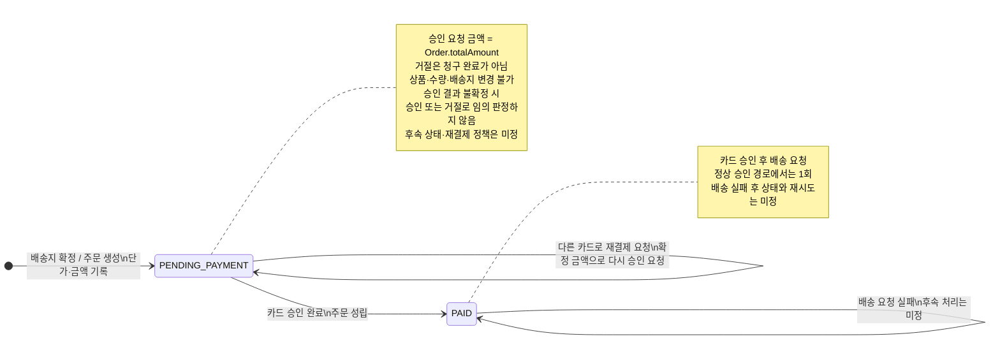
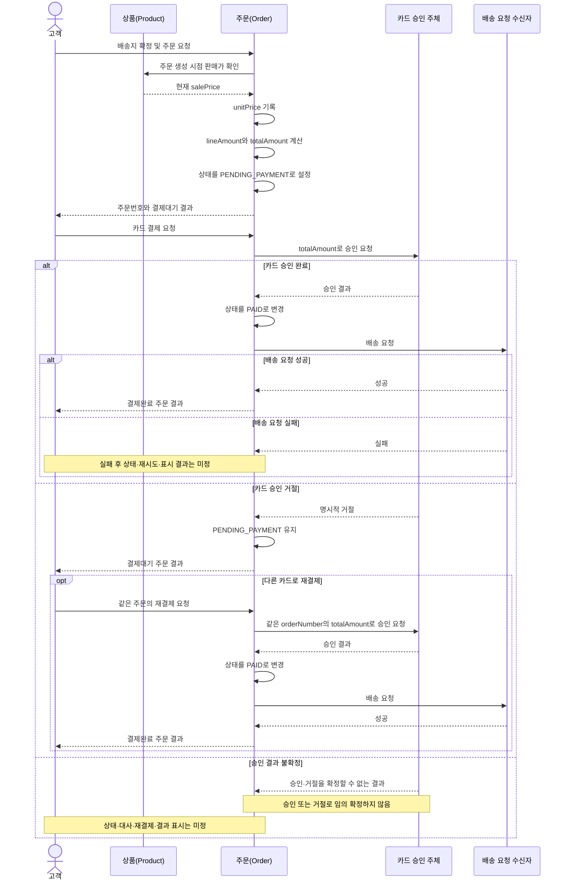
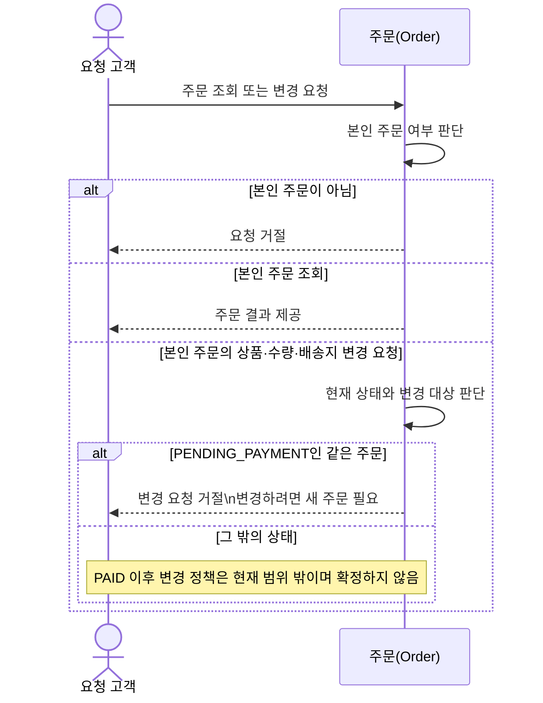

# 주문 기능 동적 관점 초안

## 1. 범위와 해석

이 초안은 실습 3의 요구사항과 실습 4의 정적 업무 모델을 시간 흐름에 따라 해석한 것이다.

- 동적 관점의 중심은 같은 `Order`가 생성되고 카드 승인 결과에 따라 상태가 변하는 과정이다.
- 주문 상태로 확정된 값은 `PENDING_PAYMENT`와 `PAID`뿐이다.
- 승인 거절은 `PENDING_PAYMENT`에서 다른 상태로 바뀌는 사건이 아니다.
- 승인 결과 불확정과 배송 요청 실패에 대해서는 새로운 상태나 후속 정책을 확정하지 않는다.
- 카드 승인 주체와 배송 요청 수신자는 업무 상호작용 상대일 뿐, 소프트웨어 서비스나 기술 연동 구성요소를 뜻하지 않는다.

---

## 2. 주요 사건

| 사건 | 의미 | 확정 여부 |
|---|---|---|
| 배송지 확정 | 주문을 생성할 수 있는 조건이 갖추어짐 | 확정 |
| 주문 생성 | 상품·수량·기록 단가·배송지·주문 금액과 주문번호를 갖는 주문이 생김 | 확정 |
| 판매가 변경 | `Product.salePrice`가 주문 생성 후 변경됨 | 가능하며 영향 규칙 확정 |
| 카드 승인 요청 | 확정된 `Order.totalAmount`로 카드 승인을 요청함 | 확정 |
| 카드 승인 | 결제가 승인되었다는 확정 결과를 받음 | 확정 |
| 카드 승인 거절 | 결제가 허용되지 않았다는 확정 결과를 받음 | 확정 |
| 승인 결과 불확정 | 승인인지 거절인지 확정할 수 없음 | 사건은 확인, 후속 처리 미정 |
| 재결제 요청 | 명시적으로 거절된 같은 주문에 다른 카드로 다시 승인을 요청함 | 확정 |
| 배송 요청 | 카드 승인 후 배송을 요청함 | 정상 경로에서 확정 |
| 배송 요청 성공 | 배송 요청이 성공함 | 사건은 확인 |
| 배송 요청 실패 | 배송 요청이 실패함 | 사건은 확인, 후속 처리 미정 |
| 주문 결과 확인 | 고객이 현재 주문 결과를 확인함 | 확정 |
| 주문 조회 요청 | 고객이 특정 주문을 조회하려 함 | 확정 |
| 주문 변경 요청 | 고객이 상품·수량·배송지 변경을 요청함 | 확정 |
| 본인 여부 판정 | 요청자가 해당 주문의 주문자인지 판단함 | 필요성 확정, 방법 미정 |

---

## 3. 주문 상태와 전이

### 확인된 상태

- `PENDING_PAYMENT`
  - 주문은 생성되었으나 카드 승인이 완료되지 않은 상태다.
  - 최초 주문 상태다.
  - 명시적 승인 거절 후에도 유지된다.
- `PAID`
  - 카드 승인이 완료되어 주문이 성립한 상태다.

`승인 결과 불확정`, `배송 요청 중`, `배송 요청 실패`를 새로운 `OrderStatus` 값으로 추가하지 않는다. 필요한지는 미정 질문으로 남긴다.

### 상태 기계

### 전이 목록

| 현재 상태 | 사건 | 조건 | 결과 상태 | 주요 결과 |
|---|---|---|---|---|
| 주문 없음 | 배송지 확정 및 주문 생성 | 주문 생성에 필요한 항목이 갖춰짐 | `PENDING_PAYMENT` | 주문번호 부여, 생성 시점 단가 및 금액 기록 |
| `PENDING_PAYMENT` | 카드 승인 거절 | 명시적인 거절 결과 | `PENDING_PAYMENT` | 청구 완료로 보지 않으며 배송을 요청하지 않음 |
| `PENDING_PAYMENT` | 다른 카드로 재결제 요청 | 이전 결과가 명시적 거절임 | `PENDING_PAYMENT` | 새 주문을 만들지 않고 같은 주문 금액으로 다시 요청 |
| `PENDING_PAYMENT` | 카드 승인 완료 | 승인 결과가 확정됨 | `PAID` | 주문 성립 후 배송 요청 |
| `PENDING_PAYMENT` | 승인 결과 불확정 | 승인·거절을 판정할 수 없음 | 전이 확정 불가 | 임의로 `PAID` 처리하거나 거절로 단정하지 않음 |
| `PAID` | 배송 요청 성공 | 정상 배송 요청 | `PAID` | 고객이 주문 결과를 확인할 수 있음 |
| `PAID` | 배송 요청 실패 | 배송 요청 실패 | 미정 | 상태, 재시도 및 고객에게 보일 결과를 결정해야 함 |

재결제 요청은 상태를 바꾸는 사건이라기보다 같은 `PENDING_PAYMENT` 주문에서 새로운 카드 승인 시도를 시작하는 사건이다.

---

## 4. 분석 수준 업무 상호작용

### 대표 흐름 시퀀스 다이어그램

이 다이어그램의 “판매가 확인”은 주문 생성 시 `OrderItem.unitPrice = Product.salePrice`가 되어야 한다는 업무 관계를 표현한다. 상품 시스템 호출 시점이나 횟수 같은 기술 연동 절차를 정한 것은 아니다.

### 같은 내용을 목록으로 읽기

1. 고객이 배송지를 확정하고 주문을 요청한다.
2. 주문 생성 시점의 각 상품 판매가를 주문 항목의 `unitPrice`로 기록한다.
3. 각 항목의 `lineAmount`를 `unitPrice × quantity`로 계산한다.
4. 모든 `lineAmount`를 합해 `Order.totalAmount`를 확정한다.
5. 주문번호를 가진 주문을 생성하고 상태를 `PENDING_PAYMENT`로 둔다.
6. 고객이 카드 결제를 요청하면 `Order.totalAmount`로 승인을 요청한다.
7. 승인이 완료되면 같은 주문을 `PAID`로 변경하고 주문이 성립한다.
8. 주문이 성립하면 배송을 요청한다.
9. 정상 경로에서 배송 요청이 성공하면 고객이 결제완료 주문 결과를 확인한다.
10. 승인이 명시적으로 거절되면 주문은 `PENDING_PAYMENT`를 유지하고 배송을 요청하지 않는다.
11. 고객이 다른 카드로 재결제하면 새 주문을 만들지 않고 같은 주문번호와 주문 금액을 사용한다.
12. 재결제가 승인되면 같은 주문이 `PAID`가 되고, 전체 정상 사례에서 배송 요청은 누적 한 번 발생한다.
13. 승인 결과가 불확정이면 승인이나 거절로 임의 확정하지 않는다.
14. 배송 요청이 실패한 경우의 상태, 재시도와 고객 결과는 아직 결정하지 않는다.

---

## 5. 조회 및 변경 요청 상호작용

목록으로 읽으면 다음과 같다.

- 주문 조회 또는 변경 요청을 받으면 먼저 본인 주문인지 판단해야 한다.
- 타인의 주문이면 조회와 변경 요청을 모두 거절한다.
- 본인의 주문이면 조회할 수 있다.
- 본인 주문이라도 `PENDING_PAYMENT` 상태에서 상품, 수량 또는 배송지를 변경할 수 없다.
- 해당 내용을 바꾸려면 새 주문을 생성해야 한다.
- 새 주문을 만들 때 기존 결제대기 주문을 어떻게 처리할지는 미정이다.
- `PAID` 이후의 취소·변경·환불 등은 현재 범위에 포함되지 않는다.

---

## 6. 대표 업무 규칙 예시

### 예시 A: 정상 승인

- 펜 2개, 생성 시점 판매가 1,000원, 배송지 서울로 주문한다.
- `unitPrice = 1,000원`
- `lineAmount = 1,000원 × 2 = 2,000원`
- `totalAmount = 2,000원`
- 최초 상태는 `PENDING_PAYMENT`다.
- 카드 Y에 2,000원 승인을 요청한다.
- 승인 완료 시 같은 주문이 `PAID`가 된다.
- 승인 후 배송 요청이 한 번 발생한다.

### 예시 B: 주문 생성 후 판매가 변경

- 주문을 2,000원으로 생성한 후 현재 판매가가 개당 1,200원으로 오른다.
- 기존 주문의 `unitPrice`는 1,000원으로 유지된다.
- 기존 주문의 `lineAmount`와 `totalAmount`도 2,000원으로 유지된다.
- 카드 승인 요청 금액은 현재 판매가로 다시 계산한 2,400원이 아니라 2,000원이다.

### 예시 C: 승인 거절

- 카드 X에 2,000원 승인을 요청한다.
- 카드 X가 명시적으로 거절한다.
- 주문 상태는 `PENDING_PAYMENT`로 유지된다.
- 거절을 청구 완료로 취급하지 않는다.
- 배송을 요청하지 않는다.

### 예시 D: 거절 후 재결제

- 카드 X 거절 후 고객이 카드 Y로 다시 결제한다.
- 새 주문을 만들지 않는다.
- 같은 `orderNumber`를 유지한다.
- 카드 Y에도 기존 `totalAmount`인 2,000원을 요청한다.
- 카드 Y 승인 후 같은 주문이 `PAID`가 된다.
- 카드 X 거절부터 카드 Y 승인까지 정상 사례의 누적 배송 요청은 한 번이다.

### 예시 E: 승인 결과 불확정

- 카드 승인 요청 후 승인인지 거절인지 확정할 수 없는 결과를 받는다.
- 이를 승인으로 간주해 `PAID`로 바꾸면 안 된다.
- 명시적 거절로 간주해 바로 재결제를 허용하는 것도 아직 확정할 수 없다.
- 주문에 남길 상태나 표식, 대사 방법 및 고객에게 보여줄 결과에 대한 결정이 필요하다.

---

## 7. 추가 결정이 필요한 질문

동적 모델을 완성하려면 다음 질문에 대한 업무 결정이 필요하다.

1. 승인 결과가 불확정일 때 `Order.status`는 계속 `PENDING_PAYMENT`로 두는가, 아니면 별도의 상태나 표식이 필요한가?
2. 승인 결과가 불확정인 동안 같은 주문의 재결제를 허용하는가?
3. 불확정 결과의 최종 승인 여부를 누가, 언제, 어떤 기준으로 확인하는가?
4. 불확정 결과 뒤에 중복 승인이 발견되면 어떻게 처리하는가?
5. 배송 요청 실패 시 주문은 계속 `PAID`로 표시되는가, 별도의 상태나 표식이 필요한가?
6. 배송 요청 실패 후 재시도하는가? 한다면 횟수·간격·종료 조건은 무엇인가?
7. 배송 요청의 정상 경로 1회와 실패 재시도를 어떻게 구분할 것인가?
8. 결제대기 기한은 얼마이며, 기한이 지나면 어떤 사건과 상태 전이가 발생하는가?
9. 기한 경계에서 이미 진행 중인 카드 승인 요청은 어떻게 처리하는가?
10. 상품·수량·배송지 변경을 위해 새 주문을 생성하면 기존 `PENDING_PAYMENT` 주문은 어떻게 처리하는가?
11. 재고는 어느 사건 전후에 판단하며, 승인 전후 재고 부족은 각각 어떻게 처리하는가?
12. 고객이 본인 주문임을 판정하는 데 필요한 업무 정보와 책임 주체는 무엇인가?
13. 승인 결과 불확정 또는 배송 요청 실패 시 고객에게 어떤 주문 결과를 보여주는가?
14. 동시에 또는 중복으로 들어온 결제 요청에서 복수 승인이 발생하지 않도록 할 업무 책임과 판정 규칙은 무엇인가?