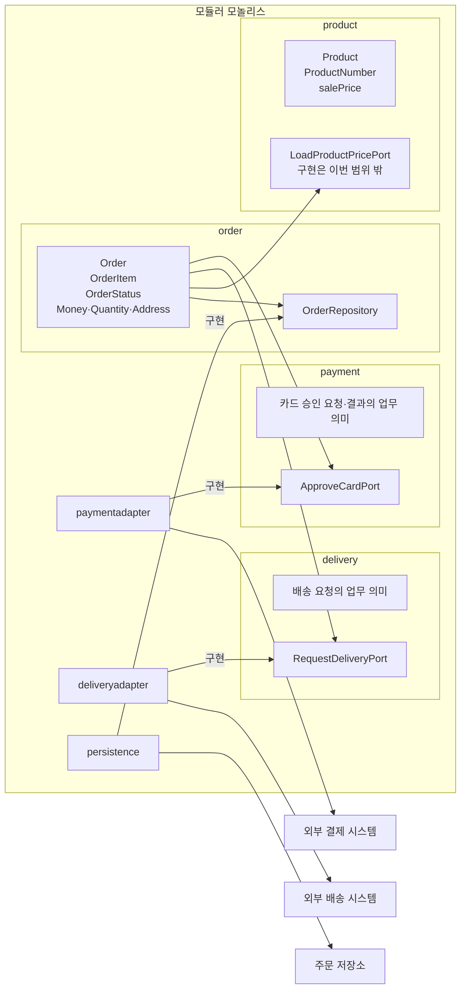

# 수정 아키텍처 제안

## 1. 선택과 판단 근거

이 사례에는 **포트와 어댑터 구조를 적용한 모듈러 모놀리스**를 제안한다.

- **배포 근거:** 독립 배포 요구가 없으므로 하나의 배포 단위로 둔다.
- **조직 근거:** 업무별 독립 팀이나 별도 출시 주기가 제시되지 않았으므로 마이크로서비스로 분리하지 않는다.
- **변경 근거:** 주문 규칙과 외부 상품·결제·배송 시스템의 변경 이유가 다르므로 업무 패키지가 출력 포트를 소유하고 연동·영속 패키지가 이를 구현한다.

| 후보 | 판단 |
|---|---|
| 계층형 | 기술 계층이 업무 경계보다 앞에 드러나므로 주 구조로 사용하지 않는다. |
| 포트와 어댑터 | 업무 규칙이 외부 시스템 기술에 의존하지 않게 하므로 채택한다. |
| 모듈러 모놀리스 | 현재 독립 배포 근거가 없으면서 패키지 의존은 통제할 수 있으므로 채택한다. |
| 마이크로서비스 | 독립 배포·팀별 소유·개별 확장 근거가 없으므로 현재는 채택하지 않는다. |

입력 포트와 유스케이스 인터페이스는 두지 않는다. 호출자가 주문 시스템으로 들어오는 구조는 이번 패키지 설계 범위에서 제외한다.

## 2. 업무 패키지와 포트 배치

- `order`
  - `Order`, `OrderItem`, `OrderStatus`, `Money`, `Quantity`, `Address`
  - 주문 생성, 금액 확정, 주문 상태 전이
  - `OrderRepository` 출력 포트 소유

- `payment`
  - 카드 승인 요청과 승인 결과의 업무 의미
  - `ApproveCardPort` 출력 포트 소유

- `delivery`
  - 승인 완료 뒤 발생하는 배송 요청의 업무 의미
  - `RequestDeliveryPort` 출력 포트 소유

- `product`
  - 상품 번호와 판매가의 업무 의미
  - `LoadProductPricePort` 출력 포트 소유
  - 이번 범위에서는 포트만 선언하며 외부 상품 시스템 연동 구현 패키지는 만들지 않음

- `paymentadapter`
  - 외부 결제 시스템 연동
  - `payment.ApproveCardPort` 구현

- `deliveryadapter`
  - 외부 배송 시스템 연동
  - `delivery.RequestDeliveryPort` 구현

- `persistence`
  - 주문 영속화
  - `order.OrderRepository` 구현

상품 시스템의 판매가 조회 규격은 정의하지만, `product.LoadProductPricePort`의 구현 위치와 구현 기술은 이번 범위 밖이다.

## 3. 패키지 다이어그램



화살표는 소스 코드의 의존 방향을 나타낸다. `paymentadapter`, `deliveryadapter`, `persistence`에서 각 포트로 향하는 화살표는 해당 패키지가 업무 패키지 소유의 포트를 구현한다는 뜻이다.

외부 상품 시스템과 그 구현 패키지는 도식에 넣지 않는다. `product`는 `LoadProductPricePort`를 선언하지만 그 구현은 이번 범위 밖이다.

### 같은 내용을 목록으로 표현

- `order`
  - 주문 모델과 주문 규칙을 가진다.
  - `OrderRepository`를 소유한다.
  - 카드 승인을 위해 `payment.ApproveCardPort`를 참조할 수 있다.
  - 배송 요청을 위해 `delivery.RequestDeliveryPort`를 참조할 수 있다.
  - 주문 생성 시 판매가를 얻기 위해 `product.LoadProductPricePort`를 참조할 수 있다.

- `payment`
  - `ApproveCardPort`를 소유한다.
  - `paymentadapter`가 이 포트를 구현한다.

- `delivery`
  - `RequestDeliveryPort`를 소유한다.
  - `deliveryadapter`가 이 포트를 구현한다.

- `product`
  - `LoadProductPricePort`를 소유한다.
  - 이번 범위에서는 포트만 선언한다.
  - 외부 상품 시스템 연동 구현 패키지는 이번 범위에서 만들지 않는다.

- `paymentadapter`
  - `payment.ApproveCardPort`를 구현한다.
  - 외부 결제 시스템과 통신한다.

- `deliveryadapter`
  - `delivery.RequestDeliveryPort`를 구현한다.
  - 외부 배송 시스템과 통신한다.

- `persistence`
  - `order.OrderRepository`를 구현한다.
  - 주문 저장소와 통신한다.

## 4. 패키지 의존 규칙

다음 규칙은 패키지의 import 또는 참조 관계를 정적으로 검사하여 판정할 수 있게 작성한다.

### 허용

- `order`는 `payment`, `delivery`, `product`를 참조할 수 있다.
- `paymentadapter`는 `payment`를 참조할 수 있다.
- `deliveryadapter`는 `delivery`를 참조할 수 있다.
- `persistence`는 `order`를 참조할 수 있다.
- `paymentadapter`는 외부 결제 시스템 라이브러리를 참조할 수 있다.
- `deliveryadapter`는 외부 배송 시스템 라이브러리를 참조할 수 있다.
- `persistence`는 데이터베이스 및 영속 기술 라이브러리를 참조할 수 있다.

허용 목록에 없는 업무 패키지 사이의 참조는 허용하지 않는다.

### 검사 가능한 금지

- 업무 패키지 `order`, `payment`, `delivery`, `product`에서 연동·영속 패키지 `paymentadapter`, `deliveryadapter`, `persistence`로 향하는 의존을 금지한다.
- `order`, `payment`, `delivery`, `product`, `paymentadapter`, `deliveryadapter`, `persistence` 사이에 직·간접 패키지 의존 순환이 생기는 것을 금지한다.

예를 들어 `order → payment`가 존재하면 `payment → order`뿐 아니라 `payment → X → order`와 같은 간접 순환도 금지한다. 순환이 생기면 관련 패키지를 독립적으로 변경하거나 검증하기 어려워지기 때문이다.

### 책임의 약속

다음은 import 검사로 판정하는 의존 규칙이 아니라 각 패키지가 지켜야 할 책임의 약속이다.

- `paymentadapter`는 외부 결제 결과를 `payment`가 정의한 승인·거절·확정 불가의 업무 의미로 변환한다. 주문 상태를 결정하거나 직접 변경하지 않는다.
- `deliveryadapter`는 `delivery`가 표현한 요청을 외부 배송 시스템에 전달한다. 독자적으로 배송 요청을 만들지 않는다.
- `persistence`는 주문을 저장하고 조회한다. 주문 상태 전이나 주문 금액을 결정하지 않는다.
- `product`의 포트나 이후의 구현에서 미정인 재고 판단 시점과 부족 처리 정책을 추가하지 않는다.
- 어느 패키지도 미정인 만료, 응답 미확정 후속 처리, 배송 실패·재시도 정책을 임의로 구현하지 않는다.

## 5. 외부 시스템 연동 규격

아래는 업무 수준의 최소 규격이다. HTTP, 메시지, 동기·비동기 여부와 구체 필드 형식은 확정하지 않는다.

### 상품 시스템: 판매가 조회

요청:

```text
ProductPriceRequest
- productNumber
```

응답:

```text
ProductPriceResponse
- productNumber
- salePrice
- currencyOrUnit
```

규칙:

- `salePrice`는 원 단위 0 이상 정수여야 한다.
- 주문 생성 시 받은 판매가를 주문 항목의 확정 단가로 저장한다.
- 같은 상품을 여러 항목으로 허용할지 합칠지는 미정이다.
- 재고 관련 필드는 재고 판단 시점이 정해지기 전까지 필수 계약으로 넣지 않는다.

### 결제 시스템: 카드 승인

요청:

```text
CardApprovalRequest
- orderNumber
- amount
- cardApprovalData
- requestReference
```

응답:

```text
CardApprovalResponse
- requestReference
- result: APPROVED | DECLINED | UNCONFIRMED
- externalApprovalReference: 승인된 경우 제공 가능한 외부 참조 값
- declineInformation: 거절된 경우 제공 가능한 정보
```

규칙:

- `amount`는 저장된 `Order.totalAmount`와 같아야 한다.
- 승인 시 현재 상품 판매가를 다시 조회하지 않는다.
- `APPROVED`만 `PAID` 전이를 일으킨다.
- `DECLINED`는 주문을 `PENDING_PAYMENT`로 유지한다.
- `UNCONFIRMED`는 승인 또는 거절로 해석하지 않는다.
- 카드 원문 정보를 주문 도메인에 저장할지는 정하지 않는다.
- `requestReference`의 형식, 재사용 여부, 중복 요청 처리 계약은 결제 응답 미확정 정책과 함께 결정해야 한다.

`UNCONFIRMED`는 새 업무 상태를 뜻하지 않는다. 기존의 “결제 응답을 확정할 수 없음”을 어댑터가 표현하는 결과 분류다.

### 배송 시스템: 배송 요청

요청:

```text
DeliveryRequest
- orderNumber
- shippingAddress
- items
  - productNumber
  - quantity
```

응답:

```text
DeliveryResponse
- orderNumber
- acceptanceResult
- externalDeliveryReference: 제공되는 경우의 외부 참조 값
```

규칙:

- `RequestDeliveryPort`는 승인 완료 처리 뒤에만 호출한다.
- 주문 생성 시 확정된 배송지를 전달한다.
- 거절이나 결제 응답 미확정 시에는 호출하지 않는다.
- 배송비는 범위 밖이므로 포함하지 않는다.
- 배송 요청 실패가 주문의 `PAID` 상태에 미치는 영향은 정하지 않는다.
- 전송 재시도, 중복 방지 키, 응답 시간 초과 처리는 현재 계약으로 확정하지 않는다.

### 호출자와 주문 시스템

최소 업무 요청:

```text
CreateOrder
- requesterContext
- items
- shippingAddress

PayOrder
- requesterContext
- orderNumber
- cardApprovalData

GetOrderResult
- requesterContext
- orderNumber
```

최소 결과:

```text
OrderResult
- orderNumber
- totalAmount
- status
- paymentResult: 확인 가능한 범위
```

- 인증 방식, 비회원 본인 확인 방식, 거절 응답 코드, 화면 표현은 정하지 않는다.
- `paymentResult`의 보존 구조가 미정이므로 상세 필드를 확정하지 않는다.
- 위 규격은 업무 메시지만 나타낸다. 이를 처리할 입력 포트나 유스케이스 인터페이스의 배치는 이번 범위에서 정하지 않는다.

## 6. 결정이 필요한 질문

다음 답에 따라 포트 계약과 실행 흐름이 달라지므로 임의로 확정하지 않는다.

1. 상품 시스템에 재고 판단을 언제 요청해야 하는가? 가격 조회와 같은 호출인가, 별도 요청인가?
2. 승인 전에 재고 부족이 확인되면 주문 상태와 결제 요청은 어떻게 처리해야 하는가?
3. 승인 뒤 재고 부족이 확인되면 이미 완료된 승인과 `PAID` 주문을 어떻게 처리해야 하는가?
4. 결제 결과가 확정 불가일 때 결제 시스템에 결과 조회 기능이 있는가? 그 전까지 같은 주문의 재결제를 허용하는가?
5. 카드 결제 요청에도 “본인 주문만 가능” 규칙을 적용하는가?
6. 비회원 주문을 허용하는가? 허용한다면 조회와 결제 요청에서 본인을 어떻게 확인하는가?
7. 결제대기 기한이 있는가? 있다면 만료 시 상태와 행위는 무엇인가?
8. 배송 요청 실패가 `PAID` 상태에 영향을 주는가? 누가 어떤 조건으로 재요청하는가?
9. 배송 시스템은 중복 요청을 식별하거나 거절할 수 있는 계약을 제공하는가?
10. 승인 결과와 결제 시도 이력을 어느 수준까지 보존해야 하는가?
11. 주문 결과의 별도 통지가 필요한가? 필요하다면 주문 시스템과 별도 통지 시스템 중 누가 담당하는가?
12. 독립 배포가 필요한 조직 또는 운영 조건이 있는가? 예를 들어 결제 연동만 별도 팀이 소유하거나 독립적으로 출시해야 하는가?