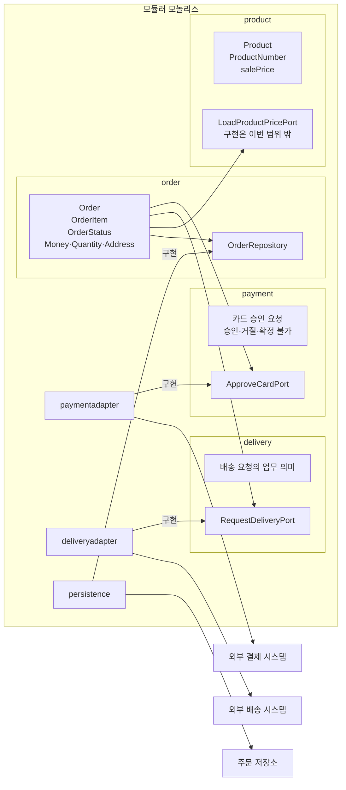

# “주문한다” 아키텍처 결정

## 1. 아키텍처 스타일과 근거

**포트와 어댑터 구조를 적용한 모듈러 모놀리스**를 선택한다.

- **배포:** 독립 배포 요구가 없으므로 하나의 배포 단위로 둔다.
- **조직:** 업무별 독립 팀이나 별도 출시 주기가 제시되지 않았으므로 마이크로서비스로 분리하지 않는다.
- **변경:** 주문 규칙과 외부 상품·결제·배송 시스템의 변경 이유가 다르므로 업무 패키지가 출력 포트를 소유하고 연동·영속 패키지가 이를 구현한다.

계층형은 기술 계층이 업무 경계보다 앞에 드러나므로 주 구조로 사용하지 않는다. 마이크로서비스는 독립 배포·팀별 소유·개별 확장의 근거가 없어 채택하지 않는다.

입력 포트와 유스케이스 인터페이스는 두지 않는다. 호출자가 주문 시스템으로 들어오는 구조는 이번 패키지 설계 범위에서 제외한다.

## 2. 업무 패키지와 포트 배치

- `order`
  - `Order`, `OrderItem`, `OrderStatus`, `Money`, `Quantity`, `Address`
  - 주문 생성, 금액 확정, 주문 상태 전이
  - `OrderRepository` 출력 포트 소유

- `payment`
  - 카드 승인 요청과 승인 결과의 업무 의미
  - `ApproveCardPort` 출력 포트 소유

- `delivery`
  - 승인 완료 뒤 발생하는 배송 요청의 업무 의미
  - `RequestDeliveryPort` 출력 포트 소유

- `product`
  - 상품 번호와 판매가의 업무 의미
  - `LoadProductPricePort` 출력 포트 소유
  - 이번 범위에서는 포트만 선언하며 외부 상품 시스템 연동 구현 패키지는 만들지 않음

- `paymentadapter`
  - 외부 결제 시스템 연동
  - `payment.ApproveCardPort` 구현
  - 결제 제공자의 전문과 코드 체계를 업무의 요청 및 결과로 변환

- `deliveryadapter`
  - 외부 배송 시스템 연동
  - `delivery.RequestDeliveryPort` 구현
  - 업무의 배송 요청을 배송 제공자의 전문으로 변환

- `persistence`
  - 주문 영속화
  - `order.OrderRepository` 구현

상품 시스템의 판매가 조회 업무 규격은 정의하지만 `product.LoadProductPricePort`의 구현 위치와 구현 기술은 이번 범위 밖이다.

## 3. 패키지 다이어그램



화살표는 소스 코드의 의존 방향을 나타낸다. 연동·영속 패키지에서 포트로 향하는 화살표는 해당 패키지가 업무 패키지 소유의 포트를 구현한다는 뜻이다.

외부 상품 시스템과 그 구현 패키지는 도식에 넣지 않는다.

### 목록으로 표현한 동일 구조

- `order`
  - 주문 모델과 주문 규칙을 가진다.
  - `OrderRepository`를 소유한다.
  - `payment.ApproveCardPort`를 참조할 수 있다.
  - `delivery.RequestDeliveryPort`를 참조할 수 있다.
  - `product.LoadProductPricePort`를 참조할 수 있다.

- `payment`
  - `ApproveCardPort`를 소유한다.
  - 승인 요청과 승인·거절·확정 불가라는 업무 결과를 정의한다.
  - `paymentadapter`가 이 포트를 구현한다.

- `delivery`
  - `RequestDeliveryPort`를 소유한다.
  - `deliveryadapter`가 이 포트를 구현한다.

- `product`
  - `LoadProductPricePort`를 소유한다.
  - 이번 범위에서는 포트만 선언한다.
  - 외부 상품 시스템 연동 구현 패키지는 만들지 않는다.

- `paymentadapter`
  - `payment.ApproveCardPort`를 구현한다.
  - 외부 결제 시스템과 통신한다.
  - 제공자의 전문을 승인·거절·확정 불가라는 업무 결과로 변환한다.

- `deliveryadapter`
  - `delivery.RequestDeliveryPort`를 구현한다.
  - 외부 배송 시스템과 통신한다.
  - 업무의 배송 요청을 제공자의 전문으로 변환한다.

- `persistence`
  - `order.OrderRepository`를 구현한다.
  - 주문 저장소와 통신한다.

## 4. 의존 규칙

### 허용

- `order`는 `payment`, `delivery`, `product`를 참조할 수 있다.
- `paymentadapter`는 `payment`를 참조할 수 있다.
- `deliveryadapter`는 `delivery`를 참조할 수 있다.
- `persistence`는 `order`를 참조할 수 있다.
- `paymentadapter`는 외부 결제 시스템 라이브러리를 참조할 수 있다.
- `deliveryadapter`는 외부 배송 시스템 라이브러리를 참조할 수 있다.
- `persistence`는 데이터베이스 및 영속 기술 라이브러리를 참조할 수 있다.

허용 목록에 없는 업무 패키지 사이의 참조는 허용하지 않는다.

### 검사 가능한 금지

다음 규칙은 패키지의 import 또는 참조 관계를 정적으로 검사한다.

- 업무 패키지 `order`, `payment`, `delivery`, `product`에서 연동·영속 패키지 `paymentadapter`, `deliveryadapter`, `persistence`로 향하는 의존을 금지한다.
- `order`, `payment`, `delivery`, `product`, `paymentadapter`, `deliveryadapter`, `persistence` 사이의 직·간접 패키지 의존 순환을 금지한다.

예를 들어 `order → payment`가 존재하면 `payment → order`뿐 아니라 `payment → X → order`와 같은 간접 순환도 금지한다.

### 검사로 판정하지 못하는 책임의 약속

- `paymentadapter`는 외부 결제 제공자의 전문을 `payment`가 정의한 승인·거절·확정 불가의 업무 의미로 변환한다.
- `paymentadapter`는 제공자의 필드 이름, 참조 값 및 코드 체계를 업무 패키지에 노출하지 않는다.
- `paymentadapter`는 주문 상태를 결정하거나 직접 변경하지 않는다.
- `deliveryadapter`는 `delivery`가 표현한 요청을 외부 배송 시스템에 전달한다.
- `deliveryadapter`는 제공자의 필드 이름, 참조 값 및 코드 체계를 업무 패키지에 노출하지 않으며 독자적으로 배송 요청을 만들지 않는다.
- `persistence`는 주문을 저장하고 조회하며, 주문 상태 전이나 주문 금액을 결정하지 않는다.
- `product`의 포트나 이후의 구현에 미정인 재고 판단 시점과 부족 처리 정책을 추가하지 않는다.
- 어느 패키지도 미정인 만료, 결제 응답 미확정 후속 처리, 배송 실패 및 재시도 정책을 임의로 구현하지 않는다.

## 5. 외부 시스템 연동 규격

다음 규격은 업무 패키지가 외부에 보내고 외부로부터 받는 업무의 말만 정의한다. HTTP, 메시지, 동기·비동기 여부와 제공자의 전문 형식, 필드 이름, 참조 값 및 코드 체계는 확정하지 않는다.

제공자 규격과 업무 규격 사이의 변환은 해당 연동 구현의 책임이다.

### 5.1 상품 시스템: 판매가 조회

업무가 보내는 것:

```text
ProductPriceRequest
- productNumber
```

업무가 받는 것:

```text
ProductPriceResponse
- productNumber
- salePrice
```

규칙:

- `salePrice`는 원 단위의 0 이상 정수다.
- 금액 단위가 원으로 정해져 있으므로 별도의 단위 필드를 두지 않는다.
- 주문 생성 시 받은 판매가를 주문 항목의 확정 단가로 저장한다.
- 주문 생성 후에는 현재 판매가가 바뀌어도 확정 단가와 주문 금액을 변경하지 않는다.

미정 또는 이번 범위 밖:

- 같은 상품을 여러 주문 항목으로 허용할지 합칠지는 미정이다.
- 재고 판단 시점이 정해지기 전까지 재고 관련 필드를 업무 규격에 넣지 않는다.
- 외부 상품 시스템의 실제 전문과 `LoadProductPricePort` 구현은 이번 범위 밖이다.

### 5.2 결제 시스템: 카드 승인

업무가 보내는 것:

```text
CardApprovalRequest
- orderNumber
- amount
- cardApprovalData
```

업무가 받는 것:

```text
CardApprovalResult
- result: APPROVED | DECLINED | UNCONFIRMED
```

규칙:

- `amount`는 원 단위의 0 이상 정수이며 저장된 `Order.totalAmount`와 같아야 한다.
- 승인 시 현재 상품 판매가를 다시 조회하지 않는다.
- `APPROVED`만 주문을 `PAID`로 전이시킨다.
- `DECLINED`는 주문을 `PENDING_PAYMENT`로 유지한다.
- `UNCONFIRMED`는 승인 또는 거절로 해석하지 않는다.
- `APPROVED`, `DECLINED`, `UNCONFIRMED`는 `payment`가 사용하는 업무의 결과다.
- 외부 결제 시스템의 필드, 참조 값 및 결과 코드는 `paymentadapter`가 업무 결과로 변환한다.

`UNCONFIRMED`는 새로운 주문 상태가 아니라 결제 응답을 확정할 수 없다는 결제 업무의 결과다.

미정:

- 카드 원문 정보를 주문 도메인에 저장할지는 정하지 않는다.
- 외부 참조 값의 보존 여부는 정하지 않는다.
- 중복 요청의 식별과 처리 계약은 정하지 않는다.
- `UNCONFIRMED` 이후의 처리와 재결제 허용 여부는 정하지 않는다.

### 5.3 배송 시스템: 배송 요청

업무가 보내는 것:

```text
DeliveryRequest
- orderNumber
- shippingAddress
- items
  - productNumber
  - quantity
```

업무가 받는 것:

```text
정의하지 않음
```

규칙:

- 현재 확인된 업무 사건은 승인 완료 뒤 배송 요청을 보내는 것까지다.
- `RequestDeliveryPort`는 승인 완료 처리 뒤에만 호출한다.
- 주문 생성 시 확정된 배송지를 전달한다.
- 카드 승인 거절이나 결제 응답 미확정 시에는 호출하지 않는다.
- 배송비는 범위 밖이므로 포함하지 않는다.
- 배송 제공자의 접수 결과, 참조 값 또는 코드 체계를 업무 결과로 두지 않는다.
- 외부 배송 시스템의 실제 전문이나 기술적 응답은 `deliveryadapter` 내부에서 처리한다.

미정:

- 배송 요청 실패가 주문의 `PAID` 상태에 미치는 영향은 정하지 않는다.
- 배송 요청의 재시도 기준과 담당 주체는 정하지 않는다.
- 중복 방지 키와 중복 요청 처리 방식은 정하지 않는다.
- 응답 시간 초과 처리는 정하지 않는다.

### 5.4 호출자와 주문 시스템

입력 포트나 유스케이스 인터페이스의 배치는 범위 밖이지만, 확인된 최소 업무 메시지는 다음과 같다.

업무가 받는 요청:

```text
CreateOrder
- requesterContext
- items
- shippingAddress

PayOrder
- requesterContext
- orderNumber
- cardApprovalData

GetOrderResult
- requesterContext
- orderNumber
```

업무가 보내는 결과:

```text
OrderResult
- orderNumber
- totalAmount
- status
- paymentResult: 확인 가능한 범위
```

미정:

- 인증 방식과 비회원 본인 확인 방식은 정하지 않는다.
- 거절 응답 코드와 화면 표현은 정하지 않는다.
- `paymentResult`의 보존 구조와 상세 필드는 정하지 않는다.
- 카드 결제 요청에도 본인 주문 조건을 적용할지는 정하지 않는다.

## 6. 결정이 필요한 질문

1. 상품 시스템에 재고 판단을 언제 요청해야 하는가? 가격 조회와 같은 호출인가, 별도 요청인가?
2. 승인 전에 재고 부족이 확인되면 주문 상태와 결제 요청은 어떻게 처리해야 하는가?
3. 승인 뒤 재고 부족이 확인되면 이미 완료된 승인과 `PAID` 주문을 어떻게 처리해야 하는가?
4. 결제 결과가 확정 불가일 때 결제 시스템에 결과 조회 기능이 있는가? 그 전까지 같은 주문의 재결제를 허용하는가?
5. 카드 결제 요청에도 “본인 주문만 가능” 규칙을 적용하는가?
6. 비회원 주문을 허용하는가? 허용한다면 조회와 결제 요청에서 본인을 어떻게 확인하는가?
7. 결제대기 기한이 있는가? 있다면 만료 시 상태와 행위는 무엇인가?
8. 배송 요청 실패가 `PAID` 상태에 영향을 주는가? 누가 어떤 조건으로 재요청하는가?
9. 배송 시스템은 중복 요청을 식별하거나 거절할 수 있는 계약을 제공하는가?
10. 승인 결과와 결제 시도 이력을 어느 수준까지 보존해야 하는가?
11. 주문 결과의 별도 통지가 필요한가? 필요하다면 주문 시스템과 별도 통지 시스템 중 누가 담당하는가?
12. 독립 배포가 필요한 조직 또는 운영 조건이 있는가? 예를 들어 결제 연동만 별도 팀이 소유하거나 독립적으로 출시해야 하는가?