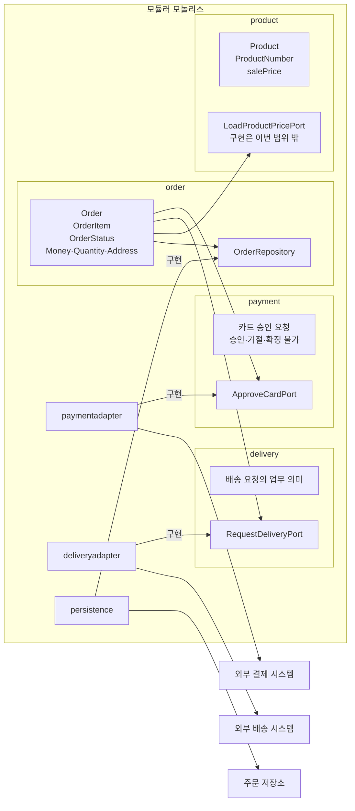

# “주문한다” 아키텍처 결정

## 1. 아키텍처 스타일과 근거

**포트와 어댑터 구조를 적용한 모듈러 모놀리스**를 선택한다.

- **배포:** 독립 배포 요구가 없으므로 하나의 배포 단위로 둔다.
- **조직:** 업무별 독립 팀이나 별도 출시 주기가 제시되지 않았으므로 마이크로서비스로 분리하지 않는다.
- **변경:** 주문 규칙과 외부 시스템의 변경 이유가 다르므로 업무 패키지가 출력 포트를 소유하고 연동·영속 패키지가 구현한다.

입력 포트와 유스케이스 인터페이스는 두지 않는다. 호출자가 들어오는 구조는 이번 패키지 설계 범위에서 제외한다.

## 2. 패키지와 포트 배치

화살표는 소스 코드의 의존 방향이다. 연동·영속 패키지에서 업무 포트로 향하는 화살표는 포트 구현을 뜻한다.

- `order`: 주문 모델과 규칙을 가지며 `OrderRepository`를 소유하고 `payment`, `delivery`, `product`의 출력 포트를 사용한다.
- `payment`: 승인 요청과 승인·거절·확정 불가를 정의하고 `ApproveCardPort`를 소유한다.
- `delivery`: 배송 요청을 정의하고 `RequestDeliveryPort`를 소유한다.
- `product`: 상품과 판매가를 정의하고 `LoadProductPricePort`를 소유하되, 외부 상품 시스템 구현은 이번 범위에서 만들지 않는다.
- `paymentadapter`: `ApproveCardPort`를 구현하고 결제 제공자의 전문을 업무 의미로 변환한다.
- `deliveryadapter`: `RequestDeliveryPort`를 구현하고 업무의 배송 요청을 제공자 전문으로 변환한다.
- `persistence`: `OrderRepository`를 구현하고 주문 저장소와 통신한다.

## 3. 의존 규칙

### 허용

- `order` → `payment`, `delivery`, `product`
- `paymentadapter` → `payment`, 외부 결제 라이브러리
- `deliveryadapter` → `delivery`, 외부 배송 라이브러리
- `persistence` → `order`, 데이터베이스 및 영속 기술 라이브러리

허용 목록에 없는 업무 패키지 사이의 참조는 허용하지 않는다.

### 검사 가능한 금지

- 업무 패키지 `order`, `payment`, `delivery`, `product`에서 연동·영속 패키지 `paymentadapter`, `deliveryadapter`, `persistence`로 향하는 의존을 금지한다.
- 위 일곱 패키지 사이의 직·간접 의존 순환을 금지한다.

### 검사로 판정하지 못하는 책임의 약속

- `paymentadapter`는 제공자 전문을 승인·거절·확정 불가로 변환하며, 제공자의 필드·참조 값·코드를 업무 패키지에 노출하지 않고 주문 상태를 변경하지 않는다.
- `deliveryadapter`는 업무의 배송 요청만 전달하며, 제공자의 필드·참조 값·코드를 노출하거나 독자적으로 배송 요청을 만들지 않는다.
- `persistence`는 주문을 저장·조회할 뿐 주문 상태 전이나 주문 금액을 결정하지 않는다.
- `product`와 이후 구현은 미정인 재고 판단 시점과 부족 처리 정책을 추가하지 않는다.
- 어느 패키지도 미정인 만료, 결제 응답 미확정 후속 처리, 배송 실패·재시도 정책을 임의로 구현하지 않는다.

## 4. 외부 시스템 연동 규격

업무의 말만 정의한다. 전송 방식과 제공자의 전문·필드·참조 값·코드는 확정하지 않으며 해당 연동 구현이 변환한다.

### 상품 시스템

- **보냄:** `ProductPriceRequest(productNumber)`
- **받음:** `ProductPriceResponse(productNumber, salePrice)`
- **필수 규칙:** `salePrice`는 원 단위의 0 이상 정수이며 주문 생성 시 확정 단가가 된다.
- **미정·범위 밖:** 동일 상품 항목의 병합 여부와 재고 관련 규격은 미정이다. 외부 전문과 `LoadProductPricePort` 구현은 이번 범위 밖이다.

### 결제 시스템

- **보냄:** `CardApprovalRequest(orderNumber, amount, cardApprovalData)`
- **받음:** `CardApprovalResult(APPROVED | DECLINED | UNCONFIRMED)`
- **필수 규칙:** `amount`는 저장된 주문 총액과 같아야 한다. `APPROVED`만 `PAID` 전이를 일으키며, `DECLINED`는 `PENDING_PAYMENT`를 유지하고 `UNCONFIRMED`는 승인이나 거절로 해석하지 않는다.
- **미정:** 카드 원문과 외부 참조 값의 보존, 중복 요청 계약, `UNCONFIRMED` 이후 처리와 재결제 허용 여부는 정하지 않는다.

`UNCONFIRMED`는 주문 상태가 아니라 결제 응답을 확정할 수 없다는 업무 결과다.

### 배송 시스템

- **보냄:** `DeliveryRequest(orderNumber, shippingAddress, items[productNumber, quantity])`
- **받음:** 정의하지 않음
- **필수 규칙:** 승인 완료 뒤 확정 배송지로 요청하며, 승인 거절이나 결제 응답 미확정 때에는 요청하지 않는다.
- **미정:** 배송 실패가 `PAID`에 미치는 영향, 재시도 기준과 담당 주체, 중복 처리 방식 및 응답 시간 초과 처리는 정하지 않는다.

배송 제공자의 접수 결과·참조 값·코드는 업무 결과로 두지 않고 기술적 응답은 `deliveryadapter`에서 다룬다.

### 호출자와 주문 시스템

- **받음:** `CreateOrder(requesterContext, items, shippingAddress)`, `PayOrder(requesterContext, orderNumber, cardApprovalData)`, `GetOrderResult(requesterContext, orderNumber)`
- **보냄:** `OrderResult(orderNumber, totalAmount, status, paymentResult)`
- **미정:** 인증과 비회원 본인 확인, 거절 응답과 화면 표현, `paymentResult`의 보존 구조·상세 필드, 결제 요청에 본인 주문 조건을 적용할지는 정하지 않는다.

입력 포트와 유스케이스 인터페이스의 배치는 이번 범위 밖이다.

## 5. 결정이 필요한 질문

- **앞 실습의 미정 유지:** 회원·비회원과 본인 확인, 결제대기 기한, 결제 응답 미확정 후속 처리, 재고 판단 시점과 승인 전·후 부족 처리, 배송 실패·재시도, 승인 결과와 결제 이력 보존, 주문 결과 통지는 해결하지 않고 미정으로 유지한다.
- **이 아키텍처에서 확인할 질문:** 결제 시스템이 확정 불가 결과의 조회 기능을 제공하는가? 배송 시스템이 중복 요청을 식별하거나 거절하는 계약을 제공하는가? 결제 연동 등의 독립 배포·팀 소유·별도 출시가 필요한가?