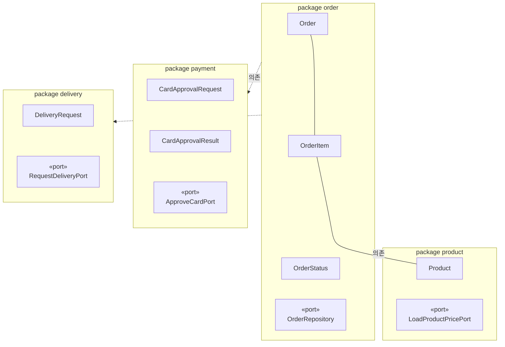
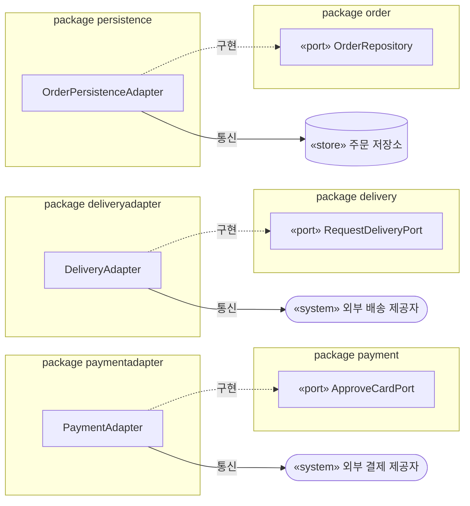

# “주문한다” 아키텍처 결정

## 1. 아키텍처 스타일과 근거

**포트와 어댑터 구조를 적용한 모듈러 모놀리스**를 선택한다.

- **배포:** 독립 배포 요구가 없으므로 하나의 배포 단위로 둔다.
- **조직:** 업무별 독립 팀이나 별도 출시 주기가 제시되지 않았으므로 마이크로서비스로 분리하지 않는다.
- **변경:** 주문 규칙과 외부 시스템의 변경 이유가 다르므로 업무 패키지가 출력 포트를 소유하고 연동·영속 패키지가 구현한다.

## 2. 패키지 다이어그램과 포트 배치

### 2.1 업무 경계

이 그림은 도메인 모델을 입력으로 삼아 업무 개념과 출력 포트가 어느 패키지 경계에 속하는지 보여 준다.

범례:

- 화살촉 없는 실선은 실습 4에서 확인한 `Order`—`OrderItem`, `OrderItem`—`Product`의 **업무 연관**이다. Java 객체 참조, 탐색 방향 및 저장 방식은 정하지 않는다.
- 패키지 사이의 점선 화살표는 `order`에서 `payment`, `delivery`, `product`로 향하는 **설계상 코드 의존**이다.
- 특정 `Order` 객체에서 외부 포트로 향하는 호출 관계는 나타내지 않는다. 포트를 호출할 구체 객체와 그 책임은 다음 설계 활동에서 정한다.

보이지 않는 연결(`~~~`)은 패키지 내부 요소의 세로 배치를 위한 것이며 의미 있는 업무 관계가 아니다.

그림에 배치한 클래스와 포트는 패키지 경계를 보여 주기 위한 대표 요소이며 도메인 모델 전체를 대체하지 않는다.

### 2.2 포트의 구현

이 그림은 업무 패키지가 소유한 포트를 어느 연동·영속 클래스가 구현하는지 보여 준다.

연동·영속 패키지에서 업무 포트로 향하는 점선 화살표는 포트 구현을 뜻한다. 외부 결제·배송 제공자는 시스템으로, 주문 저장소는 저장소로 구분한다.

`product.LoadProductPricePort`의 소유 경계는 첫 그림에 나타냈다. 외부 상품 시스템 연동 구현은 이번 범위 밖이므로 둘째 그림에는 넣지 않는다.

### 2.3 패키지별 배치

- `order`: `Order`, `OrderItem`, `OrderStatus`를 소유하고 `OrderRepository`를 선언하며 `payment`, `delivery`, `product`에 의존한다.
- `payment`: `CardApprovalRequest`, `CardApprovalResult`와 `ApproveCardPort`를 소유한다.
- `delivery`: `DeliveryRequest`와 `RequestDeliveryPort`를 소유한다. 배송 실패가 `PAID`에 미치는 영향, 재시도 기준과 담당 주체, 중복 처리 방식 및 응답 시간 초과 처리는 정하지 않는다.
- `product`: `Product`와 `LoadProductPricePort`를 소유한다. 동일 상품 항목의 병합 여부와 재고 관련 규격은 정하지 않으며 외부 상품 시스템 연동 구현은 이번 범위에서 만들지 않는다.
- `paymentadapter`: `PaymentAdapter`가 `ApproveCardPort`를 구현하고 외부 결제 제공자의 전문을 업무 의미로 변환한다.
- `deliveryadapter`: `DeliveryAdapter`가 `RequestDeliveryPort`를 구현하고 업무의 배송 요청을 외부 배송 제공자의 전문으로 변환한다.
- `persistence`: `OrderPersistenceAdapter`가 `OrderRepository`를 구현하고 주문 저장소와 통신한다.

호출자가 들어오는 쪽과 입력 포트 및 유스케이스 인터페이스의 배치는 이번 범위 밖이다.

## 3. 의존 규칙

### 허용

- `order` → `payment`, `delivery`, `product`
- `paymentadapter` → `payment`, 외부 결제 라이브러리
- `deliveryadapter` → `delivery`, 외부 배송 라이브러리
- `persistence` → `order`, 데이터베이스 및 영속 기술 라이브러리

### 검사 가능한 금지

- 업무 패키지 `order`, `payment`, `delivery`, `product`에서 연동·영속 패키지 `paymentadapter`, `deliveryadapter`, `persistence`로 향하는 의존을 금지한다.
- 업무 패키지 사이에서는 허용 목록에 없는 의존을 금지한다. 따라서 순환 여부와 관계없이 `payment → delivery` 같은 의존은 금지한다.
- 위 일곱 패키지 사이의 직·간접 의존 순환을 금지한다.

### 검사로 판정하지 못하는 책임의 약속

- `paymentadapter`는 제공자 전문을 승인·거절·확정 불가로 변환하며, 제공자의 필드·참조 값·코드를 업무 패키지에 노출하지 않고 주문 상태를 변경하지 않는다.
- `deliveryadapter`는 업무의 배송 요청만 전달하며, 제공자의 필드·참조 값·코드를 노출하거나 독자적으로 배송 요청을 만들지 않는다.
- `persistence`는 주문을 저장·조회할 뿐 주문 상태 전이나 주문 금액을 결정하지 않는다.
- `product`와 이후 구현은 미정인 재고 판단 시점과 부족 처리 정책을 추가하지 않는다.
- 어느 패키지도 미정인 만료, 결제 응답 미확정 후속 처리, 배송 실패·재시도 정책을 임의로 구현하지 않는다.

## 4. 결제 포트 연동 규격

`ApproveCardPort`에는 업무의 말만 둔다. 전송 방식과 결제 제공자의 전문·필드·참조 값·코드는 확정하지 않으며 `paymentadapter`가 변환한다.

- **업무가 보냄:** `CardApprovalRequest(orderNumber, amount, cardApprovalData)`
- **업무가 받음:** `CardApprovalResult(APPROVED | DECLINED | UNCONFIRMED)`

### 필수 규칙

- `amount`는 원 단위의 0 이상 정수이며 저장된 주문 총액과 같아야 한다.
- 승인 시 현재 상품 판매가를 다시 조회하지 않는다.
- `APPROVED`만 주문을 `PAID`로 전이시킨다.
- `DECLINED`는 주문을 `PENDING_PAYMENT`로 유지한다.
- `UNCONFIRMED`는 승인 또는 거절로 해석하지 않는다.
- `APPROVED`, `DECLINED`, `UNCONFIRMED`는 `payment`가 사용하는 결제 업무 결과이며 주문 상태가 아니다.
- `UNCONFIRMED`는 결제 응답을 확정할 수 없다는 업무 결과다.

### 정하지 않는 것

- 카드 원문 정보를 주문 도메인에 저장할지 정하지 않는다.
- 외부 참조 값의 보존 여부를 정하지 않는다.
- 중복 요청의 식별과 처리 계약을 정하지 않는다.
- `UNCONFIRMED` 이후의 처리와 재결제 허용 여부를 정하지 않는다.
- 결제 시스템이 확정 불가 결과의 조회 기능을 제공하는지 정하지 않는다.
- 결제 연동의 독립 배포·팀 소유·별도 출시 필요 여부를 정하지 않는다.