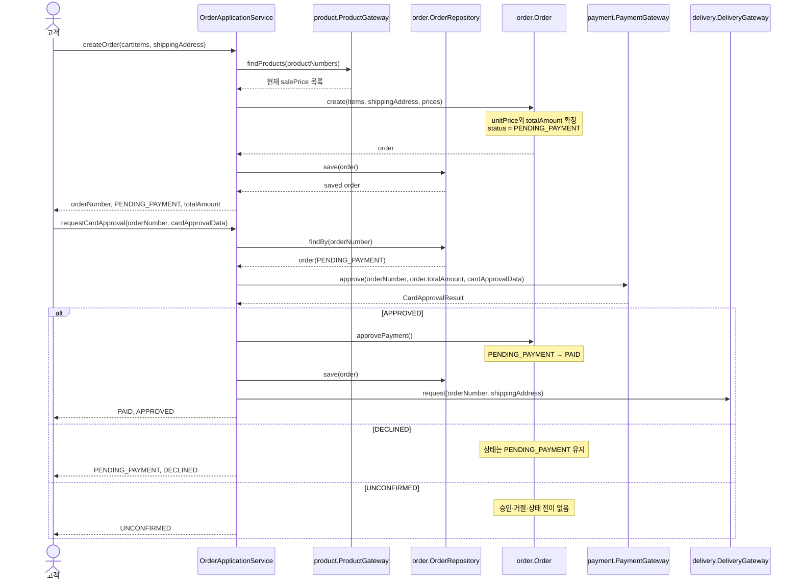

## 책임과 협력

`Order`가 업무 규칙과 상태 전이를 지키고, 유스케이스 조정자(논리적으로 `OrderApplicationService`)가 시스템 오퍼레이션을 받으며 외부 포트를 조율한다.

- `Order`
  - 주문 항목의 확정 단가·수량·총액 합계 불변식을 보장한다.
  - 생성 시 `PENDING_PAYMENT` 상태와 확정 배송지를 갖는다.
  - `PENDING_PAYMENT`에서만 승인 완료를 받아 `PAID`로 전이한다.
  - 거절에는 상태를 바꾸지 않는다.
  - 주문 항목·수량·확정 단가·배송지를 변경하는 오퍼레이션을 제공하지 않는다.

- `OrderApplicationService` (논리적 유스케이스 조정자)
  - `주문 생성`, `카드 결제 요청`, `주문 결과 확인` 시스템 오퍼레이션을 받는다.
  - `OrderRepository`, `ProductGateway`, `PaymentGateway`, `DeliveryGateway`를 호출 순서에 맞게 협력시킨다.
  - 외부 결제 결과를 해석하는 업무 의미는 `payment.CardApprovalResult`만 사용한다.
  - `Order`의 상태를 직접 대입하지 않고 도메인 오퍼레이션을 호출한다.

- `ProductGateway`
  - 주문 생성 시 상품의 현재 판매가를 제공한다.
  - 재고 판단은 수행하지 않는다. 판단 시점과 부족 처리 정책이 미정이기 때문이다.

- `PaymentGateway`
  - 확정 총액으로 카드 승인을 요청하고 `APPROVED`, `DECLINED`, `UNCONFIRMED` 중 하나를 돌려준다.

- `DeliveryGateway`
  - 승인 완료 후 확정 배송지를 담은 배송 요청을 전달한다.
  - 배송 실패, 재시도, 중복 방지는 책임으로 확정하지 않는다.

시스템 오퍼레이션 수신자는 `OrderApplicationService`가 적절하다. `Order`는 하나의 주문 상태와 불변식을 보호해야 하고, 가격 조회·저장·결제·배송처럼 여러 객체와 외부 포트를 횡단하는 절차까지 맡으면 응집도가 무너진다. 반면 아키텍처 결정은 입력 포트와 유스케이스의 물리적 배치를 미정으로 남겼다. 따라서 아래 `OrderApplicationService`는 논리적 책임 배치이며, 이를 실제로 어느 패키지에 둘지는 확정할 수 없다.

## 설계 시퀀스



`APPROVED`에서 저장과 배송 요청 사이의 원자성, 그리고 배송 요청 실패 시 반환값과 후속 처리는 확정할 수 없다. 위 도식은 승인 완료 뒤 배송 요청을 시도한다는 확정된 흐름만 표현한다.

## 제안 인터페이스 선언

```java
package order;

public interface OrderRepository {
    Order save(Order order);
    Order findBy(OrderNumber orderNumber);
}
```

```java
package product;

public interface ProductGateway {
    Product findBy(ProductNumber productNumber);
}
```

```java
package payment;

public interface PaymentGateway {
    CardApprovalResult approve(CardApprovalRequest request);
}
```

```java
package delivery;

public interface DeliveryGateway {
    void request(DeliveryRequest request);
}
```

```java
// 물리 패키지는 미정. 논리적 입력 포트다.
public interface OrderUseCase {
    CreateOrderResult createOrder(CreateOrderCommand command);

    CardApprovalResponse requestCardApproval(
        RequestCardApprovalCommand command
    );

    OrderResult getOrder(OrderNumber orderNumber);
}
```

```java
package order;

public final class Order {
    public static Order create(
        OrderNumber orderNumber,
        List<NewOrderItem> items,
        Address shippingAddress
    );

    public void approvePayment();

    public boolean isPendingPayment();
    public Money totalAmount();
    public Address shippingAddress();
    public OrderStatus status();
}
```

`approvePayment()`은 `PENDING_PAYMENT`가 아닐 때 거절해야 한다. 거절과 미확정 결과는 `Order`에 상태 변경을 요청하지 않는다.

## 오퍼레이션 계약

| 오퍼레이션 | 사전조건 | 사후조건 |
|---|---|---|
| `createOrder` | 장바구니 항목이 1개 이상이며 각 수량이 1 이상이다. 배송지가 제공된다. 상품 게이트웨이에서 각 상품의 현재 판매가를 얻을 수 있다. | 새 주문이 생성·저장된다. 각 항목의 `unitPrice`는 생성 시 판매가이며, `totalAmount = Σ(unitPrice × quantity)`이고 상태는 `PENDING_PAYMENT`다. |
| `requestCardApproval` | 주문이 존재하고 `PENDING_PAYMENT`다. 승인 요청 금액은 저장된 `totalAmount`다. | `APPROVED`면 같은 주문이 `PAID`가 되고 확정 배송지로 배송 요청을 시도한다. `DECLINED`면 상태는 `PENDING_PAYMENT`로 유지되고 배송 요청하지 않는다. `UNCONFIRMED`면 승인·거절·상태 전이를 하지 않는다. |
| `getOrder` | 주문이 존재한다. | 주문 번호, 상태, 확정 총액, 확정 배송지 및 주문 항목을 반환한다. 조회는 상태나 확정 값을 변경하지 않는다. |
| `Order.create` | 항목이 1개 이상, 수량이 1 이상, 단가와 계산 총액이 0 이상, 배송지가 존재한다. | 불변식이 성립하는 `PENDING_PAYMENT` 주문을 만든다. |
| `Order.approvePayment` | 현재 상태가 `PENDING_PAYMENT`다. | 상태가 `PAID`가 된다. 항목, 확정 단가, 총액, 배송지는 변하지 않는다. |

## 설계에 남는 빈자리와 확인 질문

다음은 정책을 임의로 확정하지 않기 위해 질문으로 남긴다.

1. 카드 결제 요청은 “변경 요청”으로 보아 본인 주문 권한을 반드시 검사해야 하는가? 실습 5에서 이 적용 여부가 미정이다.
2. 주문 생성과 조회에서 회원/비회원의 주문 주체 및 본인 확인 정보를 어떤 타입과 경계에서 받을 것인가?
3. `UNCONFIRMED` 결과를 받은 뒤 같은 주문의 재결제를 허용하는가?
4. 결제 승인 후 주문 저장 또는 배송 요청이 실패하면, 고객에게 어떤 결과를 반환하고 이후 무엇을 보장해야 하는가?
5. “승인 결과를 확인”할 때 현재 상태만으로 충분한가, 아니면 카드별 승인·거절 이력을 영속해야 하는가? 결제 이력 보존 구조는 아직 정해지지 않았다.
6. `OrderApplicationService`와 `OrderUseCase`를 실제로 어느 패키지에 배치할 것인가? 실습 6은 입력 포트·유스케이스의 배치를 범위 밖으로 남겼다.