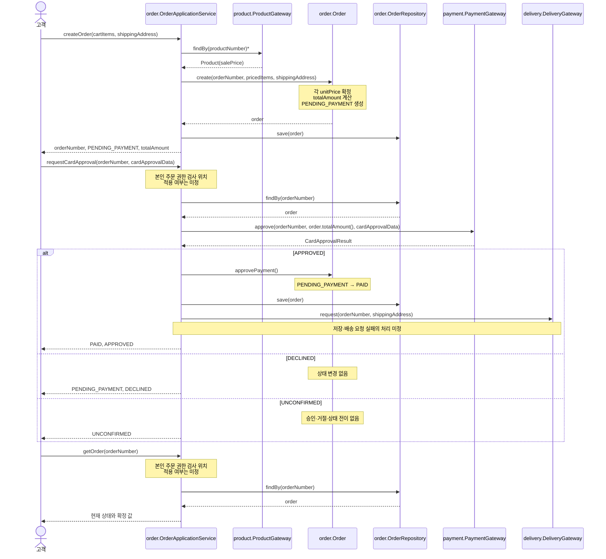

## 책임 배치와 근거

유스케이스 조정자는 `order.OrderApplicationService`로 둔다. `order`가 주문 규칙과 `OrderRepository`를 소유하고 `payment`·`delivery`·`product`의 출력 포트에 의존하도록 한 아키텍처 결정에 맞는다. 이 객체는 컨트롤러이며, 계산·상태 전이 규칙 자체는 `Order`에 두지 않는다.

| 책임 | 담당 객체 | 근거 |
|---|---|---|
| 주문 금액 계산 | `order.Order` | 주문 항목의 확정 단가와 수량을 모두 보유하는 정보 전문가이며, 서비스가 값을 넘겨받아 총액을 계산하지 않는다. |
| 생성 시 단가 확정 | `product.Product`와 `order.Order` | 현재 판매가는 `Product`가 아는 정보이므로 `ProductGateway`로 조회하고, 그 값을 주문 항목의 불변 `unitPrice`로 확정하는 것은 주문 생성 책임을 가진 `Order`가 맡는다. |
| 상태 전이와 금지 | `order.Order` | 현재 상태를 보유하는 정보 전문가이므로 `PENDING_PAYMENT → PAID` 전이와 결제대기 주문의 변경 금지를 스스로 보장한다. |
| 사건 수신과 호출 순서 | `order.OrderApplicationService` | 시스템 오퍼레이션을 받는 컨트롤러로서 상품 조회, 저장, 승인 요청, 상태 전이, 배송 요청의 협력을 조정한다. |
| 주문 조회와 저장 | `order.OrderRepository` | 주문 영속·재구성의 정보 전문가는 리포지터리다. 서비스는 조회·저장 시점만 조정하며 상태나 금액을 결정하지 않는다. |
| 외부 카드 승인 요청 | `payment.PaymentGateway` | 결제 업무 언어의 출력 포트이며, 서비스가 확정 총액으로 요청하고 어댑터가 제공자 전문으로 변환한다. |
| 외부 배송 요청 | `delivery.DeliveryGateway` | 배송 요청 전달의 출력 포트이며, 승인 완료 뒤 서비스가 확정 배송지를 담아 호출한다. 어댑터는 독자적으로 요청을 만들지 않는다. |

`OrderApplicationService`는 주문 금액을 계산하거나 상태 필드를 직접 대입하지 않는다. 상품의 현재 판매가도 서비스가 보유하거나 계산하지 않고, `ProductGateway`에서 받은 값을 `Order` 생성에 전달할 뿐이다.

본인 주문 권한 검사, 회원·비회원 식별 정보의 타입, 결제 응답 `UNCONFIRMED` 뒤 재결제, 승인 뒤 저장·배송 실패 처리는 정책이 미정이다. 따라서 아래 설계에는 해당 검사가 들어갈 자리만 표시하고 행동을 확정하지 않는다.

## 설계 시퀀스



## 인터페이스 선언

```java
package order;

public interface OrderRepository {
    Order findBy(OrderNumber orderNumber);
    void save(Order order);
}
```

```java
package product;

public interface ProductGateway {
    Product findBy(ProductNumber productNumber);
}
```

```java
package payment;

public interface PaymentGateway {
    CardApprovalResult approve(CardApprovalRequest request);
}
```

```java
package delivery;

public interface DeliveryGateway {
    void request(DeliveryRequest request);
}
```

```java
package order;

public interface OrderUseCase {
    CreateOrderResult createOrder(CreateOrderCommand command);

    CardApprovalResponse requestCardApproval(
        RequestCardApprovalCommand command
    );

    OrderResult getOrder(OrderNumber orderNumber);
}
```

```java
package order;

public final class Order {
    public static Order create(
        OrderNumber orderNumber,
        List<PricedOrderItem> items,
        Address shippingAddress
    );

    public void approvePayment();

    public Money totalAmount();
    public Address shippingAddress();
    public OrderStatus status();
}
```

`PricedOrderItem`은 상품 번호, 수량, `ProductGateway`로부터 얻은 생성 시점 판매가를 담는 생성용 값이다. `Order.create`가 이를 사용해 주문 항목의 확정 단가와 총액을 만든다. 따라서 애플리케이션 서비스에 별도의 금액 계산 책임은 없다.

`approvePayment()`은 현재 상태가 `PENDING_PAYMENT`일 때만 `PAID`로 전이한다. 그 외 상태에서는 전이를 허용하지 않으며, 상품·수량·확정 단가·총액·배송지를 바꾸지 않는다.

## 오퍼레이션 계약

| 오퍼레이션 | 사전조건 | 사후조건 |
|---|---|---|
| `createOrder` | 장바구니 항목이 1개 이상이고 각 수량이 1 이상이다. 배송지가 제공된다. 각 상품의 현재 판매가를 조회할 수 있다. | 새 주문이 저장된다. 각 항목의 `unitPrice`는 생성 시점 판매가로 확정되고, `totalAmount = Σ(unitPrice × quantity)`이며 상태는 `PENDING_PAYMENT`다. |
| `requestCardApproval` | 주문이 존재하고 `PENDING_PAYMENT`다. 요청 금액은 저장된 `totalAmount`다. | `APPROVED`면 같은 주문이 `PAID`가 되고 확정 배송지로 배송 요청을 시도한다. `DECLINED`면 상태는 유지되고 배송 요청하지 않는다. `UNCONFIRMED`면 승인·거절·상태 전이를 하지 않는다. |
| `getOrder` | 주문이 존재한다. | 주문 번호, 현재 상태, 확정 총액, 확정 배송지, 주문 항목을 반환한다. 주문은 변경하지 않는다. |
| `Order.create` | 항목이 1개 이상이고 수량은 1 이상이다. 확정 단가와 계산 총액은 0 이상이며 배송지가 존재한다. | 불변식을 만족하는 `PENDING_PAYMENT` 주문을 만든다. |
| `Order.approvePayment` | 현재 상태가 `PENDING_PAYMENT`다. | 상태가 `PAID`가 된다. 항목, 확정 단가, 총액, 배송지는 변하지 않는다. |

주문 결과 확인은 승인·거절 이력을 저장하거나 조회하지 않고, 현재 주문 상태와 이미 확정된 주문 값만 반환한다.