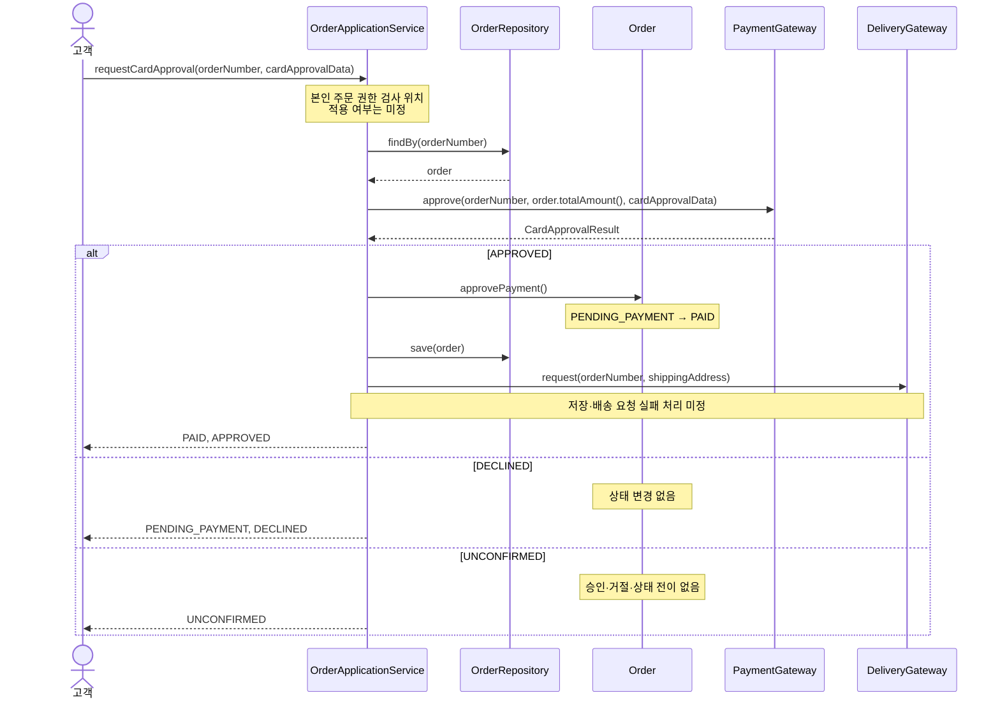

# “주문한다” 객체 책임·협력 설계

## 1. 책임 배치

유스케이스 조정자는 `order.OrderApplicationService`로 둔다. `order`가 주문 규칙과 `OrderRepository`를 소유하고, `product`·`payment`·`delivery`의 출력 포트에 의존한다는 아키텍처 결정에 따른다.

- **주문 금액 계산 — `order.Order`**  
  확정 단가와 수량을 가진 정보 전문가가 합계를 계산한다. 서비스가 값을 받아 별도로 계산하지 않는다.

- **생성 시 단가 확정 — `product.ProductGateway`, `order.Order`**  
  현재 판매가는 상품 포트에서 조회하고, 주문 생성 시 그 값을 `unitPrice`로 확정하는 책임은 주문에 둔다.

- **상태 전이와 금지 — `order.Order`**  
  현재 상태를 가진 정보 전문가가 `PENDING_PAYMENT → PAID` 전이와 주문 확정 값의 불변성을 보장한다.

- **사건 수신과 호출 순서 — `order.OrderApplicationService`**  
  시스템 오퍼레이션을 받는 컨트롤러로서 가격 조회, 저장, 승인 요청, 상태 전이, 배송 요청을 조정한다.

- **주문 조회와 저장 — `order.OrderRepository`**  
  주문을 저장·재구성한다. 금액 계산과 상태 전이는 하지 않는다.

- **외부 카드 승인 요청 — `payment.PaymentGateway`**  
  카드 승인이라는 결제 업무 언어의 출력 포트다.

- **외부 배송 요청 — `delivery.DeliveryGateway`**  
  승인 완료 뒤 확정 배송지를 전달하는 배송 업무 출력 포트다.

`OrderApplicationService`는 `Order`의 상태 필드를 직접 대입하거나 주문 금액을 계산하지 않는다. 결제 요청 금액에는 `order.totalAmount()`를 그대로 사용한다.

결제·배송·상품 포트를 하나로 묶지 않는다. 세 책임은 업무 언어와 변경 이유가 다르고, 아키텍처가 각각 `payment`, `delivery`, `product` 패키지의 독립 포트로 정했기 때문이다.

## 2. 설계 시퀀스

원본 업무 흐름은 고객의 결제 요청 뒤 결제 시스템의 승인 결과를 받고, 승인일 때 배송을 요청하는 것이다. 이를 객체 책임으로 구체화하면 다음과 같다.



- **주문 생성**  
  `OrderApplicationService`가 `ProductGateway`에서 상품별 현재 판매가를 조회하고 `Order.create(orderNumber, pricedItems, shippingAddress)`를 호출한다. `Order`가 `unitPrice`와 `totalAmount`를 확정한 `PENDING_PAYMENT` 주문을 만들고, 서비스가 이를 `OrderRepository`에 저장한다.

- **주문 결과 확인**  
  `OrderApplicationService`에 본인 주문 권한 검사 위치가 있으나 적용 여부는 미정이다. 서비스는 `OrderRepository`에서 주문을 조회하여 현재 상태와 확정 값을 반환한다.

## 3. 인터페이스

```java
package order;

public interface OrderPlacementUseCase {
    CreateOrderResult createOrder(CreateOrderCommand command);
}

public interface CardPaymentUseCase {
    CardApprovalResponse requestCardApproval(
        RequestCardApprovalCommand command
    );
}

public interface OrderQueryUseCase {
    OrderResult getOrder(OrderNumber orderNumber);
}

public interface OrderRepository {
    Order findBy(OrderNumber orderNumber);
    void save(Order order);
}
```

```java
package product;

public interface ProductGateway {
    Money findCurrentSalePrice(ProductNumber productNumber);
}
```

```java
package payment;

public interface PaymentGateway {
    CardApprovalResult approve(CardApprovalRequest request);
}
```

```java
package delivery;

public interface DeliveryGateway {
    void request(DeliveryRequest request);
}
```

```java
package order;

public final class Order {
    public static Order create(
        OrderNumber orderNumber,
        List<PricedOrderItem> items,
        Address shippingAddress
    );

    public void approvePayment();

    public Money totalAmount();
    public Address shippingAddress();
    public OrderStatus status();
}
```

`PricedOrderItem`은 상품 번호, 수량, 생성 시점 판매가를 담는 생성용 값이다. `Order.create`가 이를 사용해 확정 단가와 주문 금액을 만든다.

## 4. 오퍼레이션 계약

- **`createOrder`**
  - 사전조건: 항목이 1개 이상이고 수량은 각각 1 이상이다. 배송지가 제공되고 각 상품의 현재 판매가를 조회할 수 있다.
  - 사후조건: 주문이 저장된다. 각 `unitPrice`는 생성 시 판매가로 확정되고, `totalAmount = Σ(unitPrice × quantity)`, 상태는 `PENDING_PAYMENT`다.

- **`requestCardApproval`**
  - 사전조건: 주문이 존재하고 `PENDING_PAYMENT`다. 승인 요청 금액은 저장된 `totalAmount`다.
  - 사후조건 — `APPROVED`: 같은 주문이 `PAID`가 되고 확정 배송지로 배송 요청을 시도한다.
  - 사후조건 — `DECLINED`: 상태를 유지하고 배송 요청하지 않는다.
  - 사후조건 — `UNCONFIRMED`: 승인·거절·상태 전이를 하지 않는다.

- **`getOrder`**
  - 사전조건: 주문이 존재한다.
  - 사후조건: 현재 상태와 주문 번호·항목·확정 단가·총액·배송지를 반환하며 주문을 변경하지 않는다.

- **`Order.create`**
  - 사전조건: 항목이 1개 이상이고 수량은 1 이상이며, 단가와 계산 총액은 0 이상이고 배송지가 존재한다.
  - 사후조건: 불변식을 만족하는 `PENDING_PAYMENT` 주문을 만든다.

- **`Order.approvePayment`**
  - 사전조건: 현재 상태가 `PENDING_PAYMENT`다.
  - 사후조건: 상태가 `PAID`가 되며 항목, 단가, 총액, 배송지는 변하지 않는다.

테스트 대역은 포트 호출의 업무 계약도 검사한다. 예를 들어 `PaymentGateway` 대역은 기대 주문 번호와 확정 총액을 받은 경우에만 구성된 결과를 반환한다. 이를 검사하지 않으면 판매가 변경 후 현재 가격 2,400원으로 승인 요청하는 잘못된 구현도 무조건 `APPROVED`를 반환하는 느슨한 대역에서는 통과할 수 있다.

## 5. 작업 단위와 완료 조건

- **1. 고객이 배송지를 지정해 주문을 만든다**
  - 구현 결과: 생성 시 판매가·수량으로 총액을 확정한 `PENDING_PAYMENT` 주문을 저장한다.
  - 완료 확인: 펜 2개, 1,000원, 서울이면 단가 1,000원·총액 2,000원 주문이 저장된다. 이후 가격이 1,200원이어도 기존 값은 유지된다.

- **2. 고객이 카드 승인으로 주문을 성립시킨다**
  - 구현 결과: 확정 총액으로 승인 요청하고, 승인일 때만 `PAID` 전이와 배송 요청을 수행한다.
  - 완료 확인: 2,000원 승인 결과가 `APPROVED`면 같은 주문이 `PAID`가 되고 서울 배송 요청이 1회다.

- **3. 고객이 카드 거절 뒤 같은 주문으로 재결제한다**
  - 구현 결과: 거절은 주문을 바꾸지 않고 배송하지 않으며, 재결제는 기존 주문으로 수행한다.
  - 완료 확인: `DECLINED` 뒤 `PENDING_PAYMENT`와 배송 0회를 유지한다. 다음 `APPROVED`에서 새 주문 없이 `PAID`, 전체 배송 요청은 1회다.

- **4. 고객이 확정할 수 없는 결제 응답을 받는다**
  - 구현 결과: `UNCONFIRMED`를 승인·거절로 해석하지 않는다.
  - 완료 확인: 상태와 확정 값은 `PENDING_PAYMENT` 그대로이고 배송 요청은 0회다.

- **5. 고객이 현재 주문 결과를 확인한다**
  - 구현 결과: 이력 없이 현재 상태와 확정 값을 조회한다.
  - 완료 확인: 승인된 주문 조회 시 `PAID`, 2,000원, 서울, 펜 2개·단가 1,000원이 반환되고 조회 전후 주문은 변하지 않는다.

작업 순서는 1 → 2가 기본 흐름이다. 3과 4는 1 뒤에, 5는 생성 또는 각 결제 결과 뒤에 검증할 수 있다.

본인 주문 권한 검사와 식별 타입, 결제대기 만료, `UNCONFIRMED` 뒤 재결제, 재고 판단, 승인 뒤 저장·배송 실패와 재시도·중복 방지, 별도 통지는 미정으로 남긴다.